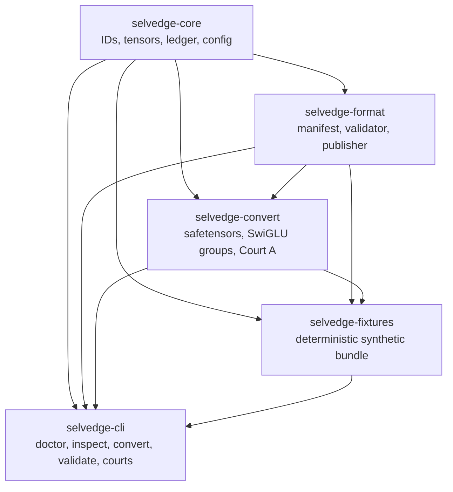
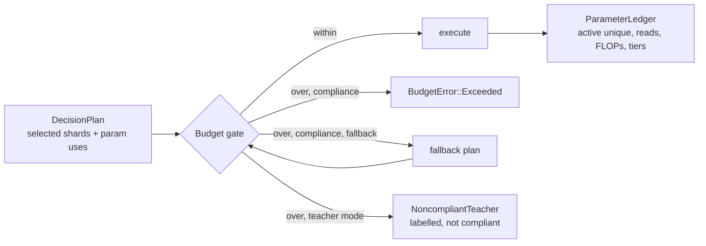
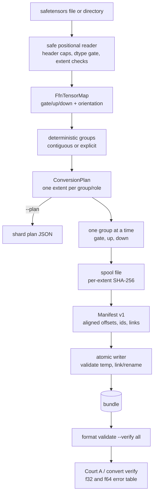
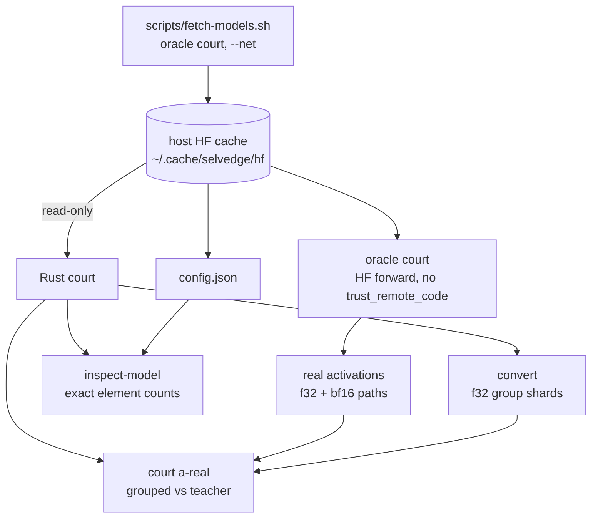

# SELVEDGE architecture — foundation, conversion and the real-model path (S2/S3a)

Status: **implemented foundation, exact SwiGLU conversion, pinned oracle court,
real-checkpoint accounting and real-activation parity**. No model-quality claim
is made. Numbers about reconstruction, parameters and tolerances come from
receipts referenced in `docs/WORK-LOG.md`, `docs/BUDGET-MATH.md` and
`docs/MODELS.md`.

## Crate boundaries



`selvedge-core` has no dependency on the filesystem format, the CLI or a model
backend. `selvedge-format` depends only on `selvedge-core` plus serde, serde_json
and thiserror. `selvedge-convert` depends on core and format; it owns the
safetensors reader, the SwiGLU grouping math and the reconstruction verifier.
`selvedge-fixtures` uses core, format and convert to produce tracked artifacts.
`selvedge-cli` is the only crate that reads command-line arguments and spawns
processes (`df` in `doctor`).

Later phases slot in on the right:

```text
selvedge-convert  -> produces Manifest + payload (S2, implemented)
selvedge-atlas    -> consumes SelectionDecision / produces selectors (S3)
selvedge-store    -> implements CostModel / Backend / residency (S4+)
selvedge-sim      -> replays ExecutionTrace against CostModel (S4+)
selvedge-runtime  -> executes exact or approximate plans (later)
selvedge-bench    -> measurement harness (later)
```

## Core data contracts

| contract | invariant |
| --- | --- |
| `ShardId` | SHA-256 over a versioned canonical encoding of format version, model identity, role, layer, channels, channel axis, dtype, quantization scheme and transform id; recomputed by the validator |
| `ModelDigest` | SHA-256 over a sorted, normalized checkpoint fileset encoding; optional upstream revision and tokenizer digest are recorded verbatim |
| `TensorRole` | stable string names plus an audited `Other(String)`; round-trip safe and unambiguous |
| `DType` | exact byte math for f32/f16/bf16/i8/u8 and block-packed i4/ternary; unknown names become `Unsupported` and validation rejects them |
| `QuantScheme` | non-zero block size, whole-block element count, packed-block agreement |
| `StorageOrder` | row-major, column-major, or explicit transpose axis permutation; never inferred from shape |
| `TensorSlice` | non-empty ordered channel range, shape rank and channel-axis agreement, element-count consistency, quantization consistency |
| `ParamIdentity` | tensor key plus half-open element range; equal tensor keys alias the same learned elements |
| `ParameterLedger` | unique-union accounting over parameter identities, repeated reads kept separate, FLOPs and tier bytes tracked, auxiliary bytes excluded from learned counts; `admit_selection_path` checks the union of selector **and** execution parameters before execution |
| `Budget` | pre-execution union check; compliance mode returns an error rather than a boolean |
| `SelectionDecision` | sorted unique shard ids plus selector provenance; duplicates rejected |
| `NativeComputationSet` | a bundle's declared full native shard set; sorted unique ids plus a canonical digest computed by the constructor |
| `NativeSetWitness` | private fields; only `compare` can produce one, by full set equality against a declaration, with bundle id and both digests |
| `ExactSelection` | private fields; only `from_witness` can produce one, and it re-derives the decision's digest and requires the witnessed executed digest |
| `SemanticExactness` | `Proven(ExactSelection)` or `Approximate { decision, gap }`; no reclassification state |
| `ArmVerdict` | two independent evidence-bearing records: `CausalAvailability` and `PhysicalCompliance`; no deployable boolean |
| `Config` | typed TOML with hard limits, validation, canonical JSON hash |

All integer encodings are explicit little-endian. Hashed paths use `BTreeMap`
or sorted vectors, never hash-map iteration. Every constructor and parser
returns `Result`; library code contains no `unwrap`/`expect` (the lint is
enabled and test modules carry an explicit allow).

## Accounting flow



`active_unique_params(t)` is the union of element ranges, merged per tensor
key. Tied embeddings are represented by reusing the same `ParamTensorId` and
range, so they count once. Overlapping or adjacent fragments merge. A recurrent
weight used several times counts once as unique and every repetition as a read.
Scales, zero points and other metadata are recorded under `AuxiliaryKind` and
are never added to the learned count.

FLOPs are caller-supplied estimates. `FlopEstimate::matmul` uses `2 * M * N * K`
and its documentation states the convention; controller FLOPs are a separate
counter. No FLOP number here is measured.

The budget gate is called before execution. In compliance mode an over-budget
plan yields `BudgetError::Exceeded`. The only way to proceed is a fallback hook
that returns a replacement plan which is re-checked; a fallback that remains
over budget is rejected. Teacher mode returns a labelled verdict and must not be
mixed into compliant results.

## Exact versus approximate

Exactness is a **semantic** claim about the model computation. It is separate
from **scope integrity**, which is a storage claim:

- `selvedge_store::ExecutionScope` proves only that the store will not return a
  shard outside the supplied set. It has no native computation set to compare
  against and cannot be converted into `ExactSelection`. A correct scoped read
  is not evidence that a selector executed the native neural computation.
- `NativeComputationSet::declare(bundle_id, shards)` is the model bundle's own
  declaration. The constructor sorts the ids, rejects duplicates and empty sets,
  and computes a canonical digest over `(bundle_id, ids)`.
- `NativeSetWitness::compare(executed_bundle_id, executed, native)` requires the
  bundle ids to match, the executed set to be duplicate-free, and **full set
equality in both directions**. It records the bundle id, the declared digest,
  the executed digest and the shard count. The fields are private.
- `ExactSelection::from_witness(decision, witness)` re-derives the decision's
  digest and requires it to equal the witnessed executed digest and the
  declared digest. There is no string-justification constructor, no declared
  mode shortcut and no store-scope conversion.
- `SemanticExactness::classify(decision, bundle, Some(native))` returns
  `Proven` only through that path; otherwise `Approximate` with a typed
  `SemanticGap` (`NoNativeDeclaration`, `SetMismatch`, `BundleMismatch`).

A selector that predicts a subset therefore cannot produce `Proven`; its only
possible record is `Approximate`. If routing changes which operators run, the
path is approximate by construction.

**Compile-fail evidence.** `crates/selvedge-core/tests/ui/` contains five cases
and `tests/compile_fail.rs` runs each one through `rustc` against the built
rlib, asserting the named error. The cases prove that
`reclassify_from_approximate` no longer exists, that a witness cannot be built
from a struct literal, that the real `selvedge_store::ExecutionScope` is not
accepted where a witness is required, that a physical verdict cannot be
constructed from a boolean, and that an exact-labelled decision cannot be
minted from outside the crate. This is the offline equivalent of trybuild; no
extra dependency or network is needed.

Caching and prefetching may change latency but must not change the selected
set; that is the exact-mode contract future phases must test in Court E. The
existing M1-M3 measurements use the approximate masked path and **no exact
neural-execution claim is made**.

## Audit: places where an approximation could be relabelled

The review asked for a workspace audit of paths that could turn an approximation
into a stronger claim without evidence. The findings and dispositions:

| location | risk before | disposition |
| --- | --- | --- |
| `SelectionProvenance` / `SelectionMode` | a caller could construct an exact-mode provenance, and `reclassify_from_approximate` could promote a subset | the only public provenance constructor is `approximate`; no constructor mints an exact-labelled decision (a compile-fail case asserts that the former `SelectionDecision::native` does not exist). Exactness is `ExactSelection`, which needs a witness. The declared `mode` can only arrive from a deserialized receipt and is documented as a label, never evidence |
| `selvedge_store::ExecutionScope` | a correct scoped read could be presented as exact execution | separate type with no conversion to `ExactSelection`; a compile-fail case asserts the type error; module docs state the distinction |
| `selvedge_store::ProofRegistry` | a publication proof skips re-hashing, so a forged registry could hide corrupt bytes | explicit trust input: only used when `VerificationMode::PublicationProof` is configured; bundle and manifest digests are checked. All M1-M3 measurements use `VerificationMode::Always`. Documented in `docs/LIMITATIONS.md`; not silently defaulted |
| `ReadReport.verified` on a cache hit | a hit could look like a fresh verification of the bytes | the report carries the admission-time `verification` proof and `verify_ns` is zero on a hit, so the receipt distinguishes "verified before admission" from "hashed on this read"; the proof method is `sha256_read` or `publication_proof`, never a bare boolean |
| `TokenAccounting::within_budget` | a derived boolean could be treated as permission | it is a record field only; the gate is `check_decision`, which returns `Err` in compliance mode |
| M2 `deployable` flag | one boolean for causality and physical cost | deleted from the Python harness; replaced by `ArmVerdict` (`CausalAvailability` + `PhysicalCompliance`) in every receipt and table |
| `PhysicalEvidence` constructed counts | a formula could be called a measurement | `PhysicalCompliance::compliant` rejects `ReadMeasurement::Constructed`; the sparse oracle path reports `Measured` only after a counter and a per-op audit |
| `atlas::TwoViewDecision` | a missing cost could be treated as zero | `DecisionStatus::CostUnavailable` is a separate variant; it is never a numeric zero |
| `NativeComputationSet::declare` | a caller could declare a set equal to its own arbitrary execution and then "prove" exactness against it | a residual trust boundary, stated rather than hidden: the declaration must be derived from the validated bundle manifest. The witness proves equality with the declaration, not that the declaration is the model's true native computation. No runtime consumes the witness yet; Court E must source the declaration from the manifest |
| `PhysicalEvidence` / `ReadMeasurement::Measured` | the counts and the audit string are caller-supplied, so a fabricated receipt could claim compliance | the type forces the measured-versus-constructed distinction and names the audit, but cannot verify that the audit happened. The receipt and the named audit are the trust input; the sparse path's counter is cross-checked against a per-op `torch.profiler` audit and the receipt is committed |

Two residual trust boundaries remain and are stated rather than hidden. First, a
`NativeSetWitness` proves that the executed set equals the *declared* native set;
it cannot prove that the declaration is honest, so the declaration must come from
the validated bundle manifest. Second, a `PhysicalCompliance::Compliant` verdict
proves that the counts were labelled measured rather than constructed; the
measurement itself is a receipt, and the receipt is what a reader must audit.
Neither limitation is a reason to weaken the types: the types make the honest
path the only ergonomic one and force a fabricated claim to be explicit.

## Two verdicts, not one deployable boolean

`selvedge_core::verdict` defines two independent records emitted for every
evaluated arm:

- `CausalAvailability::Available { evidence }` lists the exact
  `DecisionInput`s the selector read and names the audit; `Unavailable` names
  one of `FutureTokens`, `FutureLayers`, `TeacherLogits`, `GoldLabels`,
  `UnmaskedFutureState`, `HeldOutMeasurement`, `BackwardTarget` or
  `UndeclaredInput`.
- `PhysicalCompliance::Compliant { evidence }` requires
  `ReadMeasurement::Measured` (a constructed formula cannot establish
  compliance) plus selector parameter elements, selector reads, execution
  reads, executed unique elements, and selection/execution FLOPs.
  `NonCompliant` names `DenseComputationMasked`,
  `SelectionReadsOutsideActiveSet`, `MissingSparseExecutionPath`,
  `UnmeasuredParameterReads` or `OverCeiling`.

`ParameterLedger::admit_selection_path` takes a `SelectionPath` (selector uses
plus execution uses) and checks their **union** against the ceiling before
execution. It returns `AdmittedSelectionPath`, whose private fields mean an
over-budget selector has no value that an execution function could accept. This
is the type-level form of "do not spend the parameter budget twice".

## Format flow

```text
convert -> Manifest + payload
             |
             v
      encode/publish (fsync, validate temp, atomic link/rename)
             |
             v
      validate (structure + extents + hashes)
             |
             v
      BundleFile (re-verify on shard read)
             |
             v
      catalog / hot reload (reject conflicting bundle id)
```

The manifest is validated before any payload read. Every shard id is recomputed;
every extent must be inside the payload, aligned, non-overlapping and have a
byte length consistent with its shape, dtype and quantization description. The
reader re-verifies a shard hash on every access. `MemoryBundle` uses the same
encoder and validator, so toy courts do not bypass integrity checks.

Full byte layout, versioning, alignment rules and the untrusted-artifact threat
model are in `docs/SHARD-FORMAT.md`.

## Conversion dataflow (S2)



The reader streams from the checkpoint with
`std::os::unix::fs::FileExt::read_at`, never maps the file and never performs an
unchecked cast. It supports f32, f16, bf16, i8 and u8 and rejects every other
dtype, including packed four-bit types, with a typed error. Header length is
capped at 64 MiB and checked against the physical file before allocation;
offsets, overlaps, shapes, byte lengths, duplicate keys and UTF-8 are all
validated before a read. f16 and bf16 widen exactly to f32; the conversion writes
unquantized f32 shards.

### Memory-bounding rule

The converter reads exactly one group's gate, up or down region at a time. Before
it allocates a region it reserves that region's byte count in an in-flight
budget (`--max-inflight-bytes`, defaulting to the configured resident cap); the
reservation is released after the extent has been written to the spool. The
spool file holds the payload on disk, so no whole checkpoint, matrix or bundle is
held in memory. An explicit channel list pays one extra temporary row/column
reservation, which is also counted. Exceeding the budget returns
`MemoryBudgetExceeded`; it never falls back to a larger allocation.

Verification is a different path: `convert verify` and Court A must hold one
layer's full source FFN tensors and its group copies to compute the dense
reference. That is bounded by the layer size, not by the checkpoint, and is not
the streaming conversion path. The synthetic Court A layers are tiny.

### Exactness and tolerance policy

The grouped identity is exact in real arithmetic when the groups cover the
intermediate channels. The implementation measures error instead of claiming
bitwise equality:

- the dense reference computes in both f32 and f64 with a fixed reduction order;
- the grouped path iterates groups in bundle order and channels ascending inside
  each group, with no Kahan compensation;
- f32 and f64 group contributions are compared separately against the source
  restricted to the same channels;
- a component passes when `|a - b| <= abs_tol + rel_tol * |b|`; the report also
  prints the maximum absolute and relative errors, the mean absolute error and
  the component count;
- the default bound is a compile-time constant in `selvedge-convert`; the
  measured maxima and the bound itself are published from a Court A receipt in
  `docs/WORK-LOG.md`, never hand-written;
- f16 and bf16 sources are decoded exactly and then computed in f32, so the same
  bound applies; the report records the source dtype;
- the empty group set is mathematically zero and is tested as exactly `+0.0`;
  that is not a proof that skipping a group preserves model quality.

Court A also checks group permutations, single-group span, sizes one/two/three/prime,
non-divisible grouping, `intermediate=1`, `hidden=1`, flattened input shapes
`[1,1]`, `[4,17]`, `[2,3,5]`, column-major and transposed sources, a seed
battery, byte-and-id determinism, per-shard id/hash recomputation, full-hash
validation, and reconstruction from bundle bytes rather than from in-memory
conversion state.

## Oracle boundary and real-model accounting (S3a)

**Python is instrumentation only.** The oracle court exists to run the
Hugging Face teacher, capture activations and (later) calibration. It never owns
the shard format, the parameter accounting, the bundle reader or the CLI; those
remain Rust. The Rust court mounts the same model cache read-only, and the only
writer of that cache is the explicit, networked fetch step.



### Oracle court

- `docker/Dockerfile.oracle` extends the same digest-pinned Python base as the
  Python court and installs the exact pins from
  `docker/requirements-oracle.txt`.
- The build proves the stack imports. The runtime probe proves a pinned matmul
  and SiLU run, and, with `--gpu`, that a real CUDA tensor op ran in the
  container. The probe report and the court receipt record the device, the CUDA
  runtime and the fallback reason when `--gpus all` is unavailable.
- The court is offline unless `--net` is passed. `HF_HOME` and `HF_HUB_CACHE`
  point at the mounted cache, and `HF_HUB_OFFLINE`/`TRANSFORMERS_OFFLINE` are set
  from the network mode. Teacher loads use a local directory path plus
  `local_files_only=True`.
- `trust_remote_code` is never enabled. The Qwen3 architecture is implemented by
  the pinned `transformers` release; no model repository code runs.

### Accounting boundary

`selvedge inspect-model` reads `config.json` and the safetensors headers only.
Component membership is explicit: an unexpected tensor is a hard error, so no
learned element silently escapes the totals. Tied embeddings are verified by
comparing both matrices elementwise after exact widening; a config claim that
the bytes contradict is rejected. The report carries per-tensor accounts,
category totals, the tie verdict, budget arithmetic and FLOP estimates. The
conventions (whole-matrix embedding, tie counted once, always-active backbone)
are in `docs/BUDGET-MATH.md`.

### Real-activation parity

`selvedge court a-real` reads a validated bundle, the source checkpoint and a
safetensors activation file produced by `oracle/capture_activations.py`. For
every layer it computes:

- the dense FFN in f32 from the checkpoint tensors;
- the grouped FFN in f32 from the bundle's groups;
- the same grouped FFN with explicit bf16 intermediate rounding, matching the
  teacher's native arithmetic (f32 accumulation, bf16 rounding after the gate/up
  projections, after SiLU, after the gate/up product, and once after the down
  projection).

It then compares four paths: bundle-vs-dense, dense-vs-teacher f32,
grouped-vs-teacher f32, and grouped-bf16-emulated-vs-teacher-native-bf16. A
plain f32 computation on bf16 inputs is also reported, labelled informational,
because it is not the teacher's arithmetic. Rows are independent and split
across threads; the arithmetic inside a row keeps the documented group and
channel order.

### Storage choice and tolerance

The bundle stores unquantized f32, an exact widening of the bf16 checkpoint.
That costs two extra bytes per FFN element versus bf16 storage and buys an
f32-equivalent path that does not depend on the teacher's internal rounding.
A bf16-stored bundle is **not** claimed: reproducing native bf16 requires the
rounding sequence above, not a lower-precision copy of the weights.

The acceptance criterion for the real paths is elementwise
`|a - b| <= (abs + scale * rms) + rel * |reference|`, where `rms` is the
reference RMS for that comparison. The scale term is required because FFN
outputs contain components produced by cancellation of much larger terms, where
an elementwise relative test alone is meaningless. The constants are:

- f32 absolute:
  <!-- BEGIN GENERATED: arch-f32-abs -->
0.0001
  <!-- END GENERATED: arch-f32-abs -->
- f32 relative:
  <!-- BEGIN GENERATED: arch-f32-rel -->
0.0001
  <!-- END GENERATED: arch-f32-rel -->
- f32 scale fraction of RMS:
  <!-- BEGIN GENERATED: arch-f32-scale -->
0.001
  <!-- END GENERATED: arch-f32-scale -->
- native bf16 absolute:
  <!-- BEGIN GENERATED: arch-bf16-abs -->
0.05
  <!-- END GENERATED: arch-bf16-abs -->
- native bf16 relative:
  <!-- BEGIN GENERATED: arch-bf16-rel -->
0.015625
  <!-- END GENERATED: arch-bf16-rel -->
- native bf16 scale fraction of RMS:
  <!-- BEGIN GENERATED: arch-bf16-scale -->
0.015625
  <!-- END GENERATED: arch-bf16-scale -->

Measured maxima, Qwen3-0.6B:

- grouped-from-bundle f32 vs dense-from-checkpoint f32:
  <!-- BEGIN GENERATED: arch-recon-06b-max-abs -->
0.0
  <!-- END GENERATED: arch-recon-06b-max-abs -->
- grouped f32 vs teacher f32:
  <!-- BEGIN GENERATED: arch-real-06b-f32-max-abs -->
0.005859375
  <!-- END GENERATED: arch-real-06b-f32-max-abs -->
- grouped bf16-emulated vs teacher native bf16:
  <!-- BEGIN GENERATED: arch-real-06b-bf16-max-abs -->
0.5
  <!-- END GENERATED: arch-real-06b-bf16-max-abs -->

Measured maxima, Qwen3-1.7B:

- grouped-from-bundle f32 vs dense-from-checkpoint f32:
  <!-- BEGIN GENERATED: arch-recon-17b-max-abs -->
0.0
  <!-- END GENERATED: arch-recon-17b-max-abs -->
- grouped f32 vs teacher f32:
  <!-- BEGIN GENERATED: arch-real-17b-f32-max-abs -->
0.021484375
  <!-- END GENERATED: arch-real-17b-f32-max-abs -->
- grouped bf16-emulated vs teacher native bf16:
  <!-- BEGIN GENERATED: arch-real-17b-bf16-max-abs -->
4.0
  <!-- END GENERATED: arch-real-17b-bf16-max-abs -->

The random-input reconstruction gate (`convert verify`) keeps its own
compile-time tolerance in `selvedge-convert`; it was recalibrated on the real
checkpoints and its measured maxima are in the Court A/verification receipts.

### FLOP formulas

For one output token, with hidden width `H`, intermediate width `I`, head count
`Nh`, key/value head count `Nkv`, head width `d`, vocabulary `V`, layers `L`,
and context length `C`:

```text
matmul                      = 2 * out_features * in_features
q projection                = 2 * (Nh*d) * H
k, v projections            = 2 * (Nkv*d) * H each
o projection                = 2 * H * (Nh*d)
attention core (QK^T + AV)  = 4 * C * (Nh*d)
attention softmax estimate  = 5 * C * Nh
RMSNorm estimate            = 4 * normalised_elements per application
SwiGLU matmul               = 2*(I*H) + 2*(I*H) + 2*(H*I) = 6*I*H
SwiGLU elementwise estimate = 6 * I (SiLU, gate multiply, group accumulate)
lm_head                     = 2 * V * H, once per token, tied or not
embedding lookup            = gather, no matmul FLOPs
```

These are estimates. `selvedge` never reports them as measured FLOPs.

## Configuration

`Config` is deserialized from TOML with unknown fields rejected. It carries:

- budget limit and compliance mode;
- resident memory cap and temporary-storage budget;
- shard alignment, manifest cap, bundle cap, default hash-verification choice;
- doctor free-space threshold;
- absolute hard ceilings that the configured values may not exceed.

`config_hash()` is SHA-256 over canonical compact JSON with sorted keys. It is
the value later benchmark rows must carry.

## What is implemented versus planned

| area | status | note |
| --- | --- | --- |
| canonical encodings and IDs | implemented | tested round-trip and field sensitivity |
| model digest definition | implemented | fileset normalization, order independent |
| tensor/quantization slice contracts | implemented | rejection paths for unknown types |
| parameter ledger and budget gate | implemented | Court C scenarios pass |
| exact/approximate selection attestation | implemented | typed constructors only |
| residency/transfer records, cost/backend traits | implemented | contracts only, no device code |
| manifest v1 and on-disk bundle | implemented | validator, atomic publisher, sidecar |
| in-memory bundle | implemented | same encoder/validator |
| hot-reload conflict detection | implemented | catalog rejects conflicting id |
| `selvedge doctor` | implemented | host probes only under `--probe-host`; CUDA reported absent |
| `selvedge inspect` | implemented | bundle or bare manifest, read-only |
| `selvedge format validate` | implemented | all/selected/structural modes |
| `selvedge convert` | implemented | safetensors f32/f16/bf16, groups, plan, atomic publication |
| `selvedge convert verify` / `selvedge court a` | implemented | on-disk reconstruction, measured f32/f64 error |
| `selvedge inspect-model` | implemented | exact real-checkpoint accounting, tie verification, budget and FLOP estimates |
| oracle court | implemented | pinned torch/transformers image, GPU device passthrough verified, offline cache mount |
| model fetch | implemented | pinned revisions, LFS-oid/SHA-256 verification, idempotent |
| real-activation parity (`court a-real`) | implemented | real FFN inputs, f32 and emulated native-bf16 paths |
| masked group sums (`court b-real`) | implemented | arbitrary real group subset from a validated bundle, raw f32 cross-check |
| group-omission frontier instrument | implemented | exact masked MLP, dense and grouped parity gates, per-token KL metrics, public receipted sweeps |
| attribution, selectors | **not implemented** | S3b measured static masks; per-token causal and trained selectors are M2 |
| executable Courts C and D | implemented | named scenarios plus integration tests |
| synthetic fixtures | implemented | deterministic PRNG, tracked bundle and safetensors checkpoint |
| GGUF | **not implemented** | later; packed block boundaries must not be sliced as floats |
| teacher oracle, attribution, selectors | **partially implemented** | teacher oracle, accounting, real-activation parity and the static group-omission frontier exist; per-token attribution and selectors do not |
| execution traces, simulator, scheduler | **not implemented** | later |
| real inference backend, CUDA kernels | **not implemented** | the Rust build compiles no CUDA; the oracle image only uses the pinned CUDA torch for teacher instrumentation |
| quality measurements | **partially implemented** | the KL/PPL/top-1 frontier in `results/M1-FRONTIER.md` is measured and receipted; no capability benchmark exists, and no latency or I/O measurement exists |

No capability, speed, memory-savings or novelty claim is made. The M1 frontier
is a distributional-fidelity result on pinned text; its scope and limits are in
`docs/LIMITATIONS.md`.

### M1 frontier instrument (S3b)

Python is instrumentation here too. `oracle/masked_mlp.py` owns the masked-MLP
arithmetic and the metric definitions; `oracle/frontier_sweep.py` owns the
sweeps and receipts. The Rust side does not serve the model; it recomputes one
layer's masked group sum from a validated bundle through
`selvedge-convert::masked`, so the Python instrument is not trusted on its own.
The exactness gates, the registered contract and the frontier report are
`results/frontier/exactness-*.json`, `docs/EXPERIMENT-CONTRACT.md` and
`results/M1-FRONTIER.md`. Every sweep receipt records the model revision,
tokenizer identity, dataset hashes, split hash, device, driver, torch/CUDA
versions, precision flags, seed, realized active count and per-article metrics.

## Interfaces for the next phases

### S2 — conversion should produce

- `ModelDigest::of_fileset(&[CheckpointFile])` from the normalized checkpoint
  files; pass the upstream revision and tokenizer digest to
  `ModelDigest::from_parts`.
- One `ShardRecord` per emitted shard, with `ShardIdentity` and
  `ShardId::derive` used to compute the id before the record is built.
  `TensorSlice` and `bytes_for` should be used for the element/byte math;
  `StorageOrder` must state the actual on-disk orientation.
- For quantized shards, `QuantizationSpec` must place scales immediately after
  the weights and zero points immediately after scales; the extent hash covers
  the whole extent.
- `selvedge_format::encode_bundle_bytes` for a byte buffer, or
  `publish_bundle` / `publish_bundle_from_reader` for an atomic on-disk
  publication. Never write a final bundle path directly.
- `CalibrationProvenance` when a calibration set was used. Do not claim
  provenance that was not recorded.
- Return values, not panics, for every malformed checkpoint element. Court A
  (exact reconstruction) remains S2's gate.

### S3 — oracle and selectors should consume/produce

- Build `SelectionDecision::new(shards, SelectionProvenance::approximate(selector_id, scores))`. Record the realized set with
  `SelectionProvenance::set_realized` after execution. The public constructor
  cannot mint an exact-mode provenance.
- To claim semantic exactness, compare the executed set with the bundle's
  `NativeComputationSet` using `NativeSetWitness::compare`, then pass the
  witness to `ExactSelection::from_witness`. There is no reclassification
  constructor and an `ExecutionScope` is not a witness.
- Build `DecisionPlan` with `ParamUse` values. A tied embedding and LM head must
  share one `ParamTensorId`; a recurrent block must reuse one identity with
  `reads` above the element count. Quantization metadata goes to
  `record_auxiliary`, not to a parameter use.
- Call `ParameterLedger::check_decision` (or
  `check_decision_with_fallback`) before execution. Do not treat a
  `TokenAccounting` boolean as permission; the compliance gate returns `Err`.
- For a selector that reads learned weights, call
  `ParameterLedger::admit_selection_path` with a `SelectionPath` containing both
  the selector uses and the execution uses. The union is checked; only an
  `AdmittedSelectionPath` may reach execution.
- Emit `TokenAccounting` per output token for compliant results and label
  teacher-mode rows with `BudgetVerdict::NoncompliantTeacher`.
- Use `CostModel` and `Backend` for predicted/actual costs; do not attribute
  async bytes to overlapped execution without completion evidence.

### S4+ — storage, simulator, runtime should consume

- `BundleFile` for reads with explicit byte caps and optional cancellation.
- `validate_bundle` with `VerifyMode::Selected` for warm paths and
  `VerifyMode::All` at publication/audit boundaries. Structural-only validation
  must be labelled as such in any report.
- `BundleCatalog::offer` for hot reload; a conflict is a rejection, not a
  replacement.
- `ResidencySnapshot`, `TransferRequest`, `TransferCompletion` and
  `CostModel` for scheduling and measurement. `TransferCompletion` keeps
  requested, transferred and useful bytes separate so waste is explicit.
- `Config::config_hash` in every benchmark row, alongside the model revision,
  dataset revision, seed and command.

## Bound behavior

- The validator checks manifest length against configuration and a hard ceiling
  before allocating.
- Manifest, bundle and sidecar reads use bounded allocations
  (`try_reserve_exact`) and configured caps.
- Hashing streams through a fixed buffer.
- `BundleFile` refuses a shard larger than the caller's byte cap.
- Test temporary directories live under `SELVEDGE_TEST_TMP`/`TMPDIR` and are
  removed on drop; the Docker court bounds `/tmp` independently.

## Atlas boundary (M2)

`selvedge-atlas` is the causal-selection boundary. It owns five contracts and
nothing else:

| contract | invariant |
| --- | --- |
| `QualityObservation` | one measured intervention, with model digest, layer, group, context, base set, metric, delta, uncertainty, source receipt and stamp; out-of-range indices, non-finite values, unsorted base sets and a base set containing the measured group are rejected |
| `InteractionGraph` | ordered unary nodes plus canonical `low < high` pairwise edges with Welford statistics; no self-loops, no missing endpoints, no non-finite statistics; hyperedges carry a measured base set and require strictly ascending group ids |
| `SelectorInput` | the only record a deployed selector may read: pre-MLP hidden state, the layer's own group features, layer, position, a sequence key derived from the prefix, and an optional raw hidden vector; `deny_unknown_fields` means a record carrying future tokens, teacher logits or gold labels fails to deserialize |
| `Selector` | a deterministic map from a validated `SelectorInput` and `k` to a sorted group set; the implemented selectors are magnitude, frequency, deterministic random, static magnitude/frequency, learned unary and learned interaction-aware |
| `TwoViewDecision` | independent `ValueEstimate` (value if executed) and `CostEstimate` (cost to materialise now), combined only when both are available; a missing cost model is `DecisionStatus::CostUnavailable`, never a measured zero |

```mermaid
flowchart LR
    cal[calibration interventions] --> obs[QualityObservation]
    obs --> graph[InteractionGraph]
    obs --> fit[atlas fit]
    fit --> weights[weights JSON]
    input[SelectorInput<br/>pre-decision only] --> sel[Selector]
    weights --> sel
    sel --> decision[SelectionDecision<br/>approximate]
    sel --> two[TwoViewDecision]
    cost[CostHead<br/>M3 scheduler] --> two
```

Dataflow for the measured M2 experiment:

```text
oracle/m2_selectors.py prepare
  -> calibration per-document statistics
  -> intervention labels (one-layer local squared error)
  -> m2-weights.json + m2-fit-data.json
oracle/m2_selectors.py evaluate / oracle / interactions
  -> Python arm decisions and held-out metrics
oracle/m2_selectors.py fixtures
  -> selector-inputs.json (real contexts + Python expected decisions)
selvedge atlas select
  -> Rust decisions, parity-tested against the fixtures
selvedge atlas compare
  -> independent realized-budget accounting and paired comparison
```

The selectors are **approximate** by construction: they predict a subset, so
they cannot produce an exact `SelectionDecision` or `ExactSelection`. The oracle
is not part of the crate; it needs the per-layer group contributions and
repeated forwards, so it is causally unavailable (`unmasked_future_state`) and
physically non-compliant (`dense_computation_masked`) in every receipt. The
value head is trained on interventions; the cost head is deliberately unfilled
until the M3 trace scheduler has real traces, so no M2 result silently assumes a
transfer time.
