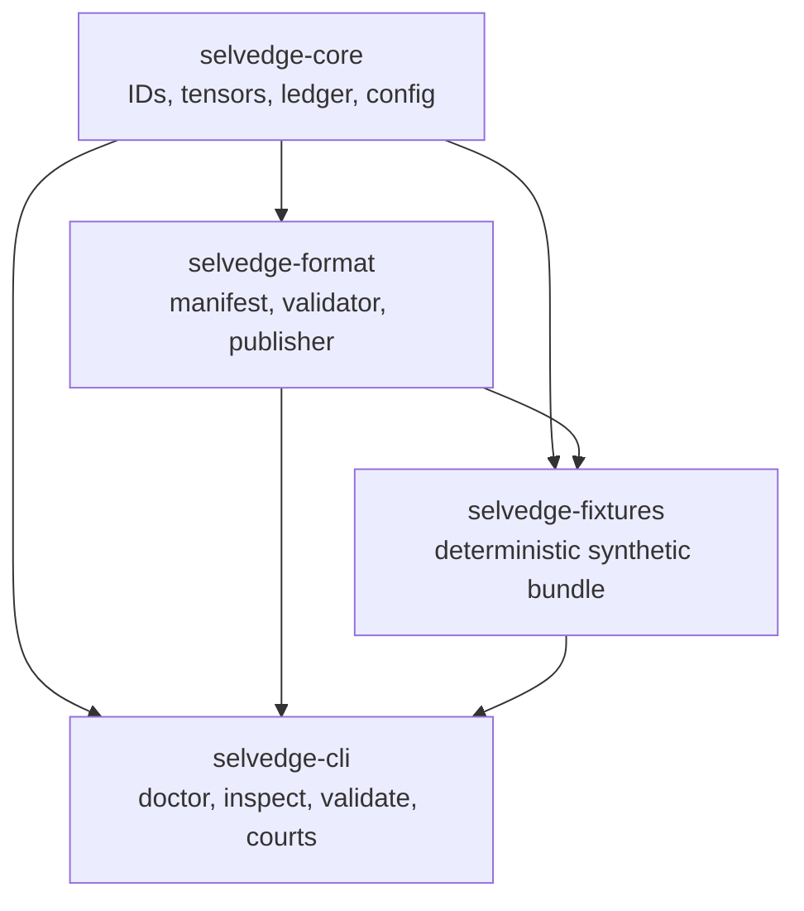
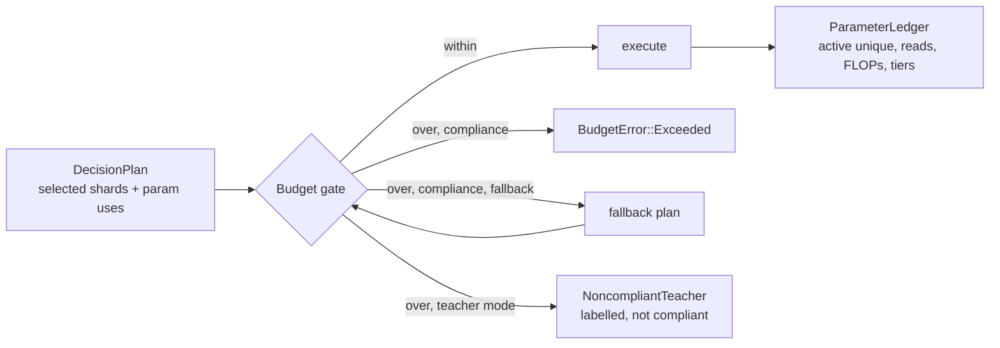

# SELVEDGE architecture — foundation increment (S1)

Status: **implemented foundation, no model and no measured performance**.
This document describes the crates that exist, the contracts they enforce, and
what is deliberately not built yet. Nothing here is a benchmark result.

## Crate boundaries



`selvedge-core` has no dependency on the filesystem format, the CLI or a model
backend. `selvedge-format` depends only on `selvedge-core` plus serde, serde_json
and thiserror. `selvedge-fixtures` uses both to produce a tracked artifact.
`selvedge-cli` is the only crate that reads command-line arguments and spawns
processes (`df` in `doctor`).

Later phases slot in on the right:

```text
selvedge-convert  -> produces Manifest + payload (S2)
selvedge-atlas    -> consumes SelectionDecision / produces selectors (S3)
selvedge-store    -> implements CostModel / Backend / residency (S4+)
selvedge-sim      -> replays ExecutionTrace against CostModel (S4+)
selvedge-runtime  -> executes exact or approximate plans (later)
selvedge-bench    -> measurement harness (later)
```

## Core data contracts

| contract | invariant |
| --- | --- |
| `ShardId` | SHA-256 over a versioned canonical encoding of format version, model identity, role, layer, channels, channel axis, dtype, quantization scheme and transform id; recomputed by the validator |
| `ModelDigest` | SHA-256 over a sorted, normalized checkpoint fileset encoding; optional upstream revision and tokenizer digest are recorded verbatim |
| `TensorRole` | stable string names plus an audited `Other(String)`; round-trip safe and unambiguous |
| `DType` | exact byte math for f32/f16/bf16/i8/u8 and block-packed i4/ternary; unknown names become `Unsupported` and validation rejects them |
| `QuantScheme` | non-zero block size, whole-block element count, packed-block agreement |
| `StorageOrder` | row-major, column-major, or explicit transpose axis permutation; never inferred from shape |
| `TensorSlice` | non-empty ordered channel range, shape rank and channel-axis agreement, element-count consistency, quantization consistency |
| `ParamIdentity` | tensor key plus half-open element range; equal tensor keys alias the same learned elements |
| `ParameterLedger` | unique-union accounting over parameter identities, repeated reads kept separate, FLOPs and tier bytes tracked, auxiliary bytes excluded from learned counts |
| `Budget` | pre-execution union check; compliance mode returns an error rather than a boolean |
| `SelectionDecision` | sorted unique shard ids plus selector provenance; duplicates rejected |
| `ExactSelection` | private fields; only constructible from a verified native-set equality or an explicit documented reclassification |
| `Config` | typed TOML with hard limits, validation, canonical JSON hash |

All integer encodings are explicit little-endian. Hashed paths use `BTreeMap`
or sorted vectors, never hash-map iteration. Every constructor and parser
returns `Result`; library code contains no `unwrap`/`expect` (the lint is
enabled and test modules carry an explicit allow).

## Accounting flow



`active_unique_params(t)` is the union of element ranges, merged per tensor
key. Tied embeddings are represented by reusing the same `ParamTensorId` and
range, so they count once. Overlapping or adjacent fragments merge. A recurrent
weight used several times counts once as unique and every repetition as a read.
Scales, zero points and other metadata are recorded under `AuxiliaryKind` and
are never added to the learned count.

FLOPs are caller-supplied estimates. `FlopEstimate::matmul` uses `2 * M * N * K`
and its documentation states the convention; controller FLOPs are a separate
counter. No FLOP number here is measured.

The budget gate is called before execution. In compliance mode an over-budget
plan yields `BudgetError::Exceeded`. The only way to proceed is a fallback hook
that returns a replacement plan which is re-checked; a fallback that remains
over budget is rejected. Teacher mode returns a labelled verdict and must not be
mixed into compliant results.

## Exact versus approximate

Exact mode is a typed distinction, not a string on a report:

- `SelectionDecision` carries `SelectionMode::Exact` or `Approximate` in its
  provenance.
- `NativeSetAttestation::attest` succeeds only when the decision is exact and
  its selected set equals the supplied native computation set.
- `ExactSelection` has private fields and can only be built by
  `from_verified` (set equality) or
  `reclassify_from_approximate` (explicit justification recorded in
  provenance).
- A selector that predicts a subset therefore cannot accidentally produce an
  exact decision. If routing changes which operators run, the path is
  approximate by construction.

Caching and prefetching may change latency but must not change the selected
set; that is the exact-mode contract future phases must test in Court E.

## Format flow

```text
convert -> Manifest + payload
             |
             v
      encode/publish (fsync, validate temp, atomic link/rename)
             |
             v
      validate (structure + extents + hashes)
             |
             v
      BundleFile (re-verify on shard read)
             |
             v
      catalog / hot reload (reject conflicting bundle id)
```

The manifest is validated before any payload read. Every shard id is recomputed;
every extent must be inside the payload, aligned, non-overlapping and have a
byte length consistent with its shape, dtype and quantization description. The
reader re-verifies a shard hash on every access. `MemoryBundle` uses the same
encoder and validator, so toy courts do not bypass integrity checks.

Full byte layout, versioning, alignment rules and the untrusted-artifact threat
model are in `docs/SHARD-FORMAT.md`.

## Configuration

`Config` is deserialized from TOML with unknown fields rejected. It carries:

- budget limit and compliance mode;
- resident memory cap and temporary-storage budget;
- shard alignment, manifest cap, bundle cap, default hash-verification choice;
- doctor free-space threshold;
- absolute hard ceilings that the configured values may not exceed.

`config_hash()` is SHA-256 over canonical compact JSON with sorted keys. It is
the value later benchmark rows must carry.

## What is implemented versus planned

| area | status | note |
| --- | --- | --- |
| canonical encodings and IDs | implemented | tested round-trip and field sensitivity |
| model digest definition | implemented | fileset normalization, order independent |
| tensor/quantization slice contracts | implemented | rejection paths for unknown types |
| parameter ledger and budget gate | implemented | Court C scenarios pass |
| exact/approximate selection attestation | implemented | typed constructors only |
| residency/transfer records, cost/backend traits | implemented | contracts only, no device code |
| manifest v1 and on-disk bundle | implemented | validator, atomic publisher, sidecar |
| in-memory bundle | implemented | same encoder/validator |
| hot-reload conflict detection | implemented | catalog rejects conflicting id |
| `selvedge doctor` | implemented | host probes only under `--probe-host`; CUDA reported absent |
| `selvedge inspect` | implemented | bundle or bare manifest, read-only |
| `selvedge format validate` | implemented | all/selected/structural modes |
| executable Courts C and D | implemented | named scenarios plus integration tests |
| synthetic fixtures | implemented | deterministic PRNG, tracked artifact |
| tensor conversion / safetensors / GGUF | **not implemented** | S2 |
| teacher oracle, attribution, selectors | **not implemented** | S3 |
| execution traces, simulator, scheduler | **not implemented** | later |
| real inference backend, CUDA kernels | **not implemented** | CUDA is not compiled in |
| quality or latency measurements | **none** | no benchmark has been run |

No claim of model quality, speed, memory savings or novelty is made in this
increment.

## Interfaces for the next phases

### S2 — conversion should produce

- `ModelDigest::of_fileset(&[CheckpointFile])` from the normalized checkpoint
  files; pass the upstream revision and tokenizer digest to
  `ModelDigest::from_parts`.
- One `ShardRecord` per emitted shard, with `ShardIdentity` and
  `ShardId::derive` used to compute the id before the record is built.
  `TensorSlice` and `bytes_for` should be used for the element/byte math;
  `StorageOrder` must state the actual on-disk orientation.
- For quantized shards, `QuantizationSpec` must place scales immediately after
  the weights and zero points immediately after scales; the extent hash covers
  the whole extent.
- `selvedge_format::encode_bundle_bytes` for a byte buffer, or
  `publish_bundle` / `publish_bundle_from_reader` for an atomic on-disk
  publication. Never write a final bundle path directly.
- `CalibrationProvenance` when a calibration set was used. Do not claim
  provenance that was not recorded.
- Return values, not panics, for every malformed checkpoint element. Court A
  (exact reconstruction) remains S2's gate.

### S3 — oracle and selectors should consume/produce

- Build `SelectionDecision::new(shards, SelectionProvenance::new(selector_id,
  SelectionMode::Approximate, scores))`. Record the realized set with
  `SelectionProvenance::set_realized` after execution.
- To claim exactness, compare against the native set with
  `ExactSelection::from_verified`; only use
  `reclassify_from_approximate` when an external verification is documented.
- Build `DecisionPlan` with `ParamUse` values. A tied embedding and LM head must
  share one `ParamTensorId`; a recurrent block must reuse one identity with
  `reads` above the element count. Quantization metadata goes to
  `record_auxiliary`, not to a parameter use.
- Call `ParameterLedger::check_decision` (or
  `check_decision_with_fallback`) before execution. Do not treat a
  `TokenAccounting` boolean as permission; the compliance gate returns `Err`.
- Emit `TokenAccounting` per output token for compliant results and label
  teacher-mode rows with `BudgetVerdict::NoncompliantTeacher`.
- Use `CostModel` and `Backend` for predicted/actual costs; do not attribute
  async bytes to overlapped execution without completion evidence.

### S4+ — storage, simulator, runtime should consume

- `BundleFile` for reads with explicit byte caps and optional cancellation.
- `validate_bundle` with `VerifyMode::Selected` for warm paths and
  `VerifyMode::All` at publication/audit boundaries. Structural-only validation
  must be labelled as such in any report.
- `BundleCatalog::offer` for hot reload; a conflict is a rejection, not a
  replacement.
- `ResidencySnapshot`, `TransferRequest`, `TransferCompletion` and
  `CostModel` for scheduling and measurement. `TransferCompletion` keeps
  requested, transferred and useful bytes separate so waste is explicit.
- `Config::config_hash` in every benchmark row, alongside the model revision,
  dataset revision, seed and command.

## Bound behavior

- The validator checks manifest length against configuration and a hard ceiling
  before allocating.
- Manifest, bundle and sidecar reads use bounded allocations
  (`try_reserve_exact`) and configured caps.
- Hashing streams through a fixed buffer.
- `BundleFile` refuses a shard larger than the caller's byte cap.
- Test temporary directories live under `SELVEDGE_TEST_TMP`/`TMPDIR` and are
  removed on drop; the Docker court bounds `/tmp` independently.
