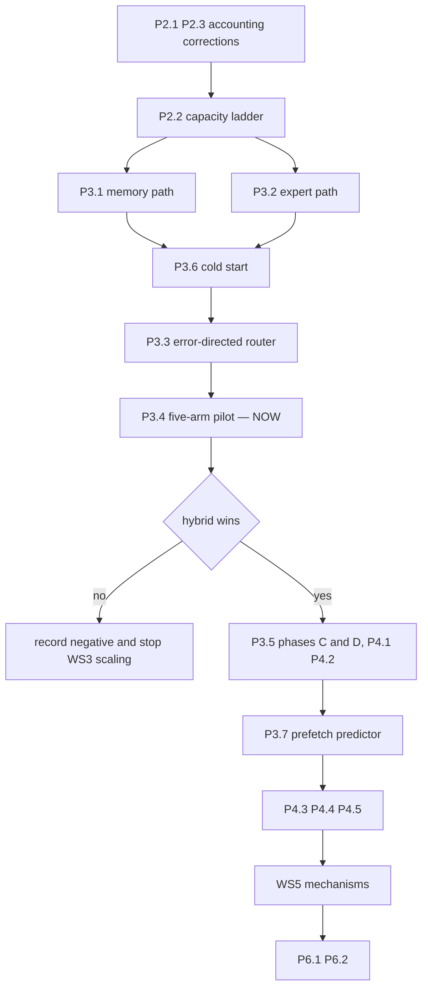
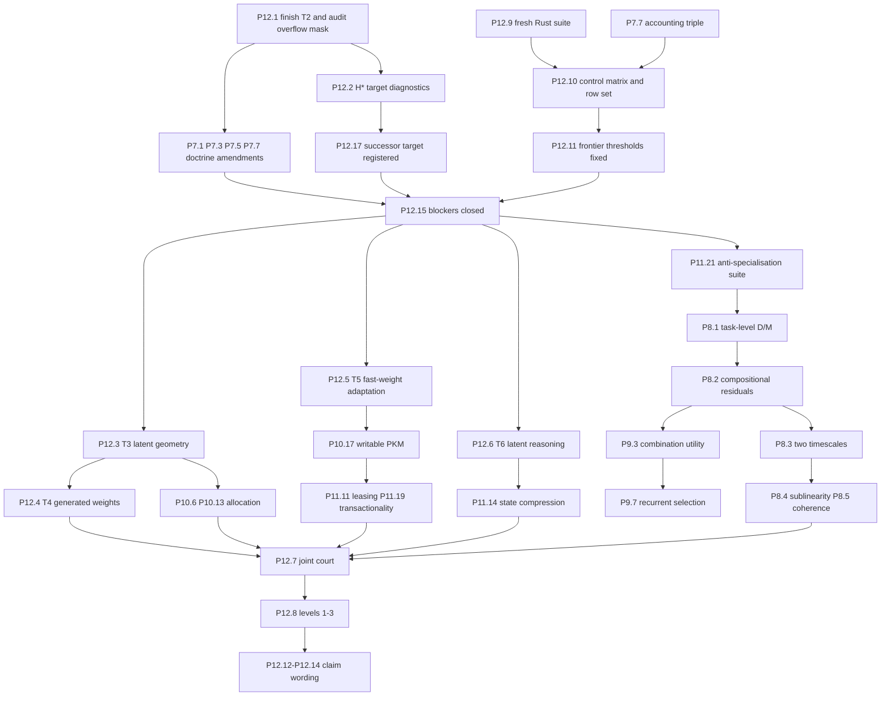

# PROGRAM PLAN — next phase, exhaustive and auditable

Status: **plan of record, pre-registration not yet written.** This document is
the complete TODO for the next program phase. Every item is numbered, and no
item from the strategy review is omitted. An item is only "done" when the
acceptance evidence named in it exists in the repository; a prose claim is not
evidence.

**Third extension, 2026-11-16 (S16C).** The plan is now **tiered** (§0.1),
an ordering inversion in the §16 queue is corrected and recorded (§0.2), and two
new workstreams are appended: **WS13** (published mechanisms to reproduce and
sixteen inventions, 21 items) and **WS14** (runtime and evaluation corrections,
7 items). No existing P-ID is renumbered, retitled or removed.

**Fourth extension, 2026-11-16 (S24).** Four workstreams are appended and none of
the 140 existing P-IDs is renumbered, retitled or removed: **WS15** (beyond-MoE
architectures, 9 items), **WS16** (subtractive intelligence and residual-governed
control, 35 items), **WS17** (the Phenom collaboration surface, 4 items) and
**WS18** (the experiment matrix and its incentive guards, 12 items). The
literature behind every named work is in `docs/PRIOR-ART-AND-NOVELTY.md` §14–§15,
fetched in rounds 19–24 on 2026-11-16; four of the named works did not resolve
(DA-MoE, DynaMoE, Dynamic Expert Sharing, the Springer LLM I/O survey) and the
plan does not cite them as alternatives. The gate that already bound WS13 is
extended to WS15–WS18 and restated with its date in §20.0.

Companion documents: `docs/MANDATE.md` (requirements),
`docs/EXPERIMENT-CONTRACT.md` (registered thresholds; T1 is the current
section), `docs/PRIOR-ART-AND-NOVELTY.md` (what is actually prior art),
`docs/LIMITATIONS.md` (what the measured results do not establish),
`docs/TRAINING.md` (the training instrument as it exists).

## 0. How to read this plan

**Fields.** Each item carries:

- **What** — the deliverable, in checkable terms.
- **Why** — the reason it exists; what fails if it is skipped.
- **Depends** — item IDs that must be done first, or "none".
- **Acceptance evidence** — the exact receipt, court, test or document that
  makes the item done. Where an item changes a measurement, the receipt must
  name revision, command, environment and fixture.
- **Status** — one of `done`, `partial`, `open`, `blocked`, `deferred`.
- **Effort** — engineering sessions (S/M/L/XL) and, where a run is required,
  measured-resource estimate. One session is a focused working session on this
  workstation. Estimates are honest guesses and are not evidence.

**Status at the time of writing (revision at HEAD of `staging`):**

| area | state |
| --- | --- |
| M1 static whole-group omission | measured, **negative** (`results/M1-FRONTIER.md`) |
| M2 per-token post-hoc selection | measured, **negative**; oracle bound outside the usable tier (`results/M2-SELECTORS.md`, `docs/M2-CORRECTION.md`) |
| T1 trained/upcycled arms | pre-registered; infrastructure built; **no training run** |
| Rust crates | `core`, `format`, `convert`, `fixtures`, `atlas`, `store`, `cli` exist; `sim`, `runtime`, `bench` do not |
| Storage baselines | measured cold/warm NVMe and host-RAM baselines (`docs/STORAGE.md`) |
| Memory path, error-directed router, prefetch predictor | **do not exist** |
| Prior-art ledger | exists (`docs/PRIOR-ART-AND-NOVELTY.md`), created in this phase from recorded fetches |

**Number rule.** Measured performance, storage, latency, resource and
verification-count numbers are never written here by hand. Where a measured
quantity matters, this plan names the generated block in `docs/PERF-NUMBERS.md`
or the receipt under `results/`. Derived design counts (parameter arithmetic
over the registered architecture constants) are marked as arithmetic, are
exact integers, and carry a reproduce command; they are not measurements.

**Extension, 2026-11-15.** Sections 10–17 were appended (WS7–WS12, the
dependency-ordered execution queue and an updated NOW) without renumbering or
deleting any existing item. WS1–WS6 and their IDs are unchanged. WS7–WS12 are
written against the state of the T2 pilot at that time (running: `D` and `M`
evaluated, `X` evaluating, `H` and `H*` pending) and against the extended
prior-art ledger; every mechanism item whose novelty is contested carries the
ledger entry that contests it. Section 7's sequencing diagram remains the order
for WS1–WS6; section 16 supersedes it only for the new items.

---

## 0.0 Critical paths (2026-11-16, S20)

The program has **two independent critical paths**. They share instruments but not
blockers, and conflating them has repeatedly made the physical-execution work
look like a gate on the capability work (it is not).

**(a) Neural capability path — the decisive path now.**
1. Finish **H\*** (running) and record its verdict.
2. Certify the historical **X** and **H** checkpoints by provenance amendment
   (`results/t2/PROVENANCE-AMENDMENT-X-and-H.json`), or leave them unscoreable
   with the reason recorded.
3. Run the fresh Rust suite through the ordinary `cargo test` suite and the
   3-item trio that the capability court already invokes.
This path needs the **PyTorch adapter**, not the Rust runtime.

**(b) Physical execution path — real but not on the capability critical path.**
1. Runtime optimisation (P14.1–P14.3: decoded residency, async prefetch,
   batched prefill).
2. Integration of trained modules into the runtime.
3. Real transfer and latency measurement on the executed path.

**Dependency rule.** **P14.1–P14.3 do not gate the T2 capability run.** The T2
capability court executes through the PyTorch adapter; WS14 changes what the
*Rust runtime* measures (bytes/token, cold-byte p95, latency), not whether a
capability verdict can be produced. Any text hat implies otherwise is corrected
where it appears. The two paths converge only when a *runtime* claim is made. The
capability path may report before any WS14 item lands, and must say which
runtime revision it measured on.

---

## 0.1 Tier structure and status legend (2026-11-16)

A tier states **how much the program is committed to an item and how much
evidence it has**, not how interesting it is. Tiers are orthogonal to the
`Status` field: an item can be `open` in any tier.

| tier | meaning | what an item in this tier must carry |
| --- | --- | --- |
| **ACTIVE** | the current decisive path plus the instruments and constraints that bind it now | a scheduled next action; acceptance evidence that exists or is being produced in this phase; for an experiment, a registered contract |
| **CANDIDATE** | rigorously defined, **not yet justified** | a cheap decisive experiment, an explicit falsifying control, and a kill criterion that says what result retires it |
| **HYPOTHESIS** | retained for the long horizon, **no implementation commitment** | a statement of the question and why the program keeps it; no schedule, no budget, no claim |

Rules:

1. An item moves **up** a tier only when the acceptance evidence of the tier
   below exists. It moves **down** when its kill criterion fires; the negative
   result is kept (P6.5), never deleted.
2. A tier is revisable at a checkpoint and must be revised then. It is a record
   of commitment, not a verdict on the item's merit.
3. Tiers do **not** renumber anything. WS1–WS12 keep their IDs and text; WS13 and
   WS14 continue the numbering with P13.x and P14.x.
4. The tier index below is the authoritative statement. The table lists ranges
   only where the range is contiguous and every item inside it has the same tier.

### Tier index — 112 existing items (WS1–WS12)

| tier | items by workstream section | count |
| --- | --- | ---: |
| **ACTIVE** | §1 (WS1): P1.1–P1.4 · §2 (WS2): P2.1, P2.3–P2.4 · §3 (WS3): P3.4 · §6 (WS6): P6.1–P6.5 · §10 (WS7): P7.1, P7.3, P7.5, P7.7 · §15 (WS12): P12.1, P12.1a, P12.2, P12.9–P12.11, P12.15–P12.17 | 26 |
| **CANDIDATE** | §2: P2.2 · §3: P3.1–P3.3, P3.5–P3.7 · §4 (WS4): P4.1–P4.5 · §5 (WS5): P5.1–P5.10 · §10 (WS7): P7.2, P7.4, P7.6 · §11 (WS8): P8.1–P8.5 · §12 (WS9): P9.1–P9.7 · §13 (WS10): P10.1–P10.13, P10.15, P10.17–P10.18 · §14 (WS11): P11.1–P11.21 · §15 (WS12): P12.3–P12.6 | 78 |
| **HYPOTHESIS** | §5: P5.11 · §13: P10.14, P10.16 · §15: P12.7–P12.8, P12.12–P12.14 | 8 |

Tier index — new items: WS13 (§18) has **21** items — P13.1–P13.4 and
P13.6–P13.21 `CANDIDATE` (20), P13.5 `HYPOTHESIS` (1). WS14 (§19) has **8**
items — P14.1–P14.3 `ACTIVE` as runtime-optimisation work (they **do not** gate
the T2 capability run; see §0.0) and P14.4–P14.8 `CANDIDATE`.

Tier index — S24 items: WS15–WS18 (§20–§23) have **60** items — `ACTIVE` 1,
`CANDIDATE` 56, `HYPOTHESIS` 3.

| tier | items | count |
| --- | --- | ---: |
| **ACTIVE** | P18.6 (cut-set discovery from stored omission traces, the only diagnostic permitted before the gate) — **executed by S25, negative; see §23** | 1 |
| **CANDIDATE** | P15.1–P15.8 · P16.1–P16.25, P16.27–P16.31, P16.33–P16.35 · P17.1–P17.4 · P18.1–P18.5, P18.7–P18.12 | 56 |
| **HYPOTHESIS** | P15.9 (integration) · P16.26 (Braess) · P16.32 (biological control) | 3 |

Tier index — S35 revision: WS19 (§24) has **7** items — P19.0–P19.6. P19.0's
accounting half landed at S33 (schema v2, receipts, reference) and its kernel half
now gates **only** stages 5–6, so the quality stage that needs no Rust executor is
`ACTIVE` and is the next measurement. WS20 (§25) registers **no** new experiments
— it is a stop/keep register over existing P-numbers.

Tier index — S42 addition: WS19 now has **10** items. P19.2b (the corrective
graft) is added beside P19.2 without renumbering it; P19.7 (bf16 weight-update
numerics for the bar arm) and P19.8 (the objective question) are new numbered
items. No existing P-number was renumbered or reused.

**Parked at S38 (2026-11-17).** Two registered lines are **deferred, not
withdrawn**, with their registrations kept intact: **T4** (`docs/EXPERIMENT-CONTRACT.md`,
the K18 trade question) and the **capability-court discrimination endpoint**
(`docs/CAPABILITY-COURT.md` §7.3, `docs/capability-preregistration-v5.json`).
The reason is the same for both and is scheduling: the GPU budget is focused on
WS19, and each needs either four training arms (T4) or an authoring pass plus a
scoring run (the endpoint). They are listed here so a reader does not mistake
their absence from the schedule for a verdict, and un-parking requires a dated
amendment naming the session and the GPU hours.

| tier | items | count |
| --- | --- | ---: |
| **ACTIVE** | P19.1 (stage 1: the anchor scoreboard — **executed at S36**, receipts in `docs/FRONTIER-TARGET.md` §9) · P19.2 (stage 2: the next measurement, registration in `docs/WS19-EXECUTION-REGISTRATION.md`) · P19.2b (the corrective graft, registered at S42 in `docs/ws19-corrective-graft-preregistration-v1.json`) | 3 |
| **CANDIDATE** | P19.0 (accounting half done at S33; kernel half gates stages 5–6 only) · P19.3 retrofitted loop (a reproduction) · P19.4 per-pass state-conditioned memory (the one narrow novelty) · P19.5 NVMe serving (needs the kernel half) · P19.6 spend headroom and claim (needs the kernel half) · P19.7 bf16 weight-update numerics (implemented at S42; the smoke receipt is the evidence) · P19.8 CE+KL vs corrective objective (registered at S42, not run) | 7 |
| **HYPOTHESIS** | — | 0 |
| **PARKED** (outside the tiers) | T4 · the capability-court discrimination endpoint — registrations intact, GPU focus is WS19; see the note above | 2 |

**Assignments that need a reason.**

- **P18.6 is the only `ACTIVE` item in the four workstreams.** It consumes
  omission receipts that already exist (`results/M1-FRONTIER.md`,
  `results/M2-SELECTORS.md`, the T2 per-item rows) and needs no training run and
  no new model. Every other item here needs either a training run, a new module
  or a new measurement instrument, so the tier rule (ACTIVE requires evidence
  being produced in this phase) keeps them at `CANDIDATE`. **It has since been
  executed and its registered kill criterion fired** (S25: receipt
  `results/p18.6/cutset-20261116T073406Z.json`, report `results/P18.6-CUTSET.md`,
  negative). The row is kept as the record of what was `ACTIVE` in the phase in
  which the matrix was written; nothing in WS15–WS18 is `ACTIVE` now.
- **P16.26 and P16.32 are `HYPOTHESIS`** because their own evidence base is an
  analogy: Braess' paradox and the biological principles are each attested only
  by secondary or citing records (`docs/PRIOR-ART-AND-NOVELTY.md` rows 158,
  161–168), and neither names a decisive experiment that could run before the
  gate opens. Keeping them is deliberate — they are why the plan has a
  subtractive workstream at all — but nothing is scheduled.
- **P15.9 is `HYPOTHESIS`** because it is defined as "the winners only": it
  cannot be specified until P15.1–P15.8 report, and specifying it now would be
  the breadth-without-attribution failure P12.16 names.
- **P16.34 is `CANDIDATE`, not `ACTIVE`, even though it is pure CPU work.** It
  requires a new crate and a new trace corpus. A CPU-only implementation is not
  the same thing as a diagnostic over existing artifacts, and the tier is a
  statement about commitment and evidence, not about hardware.
- **P18.12 is `CANDIDATE`** because it is a reporting rule with no execution
  surface until a WS15/WS16 claim exists. It becomes `ACTIVE` at the first such
  claim, and it binds that claim from its first sentence.

**Assignments that need a reason, not just a row.**

- **P12.10 and P12.11 are ACTIVE although their content is "infrastructure".**
  They are *decision criteria* — the row set every comparison is reported against
  and the thresholds a frontier run is scored against. §0.2 records why they may
  not be scheduled after the experiments.
- **P3.4 is ACTIVE** because it is running as the registered T2 pilot (P12.1);
  the five-arm matrix is the T2 matrix, not a second experiment.
- **P12.3–P12.6 (T3–T6) are CANDIDATE, not HYPOTHESIS**, even though they are the
  next courts: each has a registration and a kill condition, but none may start
  before the pilot's verdict (P12.1) and the two blockers (P12.15).
- **P12.7, P12.8, P12.12–P12.14 are HYPOTHESIS**: they commit the program to a
  *shape* of claim (a joint court, three levels, a transfer test) with no
  implementation commitment in this phase. P12.11's thresholds still bind them.
- **P5.11, P10.14, P10.16 are HYPOTHESIS** because each is explicitly deferred in
  its own text (recurrent latent computation; shortcut-connected specialists;
  learned reasoning length).
- **P1.x, P6.x and four of the seven WS7 doctrine items are ACTIVE** as standing
  constraints: they bind how the current experiments are registered, measured and
  reported, which is what makes them active rather than background.


### The three tiers, item by item

The row above is the summary; this is the same assignment spelled out, so no item
can hide inside a range. **ACTIVE** opens with the decisive path — P12.1 (finish
T2 and preserve its verdict), P12.1a (the corrected-dispatch sensitivity run),
P12.2 (the `H*`-target diagnostics), P12.17 (the successor target, which is the
one next decisive test) — and then the criteria, instruments and constraints that
bind it. **CANDIDATE** is the defined mechanism space: every item carries a cheap
experiment, a falsifying control and a kill criterion, and none is scheduled.
**HYPOTHESIS** is retained with no implementation commitment at all.

#### ACTIVE — 29 items

**§1 — WS1 — Strategy and novelty boundaries**

| id | item |
| --- | --- |
| P1.1 | Compete on the joint design, not on sparse routing alone |
| P1.2 | Separate "1B active with a dormant expert bank" from the actual question |
| P1.3 | Maintain the novelty boundary ledger |
| P1.4 | Rank the three directions and defer the third |

**§2 — WS2 — Correct the registered architecture accounting**

| id | item |
| --- | --- |
| P2.1 | Record the Arm B sizing defect: routing is a compute saver, not capacity extraction |
| P2.3 | Correct Arm A adapter counting and re-verify the active union with the Rust ledger |
| P2.4 | Verify the teacher-target approximation against a full-distribution teacher, and add a hard-label control |

**§3 — WS3 — Error-directed capacity architecture (first experimental matrix)**

| id | item |
| --- | --- |
| P3.4 | First matrix: five arms, one backbone, one data order, one compute budget |

**§6 — WS6 — Success criteria and honest evaluation**

| id | item |
| --- | --- |
| P6.1 | Neural-capacity advantage |
| P6.2 | Physical-execution advantage |
| P6.3 | Every comparison reports quality, bytes/token and wall-clock |
| P6.4 | Keep the Rust core/Atlas/converter/format/store; add a trainable one-pass model with an independently measured active union |
| P6.5 | Pre-register before each run; keep negative results; no post-hoc thresholds |

**§10 — WS7 — Design doctrine derived from the selvedge metaphor**

| id | item |
| --- | --- |
| P7.1 | Weave selectivity in from the start; no post-hoc repair of a dense weave |
| P7.3 | The boundary may have a different structure from the body |
| P7.5 | Self-finished execution: the plan travels with its own evidence |
| P7.7 | The formal objective, with the three quantities kept apart |

**§15 — WS12 — Staged program and frontier claim**

| id | item |
| --- | --- |
| P12.1 | Finish T2 and preserve its verdict; audit the routed-overflow validity mask |
| P12.1a | The corrected-dispatch sensitivity run (successor to P12.1, registered separately) |
| P12.2 | Diagnose H*'s target: leave-one-out, per-expert normalisation, deployed-budget utility |
| P12.9 | Fresh Rust task suite |
| P12.10 | The control matrix |
| P12.11 | Frontier thresholds, fixed before any frontier run |
| P12.15 | Two pre-scaling technical problems, tracked as blockers |
| P12.16 | Anti-pattern guard: no new implementation program before the first three steps report |
| P12.17 | The successor utility target: interaction-aware, deployed-budget, absolute utility retained |

**§19 — WS14 — Runtime and evaluation corrections (physical-execution path; does not gate the T2 capability run — see §0.0)**

| id | item |
| --- | --- |
| P14.1 | Decoded-weight residency: stop re-decoding on every read |
| P14.2 | Prefetch is synchronous: separate fetch and compute timelines |
| P14.3 | Token-at-a-time prefill: keep the scalar oracle, add a batched path |


#### CANDIDATE — 103 items

**§2 — WS2 — Correct the registered architecture accounting**

| id | item |
| --- | --- |
| P2.2 | Capacity-scaling ladder with a genuinely oversized bank |

**§3 — WS3 — Error-directed capacity architecture (first experimental matrix)**

| id | item |
| --- | --- |
| P3.1 | Memory path with deterministic hashed addressing |
| P3.2 | Expert path: conditional residual specialists that do not duplicate memory or backbone |
| P3.3 | Error-directed training: utility target and pre-execution prediction |
| P3.5 | Training-recipe phases A–D |
| P3.6 | Cold-start handling: warm-up/diversity initialisation, measured specialisation |
| P3.7 | Predictability without forcing reuse: a separate prefetch predictor |

**§4 — WS4 — Physical bottleneck and placement**

| id | item |
| --- | --- |
| P4.1 | Record the bytes-per-token budget as a design constraint |
| P4.2 | Three-tier progression: VRAM → host RAM → selective NVMe |
| P4.3 | Three-way per-group decision: full precision / compressed approximation / omit |
| P4.4 | Weight-traffic equivalence reporting |
| P4.5 | Do not use sparse fragmentation when a resident contiguous approximation plus sparse correction is cheaper |

**§5 — WS5 — Inverted and combined mechanisms**

| id | item |
| --- | --- |
| P5.1 | Resident dense low-rank approximation + sparse exact delta |
| P5.2 | Chunk-tiered tiering (chunk union decides fetch) |
| P5.3 | Rotated shared-base delta experts |
| P5.4 | Adaptive dense correction triggered by delta mass |
| P5.5 | WINA / quantisation-error tiering |
| P5.6 | Native gate as router under the union budget, with low-parameter gating |
| P5.7 | Sequence-level budget allocation with per-output-token union accounting |
| P5.8 | Sequence-level masked-expert bank plus adaptive depth |
| P5.9 | Cheap interaction signals |
| P5.10 | Oracle-in-the-loop training |

**§10 — WS7 — Design doctrine derived from the selvedge metaphor**

| id | item |
| --- | --- |
| P7.2 | Continuity across the boundary: reusable task working sets, never forced router stickiness |
| P7.4 | The boundary must not distort what it protects |
| P7.6 | Composable capability protocol, with composability measured |

**§11 — WS8 — Complementarity and two-timescale organization**

| id | item |
| --- | --- |
| P8.1 | Task-level D/M selection on fresh held-out tasks |
| P8.2 | Compositional residuals with a bounded learned gate |
| P8.3 | Two-timescale selector: task-level working set, token-level inside it |
| P8.4 | Sublinear cold bytes per task and p95 latency as accessible capacity grows |
| P8.5 | Task-coherent specialization versus vocabulary specialization |

**§12 — WS9 — Deficit-directed capability construction**

| id | item |
| --- | --- |
| P9.1 | Counterfactual capability compiler |
| P9.2 | Three representations compete under one error-driven objective |
| P9.3 | Combination utility and an interaction-aware controller |
| P9.4 | Student-deficit-conditioned addressing |
| P9.5 | Teacher-derived memory is immutable and versioned at inference |
| P9.6 | Verifier-compiled procedural capabilities |
| P9.7 | Memory-selected recurrent reasoning |

**§13 — WS10 — Eighteen candidate mechanisms, each with its own cheap decisive experiment**

| id | item |
| --- | --- |
| P10.1 | Hypernetwork-generated experts |
| P10.2 | LatentMoE geometry: near-square experts at fixed active cost |
| P10.3 | Writable fast-weight memory split into stable / episodic / working |
| P10.4 | Supervised latent reasoning |
| P10.5 | Multi-view routing and expert modulation |
| P10.6 | Intrinsic-dimension-guided capacity allocation across layers |
| P10.7 | Query-selective test-time updates on multi-stage tasks |
| P10.8 | Verifier-compiled symbolic solvers for recurring reasoning classes |
| P10.9 | Mixture-of-Recursions adaptive depth with shared weights |
| P10.10 | Student-aligned reasoning distillation |
| P10.11 | One-token internal correctness probes |
| P10.12 | Conflict-directed repair |
| P10.13 | Task-conditioned layer-wise expert budgets under one global budget |
| P10.15 | Information-density-aware expert compression |
| P10.17 | Fast-weight product key memory as a writable episodic store |
| P10.18 | Optimizer court: FOAM vs Muon vs tuned AdamW |

**§14 — WS11 — Twenty-one original mechanism proposals**

| id | item |
| --- | --- |
| P11.1 | Causal Bottleneck Repair |
| P11.2 | Capability Operator Algebra |
| P11.3 | Functional Innovation Storage |
| P11.4 | Counterfactual State Transplants |
| P11.5 | Representation Impedance Matching |
| P11.6 | Error-Syndrome Addressing |
| P11.7 | Residual Safety Escrow |
| P11.8 | Capability Birth and Fusion |
| P11.9 | Counterexample-Constrained Routing |
| P11.10 | Inter-Layer Shortcut Capsules |
| P11.11 | Temporal Capability Leasing |
| P11.12 | Failure-Directed Latent Repair |
| P11.13 | Predictive Capability Checkpoints |
| P11.14 | Reasoning State Compression |
| P11.15 | Precision-Selective Intelligence |
| P11.16 | Adversarial Capability Crystallization |
| P11.17 | Causal Computation Auctions |
| P11.18 | Adaptive Verification Depth |
| P11.19 | Neural State Transactionality |
| P11.20 | Capability Conservation Training |
| P11.21 | Anti-superficial-specialization suite |

**§15 — WS12 — Staged program and frontier claim**

| id | item |
| --- | --- |
| P12.3 | T3: latent-geometry court (P10.2) |
| P12.4 | T4: generated-weight versus stored-weight court (P10.1) |
| P12.5 | T5: fast-weight adaptation court (P10.3 / P10.7) |
| P12.6 | T6: latent-reasoning court (P10.4 / P11.14) |

**§18 — WS13 — Published mechanisms and sixteen inventions, run as competing alternatives**

| id | item |
| --- | --- |
| P13.1 | Adaptive expert widths: nested slimmable experts under one budget |
| P13.2 | Cross-layer expert reuse: shared pools over 2 / 4 / 7 layers |
| P13.3 | Global experts plus a recurrent routing state |
| P13.4 | Typed latent reasoning with a learned allocation budget |
| P13.6 | Capability Seed Compilation |
| P13.7 | Constraint-Debt Reasoning |
| P13.8 | Metamorphic Quotient Routing |
| P13.9 | Semantic Refinement Ladders |
| P13.10 | Verified Constraint Distillation |
| P13.11 | Certified Read Elision |
| P13.12 | Interaction Compilation |
| P13.13 | Conditional Representation Expansion |
| P13.14 | Omission-Conditioned Recovery |
| P13.15 | Counterexample-Preserving Compression |
| P13.16 | Latent Branch-and-Reconcile |
| P13.17 | Resident-Side-Information Coding |
| P13.18 | Phase-Transition Capability Switching |
| P13.19 | Executable Capability Contracts |
| P13.20 | Training for Future Locality |
| P13.21 | Verifier-Calibrated Internal Stopping |

**§19 — WS14 — Runtime and evaluation corrections (physical-execution path; does not gate the T2 capability run — see §0.0)**

| id | item |
| --- | --- |
| P14.4 | Expand the evaluation suite beyond 24 tasks |
| P14.5 | Strengthen checker coverage and scale for Rust cases (execution already exists) |
| P14.6 | Keep correctness separate from reference-continuation likelihood |
| P14.7 | A sealed evaluation set for external comparison |
| P14.8 | Close the statistical-power gap: reach 80% power at a 10% relative effect |


#### HYPOTHESIS — 9 items

**§5 — WS5 — Inverted and combined mechanisms**

| id | item |
| --- | --- |
| P5.11 | Recurrent latent computation as a separate later axis |

**§13 — WS10 — Eighteen candidate mechanisms, each with its own cheap decisive experiment**

| id | item |
| --- | --- |
| P10.14 | Shortcut-connected specialist execution |
| P10.16 | Learned reasoning-length control |

**§15 — WS12 — Staged program and frontier claim**

| id | item |
| --- | --- |
| P12.7 | T7: the joint court, then capacity scaling |
| P12.8 | Capability court, three levels |
| P12.12 | Three distinguishable achievement claims |
| P12.13 | Transfer test: equivalent capability libraries on a small and a larger backbone |
| P12.14 | Wildcards: mHC/xHC multi-stream residual capacity, low-rank logits basis |

**§18 — WS13 — Published mechanisms and sixteen inventions, run as competing alternatives**

| id | item |
| --- | --- |
| P13.5 | Integration controller (only after the individual winners report) |

## 0.2 P-correction — the ordering inversion, recorded and fixed

**The inversion.** The §16 queue as written on 2026-11-15 ended with

```
V[P12.8 levels 1-3] --> W[P12.10 control matrix P12.11 thresholds]
```

and its hard-order list put step 7 "**T7 and P12.8** — only winners, then the
three levels" before step 8 "**P12.10–P12.12** — the control matrix and the
claims". The diagram therefore scheduled the **control matrix** (P12.10) and the
**frontier thresholds** (P12.11) *after* the experiments they govern.

**Why that is a defect and not a preference.** P12.10 fixes the row set every
comparison is reported in, including the two rows the item itself says kill most
results ("Memory Grafting-style latent baseline" and "matching library without
routing optimisation"). P12.11 fixes the ≥10% threshold, the capacity-scaling
criterion, the replay court, the Pareto requirement and the branch split. If both
are built after T7, then T3–T6 are designed, run and read without the controls
that would have falsified them, and the frontier run is scored against
thresholds that were written after its numbers existed. That is the exact
post-hoc-threshold failure P6.5 and P12.11 exist to prevent, appearing inside the
plan that forbids it.

The dependency text was already correct and only the diagram was wrong: P12.10's
`Depends` is "P12.9, P7.7" and P12.11's is "P12.10" — neither names T7 or P12.8.
The edge was drawn from a "experiments, then claims" narrative rather than from
the `Depends` fields.

**The correction.** *Decision criteria and the measurement instrument move before
the experiments they govern; infrastructure may still be finalised later.*

| established before the first governed experiment | may be finalised later |
| --- | --- |
| the fresh suite (P12.9) — exists | residency tiers, GPU staging, kernels (P14.1–P14.3, WS4) |
| the control matrix's schema **and row set** (P12.10) — schema exists; each run fills its row | the Level-2 capacity ladder and Level-3 assembly (P12.8, P2.2) |
| the frontier thresholds and gating checks (P12.11) — pre-registered | the joint court's ablation matrix (P12.7) |
| the two pre-scaling blockers closed (P12.15) | the transfer test (P12.13) and the wildcards (P12.14) |
| the successor utility target registered (P12.17) | the third achievement claim (P12.12, Level 3 wording) |
| the anti-pattern guard in force (P12.16) | |

The rule this leaves behind, for every future edit to this plan: **a threshold, a
row set, a control, or a kill criterion may never be written after the numbers it
judges; an engineer, a kernel, a residency tier or an additional claim may be.**
§16 is redrawn accordingly.

---

## 1. WS1 — Strategy and novelty boundaries

### P1.1 — Compete on the joint design, not on sparse routing alone

**What.** State, in the contract and in the README, that the program's
contribution candidate is the *joint* design of (a) learned conditional
capacity, (b) a learned retrieval/memory path, and (c) physical execution under
a strict per-token union budget — and that sparse routing by itself is neither
new nor the claim.

**Why.** Every component in isolation has prior art (see
`docs/PRIOR-ART-AND-NOVELTY.md`). A claim framed around routing would be
refuted by Deja Vu, PowerInfer, SEAP, SparseInfer, MoE-CORE and Prefetch-Steered
Routing on day one.

**Depends.** none.
**Acceptance evidence.** `docs/EXPERIMENT-CONTRACT.md` amendment adding the claim
sentence and the "not a claim" list; `README.md` current-result paragraph that
matches it; a `perf_numbers` court run proving no number was hand-written.
**Status.** open.
**Effort.** S.

### P1.2 — Separate "1B active with a dormant expert bank" from the actual question

**What.** Record the distinction explicitly: a 1B-active model with a large
dormant expert bank is established practice (OLMoE-1B-7B reports roughly 1.3B
active; the "1B" in its name is not a strict-union count). SELVEDGE's question
is different: whether *additional* capacity can be organised so that its
retrieval is predictable under a parameter budget **and** an I/O budget, at a
strictly counted union.

**Why.** Without this distinction the program will be read as re-running
well-known MoE inference, and the review will be right.

**Depends.** P1.3.
**Acceptance evidence.** a paragraph in the contract's "what this is not"
section, with the OLMoE citation and its verified active-parameter number
(`docs/PRIOR-ART-AND-NOVELTY.md`, entry `olmoe`).
**Status.** open.
**Effort.** S.

### P1.3 — Maintain the novelty boundary ledger

**What.** Keep `docs/PRIOR-ART-AND-NOVELTY.md` live. It must name, for each
mechanism the program intends to use, the closest antecedent, the overlapping
features, and what is genuinely uncombined. The boundary list is fixed:

- **Upcycling prior art:** Drop-Upcycling, SIMoE, UpIT, ToOL/ToMoE-style
  conversion, cluster-aware upcycling.
- **Learned/conditional memory prior art:** Memory Layers at Scale, Engram
  (and its derived works), PEER, Monet.
- **Predictive loading / cache-aware routing prior art:** SeqMoE, SpecMD,
  SpecPrefetch, Prefetch-Steered Routing, DoMoE, MoE-CORE, NeuroPrefetcher,
  MoE-Infinity.
- **Activation-sparsity prior art:** Deja Vu, PowerInfer, attribution-based
  sparse activation (2026), SEAP, SparseInfer, R-Sparse, La RoSA, Sirius,
  WINA, SpAx, BlockFFN, SPON.

The only claim permitted is: a **joint trained error-directed system with strict
union accounting** that combines capacity, retrieval and physical execution, at
a measured operating point.

**Why.** The mandate makes this a deliverable, and unverified citations are the
fastest route to an invalid result.

**Depends.** none.
**Acceptance evidence.** the ledger exists, every claim carries a status
(`VERIFIED`/`PARTIAL`/`UNSUPPORTED`/`PROPOSED`), every URL carries a retrieval
date, and `scripts/prior_art_fetch.py` reproduces the fetched bytes into
`results/prior-art/`. Re-run at every milestone advance.
**Status.** partial (ledger created this phase; must be refreshed when WS3/WS4
experiments are pre-registered).
**Effort.** S per refresh, M for a full re-verification.

### P1.4 — Rank the three directions and defer the third

**What.** Adopt this ranking for the phase:

1. **Error-directed memory + expert specialization** (WS3) — first.
2. **Utility-weighted predictive execution** (WS4/WS5.10) — second.
3. **Hierarchical shared-base + delta specialists** (WS5.1, WS5.3) — deferred
   until a trained bank shows a quality win.

**Why.** Direction 3 is a compression/parameter-efficiency play. Its benefit is
conditional on there being a specialist bank whose quality is worth preserving.
Building it first would optimise a bank that may not exist.

**Depends.** P3.4 (the pilot that decides whether a bank is worth preserving).
**Acceptance evidence.** the ranking recorded in the contract with the explicit
deferral condition ("deferred until P3.4 shows a quality win for the trained
bank over the dense control").
**Status.** open.
**Effort.** S.

---

## 2. WS2 — Correct the registered architecture accounting

### P2.1 — Record the Arm B sizing defect: routing is a compute saver, not capacity extraction

**What.** Amend T1.2 to state Arm B's **total accessible** count alongside its
active count, and to draw the consequence: with a 596,049,920-element core and
8 specialists per layer at 1,572,864 elements each, the whole bank is
352,321,536 and the whole model is 948,600,832 — already under the 1e9 ceiling.
Arm B therefore does not extract capacity from beyond the ceiling at all; it
trades *compute* for quality at equal total size. That is a legitimate
experiment, but it is not the capacity-extraction experiment the program
eventually needs.

**Why.** Without this, a reader will read Arm B as evidence about dormant
capacity, which it structurally cannot be. The arithmetic is already encoded in
`oracle/train/arms.py` (`DESIGN_TOTAL_ACCESSIBLE["B"]`), but the contract's
T1.2 never states it.

**Depends.** none (arithmetic verified in §2.6 below).
**Acceptance evidence.** contract amendment (next free letter) containing the
total-accessible formula and the "compute saver" sentence; `scripts/train-admission.sh`
receipt for Arm B whose emitted record carries `total_accessible` below the
ceiling; the `rust` court at that revision.
**Status.** open (arithmetic verified; amendment not written).
**Effort.** S.

### P2.2 — Capacity-scaling ladder with a genuinely oversized bank

**What.** Register a ladder of specialist counts per layer at width 512 and
`k = 4` selected, at 8 / 16 / 64 / 256 specialists, and record for each the
total accessible parameters, the active union and the BF16 weight footprint.
Verify every figure from the actual architecture constants and router sizes
(exact values in §2.6). State the BF16 footprint at the top rung.

**Why.** The ladder is the experiment that distinguishes "routing saves
compute" from "capacity beyond the ceiling helps". At 8 specialists the whole
model is under the ceiling and the bank alone is only a third of it; the total
first exceeds the ceiling at 16, and the bank alone first exceeds it at 64.
Without the ladder, a null result at 8 specialists would be misread as a null
result about dormant capacity.

**Depends.** P2.1.
**Acceptance evidence.** contract amendment with the ladder table; a CPU test
that recomputes each rung from `results/accounting/*-qwen3-0.6b.json` and
`arms.py` constants and fails closed on any mismatch; an admission record per
rung produced by `selvedge admit` (the ledger is the source of truth, not
Python).
**Status.** open (arithmetic verified; test and admission records not written).
**Effort.** M.

### P2.3 — Correct Arm A adapter counting and re-verify the active union with the Rust ledger

**What.** Re-verify Arm A end to end. The adapter is a low-rank factorisation
over the 384-wide group activation, `r*(384+384)` elements per selected group —
not `r*(384+2048)`. The first committed text had the latter. Recompute A's
active union with the Rust `ParameterLedger` and record the admission receipt.

**Why.** The difference is load-bearing, not cosmetic: the wrong form adds
7,454,720 unique elements and puts A at 1,005,724,672, i.e. **over** the
ceiling. A review flagged the inconsistency; the contract's A5 corrects it, but
the corrected form has not been re-admitted by the Rust ledger at the current
revision.

**Depends.** none.
**Acceptance evidence.** `selvedge admit` record for A and A0 at HEAD with
`active_unique_params` equal to the design count; a guard test that the
`r*(384+2048)` variant is **rejected** by the ledger (proving the guard works,
not merely that the good case passes); the `rust` court receipt.
**Status.** partial (contract corrected in A5; ledger re-admission not recorded).
**Effort.** S.

### P2.4 — Verify the teacher-target approximation against a full-distribution teacher, and add a hard-label control

**What.** Measure whether the T1 objective (top-16 support + one tail bucket,
`docs/TRAINING.md` §2) ranks arms the same way as the full-vocabulary
cross-entropy from a live teacher. Then register a **hard-label control arm**
(teacher argmax, or the true next token) trained identically, to separate "the
compact target is adequate" from "distillation itself is doing the work".

**Why.** Every T1 comparison uses the compact target. If the ranking it induces
differs from the full target's, the T1 conclusion is about the instrument, not
the architecture. The tail bucket is lossy for the teacher by construction; the
question is whether the loss matters for the comparison.

**Depends.** P2.2 (the arms being ranked), P3.5 phase A/B (the trained models
whose ranking is compared).
**Acceptance evidence.** a receipt comparing, on a held-out sample, the compact
target loss and the full-distribution CE for the same student checkpoints, with
rank correlation and paired differences; contract amendment adding the
hard-label arm with its own pre-registered threshold; the `oracle` court that
runs the comparison twice (two seeds) so a single run cannot decide it.
**Status.** open.
**Effort.** L (requires trained checkpoints).

### 2.6 Derived design counts (arithmetic, not measurement)

Constants are the registered receipts' unique counts (T1.1): Qwen3-0.6B core
`596,049,920`; hidden `1024`; 28 layers; specialist width `512`; `k = 4`.
One specialist is `3 × 512 × 1024 = 1,572,864` elements. One router is
`1024 × s` elements per layer.

| specialists/layer `s` | bank elements (28·s·1,572,864) | router elements (28·1024·s) | total accessible | active (core + 28·4·per + routers) | BF16 bytes (2 × total) |
| ---: | ---: | ---: | ---: | ---: | ---: |
| 8 | 352,321,536 | 229,376 | 948,600,832 | 772,440,064 | 1,897,201,664 |
| 16 | 704,643,072 | 458,752 | 1,301,151,744 | 772,669,440 | 2,602,303,488 |
| 64 | 2,818,572,288 | 1,835,008 | 3,416,457,216 | 774,045,696 | 6,832,914,432 |
| 256 | 11,274,289,152 | 7,340,032 | 11,877,679,104 | 779,550,720 | 23,755,358,208 |

Reading:

- At 8 specialists the **total** is under the ceiling, so the bank is not
  capacity beyond the ceiling. This is P2.1.
- From 16 upward the total exceeds the ceiling while the active union stays
  essentially flat (only the router term moves), which is the capacity question
  the program actually wants to ask.
- The top rung's BF16 footprint is `23,755,358,208` bytes = 22.12 GiB. The
  strategy note's "~23.7 GB" and "11.872B" are rounded differently; the exact
  values here include the routers and should replace them.
- Arm A's arithmetic is `663,610,368 + 28·5·2,359,296 + 28·5·2·32·384 +
  28·2048·16 = 998,269,952` (adapters `3,440,640`, routers `917,504`). The
  rejected `r*(384+2048)` form gives `1,005,724,672`, over the ceiling. This is
  P2.3.

Reproduce (pure integer arithmetic, no model access):

```bash
python3 - <<'PY'
core, h, layers, w, k = 596_049_920, 1024, 28, 512, 4
per = 3 * w * h
for s in (8, 16, 64, 256):
    bank, routers = layers * s * per, layers * h * s
    total = core + bank + routers
    active = core + layers * k * per + routers
    print(s, bank, routers, total, active, 2 * total)
PY
```

---

## 3. WS3 — Error-directed capacity architecture (first experimental matrix)

### P3.1 — Memory path with deterministic hashed addressing

**What.** Implement a learned memory path that:

- addresses deterministically by hashing the **token prefix** (n-gram keys);
  there is no scan of a large key table per token;
- stores 256-dimensional values;
- has `2^18` to `2^20` rows;
- is inserted at a small number of layers, not all 28;
- performs 2–4 reads per token;
- charges the active union as **only the retrieved value rows plus the index
  parameters actually evaluated** — never the whole table;
- records resident bytes even when the table is resident, and bytes read when
  it is not.

**Why.** The memory path is the cheapest test of "capacity that is not
procedural computation". It must be physically honest: a table scan would blow
the union budget while looking cheap in a logical count (the M2 defect class).

**Depends.** P1.3 (Engram/Memory Layers/PEER/Monet boundaries), P2.3 (ledger
admission path).
**Acceptance evidence.** a Rust ledger test proving the union for a memory read
is `rows_read × 256 + evaluated index elements`; a leakage test proving the key
is a function of the prefix only; a receipt recording resident bytes and read
bytes separately; `rust` + `oracle` courts.
**Status.** open (no memory module exists).
**Effort.** L.

### P3.2 — Expert path: conditional residual specialists that do not duplicate memory or backbone

**What.** Implement the specialist bank as conditional residual
transformations selected by a small router. Add an explicit **non-duplication
audit**: (a) no specialist may subsume the dense backbone FFN's function at
init (zero-init parity), (b) no specialist may be a copy of a memory row set,
(c) each specialist must show measurable residual-correction behaviour on held
out data rather than reproducing the backbone output.

**Why.** A bank that learns to imitate the backbone or the memory is capacity
that does nothing. The audit turns "experts specialised" into a falsifiable
measurement.

**Depends.** P3.1 (to measure memory/expert complementarity), P3.6.
**Acceptance evidence.** a complementarity report: per-specialist residual
correlation with the backbone output, cosine similarity of specialist updates
to zero, and a memory-vs-expert ablation at matched budget; the audit runs on a
trained checkpoint, not at init.
**Status.** open (the `SpecialistBank` module exists; the audit does not).
**Effort.** M after P3.6.

### P3.3 — Error-directed training: utility target and pre-execution prediction

**What.** Define the utility target

`u_e(x) = L(without e) − L(with e)`

measured **on calibration text only**, with real labels and real interventions.
Train the router to predict the **pre-execution incremental benefit** of each
candidate. Then run the decisive comparison against magnitude/probability
routing at the same budget.

**Why.** This is the program's central scientific bet (P1.4 direction 1). M2
showed a post-hoc magnitude statistic fails for *omission*; that does not answer
whether a trained router can predict the *incremental benefit* of *added*
capacity. If it cannot beat magnitude, the error-directed idea is dead and the
program should say so.

**Depends.** P3.2, P3.5 phase B.
**Acceptance evidence.** a pre-registered contract for the comparison; a receipt
with paired bootstrap CIs; a **leakage test** that the router's features are
computable before the expert executes (no future layer state, no teacher logit,
no gold token); the `oracle` court.
**Status.** open.
**Effort.** XL (training) + M (instrument).

### P3.4 — First matrix: five arms, one backbone, one data order, one compute budget

**What.** Run: **dense control**, **memory-only**, **expert-only**, **naive
hybrid**, **error-directed hybrid**. Same backbone, same data order, same
training compute. Scale the bank **only if** the error-directed hybrid wins.

**Why.** The matrix is the minimum that can attribute a win to *error
direction* rather than to *more parameters* or *more modules*. The gating rule
prevents the program from scaling a design that has not earned it.

**Depends.** P3.1, P3.2, P3.3, P2.4 (instrument check), P6.5 (pre-registration).
**Acceptance evidence.** a receipt per arm with token count, step count, loss
curve, held-out metrics, active union and bytes/token; a pre-registration
commit before the first step; K-style kill record if the hybrid does not win.
**Status.** **this is the NOW experiment** at pilot scale (§8).
**Effort.** XL.

### P3.5 — Training-recipe phases A–D

**What.** Register and run four phases in order:

- **A. Memory residual.** Memory path versus a parameter-matched dense adapter
  versus a learned-memory baseline (Memory Layers-style).
- **B. Specialists on residual errors.** Real labels + distillation + sampled
  counterfactual utility.
- **C. Complementarity.** memory-only vs expert-only vs both vs dense control at
  matched training compute.
- **D. Dormant capacity beyond GPU memory.** Quality, utilisation long tail,
  cold bytes/token, p95 latency.

**Why.** Each phase isolates one claim. Phase D is the only one that tests the
program's physical premise, and it is worthless before C shows a quality reason
to keep the bank.

**Depends.** A: P3.1. B: P3.2. C: A+B. D: C + WS4.
**Acceptance evidence.** one pre-registration per phase; per-phase receipts;
phase C's matched-compute table with CIs; phase D's long-tail utilisation
histogram and cold-bytes distribution.
**Status.** open.
**Effort.** XL total.

### P3.6 — Cold-start handling: warm-up/diversity initialisation, measured specialisation

**What.** Zero-init parity remains required. Add and compare specialist warm-up
initialisations: (i) random, (ii) dense-weight-derived, (iii) semantic-cluster
initialisation (cluster centroids as router init, SVD subspaces as expert init —
the mechanism Cluster-Aware Upcycling reports). Measure specialisation
explicitly (routing entropy, expert-usage Gini, per-expert residual error).
**Do not assume that more tokens fixes the cold start.**

**Why.** All-identical expert initialisation plus a random router produces
expert symmetry; the prior art says so and proposes a fix. The program must
test that fix rather than rediscover the failure.

**Depends.** P3.2.
**Acceptance evidence.** a receipt comparing the three initialisations at
matched compute with (a) the specialisation metrics above, (b) held-out quality,
(c) routing entropy over training; a kill note if more tokens does not close a
persistent symmetry gap.
**Status.** open.
**Effort.** M + training.

### P3.7 — Predictability without forcing reuse: a separate prefetch predictor

**What.** Add an auxiliary prefetch predictor that is **separate from the
router**. The router decides what executes; the predictor only decides what to
load. A prefetch miss causes a **stall**, never a different result. There is no
router-stickiness penalty: do not bias routing toward resident experts.

Record the 2026 negative result as prior evidence: a stickiness-style scheme cut
misses by roughly 60% but failed the 1%-PPL preservation test, so the trade was
rejected.

**Why.** Cache-aware routing changes the deployed model's semantics
(documented by Prefetch-Steered Routing) and the separate-predictor design is
already published (SpecPrefetch: a shared lightweight adapter predicts
next-layer candidates while the frozen native router decides execution). The
honest claim is therefore *not* "predictive loading"; it is that the predictor
is scored inside the same union/bytes budget as the selector, and that a miss is
provably semantics-preserving.

**Depends.** P4.2 (a tier to prefetch from), P3.4.
**Acceptance evidence.** an exact-mode parity court (Court E) proving output
equality under prefetch on/off and under injected transfer delay; a receipt with
miss rate, exposed stall p50/p95, and prefetch-wasted bytes; the negative
result recorded with its receipt.
**Status.** open.
**Effort.** L.

---

## 4. WS4 — Physical bottleneck and placement

### P4.1 — Record the bytes-per-token budget as a design constraint

**What.** Compute the ceiling on bytes/token from **measured** cold throughput
and a stated decode rate, and record it as a constraint: at the cold no-cache
device rate in `docs/STORAGE.md` (`storage-17b-none-cold`) and a target of 20
tokens/s, the ceiling is `rate / 20` MiB/token. Arm B's four selected experts
per layer are 336 MiB in BF16 per token. Naive fetch is therefore impossible,
not merely slow.

**Why.** This is the number that decides the architecture. If the active set
cannot be fetched in the decode interval, the design must be about residency,
compression or recomputation — not about routing cleverness.

**Depends.** none (measured storage baselines already exist).
**Acceptance evidence.** a section in the contract that references the generated
block, states 20 tok/s as a **design target supplied by the operator, not a
measurement**, and derives the MiB/token ceiling; a test that fails if the Arm B
per-token expert bytes exceed the derived ceiling (so the constraint cannot
silently stop binding).
**Status.** open.
**Effort.** S.

### P4.2 — Three-tier progression: VRAM → host RAM → selective NVMe

**What.** Register and execute the progression: (1) bank fits in VRAM; (2) bank
exceeds VRAM but fits host RAM; (3) bank requires selective NVMe. **Isolate
quality, then placement, then offload** — do not confound them.

**Why.** Tier 1 measures the neural question with no I/O noise. Tier 3 measures
the systems question. Comparing a tier-3 system against a tier-1 baseline
measures the tier, not the architecture.

**Depends.** P3.4 (a bank worth placing).
**Acceptance evidence.** three receipts with the same checkpoint, one per tier,
reporting quality and physical cost; a placement-only ablation (same quality,
different tier); the `io` court for the NVMe tier.
**Status.** open.
**Effort.** XL.

### P4.3 — Three-way per-group decision: full precision / compressed approximation / omit

**What.** For each candidate group, choose among (a) full-precision execution,
(b) a compressed approximation, (c) omission. Assign the tier by **predicted
error contribution**, not by magnitude alone.

**Why.** The three-way decision is a known mechanism: SpAx (arXiv 2610.02598)
replaces the binary read/skip choice with exactly "fully retain, approximate,
omit" for offloaded weights. The program can still test *predicted-error-based
tier assignment* against magnitude, but it must not present the three-way choice
as new.

**Depends.** P4.2, P3.3 (an error predictor).
**Acceptance evidence.** a receipt comparing magnitude-assigned tiers against
predicted-error-assigned tiers at matched bytes; a calibration curve for the
error predictor; an explicit overlap statement in the ledger.
**Status.** open.
**Effort.** L.

### P4.4 — Weight-traffic equivalence reporting

**What.** Every quality comparison must report **unique parameters**, **bytes
per token** (including selector, router and prefetch bytes) and an **equivalent
bit-width** alongside accuracy.

**Why.** A quality win at 4× the traffic is not a win. Equivalent bit-width
makes a dense BF16 baseline and a sparse mixed-precision system comparable on
one axis.

**Depends.** P2.3 (the union ledger), P3.7 (prefetch bytes).
**Acceptance evidence.** a receipt schema requiring the three fields; a
generated table in the plan/results with the fields for every arm; a test that
refuses a comparison row missing any of them.
**Status.** partial (M1/M2 report active counts and bytes; equivalent bit-width
is not in the schema).
**Effort.** M.

### P4.5 — Do not use sparse fragmentation when a resident contiguous approximation plus sparse correction is cheaper

**What.** Test the inversion: compare (a) fetching sparse fragmented exact
groups against (b) keeping a resident contiguous low-rank approximation and
applying a sparse correction. If (b) is cheaper in bytes or latency at equal
quality, adopt it.

**Why.** Fragmented reads pay alignment and queue-depth costs that a contiguous
resident approximation does not (the measured over-read amplification in
`docs/STORAGE.md` is the evidence that this matters). The strategy note asserts
the inversion; it must be measured, not assumed.

**Depends.** P4.2, P5.1 (the approximation).
**Acceptance evidence.** a measured bytes/latency comparison at matched quality,
with the `io` court and p50/p95 reported.
**Status.** open.
**Effort.** L.

---

## 5. WS5 — Inverted and combined mechanisms

Each item below is literature-derived and **requires verification before
adoption**. Statuses reference `docs/PRIOR-ART-AND-NOVELTY.md`; where the named
work could not be verified, the item says so and the mechanism is treated as
`PROPOSED`, not prior art.

### P5.1 — Resident dense low-rank approximation + sparse exact delta

**What.** Represent `W = W_lowrank + Δ_sparse`, score columns by
`|x| · ||W_col − Q(W_col)||`, and measure bytes saved at equal PPL. **Kill if**
bytes are reduced by less than 15% at equal PPL on 2 of 3 models.

**Why.** This is the cheapest way to keep a contiguous resident base while
sending only corrections over the bus.

**Depends.** P4.5, P1.4 direction 3 (deferred until a trained bank wins).
**Acceptance evidence.** a receipt with per-model bytes and PPL at the fixed
threshold; the kill decision recorded even if negative.
**Status.** proposed / deferred.
**Effort.** L.

### P5.2 — Chunk-tiered tiering (chunk union decides fetch)

**What.** Make the fetch unit a **chunk union** over consecutive tokens rather
than a per-token set, and measure whether chunk-level PPL degrades faster than
per-token PPL. **Kill if** it does.

**Why.** BlockFFN shows that token-level sparsity has poor chunk-level sparsity,
i.e. the union over consecutive tokens activates a large fraction. That is a
direct threat to per-token fetch plans and a possible argument for chunk
tiering. Whether the quality cost is acceptable is the open question.

**Depends.** P4.2.
**Acceptance evidence.** a receipt with chunk sizes {2,4,8,16}, chunk-PPL vs
per-token-PPL, and bytes/token per chunk size; the `io` court for the fetch
side.
**Status.** proposed.
**Effort.** L.

### P5.3 — Rotated shared-base delta experts

**What.** Combine three verified mechanisms: an orthogonal rotation of
activations (La RoSA), cluster-aware initialisation (Cluster-Aware Upcycling),
and shared-base-plus-delta experts (DeRS). **Kill if** the rotation *raises*
inter-expert similarity (measured by pairwise delta cosine), since the rotation
would then be destroying specialisation rather than enabling it.

**Why.** Each component exists; the combination is the candidate. The kill
criterion is the one that detects the failure mode the combination invites.

**Depends.** P3.6 (initialisation), P5.1 (delta representation).
**Acceptance evidence.** an inter-expert similarity matrix before/after
rotation, plus quality and bytes at matched budget.
**Status.** proposed.
**Effort.** L.

### P5.4 — Adaptive dense correction triggered by delta mass

**What.** Trigger a dense correction pass when the sparse delta's mass exceeds a
threshold. Build it **only if** delta mass correlates with sparse error at
Spearman `≥ 0.5` on held-out data; **kill below 0.3**.

**Why.** Without the correlation, the trigger is an uninformative heuristic and
the correction pass is wasted compute.

**Depends.** P5.1.
**Acceptance evidence.** a held-out correlation receipt with CI; the build/kill
decision recorded.
**Status.** proposed.
**Effort.** M.

### P5.5 — WINA / quantisation-error tiering

**What.** Test whether activation-magnitude-based selection already proxies for
quantisation error (WINA argues magnitude alone is a poor criterion). If
magnitude does proxy it, tier assignment can stay cheap; if not, use the
measured quantisation error.

**Why.** Cheapest possible version of P4.3's "predicted error, not magnitude"
requirement, and it can falsify the requirement.

**Depends.** P4.3.
**Acceptance evidence.** a receipt correlating magnitude with measured
quantisation error per group, and the resulting tier-assignment quality at
matched bytes.
**Status.** proposed.
**Effort.** M.

### P5.6 — Native gate as router under the union budget, with low-parameter gating

**What.** Train the native SwiGLU gate as the top-k router (SGA-Sparse) and
compare against a learned low-parameter gate (Model Casting / LoPA Gating), all
under the strict union budget. Measure whether this **removes selector cost**
entirely (no separate router parameters or reads).

**Why.** A selector that costs nothing is worth more than a better selector that
costs 5% of the budget. SGA-Sparse also shows the gate/up ordering *reverses*
after sparsity-aware training, which invalidates training-free routing
comparisons.

**Depends.** P2.3 (the ledger must be able to express "gate is both selector and
execution").
**Acceptance evidence.** a receipt with selector elements = 0 for the
native-gate arm, quality at matched active budget, and a leakage/ordering test.
**Status.** proposed.
**Effort.** L.

### P5.7 — Sequence-level budget allocation with per-output-token union accounting

**What.** Allocate the expert budget across a sequence (SeqTopK-style) instead
of per token, but account the union **per output token** as the contract
requires. Compare against per-token top-k at the same sequence budget.

**Why.** Sequence-level allocation is verified prior art (SeqTopK reports under
1% overhead and consistent gains). The open question for SELVEDGE is whether it
survives the strict per-token union rule, which sequence-level schemes can
violate at the worst token.

**Depends.** P3.4.
**Acceptance evidence.** a receipt reporting both the sequence-average and the
**worst per-token** union, with a compliance verdict per token (not just per
sequence).
**Status.** proposed.
**Effort.** M.

### P5.8 — Sequence-level masked-expert bank plus adaptive depth

**What.** Combine a masked-expert bank over frozen weights (MASKerade-style
per-token masks) whose mask *set* is predicted at sequence level
(SparseInfer-style), with adaptive recursive depth (Mixture-of-Recursions-style)
and recursion-wise KV caching. Use a staged curriculum.

**Why.** Both halves are verified prior art. The combination is attractive
because masks are cheap to store and depth is a second, orthogonal budget knob.
The risk is that masked subnetworks still read the full frozen tensor unless the
runtime slices them — so the union accounting must be checked, not assumed.

**Depends.** P4.2, P3.2.
**Acceptance evidence.** a receipt proving the masked execution reads only
selected elements (profiler cross-check, as in `docs/M2-CORRECTION.md` §5), plus
quality at matched depth/budget; a curriculum table.
**Status.** proposed.
**Effort.** XL.

### P5.9 — Cheap interaction signals

**What.** Implement and compare four low-cost interaction mechanisms:
(a) low-rank **pairwise** interaction scores (the "HOPE-style" idea — note:
`HOPE` could not be verified as a paper with this mechanism, so treat it as
`PROPOSED`); (b) online geometric centroids; (c) tree-structured routing;
(d) spontaneous/resting anchor vectors (SPON, verified: input-independent
learnable vectors trained by distribution matching).

**Why.** M2 found the pairwise interaction term is context-dependent and not
predicted by the tested graph features, using a linear bilinear surrogate. The
cheap mechanisms here are the plausible next step — but only SPON has a verified
source.

**Depends.** P3.3.
**Acceptance evidence.** a head-to-head receipt at matched selector cost, with
the M2 interaction finding cited as the baseline to beat.
**Status.** proposed.
**Effort.** L.

### P5.10 — Oracle-in-the-loop training

**What.** Use the offline budgeted oracle (the M2 `offline oracle` instrument,
labelled causally unavailable and non-deployable) to label optimal group sets on
training text, then distill a cheap **causal** selector from those labels.
Compare the distilled selector against the oracle's own bound to measure the
distillation gap.

**Why.** M2 established the oracle bound is outside the usable tier for
*omission*. The open question is whether an oracle over *added capacity* has a
bound worth distilling. If the bound is poor, no selector can help and the
program should stop early.

**Depends.** P3.3, P3.4.
**Acceptance evidence.** a receipt with the oracle bound, the distilled selector,
the gap and its CI; leakage test proving the student sees only pre-decision
features.
**Status.** proposed.
**Effort.** L.

### P5.11 — Recurrent latent computation as a separate later axis

**What.** Keep recurrent latent computation as a distinct axis with **no
guaranteed benefit**. If pursued, it needs its own hypothesis, baseline and kill
criterion, plus the critical recurrent analysis as prior evidence.

**Why.** Huginn reports gains from latent recurrence; the critical analysis
finds limited evidence of interpretable latent chain-of-thought and significant
problems. The program must not present recurrence as a free win.

**Depends.** nothing; explicitly after WS3/WS4.
**Acceptance evidence.** its own pre-registration if and when started; until
then, this item is a placeholder that prevents the idea from being smuggled in
as an assumption.
**Status.** deferred.
**Effort.** unknown by design.

---

## 6. WS6 — Success criteria and honest evaluation

### P6.1 — Neural-capacity advantage

**What.** Pre-register a primary capability composite and require a **3–5%
relative** improvement over the strongest matched baseline, with paired CIs and
no major domain regression. The baseline set is: dense control, dense distilled
control, conventional MoE, memory-only, memory+MoE.

**Why.** A win against a weak baseline is not a win. The dense distilled control
is the one that separates "conditional computation" from "distillation".

**Depends.** P3.4, P3.5.
**Acceptance evidence.** the pre-registration (thresholds fixed before
measurement); the evaluation receipt with per-domain results and paired CIs;
`lm-evaluation-harness` integration or a documented reason it cannot be used.
**Status.** open.
**Effort.** L.

### P6.2 — Physical-execution advantage

**What.** Report the end-to-end frontier against strong offloading baselines at
the **same GPU memory**: quality/latency Pareto, TPS, TTFT, p50/p95/p99, cold
bytes/token, PCIe bytes, residency, and energy if measurable.

**Why.** The mandate's success condition includes a physical win; a quality-only
result is a different (weaker) claim.

**Depends.** P4.2, P3.7.
**Acceptance evidence.** an `io`/bench receipt per configuration with all fields
above; paired interleaved A/B schedule, not a single run.
**Status.** open.
**Effort.** XL.

### P6.3 — Every comparison reports quality, bytes/token and wall-clock

**What.** Enforce the reporting triple in the receipt schema. **FLOPs alone is
not a result.**

**Why.** FLOPs are an arithmetic estimate; bytes and wall-clock are what the
deployment pays.

**Depends.** P4.4.
**Acceptance evidence.** schema validation that rejects a row missing any of the
three; a regenerated table for all existing arms showing the triple.
**Status.** partial (M1/M2 report active counts, FLOPs and some timings; the
schema does not enforce the triple).
**Effort.** M.

### P6.4 — Keep the Rust core/Atlas/converter/format/store; add a trainable one-pass model with an independently measured active union

**What.** Do not replace the existing Rust components. Add the trainable
one-pass model alongside them, and measure its active union **independently**
(the Rust ledger plus a profiler cross-check), not from the model's own
bookkeeping.

**Why.** The M1/M2 correction exists because a model's own count was wrong. The
independence is the safeguard.

**Depends.** P2.3.
**Acceptance evidence.** a profiler cross-check receipt in the style of
`results/selectors/sparse-audit-*.json` for the trained model, plus the ledger
admission record per arm.
**Status.** partial (the crates exist and are retained; the trained model does
not exist).
**Effort.** L.

### P6.5 — Pre-register before each run; keep negative results; no post-hoc thresholds

**What.** One pre-registration commit per training/eval run, before the first
step. Failed and negative runs are retained with their receipts. Thresholds are
never moved after seeing results; a change requires a dated amendment that says
it was made without knowledge of the outcome, or the result is reclassified as
exploratory.

**Why.** This is the only defence against the failure mode the M2 correction
documents: a number that looked fine until the instrument was audited.

**Depends.** none.
**Acceptance evidence.** the pre-registration commit ids referenced in every
result doc; a negative-results register; the `perf_numbers` court failing on a
hand-written measured number.
**Status.** partial (M1/M2/T1 followed this; it must continue).
**Effort.** S per run.

---

## 7. Sequencing



Hard order:

1. **P2.x** — accounting must be right before anything is measured.
2. **P3.1/P3.2/P3.6** — the capacity modules and their initialisation.
3. **P3.3/P3.4** — the pilot. Nothing in WS5 starts until this reports.
4. **WS4** — placement, only for a bank that P3.4 justified.
5. **WS5** — each mechanism gated by its own kill criterion.
6. **P6.x** — the evaluation regime runs throughout; P6.5 gates every run.

## 8. NOW — the single next experiment

**Run the five-arm pilot of P3.4 (B-like experts vs parameter-matched dense
adapter, with memory-only, naive hybrid and error-directed hybrid), at the
smallest pre-registered token budget that can distinguish them, immediately
after the P2.4 teacher-target instrument check on a held-out sample.**

Why this one, and not something cheaper:

- The M2 negative result already closed the *post-hoc inference-only* branch.
  The remaining decisive question is whether **trained conditional capacity**
  beats **dense capacity at the same active parameters, data order and compute**.
  That is a single comparison with a pre-registered decision rule, and every
  later workstream (placement, prefetch, delta compression, recurrent depth)
  spends real resources on the assumption that it can succeed.
- It is the only experiment whose outcome changes the program's direction. A
  null result retires WS3, WS4's tier-2/3 work and most of WS5; a positive
  result justifies the ladder (P2.2), the tiers (P4.2) and the mechanism matrix
  (WS5).
- The instrument check (P2.4) is folded in because a target-function artefact
  would invalidate the pilot. It costs hours, not a training campaign, and it
  must pass before the pilot's first step.

Minimum pilot requirements (otherwise the result is not interpretable): one
backbone, one data order, matched tokens and matched FLOPs, an admission record
per arm, a pre-registration commit, and paired CIs on the primary metric. If the
error-directed hybrid does not beat the dense control, record the negative
result and do not scale the bank.

## 9. Explicitly out of scope for this phase

- No claim of a Pareto win over any external system until P6.2 has receipts.
- No capacity-ladder run above 16 specialists until the pilot justifies it.
- No new storage format, no new quantisation codec, no custom CUDA kernel
  (the mandate's rule: profile first).
- No recurrent-depth work (P5.11) without its own pre-registration.
- No revision of any M1/M2 measured number. They stand as recorded, including
  the corrections of record.

---

## 10. WS7 — Design doctrine derived from the selvedge metaphor

The selvedge is a self-finished edge: the fabric's own threads, woven tighter at
the boundary so it neither unravels nor needs a hem sewn on afterwards. The
workstreams below treat that as seven *constraints on every later experiment*,
not as decoration. Each is testable, and each can fail.

These items carry no experiment of their own. Their acceptance evidence is a
contract amendment plus a checklist that later pre-registrations must satisfy.
An experiment whose pre-registration does not cite the doctrine items it obeys
is not registered.

### P7.1 — Weave selectivity in from the start; no post-hoc repair of a dense weave

**What.** Record as a standing constraint that a claim about a selection
mechanism may only be made from a model that was *trained* under that selection.
Post-hoc application of a selector to a densely trained model is a closed branch,
not an open one.

**Why.** The program measured this twice. M1 showed static whole-group omission
is far outside the registered usable tier (`results/M1-FRONTIER.md`). M2 showed a
causally *unavailable* per-token oracle at the compliant budget is still outside
the tier, and that the corrected accounting makes every strong per-token selector
physically non-compliant (`docs/M2-CORRECTION.md`). A dense weave cannot be
repaired at the boundary; it has to be woven selectively.

**Depends.** none.
**Acceptance evidence.** a contract amendment stating the rule, plus a
`doctrine:` block in the pre-registration template requiring each new
registration to name the items it satisfies; `perf_numbers` court at that
revision.
**Status.** open.
**Effort.** S.

### P7.2 — Continuity across the boundary: reusable task working sets, never forced router stickiness

**What.** Separate two things that are routinely conflated:

- **working-set residency** — a *cache policy*: which capability bytes are kept
  warm across a task's tokens;
- **per-token routing freedom** — a *model property*: whether the router is
  still allowed to change its selection inside a task.

P7.2 permits the first and forbids the second. Reuse is achieved by predicting and
preloading the same *set* of units, not by freezing the route.

**Why.** Forcing stickiness buys bytes at an unknown quality cost, and the
counter-evidence must be answered rather than ignored: Temporally Extended MoE
(arXiv 2604.20156) reports switch rates falling from over 50% to below 5% while
retaining up to 90% of base-model accuracy
(`docs/PRIOR-ART-AND-NOVELTY.md`, entry 54). Meanwhile SpecMD (2602.03921) finds
access is *not* temporally local, so residency must be predicted, not assumed.

**Depends.** none.
**Acceptance evidence.** contract amendment defining both registers; a runtime
receipt with a `working_set_residency` field distinct from per-token routing; a
court test in which a router that refuses to change selection inside a task fails
closed.
**Status.** open.
**Effort.** M.

### P7.3 — The boundary may have a different structure from the body

**What.** Permit — and by default prefer — a controller that is a different kind
of object from the substrate: deterministic hash, exact index, tiny linear head or
fixed rule, driving a large learned bank. Report controller parameters and
controller latency as separate quantities from the substrate's.

**Why.** SpecPrefetch (2607.24787) keeps a frozen native router and adds a light
separate predictor; SeqTopK (2511.06494) shifts budget with under-1% overhead. In
this program's own negative results, the only *physically compliant* M2 arms were
static masks executed through the sliced sparse path. Determinism may be a
feature of the boundary rather than a compromise.

**Depends.** none.
**Acceptance evidence.** P8.1's three-rule ladder implemented with controller
parameters and latency as separate receipt fields; a comparison showing the
controller's own cost is bounded.
**Status.** open.
**Effort.** S.

### P7.4 — The boundary must not distort what it protects

**What.** Define **puckering** as the measured degradation of the substrate caused
by the budget or the selection itself — a slice that did not fit and was
substituted, a chunk whose union was forced, a selector whose scoring read the
weights it was supposed to avoid. Every experiment must report (a) the overhead
parameters and bytes of routing and storage and (b) a **no-distortion control**:
the same substrate with the budget relaxed, so the distortion has a size.

**Why.** The M2 correction is exactly a puckering measurement: the magnitude,
frequency and learned selectors all read every gate/up channel to score groups,
which is why they could not be executed under the ceiling. Without the control,
a quality drop gets attributed to the architecture instead of the boundary.

**Depends.** none.
**Acceptance evidence.** a puckering metric definition in the contract; a receipt
pair (budgeted / relaxed) for at least one T3 arm; the routing-and-storage
overhead block present in every arm receipt.
**Status.** open.
**Effort.** M.

### P7.5 — Self-finished execution: the plan travels with its own evidence

**What.** Define a **plan** record that carries: selected unit identities with
content hashes, the capability version, the causal inputs that determined the
selection, the budget accounting (union, bytes, latency), and an integrity
witness over the whole record. A plan must replay with the teacher process and
the network absent; any hash mismatch fails closed.

**Why.** "No hidden teacher at inference" is currently a promise. Made a replay
test, it is evidence. The program already fails closed on hash mismatch elsewhere
(operator directive 9), and `selvedge-format`/`selvedge-store` already carry the
hashes; this binds them into one artifact.

**Depends.** P2.3, P6.4.
**Acceptance evidence.** a `Plan` type in `selvedge-format` with a replay test in
the `rust` court; an offline replay receipt with the network court proving
`network=none`; a documented failure case for a corrupted hash.
**Status.** open.
**Effort.** L.

### P7.6 — Composable capability protocol, with composability measured

**What.** Every capability unit declares: representation space (dimension, dtype,
layernorm convention), version, precondition on inputs, cost model (params, bytes
per token, latency), and its compatibility set. Composition is then a *measured*
claim: attach two capabilities and test whether the composition works, rather
than asserting that adapters are interchangeable.

**Why.** "Capability library" language is empty without an ABI. LoRA-style
adapters are routinely assumed composable and routinely are not; the program must
be able to say which pairs compose and to show the matrix.

**Depends.** P7.5.
**Acceptance evidence.** the protocol as a Rust type; a compatibility matrix over
at least six pairs with a pre-registered threshold fixed before the matrix is run;
a receipt naming every pair's outcome, including failures.
**Status.** open.
**Effort.** M.

### P7.7 — The formal objective, with the three quantities kept apart

**What.** Write the optimisation as:

```
maximise   capability(x)
subject to |union of active weights| <= 1e9
           latency(x)                <= L
           resident memory(x)        <= M
```

and require every arm to report **active**, **transferred** and **latency** as
three distinct quantities. No scalar "effective parameters" is permitted in a
comparison table.

**Why.** The single most effective way to make a capacity claim unfalsifiable is
to fold residency and transfer into one number. The program's own M1/M2
correction exists because a collapsed count hid a real cost.

**Depends.** P4.4, P6.3.
**Acceptance evidence.** contract amendment with the objective written out; schema
validation that rejects a row in which any of the three is missing; regenerated
tables for the T2 arms showing the triple.
**Status.** open.
**Effort.** S.

---

## 11. WS8 — Complementarity and two-timescale organization

T2 asks whether conditional capacity beats dense capacity *per token*. WS8 asks a
different question: whether two capabilities that each help can be **combined**,
and whether the combination is organised at the task level rather than improvised
per token. The T2 `H`/`H*` arms answer neither, because they select per token with
a single flat router.

### P8.1 — Task-level D/M selection on fresh held-out tasks

**What.** Select between the dense-adapter capability (`D`) and the memory
capability (`M`) **per task**, in three pre-registered regimes, in this order:

1. a **fixed rule** (no learned parameters: e.g. longest-match / OOD score);
2. a **trained small router** over task-level features;
3. a **non-deployable per-problem oracle** as the bound.

The task set must be fresh: a new split, a new contamination receipt, and no
reuse of any T2 evaluation item.

**Why.** Task-level selection is the cheapest form of the boundary doctrine
(P7.2/P7.3) and it is measurable without a runtime. The oracle separates "the
selector is bad" from "the capabilities are not complementary".

**Depends.** P12.1 (T2's verdict, so the capabilities are the ones that survived),
P12.2.
**Acceptance evidence.** a fresh data-order receipt and contamination receipt with
thresholds fixed before measurement; three arm receipts (rule / router / oracle);
a decision rule in the contract stating what each ordering means.
**Status.** open.
**Effort.** L.

### P8.2 — Compositional residuals with a bounded learned gate

**What.** Instead of loading both *paths* (T2's `H`), load both learned
**residuals** and combine them with a gate bounded in both magnitude and effect:
`y = S + a·r_D + b·r_M`, with `(a,b)` produced by a small gate and constrained
(e.g. a per-token L2 budget on the perturbation). Report: fresh union accounting,
an **interference test** (does adding `M` change the output that `D` alone would
have produced, beyond the gate's declared budget?), and four references — `D`
alone, `M` alone, gated composition, per-problem oracle.

**Why.** T2's hybrid may fail through interference rather than routing. A bounded
gate makes the interference a quantity instead of a story, and the four references
are what make a composition result interpretable.

**Depends.** P8.1.
**Acceptance evidence.** four receipts on the same fresh tasks; an interference
metric with a pre-registered bound; the gate's own parameters counted in the union.
**Status.** implemented and pre-registered (`docs/EXPERIMENT-CONTRACT.md` P8.2);
CPU tests `oracle/tests/test_p82_composition_gate.py` pass; the GPU runs are
blocked only on the pilot releasing the card. The entry points are
`oracle/train/composition.py --run-composition` and `--score-composition`;
launch commands are `results/T2-PLAN.md` §6.1. No measurement exists yet.
**Effort.** L.

### P8.3 — Two-timescale selector: task-level working set, token-level inside it

**What.** Hierarchical selection: at task start a working set is chosen (and its
cold bytes charged); inside the task, token-level selection is free to move
*within* the working set, with excursions outside it charged as cold.

**Why.** This is the honest version of reuse (P7.2) and the only version whose
cost is bookkeepable: every cold byte has an event that caused it. It also gives
P8.4 something to measure.

**Depends.** P7.2, P8.1, P8.2.
**Acceptance evidence.** a runtime/log receipt with per-task cold-byte events and
their causes; a pre-registered excursion policy; a comparison against a flat
token-level selector at matched cold bytes.
**Status.** open.
**Effort.** L.

### P8.4 — Sublinear cold bytes per task and p95 latency as accessible capacity grows

**What.** Pre-register a scaling test over the accessible-capacity rungs (P2.2 /
P12.8): cold bytes per task and p95 latency must grow **sublinearly** in accessible
capacity, i.e. a fitted slope below one with a confidence interval that excludes
one.

**Why.** This is the actual product claim of a selvedge: more capacity at
sublinear residency cost. It is also falsifiable in one plot, which makes it a
good early gate.

**Depends.** P8.3, P2.2.
**Acceptance evidence.** a pre-registered estimator (slope, CI method, rungs); a
receipt per rung; the fitted curve with CI, generated — not typed.
**Status.** open.
**Effort.** L.

### P8.5 — Task-coherent specialization versus vocabulary specialization

**What.** Train two expert banks under the same budget: one specialised by
**domain/task**, one specialised by **vocabulary/token statistics**. Compare
routing consistency (does the same task stay on the same working set?), cold bytes,
and verified quality.

**Why.** Coherence is the property the boundary doctrine assumes and nobody has
measured at this scale in this program. If vocabulary specialisation wins, the
task-level story in P8.1–P8.4 is built on sand and must be revised.

**Depends.** P8.3.
**Acceptance evidence.** two bank receipts with matched active counts; the routing
consistency metric computed from logged routes; a pre-registered winner rule.
**Status.** open.
**Effort.** M.

---

## 12. WS9 — Deficit-directed capability construction

The doctrine says the boundary must be *self-finished*. That implies the program
must be able to **construct** capabilities from verified deficits rather than
hoping a bank of trainable modules happens to contain one. WS9 is that
construction pipeline, and it is where the teacher is allowed — offline.

### P9.1 — Counterfactual capability compiler

**What.** An offline pipeline that, given a student and a task suite with
executable verifiers:

1. enumerates failures (counterfactually: same item, with and without candidate
   capacity);
2. compiles a teacher correction for each failure into a capability candidate;
3. **retains** a candidate only if it transfers to *new* tasks in the same
   capability family.

**Why.** Without the retention test the compiler produces memorisation of the
discovery set, and "capability construction" becomes a synonym for a bigger
training set. The transfer requirement is the whole item.

**Depends.** P12.9 (a verifiable domain with fresh items); a synthetic verifiable
family may be used first.
**Acceptance evidence.** a compiler receipt with discovered / compiled / retained
counts taken from the compiler's own log, a retention rate with a paired CI, and
the retained set's transfer receipt on unseen tasks.
**Status.** open.
**Effort.** XL.

### P9.2 — Three representations compete under one error-driven objective

**What.** One objective, three representations of the same correction:

- **latent correction memory** — a stored activation-space correction keyed by
  context;
- **residual neural capability** — a trained low-rank/residual module;
- **verified procedural capability** — an executable, checked artefact.

Same deficits, same verifier, same budget accounting; the comparison is which
representation retains the most verified capability per stored byte and per second.

**Why.** The program currently assumes the neural representation is the right one.
It has never tested that against the two cheaper alternatives.

**Depends.** P9.1.
**Acceptance evidence.** three arms on the same retained deficit set, with verified
success, stored bytes, and solve latency; a pre-registered selection rule.
**Status.** open.
**Effort.** XL.

### P9.3 — Combination utility and an interaction-aware controller

**What.** Define the interaction utility of a pair of capabilities for an item:

```
I(m, e; x) = R(S + m + e) - R(S + m) - R(S + e) + R(S)
```

Generate **four-condition counterfactual** training data per item (none, m only, e
only, both), train a controller to predict conditional marginal utility from
**causal inputs only**, and compare against: `H*`'s independent-utility weighting,
load-balanced routing, independent gates, and a small combinatorial oracle.

**Why.** Independent utility labels cannot represent redundancy or synergy; the
T2 `H*` labels are exactly independent utilities measured once (T2.5/T2.6 risks).
The four-condition design is the cheapest way to measure the cross term, and it is
what makes "composition" more than a weighted sum.

**Depends.** P8.2, P12.2.
**Acceptance evidence.** the four-condition dataset manifest with hashes; a
controller receipt naming its inputs and proving no label leakage; five arm
results at matched union budget; the oracle bound reported separately.
**Status.** implemented and pre-registered (`docs/EXPERIMENT-CONTRACT.md` P9.3);
CPU tests `oracle/tests/test_p9_combination_utility.py` pass on synthetic ground
truth (sign recovery, CI coverage). The GPU run needs the pilot's `H*` (or `H`)
checkpoint; launch command `results/T2-PLAN.md` §6.4. No measurement exists yet.
**Effort.** XL.

### P9.4 — Student-deficit-conditioned addressing

**What.** Address capabilities from the student's **own early hidden state**: a
bounded coarse index returns a candidate set of at most `k_c` capabilities, then a
cheap re-scorer ranks them. No scan of a large learned key table is permitted, and
every inspected learned key is counted in the union/bytes ledger.

**Why.** This is where "memory" designs usually smuggle in an uncounted cost: a
long key scan. Counting inspected keys makes the addressing cost comparable to a
router's.

**Depends.** P9.1, P9.2.
**Acceptance evidence.** a receipt with inspected-key counts per token, worst-token
union compliance, and an ablation against a flat scan showing the scan is both
slower and not better.
**Status.** open.
**Effort.** L.

### P9.5 — Teacher-derived memory is immutable and versioned at inference

**What.** Everything the teacher produced is frozen at inference, carries a
version and a content hash, is referenced by plans (P7.5), and can be rolled back.
The inference courts run with the teacher model absent and the network off.

**Why.** A capability library whose entries can drift is not auditable, and
"distilled capability" claims are otherwise untestable. This also stops a slow
leak whereby inference quietly calls a teacher for hard items.

**Depends.** P7.5.
**Acceptance evidence.** immutable-store types/tests in `selvedge-store`; an
inference receipt produced in the `network=none` court with teacher artifacts
removed; a rollback test.
**Status.** open.
**Effort.** M.

### P9.6 — Verifier-compiled procedural capabilities

**What.** Compile recurring reasoning classes into **checked executables** (a
solver plus its verifier), charge compile cost, verify cost and solve cost
separately, and compare against text retrieval of worked examples and against
latent correction memory at matched stored bytes.

**Why.** For a large class of tasks an executable is cheaper and more reliable
than added weights, and the program's own doctrine (P7.3) says the boundary may be
deterministic. This is that claim, made measurable.

**Depends.** P9.2.
**Acceptance evidence.** per-class receipts with the three cost components; a
soundness statement for each verifier (what it does and does not check); the
retrieval and latent baselines at matched bytes.
**Status.** open.
**Effort.** XL.

### P9.7 — Memory-selected recurrent reasoning

**What.** Let the memory/controller choose *how much recurrence* a problem gets,
with the recurrent block shared and the selection charged.

**Why.** It is the natural join of WS9 and P10.9/P11.14, and it is the most
expensive item in WS9.

**Depends.** P9.3 (must report first), P10.9.
**Acceptance evidence.** would be a pre-registration with matched compute, KV
handling for exited tokens, and a per-problem recurrence ledger.
**Status.** blocked — deliberately deferred until P9.3 reports; running it first
would confound "composition" with "depth".
**Effort.** L.

---

## 13. WS10 — Eighteen candidate mechanisms, each with its own cheap decisive experiment

Every item here is a *mechanism*, not a phase. The rule for the whole workstream:
no mechanism earns a second experiment until its own cheap decisive experiment has
run, and each carries a **kill criterion** fixed before the run. Items whose
novelty is already published are labelled with the ledger entry that publishes
them, and the SELVEDGE increment is stated as the accounting/measurement that is
not published.

### P10.1 — Hypernetwork-generated experts

**What.** Generate expert weights instead of storing them: shared low-rank factors
plus a compact per-capability code,

```
W_c = W_0 + U diag(z_c) V^T
```

Cheap decisive experiment: at matched **stored** parameters and matched **active**
FLOPs, compare a generated bank against a stored bank of the same size, sweeping
codebook size. Report stored params, effective executed computation and generator
overhead separately.

**Why.** It is the only way capacity can grow without growing residency, so it is
the natural continuation of the selvedge idea. Related published work: D²-MoE
(known through RFID-MoE), PuzzleMoE, DeRS.
**Depends.** P12.1.
**Acceptance evidence.** one receipt per bank size with the three cost columns and
a quality/variance test.
**Kill criterion.** kill if generated experts are **less expressive at matched
stored parameters and compute**, measured as no verified-task improvement with CIs
excluding zero, or as higher output variance at equal quality.
**Status.** open.
**Effort.** L.

### P10.2 — LatentMoE geometry: near-square experts at fixed active cost

**What.** Sweep latent width 128 / 256 / 384 / 512 with near-square expert widths,
at fixed active FLOPs and active parameters; measure local Jacobian rank, utility
diversity across experts, verified task success, VRAM, and decode overhead.

**Why.** The geometry question is **published**: LatentMoE (2601.18089) reports
accuracy per FLOP/parameter, Shaping Latent MoE (2610.14644) shows local Jacobian
rank is jointly bounded by expert input and intermediate width and that near-square
experts win at fixed per-expert parameters, and Multi-View Latent MoE (2610.40577)
shows single-router rankings disagree with expert-utility rankings. SELVEDGE's
increment is the union/bytes ledger at fixed *active* cost, and the utility-diversity
measurement as a behavioural quantity rather than a rank bound.
**Depends.** P12.1.
**Acceptance evidence.** a sweep receipt with all five measurements per point, and
the accounting triple (P7.7).
**Kill criterion.** kill the geometry axis if no latent width improves verified
success at fixed active FLOPs with a CI excluding zero.
**Status.** implemented and pre-registered as the T3 section of
`docs/EXPERIMENT-CONTRACT.md`; CPU tests `oracle/tests/test_t3_latent_geometry.py`
pass; entry points `oracle/train/latent_geometry.py --train/--report` and
`oracle/eval/baseline.py --profile t3 --latent-spec`. GPU runs blocked on the
pilot; commands in `results/T2-PLAN.md` §6.3. No measurement exists yet.
**Effort.** L.

### P10.3 — Writable fast-weight memory split into stable / episodic / working

**What.** Three tiers of writable state — **stable** (protected knowledge),
**episodic** (this session), **working** (this context) — with query-selective
writes, retention, interference tests, rollback and versioning. Target task: learn
an unseen API in one interaction and use it correctly after the document is removed.

**Why.** Test-time writing is published in several forms (Titans 2501.00663;
TTT-E2E 2512.23675; TTT-NTP 2606.21803; Select-TTT 2610.36794, which shows uniform
write schedules dilute query-relevant content). KV-Skill (2608.05475) already
covers "skill as a loadable/removable operator". The uncombined part is the
**three-tier split with rollback and versioning, and a target task whose success
requires removal of the source document**.
**Depends.** P7.5, P12.1.
**Acceptance evidence.** a before/after-document-removal evaluation, an interference
matrix across the three tiers, and a rollback receipt.
**Kill criterion.** kill if after document removal the written state performs no
better than a text-retrieval baseline at equal bytes.
**Status.** open.
**Effort.** XL.

### P10.4 — Supervised latent reasoning

**What.** A looped transformer with supervision on intermediate thinking states;
compare against explicit CoT, best-of-N, and verifier-guided search **at matched
wall-clock**.

**Why.** LOTUS (2606.31779) already reports bridging the latent/explicit gap at 3B
with parallel supervision on latents, and Thinking States (2602.08332) supervises
thinking tokens during processing. The open increment is the matched-wall-clock
comparison against search, and the cost accounting.
**Depends.** P12.1.
**Acceptance evidence.** four arms, matched wall-clock, with tokens emitted (for
CoT) counted in the cost.
**Kill criterion.** kill if latent reasoning loses to explicit CoT at matched
wall-clock on verified tasks.
**Status.** open.
**Effort.** XL.

### P10.5 — Multi-view routing and expert modulation

**What.** Route from several views (task type, uncertainty, hidden state, memory
relevance) with a modulation of expert output; count **all** router parameters;
compare against a single linear router at matched total parameters.

**Why.** Multi-view selection is being published (Multi-View Latent MoE 2610.40577;
SkillMoV; MARS 2610.23583 combines memory construction and model routing). The
uncombined part is counting every router parameter inside the same union budget as
the experts, which none of those do.
**Depends.** P8.1.
**Acceptance evidence.** a receipt with the router parameter block itemised and the
single-linear control at matched total parameters.
**Kill criterion.** kill if the multi-view router's gain disappears once its own
parameters are inside the budget.
**Status.** open.
**Effort.** M.

### P10.6 — Intrinsic-dimension-guided capacity allocation across layers

**What.** Allocate expert capacity per layer by measured intrinsic dimension (or
Jacobian rank), at matched total accessible and active parameters and FLOPs.

**Why.** Layerwise allocation from expert geometry is published (2610.14644); the
intrinsic-dimension *input* to the allocation, at matched active FLOPs, with the
union ledger, is not.
**Depends.** P10.2.
**Acceptance evidence.** a per-layer allocation receipt plus a uniform-allocation
control at matched totals.
**Kill criterion.** kill if the allocation does not beat uniform at matched totals
with a CI excluding zero.
**Status.** open.
**Effort.** M.

### P10.7 — Query-selective test-time updates on multi-stage tasks

**What.** On tasks whose relevance changes mid-episode, compare uniform writes,
query-conditioned writes, and write-then-consolidate; measure retention of the
final stage after the intermediate stages are removed.

**Why.** Select-TTT (2610.36794) establishes query-conditioned write strength with
no new parameters. The uncombined part is multi-stage relevance change and
consolidation, i.e. the working→episodic transition of P10.3.
**Depends.** P10.3.
**Acceptance evidence.** a three-arm receipt on a multi-stage suite with the
final-stage retention measured.
**Kill criterion.** kill if consolidation never beats raw selective writes.
**Status.** open.
**Effort.** M.

### P10.8 — Verifier-compiled symbolic solvers for recurring reasoning classes

**What.** Compile recurring reasoning classes into solvers with verifiers; charge
the tools; compare against a larger model solving directly at matched resources.

**Why.** Same argument as P9.6, different unit (solver vs capability). No published
work located that reports the three-way cost split at matched resources.
**Depends.** P9.6.
**Acceptance evidence.** per-class receipts and the matched-resource baseline.
**Kill criterion.** kill a class if direct solving is cheaper at equal verified
accuracy.
**Status.** open.
**Effort.** L.

### P10.9 — Mixture-of-Recursions adaptive depth with shared weights

**What.** Per-token recursion depth over a shared stack; matched compute against a
fixed-depth control; explicit KV handling for tokens that exit early.

**Why.** Published: MoR (2507.10524) assigns per-token depths and caches only the
selected tokens' KV; Huginn (2502.05171) established arbitrary test-time depth, and
the critical analysis (2507.02199) found limited evidence of interpretable latent
CoT. SELVEDGE's increment is the union/bytes accounting of the retained KV.
**Depends.** P12.1.
**Acceptance evidence.** a matched-compute receipt with KV bytes per token and a
correctness check of the early-exit path.
**Kill criterion.** kill if adaptive depth does not beat fixed depth at matched
compute.
**Status.** open.
**Effort.** L.

### P10.10 — Student-aligned reasoning distillation

**What.** Select teacher traces by *learnability* and information for this student
(hard-but-learnable), not by teacher confidence; no runtime change.

**Why.** Agent Memory Distillation (ACL 2026 findings 2407) transfers hierarchical
teacher memory into a small agent training-free; no work located that selects
traces by student-side learnability for reasoning with a measured selection effect.
**Depends.** P9.1.
**Acceptance evidence.** a selection receipt plus a random-selection control at
matched tokens.
**Kill criterion.** kill if learnability selection does not beat random at matched
training tokens.
**Status.** open.
**Effort.** M.

### P10.11 — One-token internal correctness probes

**What.** Predict correctness from a single internal read-out, calibrate it on OOD
data, gate extra computation on it, and measure **both** token savings and harmful
early stopping.

**Why.** No work matching the strategy note's "One-Token Verification" was located
(`docs/PRIOR-ART-AND-NOVELTY.md` round-15 searches); it is PROPOSED here. The
harmful-early-stopping measurement is the part that makes it decidable.
**Depends.** P12.1.
**Acceptance evidence.** an AUROC/calibration receipt on OOD splits, plus a net
token-saving count that charges the probes themselves.
**Kill criterion.** kill if the probe's net saving is not positive after charging
probe cost and harmful stops.
**Status.** open.
**Effort.** M.

### P10.12 — Conflict-directed repair

**What.** From a compiler/test diagnostic, derive a **certified failure
explanation**, backjump to the implicated decision, keep the successful parts, and
verify the soundness of the diagnostic itself.

**Why.** Classical conflict-directed backjumping plus learned repair is not
published for LLM capability selection with a verified diagnostic. Related:
MemCredit (2611.15600) uses counterfactual interventions to attribute memory
utility — the attribution machinery, not the repair loop.
**Depends.** P12.9.
**Acceptance evidence.** a repair receipt with the diagnostic's soundness check
(false-explanation rate) and repaired-success rate.
**Kill criterion.** kill if the false-explanation rate exceeds the pre-registered
bound, or if repair does not beat rerun-from-scratch at equal tokens.
**Status.** open.
**Effort.** L.

### P10.13 — Task-conditioned layer-wise expert budgets under one global budget

**What.** Allocate per-layer, per-task expert budgets under a single global budget;
compare against fixed top-k.

**Why.** Sequence-level budgets are published (SeqTopK 2511.06494); layer×task
allocation under one global budget with the union ledger is not.
**Depends.** P10.6.
**Acceptance evidence.** an allocation receipt with worst-token union compliance and
the fixed-top-k control.
**Kill criterion.** kill if fixed top-k matches the allocation at equal global
budget.
**Status.** open.
**Effort.** M.

### P10.14 — Shortcut-connected specialist execution

**What.** Short-circuit connections between specialist units so a later unit can
consume an earlier unit's state without the full path, with gates.

**Why.** ScMoE (2404.05019) publishes shortcut-connected expert parallelism for
communication overlap; the capability-side use (shortcut to skip work, not to hide
latency) is different, but it is close enough that the claim must be narrow.
**Depends.** a profitable specialist bank (P12.1 verdict) **and** a runtime
(exists only after P4.2/P6.2 work).
**Acceptance evidence.** would be a receipt with changed dependencies explicitly
re-tested: any shortcut that alters the computation graph invalidates earlier
parity tests, and those tests must be re-run and named.
**Kill criterion.** kill if shortcut skipping does not reduce bytes/token at equal
verified quality.
**Status.** blocked — deferred until a profitable bank and a runtime exist.
**Effort.** L.

### P10.15 — Information-density-aware expert compression

**What.** Compress experts by routing frequency × effective rank plus sparse
corrections; allocate bits by **verified capability loss and access cost**, not by
reconstruction error.

**Why.** RFID-MoE (2602.09316) already compresses by routing frequency and
information density with SVD. The uncombined part is the allocation objective:
verified capability loss per byte, and the access cost of the correction path.
**Depends.** P2.3.
**Acceptance evidence.** a bit-allocation receipt plus an equal-bytes reconstruction-
error-optimal control.
**Kill criterion.** kill if the capability-loss allocation does not beat the
reconstruction-error allocation at equal bytes.
**Status.** open.
**Effort.** M.

### P10.16 — Learned reasoning-length control

**What.** Learn to stop or extend reasoning per item under a budget.

**Why.** Needs a reasoning process whose extra depth is worth controlling; the
program does not yet have one that beats its own baselines.
**Depends.** P10.4 or P10.9 must show depth helps.
**Acceptance evidence.** would be a receipt with matched total compute and a
harmful-stop count.
**Kill criterion.** kill if the controller's net verified success is not above fixed
length at matched compute.
**Status.** blocked — deferred until useful deeper reasoning exists.
**Effort.** M.

### P10.17 — Fast-weight product key memory as a writable episodic store

**What.** Use a product-key memory as a *writable* episodic store, against a static
hashed memory as the control, protecting durable knowledge with rollback and
versioning.

**Why.** PEER (2407.04153) and Monet (2412.04139) publish product-key retrieval
over very many tiny experts; Titans/MIRAS publish learned test-time memory. A
writable product-key store with three-tier protection is not located; the closest
named work (CNN with large memory layers, 2101.11685) is static.
**Depends.** P10.3.
**Acceptance evidence.** a two-arm receipt (static vs writable) with interference and
rollback tests.
**Kill criterion.** kill if the writable store does not beat the static hashed store
on the retention task at equal bytes.
**Status.** open.
**Effort.** L.

### P10.18 — Optimizer court: FOAM vs Muon vs tuned AdamW

**What.** On the residual-training workload only, compare optimisers by **loss per
GPU-second and per joule**; the result must never be used to explain an architecture
difference.

**Why.** The program's architecture comparisons are only as good as the optimiser
being equally tuned. FOAM could not be located by the recorded searches as an
optimiser (`docs/PRIOR-ART-AND-NOVELTY.md` §10), so the FOAM arm is conditional:
if it remains unfindable, the court runs Muon vs tuned AdamW and records FOAM as
PROPOSED.
**Depends.** none (CPU-scheduled; GPU court when the pilot is idle).
**Acceptance evidence.** a receipt with the same workload, three seeds, per-step
loss curves, GPU-seconds and joules, and a tuning protocol fixed before the run.
**Kill criterion.** no kill; the court's output is the tuning used by every later
comparison, and it is reported as a control, not as a result.
**Status.** open (gated on GPU availability — the T2 pilot currently owns the GPU).
**Effort.** M.

---

## 14. WS11 — Twenty-one original mechanism proposals

These are the program's own hypotheses. For each, the ledger search did not locate
the mechanism (`PROPOSED`), and the item states the **minimal decisive
experiment** — the smallest run that can falsify it. A proposal without a decisive
experiment is not listed here.

### P11.1 — Causal Bottleneck Repair

**What.** Find, offline and layer-wise, a **bounded intervention** that repairs a
verified failure (a layer-wise oracle over bounded edits), then learn a predictor
that proposes the same intervention at inference. The control is an equal-budget
distributed LoRA that is *not* causal.

**Why.** Causal attribution exists (attribution-based sparse activation, PMC
13570667); repair-by-intervention with a bounded budget and an equal-budget
non-causal control is not published. The control is what makes "causal" mean
something.
**Decisive experiment.** 200 verified failures, one repair budget, three arms
(oracle intervention, learned predictor, distributed LoRA control).
**Kill criterion.** kill if the learned predictor does not beat the equal-budget
non-causal control on repaired successes.
**Depends.** P12.9. **Status.** implemented and pre-registered
(`docs/EXPERIMENT-CONTRACT.md` P11.1); CPU fixture tests
`oracle/tests/test_p11_causal_repair.py` pass. The 0.6B run is blocked on the
failed-item artifact and on the GPU; command in `results/T2-PLAN.md` §6.2. No
measurement exists yet. **Effort.** XL.

### P11.2 — Capability Operator Algebra

**What.** Represent capabilities as shared low-rank **nonlinear operators** plus
bounded programs; measure non-commutativity `[A,B]` and solve held-out operator
compositions. Compare additive MoE, sequential composition, and an equal-budget
dense adapter.

**Why.** DAG-MoE (PMLR v306) composes expert outputs structurally; an algebra with
measured non-commutativity and a held-out composition test is not located.
**Decisive experiment.** 8 operators, all pairs measured, then all length-2
compositions tested on unseen item types.
**Kill criterion.** kill if sequential composition is not better than additive
aggregation on held-out compositions.
**Depends.** P9.2. **Status.** open. **Effort.** L.

### P11.3 — Functional Innovation Storage

**What.** Admit capacity only for **verified functional novelty** relative to the
existing bank; report marginal verified success per stored byte. Compare against
redundancy-penalty baselines.

**Why.** Deduplication is studied (PuzzleMoE bit-packing, MoTE); a *verified novelty
admission test* as the storage gate is not, and it directly expresses the selvedge
idea.
**Decisive experiment.** 100 candidate capabilities, admitted vs rejected, with the
bank's verified success curve per byte.
**Kill criterion.** kill if the novelty gate does not beat a redundancy penalty at
equal stored bytes.
**Depends.** P9.1. **Status.** open. **Effort.** L.

### P11.4 — Counterfactual State Transplants

**What.** Learn a transformation that maps a student hidden state **toward a
causally validated state** (one whose downstream answer is verifiably correct),
not toward raw teacher features. Compare against token-logit KD and feature
matching.
**Why.** Feature-matching KD is standard; the *causal validation of the target
state* is the difference, and it is cheap to test: transplant and verify.
**Decisive experiment.** one layer, three arms, 500 verified items.
**Kill criterion.** kill if causal-state training does not beat feature matching at
equal tokens.
**Depends.** P9.1. **Status.** open. **Effort.** L.

### P11.5 — Representation Impedance Matching

**What.** Bridge fixed stored capability into the student through four ascending
bridges (linear → nonlinear → causal-state → outcome-trained); penalise bridges
that reconstruct teacher features but fail tasks.
**Why.** "Impedance matching" as a named object with an explicit
reconstruct-but-fail penalty is not located. Frozen Memory Is Not Enough
(2608.17050) shows the frozen memory is not the whole story when moved across
backbones, which is the same gap from the memory side.
**Decisive experiment.** four bridges, one stored capability, task success vs
feature reconstruction reported together.
**Kill criterion.** kill a bridge level if its task success does not exceed the
level below at equal stored bytes.
**Depends.** P11.4. **Status.** open. **Effort.** M.

### P11.6 — Error-Syndrome Addressing

**What.** Diagnose the failure **type** from internal state (lost dependency,
quantifier confusion, broken invariant) and route repair operators by syndrome;
then test whether the same syndrome transfers across domains (Rust lifetime vs
math dependency vs quantifier).

**Why.** Task-level routing exists (SEAP); syndrome-level diagnosis with a
cross-domain transfer test is not, and it is the only version that can be called a
*mechanism* rather than a domain classifier.
**Decisive experiment.** three domains × three syndromes, held-out recombination.
**Kill criterion.** kill if the syndrome transfer matrix is not better than
chance off the diagonal.
**Depends.** P12.9, P11.21. **Status.** open. **Effort.** L.

### P11.7 — Residual Safety Escrow

**What.** A conservative lower-confidence gate on interventions that minimises
**harmful** interventions rather than maximising average gain; measure calibration
under distribution shift; compare against a sigmoid gate.

**Why.** Safety gating exists in serving systems; a gate whose objective is the
harm tail with a shift-calibration test is not established for capability
interventions.
**Decisive experiment.** one intervention type, two gates, an OOD split with a
pre-registered harm budget.
**Kill criterion.** kill if the escrow gate does not reduce harmful interventions
at equal accepted interventions.
**Depends.** P8.2. **Status.** open. **Effort.** S.

### P11.8 — Capability Birth and Fusion

**What.** Decide learn / reuse / compose / create for a new deficit; fuse duplicated
modules; admit by marginal verified utility, storage, training cost and
transferability.

**Why.** Module fusion and growth exist separately (net2net-style growth, expert
merging); the four-way birth decision with admission by verified marginal utility is
not located.
**Decisive experiment.** 50 deficits, four-way decision, measure decision quality
against a hindsight oracle.
**Kill criterion.** kill if the policy's regret against the hindsight oracle is not
below the best fixed policy.
**Depends.** P11.3. **Status.** open. **Effort.** L.

### P11.9 — Counterexample-Constrained Routing

**What.** Learn **incompatibility constraints** between capabilities from observed
harmful combinations, then select under those constraints; compare against
unconstrained top-k.

**Why.** Load balancing and capacity factors exist; learned incompatibility
constraints from measured harm do not.
**Decisive experiment.** one bank, induce harm pairs, then evaluate constrained vs
unconstrained at matched active set size.
**Kill criterion.** kill if constrained selection does not reduce harmful
combinations without losing verified success.
**Depends.** P11.2. **Status.** open. **Effort.** M.

### P11.10 — Inter-Layer Shortcut Capsules

**What.** Sparse cross-layer low-rank arcs with gates, so a later layer can read an
earlier layer's capability state directly; compare against layer-local adapters at
matched parameters and FLOPs.

**Why.** Residual-stream widening (mHC, 2609.05309 / 2608.05549) and multi-stream
attention residuals (2610.13630) are published; a *sparse, gated, cross-layer
low-rank capsule with matched-parameter layer-local controls* is the narrower
uncombined form, and it must be claimed narrowly.
**Decisive experiment.** one model, matched parameters, three arc densities.
**Kill criterion.** kill if arcs do not beat layer-local adapters at matched
parameters and FLOPs.
**Depends.** P12.1. **Status.** open. **Effort.** M.

### P11.11 — Temporal Capability Leasing

**What.** Ephemeral task-scoped low-rank workspaces with bounded lifetime, rollback
and versioning; compare against permanent specialists.

**Why.** Test-time adaptation exists (TTT family); *leasing* — a workspace whose
expiry is part of the contract, with rollback and versioning — is not, and it is
the natural unit of a selvedge boundary.
**Decisive experiment.** same task stream with leased vs permanent specialists, at
matched total training and storage.
**Kill criterion.** kill if leasing loses verified success at equal total cost.
**Depends.** P10.3. **Status.** open. **Effort.** M.

### P11.12 — Failure-Directed Latent Repair

**What.** Map `(failed hidden state, verifier signal)` to a **repaired state**,
decode and verify; compare against text-feedback repair by measured GPU-seconds.

**Why.** Self-repair with textual feedback is common; repairing the *state* with a
verifier-trained map and charging GPU-seconds against text feedback is not located.
**Decisive experiment.** 300 verified failures, two repair arms, GPU-seconds and
repaired-success.
**Kill criterion.** kill if latent repair is not cheaper per repaired success than
text-feedback repair.
**Depends.** P12.9. **Status.** open. **Effort.** L.

### P11.13 — Predictive Capability Checkpoints

**What.** Reuse verified subproblem states with a cheap applicability test and
recomputation fallback; explicitly distinguish from KV caching and semantic caching.

**Why.** Semantic caches exist (vCache; "From Exact Hits to Close Enough"; no
SemPIC located). A checkpoint of a *verified subproblem state* with an applicability
test and a fallback is a different object, and the distinction must be argued with a
non-cache baseline.
**Decisive experiment.** one task family with frequent subproblems; hit rate, verified
correctness on hits, and recomputation cost.
**Kill criterion.** kill if hits are not verifiably correct at a rate above the
pre-registered bound.
**Depends.** P12.9. **Status.** open. **Effort.** M.

### P11.14 — Reasoning State Compression

**What.** Compile an 8-iteration internal trajectory into a single operator with
fallback to the trajectory; measure latency at matched success.

**Why.** Loop distillation exists in several forms; the fallback-with-verification
contract and the latency-at-matched-success comparison are the measurable part.
SkillCache (2611.10022) compiles *orchestration* from one trace, not a reasoning
trajectory into an operator.
**Decisive experiment.** one looped model, 8 iterations, three arms (full, compiled,
compiled+fallback).
**Kill criterion.** kill if compiled execution does not match success at lower
latency.
**Depends.** P10.4. **Status.** open. **Effort.** M.

### P11.15 — Precision-Selective Intelligence

**What.** Allocate numeric precision by measured causal effect on verified solving;
report verified success per physical byte.

**Why.** Mixed-precision and per-tensor quantisation are routine; allocating
precision by *causal effect on verified solving* rather than by sensitivity proxies
is not, and the reporting unit (success per physical byte) is the honest one.
**Decisive experiment.** one model, 3 precision profiles, verified success and bytes.
**Kill criterion.** kill if causal allocation does not beat sensitivity-based
allocation at equal bytes.
**Depends.** P2.3. **Status.** open. **Effort.** M.

### P11.16 — Adversarial Capability Crystallization

**What.** Build minimal pairs that share surface form but require different
operations; test unseen **recombinations**.

**Why.** Contrastive and counterfactual data exist; the recombination test is the
only way to distinguish "learned the distinction" from "learned the template", and
it is the anti-overfitting instrument for every other item here.
**Decisive experiment.** 500 minimal pairs, 200 held-out recombinations.
**Kill criterion.** kill a mechanism if its gain vanishes on recombinations.
**Depends.** P12.9. **Status.** open. **Effort.** M.

### P11.17 — Causal Computation Auctions

**What.** Bid for computation by predicted marginal reward per second and per byte;
compare against fixed top-k and cost-aware routing.

**Why.** Cost-aware routing exists; an auction whose currency is predicted *marginal
verified reward* per second and per byte is not located, and it makes the objective
of P7.7 the literal selection rule.
**Decisive experiment.** one bank, three arms, verified success vs wall-clock Pareto.
**Kill criterion.** kill if the auction is not on the Pareto frontier of the other
two.
**Depends.** P9.3. **Status.** open. **Effort.** M.

### P11.18 — Adaptive Verification Depth

**What.** Escalate verification only when expected value exceeds cost; measure
correct answers at matched total time.

**Why.** Verification is usually fixed-depth; making depth a decision with an
expected-value rule, and reporting correct-at-matched-time, is the measurable
version.
**Decisive experiment.** one task suite, fixed vs adaptive depth, matched wall clock.
**Kill criterion.** kill if adaptive depth does not beat fixed at matched time.
**Depends.** P9.6. **Status.** open. **Effort.** M.

### P11.19 — Neural State Transactionality

**What.** Overlays with commit / rollback / expiry / compatibility checks for
test-time updates.

**Why.** Interface-level definitions of agents are everywhere; *transactional*
semantics for test-time weight or memory updates, with compatibility checks against
in-flight plans (P7.5), are not established in this literature.
**Decisive experiment.** two concurrent tasks updating one store, with commit/rollback
injected at pre-registered points.
**Kill criterion.** kill if transactional updates cannot be implemented without
losing measured throughput on the uncontended path.
**Depends.** P10.3, P7.5. **Status.** open. **Effort.** M.

### P11.20 — Capability Conservation Training

**What.** Add capacity under explicit **regression constraints on frozen behaviour**,
so competence is retained across the board instead of trading domains.

**Why.** Regularisation toward the base model exists (KL anchoring); a breadth-of-
competence constraint measured as a *conservation* property with per-skill retention
floors is not, and it is the only defence against the classic specialist trade-off.
**Decisive experiment.** one bank, with and without conservation, on a breadth matrix
with pre-registered retention floors.
**Kill criterion.** kill if conservation costs more new-capability gain than it saves
in retention.
**Depends.** P9.1. **Status.** open. **Effort.** M.

### P11.21 — Anti-superficial-specialization suite

**What.** Rust lifetime errors, mathematical dependency problems and logical-quantifier
problems engineered so the **same underlying operation** is required. A win requires
the same operator to generalise across all three.

**Why.** This is the program's anti-hindsight instrument: it makes "domain
specialisation" insufficient, and it is the acceptance test for P11.6, P10.10 and any
capability built by P9.1. No such suite is published, and it must be built and
validated (each item checked by hand to require the shared operation) before use.
**Decisive experiment.** the suite itself: 3 domains, ≥ 40 items each, with an
operation annotation and an inter-annotator agreement check.
**Kill criterion.** the suite is rejected if a competent solver cannot be shown to use
the shared operation on ≥ 90% of items in a documented sample.
**Depends.** P12.9. **Status.** the trio is implemented and operation-annotated
(`docs/CAPABILITY-COURT.md`); P11.21's per-domain item minimum and
inter-annotator agreement remain open. **Effort.** L.

---

## 15. WS12 — Staged program and frontier claim

WS12 is the staging, the control matrix, the thresholds and the claims. It exists
because a frontier claim assembled after the fact is not a claim.

### P12.1 — Finish T2 and preserve its verdict; audit the routed-overflow validity mask

**What.** Let the five-arm pilot finish, apply K15–K19 mechanically, publish
`results/T2-PILOT.md`, and preserve the verdict whatever it is. In parallel, audit
one specific implementation hazard: the **routed-overflow validity mask applied
after restoring token order**. Then reproduce the affected arm under an independent
reference implementation and document any correction **separately** from the
registered comparison.

**Why.** A capacity factor that silently drops or re-routes tokens produces a
result that is internally consistent and wrong. The audit is cheap; the
post-mortem is not.
**Depends.** nothing (the pilot is running).
**Acceptance evidence.** the pilot's decision receipt and published report; an audit
note naming the mask's semantics and a test that the mask is applied to the right
tokens; a reference-implementation receipt; a dated correction entry in
`docs/WORK-LOG.md` if anything is wrong, explicitly not folding into T2's registered
numbers.
**Status.** **done (S27).** The pilot ran to `done`; `results/T2-PILOT.md` is the
published report (63 generated regions, re-rendered and compared by
`scripts/t2_report.py --check`, numbers checked by `perf_numbers`) and
`results/T2-VERDICT.md` is the post-`H*` verdict document from
`scripts/t2_verdict.py`. **Registered outcome: `error_direction_not_supported`**
(K15 fails, K16 fails, K17 passes, K18 fails, K19 fails); the negative is kept as
the result and nothing is scaled. The post-`H*` execution pipeline is built and
CPU-tested (2026-11-16, S22) and was executed end to end (S27):
`scripts/post-hstar.sh` ran verify, evaluate, the capability court, the
registered sensitivity `S1` and the verdict in order with per-stage limits and a
resumable state, and `scripts/t2_verdict.py` refused to emit a verdict from
missing or mismatched receipts — it refused four times for real before the
receipts verified.
**Audit outcome (2026-11-15, revision `642a32b`): the defect is
real and reproduced.** `valid` is built in capacity-sorted pair order and applied
after the restore, so pair `p` is gated by another pair's validity whenever an
expert overflowed; an overflowing pair is retained and reads a clamped buffer row
that can hold another token's activation. The finished routed arm's own log shows
the overflow is routine. The correction is `mask_order="pair"`, default **off**,
recorded in every run receipt; the registered arms and thresholds are untouched.
See `docs/P12.1-DISPATCH-AUDIT.md` and
`results/t2/dispatch-audit-20261115T234953Z.json`.
**Effort.** S (audit) + M (reference implementation).

### P12.1a — The corrected-dispatch sensitivity run (successor to P12.1, registered separately)

**What.** Two steps, both GPU, neither replacing a registered number:

1. **evaluation only** — evaluate the trained `X` checkpoint with
   `--mask-order pair` and compare the receipt to `results/eval/t2-X.json`;
2. **training** — the T2.8 replication tier (`H*`, `H`, `X` at one quarter of the
   budget, three seeds) with `--mask-order pair`, published as **V2**.

**Why.** The audit measures that the overflow happened and how many pairs it
mis-assigned, not whether the registered comparison moved. Only a corrected run
can answer that, and the decisive pair is cheap.
**Depends.** P12.1, T2's published verdict. **Acceptance evidence.** two
receipts (evaluation, V2 training) with `dispatch_mask_order: pair`, and a
decision note that states whether the registered verdict survives, in the
registered words, without editing it. **Status.** **evaluation-only step done
(S27)**: `results/t2/X/eval-pair-mask.json` and `results/t2/H/eval-pair-mask.json`
are the `S1` receipts under `mask_order=pair`, and the decision note is in
`results/T2-VERDICT.md` (sensitivity section) — both arms move by less than one
percentage point of PC in the same direction, the registered verdict stands
unchanged, and nothing is re-thresholded. The **V2 retraining tier (the T2.8
replication with `--mask-order pair`) is not run**; it remains open and it is the
smallest honest way to test whether the corrected dispatch changes any verdict.
**Effort.** M.

### P12.2 — Diagnose H*'s target: leave-one-out, per-expert normalisation, deployed-budget utility

**What.** Three diagnostics on the existing `H*` labels, none requiring a new run:

1. **leave-one-out** utility with the full bank, versus the deployed top-4 read;
2. **per-expert normalisation** that removes absolute utility, leaving only relative
   preference;
3. an **interaction-aware deployed-budget utility target** for the successor
   experiment.

**Why.** `u_e` is measured once in the full-bank reference set and the router is
frozen (T2.5/T2.6 risks). If the full-bank utility and the deployed-budget utility
rank experts differently, `H*` is optimising the wrong target and its verdict is
about that target, not about utility routing.
**Depends.** P12.1.
**Acceptance evidence.** one diagnostic receipt with the rank correlation between
the full-bank and deployed-budget utilities per layer, and the target definition
written into the successor pre-registration.
**Status.** tooling complete, measurement blocked on `H*`'s Phase U.
`oracle/eval/t2_diagnostics.py` implements all three diagnostics and is tested on
synthetic ground truth; the label artifact does not exist yet, so no gap number
is claimed. The corrected target is registered as **P12.17**.
**Effort.** M.

### P12.3 — T3: latent-geometry court (P10.2)

**What.** The cheapest architecture test: sweep latent width at fixed active FLOPs
with the near-square expert configuration, on the T2 data order and budget.
**Why.** It changes the model's shape, not the program's machinery: no runtime, no
new storage, no new data.
**Depends.** P12.1, P12.2. **Acceptance evidence.** the sweep receipt and the decision
rule fixed beforehand. **Status.** implemented and pre-registered as the T3
section of `docs/EXPERIMENT-CONTRACT.md`; GPU runs blocked on the pilot.
**Effort.** L.

### P12.4 — T4: generated-weight versus stored-weight court (P10.1)

**What.** Generated bank against stored bank at matched stored parameters and active
FLOPs.
**Depends.** P12.3 (it reuses the geometry that T3 selects). **Status.** open.
**Acceptance evidence.** the matched-storage receipt and the expressivity test.
**Effort.** L.

### P12.5 — T5: fast-weight adaptation court (P10.3 / P10.7)

**What.** The one-interaction API task with document removal, and the multi-stage
relevance-change variant.
**Depends.** P12.1, P7.5. **Status.** open. **Acceptance evidence.** the removal test
and the interference matrix. **Effort.** XL.

### P12.6 — T6: latent-reasoning court (P10.4 / P11.14)

**What.** Latent reasoning against CoT and search at matched wall-clock, then
reasoning-state compression with fallback.
**Depends.** P12.1. **Status.** open. **Acceptance evidence.** four matched-clock arms
and the compression receipt. **Effort.** XL.

### P12.7 — T7: the joint court, then capacity scaling

**What.** Combine **only winners** of T3–T6; then measure capacity scaling and cold
residency behaviour, including the sublinearity test (P8.4).
**Why.** Combining mechanisms before each has an individual verdict is how
uninterpretable systems get built.
**Depends.** T3–T6 each reporting. **Status.** blocked — waits on T3–T6.
**Acceptance evidence.** a joint receipt with the individual-attribution ablation
(each mechanism removed in turn). **Effort.** XL.

### P12.8 — Capability court, three levels

**What.**

- **Level 1 — neural mechanism:** does a mechanism improve verified solving at matched
  cost?
- **Level 2 — physically executable capacity scaling** at roughly 1B → 4B → 8B → 16B
  accessible capacity with a fixed active budget;
- **Level 3 — a useful offline local assistant**: does the assembled system do work a
  strong local baseline cannot, measured on the fresh suite (P12.9)?

**Why.** Each level is a different claim and they fail independently. Level 2 without
Level 1 is a storage demo; Level 3 without Level 2 is a product demo with no capacity
story.
**Depends.** P12.7 (L1), P2.2 (L2), P12.9 (L3). **Status.** harness implemented and CPU-tested (`docs/CAPABILITY-COURT.md`); no level run yet.
**Acceptance evidence.** one receipt per level with the accounting triple (P7.7) and
the controls of P12.10. **Effort.** XL.

### P12.9 — Fresh Rust task suite

**What.** A verifiable suite of compiler diagnostics, failing tests, API migrations,
dependency-compatibility problems, lifetime errors, concurrency bugs and repo-scale
repairs; each item with an executable verifier, and each public-benchmark item with
its **contamination** and **verifier-quality** caveat recorded.

**Why.** Every capability item in WS9–WS11 needs a verifiable, uncontaminated domain.
Public code benchmarks are contaminated and their tests are imperfect; saying so per
item is the difference between a measurement and a leaderboard number.
**Depends.** none. **Acceptance evidence.** the suite's manifest with per-item
verifier and provenance fields; a contamination check receipt; a documented
verifier-false-positive rate on a hand-audited sample. **Status.** suite authored, hashed and contamination-checked; checkers self-tested in `docs/CAPABILITY-COURT.md`; no arm evaluated. **Effort.** L.

### P12.10 — The control matrix

**What.** One fixed matrix in which every row reports the same ten fields:

| # | row |
| ---: | --- |
| 1 | frozen student |
| 2 | equally trained dense adapter |
| 3 | plain text retrieval |
| 4 | Memory Grafting-style latent baseline (2605.20948) |
| 5 | conventional MoE |
| 6 | naive hybrid |
| 7 | utility-trained joint hybrid |
| 8 | matching library without routing optimisation |

Reported per row: training tokens, optimiser FLOPs, offline teacher construction
cost, total accessible capacity, active unique parameters, GPU residency, measured
I/O, task success (with paired CIs).

**Why.** A capacity claim is only as honest as its row set. Row 4 and row 8 are the
two rows most often missing and most able to kill a result.
**Depends.** P12.9, P7.7. **Acceptance evidence.** one generated table, every cell
traceable to a receipt; schema rejects a row missing any field. **Status.** schema implemented and CPU-tested; no row measured. **Effort.** L.

### P12.11 — Frontier thresholds, fixed before any frontier run

**What.**

- **≥ 10% relative** improvement on a pre-registered verified-task composite, with
  paired confidence intervals;
- a **capacity-scaling curve** at approximately fixed active compute;
- **no hidden teacher at inference** (proved by the replay court, P7.5);
- a **physical Pareto** against measured latency, residency and cold bytes;
- comparison against a strong 3B–8B quantised local baseline;
- a **separate research branch (1B)** and **product branch (3B–8B)**, never pooled.

**Why.** Pre-registered thresholds are the only defence against the frontier being
drawn after the fact. The split branches exist because a 1B research result cannot
be presented as a product result.
**Depends.** P12.10. **Acceptance evidence.** the thresholds in the contract before
the first frontier run; receipts for each bullet; the two branches reported
separately with their own baselines. **Status.** thresholds pre-registered in `docs/capability-preregistration.json`; no frontier run. **Effort.** M.

### P12.12 — Three distinguishable achievement claims

**What.** Maintain three separate claim statements and never merge them:

1. **neural architecture frontier** — a mechanism beats matched controls on verified
   tasks;
2. **local inference frontier** — the assembled system beats a quantised local
   baseline at equal residency;
3. **system capability frontier** — the system completes work of a declared class
   offline.

**Why.** Merging them is how a paper claims three advances with one experiment. Each
has different evidence, and a failure in one does not transfer to the others.
**Depends.** P12.11. **Acceptance evidence.** three claim blocks in
`docs/EXPERIMENT-CONTRACT.md`, each naming its own receipts. **Status.** open.
**Effort.** S.

### P12.13 — Transfer test: equivalent capability libraries on a small and a larger backbone

**What.** Attach *equivalent* capability libraries to a small and a larger backbone
and compare the gains, so a gain can be attributed to the library rather than to the
backbone.

**Why.** Frozen Memory Is Not Enough (2608.17050) shows this is the decisive
question when memory moves across backbones. Without it, every capability result is
backbone-specific folklore.
**Depends.** P9.1, P9.2. **Acceptance evidence.** one receipt pair with matched
libraries and the gain difference with CIs. **Status.** open. **Effort.** L.

### P12.14 — Wildcards: mHC/xHC multi-stream residual capacity, low-rank logits basis

**What.** Two wildcards, each with its own cheap test:

- **mHC / xHC multi-stream residual capacity.** mHC is published and analysed: the
  four-stream residual pathway of a 2026 frontier model effectively uses about two
  streams with depth-dependent routing (2609.05309), and the manifold-constrained
  variant appears in 2608.05549; multi-stream attention residuals are published in
  2610.13630. For **xHC**, no source was located (`UNSUPPORTED`). The cheap test: add
  streams to the student at matched active parameters and measure verified success
  and effective stream count.
- **low-rank logits basis.** No source matching the strategy note's "low-rank logits
  (ICLR 2026)" was located by the recorded searches (`UNSUPPORTED`); treat as
  PROPOSED. The cheap test: factorise the output projection and test **novel-task
  transfer** — whether a basis trained on one task family helps an unseen one.

**Why.** Both are cheap shape changes with a decisive, small experiment, and both
have an honest novelty status: one published-and-narrow, one unfound.
**Depends.** P12.1. **Status.** open. **Acceptance evidence.** one receipt per
wildcard with a matched-parameter control. **Effort.** M each.

### P12.15 — Two pre-scaling technical problems, tracked as blockers

**What.** Carry exactly two known technical problems into every scaling decision:

1. **routed overflow** — the validity mask applied after restoring token order
   (P12.1);
2. **the H\* utility/deployment mismatch** — full-bank labels driving a top-4
   deployed read (P12.2).

**Why.** Both can silently invalidate a scale-up, and both are diagnosable without a
GPU run. Naming them as blockers keeps them from being discovered at 8B.
**Depends.** none. **Acceptance evidence.** an entry in the contract's risk section
per problem, each closed by a named receipt; no Level-2 (P12.8) run may be
registered while either is open. **Status.** open (both tracked; P12.1's audit is
running). **Effort.** S.

### P12.16 — Anti-pattern guard: no new implementation program before the first three steps report

**What.** A hard rule: no sweeping new implementation program may start until the
first three staged steps (T3 latent geometry, T4 generated weights, T5 fast-weight
adaptation — P12.3–P12.5) identify **which capability representation actually
improves verified problem solving**.

**Why.** The program's failure mode is breadth without verdicts: many mechanisms,
no attribution. This rule converts "breadth preserved" (operator directive 8) from a
licence to start everything into an ordering constraint.
**Depends.** none. **Acceptance evidence.** the rule in the contract, and a
`WORK-LOG` entry for any exception with the operator's reason. **Status.** open.
**Effort.** S.

### P12.17 — The successor utility target: interaction-aware, deployed-budget, absolute utility retained

**What.** Register the corrected `H*` target before the successor experiment. It has
three parts, each addressing one measured property of the current target
(`docs/T2-DIAGNOSTICS.md` §3–§5):

1. **Deployed-budget reference set.** Labels are measured against the router's own
top-`k` set, not the full bank:
   `u^dep_e(t) = L(S(t) \ {e}) - L(S(t))` for `e ∈ S(t)` and `0` otherwise, with
   `S(t) = top-k(z(t))`; a second pass measures the held-out re-selection after the
   router is frozen, so the target cannot chase its own current choice.
2. **Absolute utility retained; only the noise sets the temperature.** No per-expert
   standardisation. The router is `z_e(t) = a_e + w_e · h_t` with `a_e` initialised
   from the measured mean deployed utility (in nats) and trained; the listwise
   target is `softmax(u^dep / tau_u)` with `tau_u` fixed to the **measured label
   noise** (median per-expert standard deviation), not to 1 standardised unit. This
   keeps the magnitude the deployed decision actually reads and uses the spread as
   calibration instead of deleting it.
3. **Interaction-aware set value.** There is no additive utility for a top-`k` set,
   so measure the pairwise residual on a calibration subset,
   `I_{e,e'} = L(S \ {e,e'}) - L(S) - u^dep_e - u^dep_e'`, fit a rank-`r` model of
   `U(S) = sum_{e in S} a_e + half sum_{e != e' in S} I_{e,e'}`, and train the
   router against the *set* value with a listwise loss over candidate sets (or a
   differentiable greedy top-`k` surrogate). `I` is reported, not hidden: a near-zero
   `I` says the additive target was adequate and the miss was elsewhere.

**Why.** The current target measures the marginal value of omitting an expert from
a full bank, then asks a top-4 router to choose which experts to *add*. It uses full
standardisation, so it deletes the absolute utility, and it assumes additivity. Each
of those is measurable from the label artifact, and each has a specific failure mode
named in `docs/T2-DIAGNOSTICS.md`; the successor target is the smallest one that
addresses all three without changing the arms' geometry.
**Depends.** P12.2 (the diagnostics decide whether each part is needed: drop part 1 if
the full-bank and deployed-budget utilities rank identically, drop part 3 if `I` is
inside its noise, drop part 2's offset if the identity term is not what the router
uses). **Acceptance evidence.** the pre-registered target written into the successor
contract with its label recipe, pass count and cost; a label receipt; and a
pre-registered kill condition that says what an additive-only target would have to
achieve for the interaction term to be declared unnecessary.
**Status.** open, written before any measurement of the successor. **Effort.** M.

---

## 16. Dependency-ordered execution queue

The queue is the order in which the new work runs. An item may move earlier only if
its dependencies are already satisfied; it may not move earlier because it is
cheaper or more interesting.



Hard order:

1. **P12.1** — the running pilot decides what exists; nothing scales before its
   verdict and its overflow audit. **P12.1a** follows it (evaluation-only first,
   then the corrected-dispatch replication tier) and publishes a sensitivity
   note, never a replacement number.
2. **P12.2 + P12.17 + P12.15** — the target diagnostics and the successor target,
   then the two pre-scaling blockers; all diagnosable without a GPU run.
3. **Doctrine (WS7) + P7.5/P7.6** — the constraints and the plan record, because
   every later receipt must carry them.
4. **Decision criteria before any governed experiment (the P-correction): P12.9,
   P12.10, P12.11.** The suite exists; the control matrix's schema and its row
   set must be fixed, and the thresholds pre-registered, **before** the first
   experiment they judge. On 2026-11-15 this step was last (old step 8); it is
   now step 4. See §0.2.
5. **P11.21** — the anti-specialisation suite, because every WS9/WS11 item needs
   it.
6. **T3–T6 (P12.3–P12.6)** — the four cheapest architecture decisions.
7. **WS8 → P9.3** — composition, then the interaction-aware target.
8. **T7 and P12.8** — only winners, then the three levels. Infrastructure may be
   finalised here; no criterion may be.
9. **P12.12–P12.14** — the claim wording and the wildcards. Thresholds, controls
   and kill criteria are **read** at this point, never rewritten.

## 17. NOW

**The pilot is running: do not start a GPU job.** The single next *program* step is
P12.1's overflow audit plus P12.2's three H*-target diagnostics, both CPU-only, while
the pilot's remaining arm (`H*`) trains and is evaluated on the GPU. The single next
*implementation* step after the pilot's verdict is T3 (P12.3).

Tier reading (S16C, §0.1): the ACTIVE work is the T2 pilot (P12.1) and the one next
decisive test — the successor utility target P12.17 applied to a single registered
run against the dense control — plus the criteria that must exist before it
(P12.10, P12.11) and the two blockers that gate its registration (P12.15).
Everything in WS13 is CANDIDATE: defined, with a cheap decisive experiment and a
kill criterion, and **not started**. Nothing in WS13 may be registered as a run
before P12.1's verdict and the P12.15 blockers.

---

## 18. WS13 — Published mechanisms and sixteen inventions, run as competing alternatives

**Phase rule.** Each item below is a separate programme with its own registered
court. Integration happens **only** after the individual winners report
(P13.5), never as an automatic combination of plausible parts. The failure mode
this forbids is the one P12.16 names: breadth without attribution.

**Accounting rule for every item in this workstream.** The ledger counts
*reused* parameters **once per output token** (an expert read once and used at
three layers is one parameter read for that token), and counts the *FLOPs* of
every repeated use **separately**. Accessible capacity, active unique parameters,
bytes moved and cold bytes are four different numbers and are never merged
(P7.7). Bits spent on depth embeddings, routers, compensators and compilers are
counted in the *active* ledger, not the accessible one.

**Evidence status (corrected 2026-11-16, S20; from `docs/PRIOR-ART-AND-NOVELTY.md`
§12).** All four published mechanisms are verified at abstract level: MoSE
(PMLR 306), MoRE (arXiv 2609.18176), GMoE (ACL 2026 long 2065) and TYLER (EMNLP
2026 main 2004). The round-18 finding that MoSE could not be located and that
GMoE/TYLER were title-only was a **retrieval false negative** (arXiv-only search;
landing pages that had not yet served an abstract) and is superseded. P13.1,
P13.3 and P13.4 are therefore **published baselines to reproduce and extend**,
each with its own measured SELVEDGE delta and falsifying control — they are not
proposed SELVEDGE mechanisms. Of the sixteen inventions, nine have a verified
nearest neighbour, one partial, and six have none located; those remain the
novelty surface.

**Tier enforcement gate (dated statement, 2026-11-16).** MoSE/GMoE/TYLER
reproductions and the sixteen inventions (P13.6–P13.21) **do not start** until
(1) H\* has reported its result and (2) the first defensible capability
measurement exists (a registered T2 verdict, not an exploratory partial). This is
a hard gate: no workstream may begin a P13 reproduction or invention ahead of it.
Any exception must be registered in advance in `docs/WORK-LOG.md` with a written
justification (what is unblocked, why it cannot wait, what it could contaminate)
and the operator's approval; an unregistered exception is a defect.

**Gate status (dated note, 2026-11-16, S23).** Unchanged and still closed. At the
time of writing, `H*` is training (step 431 of 1024, 28.2M of 67.1M tokens) and
no capability measurement exists: the registered five-arm verdict needs `H*`,
and `results/T2-PARTIAL.md` is exploratory and may not be cited as one. S23
**prepared code and executed nothing**: the P13.14 module
(`oracle/train/recovery.py`), its runner (`oracle/eval/recovery_court.py`) and
its 24 CPU tests are committed, and the experiment is pre-registered in
`docs/EXPERIMENT-CONTRACT.md` P13.14, but **no arm has been trained or measured
and no P13.14 status has moved**. MoSE/GMoE/TYLER and all sixteen inventions
remain gated on the same two conditions; no exception was requested or granted.

### P13.1 — Adaptive expert widths: nested slimmable experts under one budget

**Status: published baseline to reproduce and extend** (MoSE, Tastan et al., ICML
2026, PMLR 306:119816–119836; `https://proceedings.mlr.press/v306/tastan26a.html`).
MoSE already states "nested, slimmable" experts "executed at variable widths"
under a fixed budget; SELVEDGE re-runs that baseline on its byte-accounted store
and adds the shard-aligned, per-expert allocation and its falsifying control.
**What.** Each expert is a nested stack at **25 / 50 / 75 / 100%** of its width,
trained so every prefix is usable. Width tiers must be **aligned to shard
boundaries** (the current store reads whole shards; a tier that is not
expressible as whole shards needs a partial-read path and its cost in the same
receipt, or it is not executable under the ledger). Width is allocated per
expert under one global active-parameter and I/O budget.
**Why.** A single width per expert spends the same on a rarely-needed expert as
on an always-needed one, and the T2 pilot's whole question is whether *active*
bytes can buy capability. Width turns the bank from a fixed set of experts into a
per-token allocation along an axis the reader already controls.
**Decisive experiment.** Mixed-width vs fixed-width banks at **matched bytes and
matched compute** (same active unique parameters per token, same bytes/token,
same training tokens) on the T2 instrument and the fresh suite.
**Falsifying control.** (a) a fixed-width bank at the same *mean* width; (b) a
mixed-width bank whose widths are **hash-allocated**, so any gain from mere
heterogeneity is separated from a gain from *allocated* width.
**Kill criterion.** If mixed-width does not beat both controls by the registered
margin at matched bytes and compute, in two of three seeds, the width axis is a
reallocation and not a capacity gain: retire P13.1 and record the negative.
**Depends.** P12.1, P12.9, P12.10, P14.1. **Acceptance evidence.** one paired
receipt per control with the bytes/compute equality printed; a shard-alignment
proof for every tier used. **Status.** open. **Effort.** L. **Tier.** CANDIDATE.

### P13.2 — Cross-layer expert reuse: shared pools over 2 / 4 / 7 layers

**What.** A shared expert pool spanning groups of adjacent layers, each layer
keeping its own router, plus a learnable depth embedding so a shared expert can
distinguish which layer is calling it. The comparison is pool size 2 / 4 / 7
against an **independent per-layer bank** matched on total accessible capacity,
and against MoRE's published shape at 4.
**Why.** MoRE's abstract is verified: sharing pools across adjacent layers
"expand[s] the diversity of routing combinations without additional parameters".
If that holds on SELVEDGE's byte-accounted execution, an expert can be paid for
once and used at several depths, which is the cheapest capacity this program can
buy. If it does not hold, reuse is a memory trick that costs quality.
**Decisive experiment.** Independent bank vs 2/4/7-layer pools at matched
accessible capacity and matched active bytes per token, on the fresh suite.
**Ledger requirement.** Reused parameters count **once per output token**;
repeated FLOPs count **per use**; the depth embeddings count as active.
**Falsifying control.** The independent bank at the *same* accessible capacity,
plus a pool with **no depth embedding** (which must lose if the embedding is
load-bearing).
**Kill criterion.** Retire at pool size 4 if it does not beat the independent
bank at matched accessible capacity and bytes, or if routing entropy across the
grouped layers shows the depth embedding changes nothing (measured, not asserted).
**Depends.** P12.1, P12.9, P12.10. **Acceptance evidence.** the four-arm receipt
with the reuse-aware ledger and the routing-entropy measurement. **Status.** open.
**Effort.** L. **Tier.** CANDIDATE.

### P13.3 — Global experts plus a recurrent routing state

**What.** A small set of **global** experts available at every layer, one **local**
expert per layer, and a router that carries routing state forward across layers
(a recurrent hidden state over routing decisions). Compare against MoRE-style
pools and against independent per-layer experts.
**Why.** Global experts amortise a capability that every layer needs; a recurrent
router lets a layer's choice depend on the path taken to reach it, which a
per-token independent router cannot express.
**Evidence boundary (corrected 2026-11-16, S20).** This is a **reproduction and
extension of published GMoE** (ACL 2026 long 2065; `https://aclanthology.org/2026.acl-long.2065/`),
whose abstract states a "GRU-based recurrent component shared across layers"
with layer-specific heads that "propagate routing logits across layers", plus
"Global Experts shared across all layers" and a "Local Expert per layer". The
recurrent routing state is therefore **published, not PROPOSED**. The SELVEDGE
delta to measure is the byte-accounted cost and the state-reset ablation, not
the existence of the mechanism.
**Decisive experiment.** Three arms at matched active parameters: global+local
with a recurrent router, global+local with a stateless router, and an independent
bank. Measure **useful computation** (the drop when the global experts are
removed, and the drop when routing state is reset per layer), not only parameter
duplication.
**Falsifying control.** The stateless router **at the same parameter count** — the
recurrent state's parameters must not be the gain.
**Kill criterion.** If resetting the routing state per layer changes task success
by less than the registered margin, the state is decorative: retire the recurrent
part and keep only the global/local split.
**Depends.** P13.2 (shares the pool machinery). **Acceptance evidence.** the three
receipts plus the state-reset ablation. **Status.** open. **Effort.** XL.
**Tier.** CANDIDATE.

### P13.4 — Typed latent reasoning with a learned allocation budget

**What.** A bounded set of internal operators with declared types — **planning**,
**state update**, **procedural abstraction** — applied for a variable number of
steps, with a learned allocation budget that decides which operator runs and how
much of the budget it gets.
**Why.** Ordinary recurrence applies the same operator at every step, and
explicit chain-of-thought spends output tokens. A typed operator set with a
budget is the smallest architecture that can spend *internal* compute differently
per problem.
**Evidence boundary (corrected 2026-11-16, S20).** This is a **reproduction and
extension of published TYLER** (EMNLP 2026 main 2004; `https://aclanthology.org/2026.emnlp-main.2004/`),
whose abstract states that Tyler "learns a policy" that at each step chooses to
emit a token or "invoke a typed latent operator", with operators supporting
"global planning, local state updates, or reusable procedural abstraction". The
typed operator set and the learned allocation policy are therefore **published,
not PROPOSED**. The SELVEDGE delta is the matched-latency comparison and the
budget-variance measurement.
**Decisive experiment.** Typed operators vs explicit chain-of-thought vs ordinary
recurrence, matched on **latency, learned-parameter usage and task success**, on
the fresh suite.
**Falsifying control.** Ordinary recurrence with the **same** number of steps and
the same parameter count; and a CoT arm given the same latency budget.
**Kill criterion.** If typed operators do not beat both controls in at least two
of the seven categories at matched latency, or the learned budget collapses to a
constant across tasks (measured by budget variance), retire P13.4.
**Depends.** P12.1, P12.9, P12.6 (shares the T6 instrument). **Acceptance
evidence.** the three-arm matched-clock receipt and the budget-variance
measurement. **Status.** open. **Effort.** XL. **Tier.** CANDIDATE.

### P13.5 — Integration controller (only after the individual winners report)

**What.** One controller that jointly chooses **capability** (which module),
**width** (P13.1), **depth** (P13.4 / recurrence), **reuse** (P13.2/P13.3) and
**residency** under the 1e9 active-parameter ceiling, a latency target and a
bytes-per-token budget.
**Why.** The individual items each buy one axis. A joint controller is the only
thing that can trade them, and it is also the easiest way to build an
uninterpretable system, which is why it is last.
**Acceptance evidence.** a joint receipt with a **leave-one-axis-out ablation**
(each axis removed in turn) showing the controller's gain is attributable, and no
axis whose removal is within noise.
**Depends.** every reporting item among P13.1–P13.4 and the sixteen below.
**Status.** open, deliberately unscheduled. **Effort.** XL. **Tier.** HYPOTHESIS.

### The sixteen inventions (P13.6–P13.21)

Each entry states the mechanism, why it could work, the **decisive experiment**,
the **falsifying control** (the comparison that can kill it), and the **kill
criterion** (what result retires it). None is a commitment to implement; all are
CANDIDATE with a registered court before any run.

#### P13.6 — Capability Seed Compilation

**What.** Compile a specialist **once** into a compact *task seed* (a small set of
tensors plus a conditioning vector) that is reused across all output tokens,
instead of executing the specialist per token. Prefill counts the compiler's
parameters; inference counts the seed's. Report the **task-level causal parameter
footprint** (what the seed actually depends on).
**Why.** A 0.6B specialist executed per token is unaffordable under the ceiling;
compiled once per task it may be affordable. Task vectors (2212.04089, VERIFIED)
say a task is carried by a direction in weight space, which is the premise.
**Decisive experiment.** Four arms at matched active bytes: (a) full specialist per
token, (b) specialist resident per token, (c) learned seed, (d) prefix
conditioning only.
**Falsifying control.** Prefix conditioning alone — if a 32-token prefix matches
the seed, the seed is a prompt in disguise.
**Kill criterion.** If the seed does not beat prefix conditioning at matched bytes
while staying within the ceiling, retire.
**Depends.** P12.1, P9.1. **Acceptance evidence.** the four-arm receipt with the
causal-footprint measurement. **Status.** open. **Effort.** L. **Tier.** CANDIDATE.

#### P13.7 — Constraint-Debt Reasoning

**What.** A persistent **obligations register**: as the model plans, it records
constraints it has taken on (borrow that must end, generic bound that must be
satisfied, invariant that must hold) and carries them across steps; it is trained
against an **executable verifier** that says whether each obligation was
discharged.
**Why.** Many failures are not reasoning errors but forgotten obligations.
Reflexion (2303.11366, VERIFIED) shows verbal feedback persists across attempts;
the register makes the persistence structured and checkable rather than prose.
**Decisive experiment.** Register-equipped arm vs (a) more context and (b) more
recurrence, at matched cost; measure **constraint violations per task**.
**Falsifying control.** A register that is recorded but never read back (same
parameter count, same training signal).
**Kill criterion.** If violations do not fall by the registered margin against
both controls, or the never-read control matches, retire.
**Depends.** P12.9, P12.10. **Acceptance evidence.** the violation-rate receipt
with per-category counts. **Status.** open. **Effort.** M. **Tier.** CANDIDATE.

#### P13.8 — Metamorphic Quotient Routing

**What.** Learn an **address invariant to semantics-preserving transformations**:
renamed identifiers, reordered independent statements, reformatted output all map
to the same routing decision; deceptive **near**-equivalences (a rewrite that
changes behaviour) must map elsewhere.
**Why.** A router keyed on surface form wastes capacity re-learning the same
expert under a new name, and fails when a deceptive rewrite looks equivalent.
**Evidence boundary.** The intended citation (robustness ReCode) could not be
located; no verified prior art for this routing claim. **PROPOSED.**
**Decisive experiment.** Train with a metamorphic objective; test on **unseen**
rewrite families (not seen at training) and on a held-out deceptive set.
**Falsifying control.** An augmentation-only arm (same rewrites in training, no
invariance term) — the standard way to get this effect without the mechanism.
**Kill criterion.** If the invariant arm does not beat augmentation-only on unseen
rewrite families, retire; transfer across rust/numeric/logic is reported per
domain and a single-domain win is not a transfer claim.
**Depends.** P12.9, P14.5 (executed Rust-case coverage). **Acceptance evidence.** the
unseen-family receipt and the deceptive-set false-accept count. **Status.** open.
**Effort.** L. **Tier.** CANDIDATE.

#### P13.9 — Semantic Refinement Ladders

**What.** An ordered ladder of representational **ΔE** steps, each trained on the
*marginal verified gain* it buys, so the model chooses depth by expected benefit
per byte.
**Why.** MatFormer (2310.07707, VERIFIED) shows nested granularity works; the
missing part is spending the next increment only where a verifier says it buys
something.
**Decisive experiment.** Fixed-width vs progressive-quantised vs ladder, **at
matched bytes**, on the fresh suite.
**Falsifying control.** A ladder whose rungs are selected **randomly** at the same
expected depth — its result is the value of depth alone.
**Kill criterion.** If the ladder does not beat the random-rung control at matched
bytes, the ordering carries no information: retire.
**Depends.** P12.9. **Acceptance evidence.** the matched-byte three-arm receipt
plus the per-rung marginal-gain table. **Status.** open. **Effort.** L.
**Tier.** CANDIDATE.

#### P13.10 — Verified Constraint Distillation

**What.** Train on the **difference** between a failing and a corrected program:
extract the violated constraint, generate varied examples of that constraint class,
and distil on those rather than on correct solutions.
**Why.** Self-Debugging (2304.05128, VERIFIED) shows execution feedback teaches
repair; the difference signal is more targeted than an answer.
**Decisive experiment.** Constraint-distilled arm vs **correct-solution**
distillation at matched tokens, on **held-out structural families**.
**Falsifying control.** Correct-solution distillation at matched tokens — the
standard baseline and the one that usually wins.
**Kill criterion.** If the gain does not survive on held-out structural families
(only on the families whose constraints were extracted), retire: it memorised
constraints, not the constraint discipline.
**Depends.** P12.9, P14.5. **Acceptance evidence.** the held-out-family receipt
with per-family deltas. **Status.** open. **Effort.** L. **Tier.** CANDIDATE.

#### P13.11 — Certified Read Elision

**What.** A **conservative bound** ε on the effect of omitted computation; a read
is skipped only when the proven margin exceeds 2ε. The bound must be a **real
bound** (interval or Lipschitz-style), **not a confidence interval**.
**Why.** Every omission result in this repository's history is post-hoc and
unbounded (M1, M2). A real bound is what makes skipping *safe* rather than
*measured to be lucky*.
**Evidence boundary.** No certified-bound work could be located by the recorded
searches (CROWN unlocated). The machinery is PROPOSED until read.
**Decisive experiment.** Bound tightness measured first (fraction of tokens whose
ε is small enough to certify anything); then how many reads can actually be
certified on real held-out windows, and task success under certification.
**Falsifying control.** The **same skip rule with ε from a bootstrap CI** — if the
CI version performs identically, the "certified" claim is cosmetic and must be
dropped.
**Kill criterion.** If the certified fraction is ~0 at a useful quality level, or
the CI control matches, retire the certification and report the bound as too
loose.
**Depends.** P12.1, P12.10. **Acceptance evidence.** the tightness receipt and the
certified-read count. **Status.** open. **Effort.** L. **Tier.** CANDIDATE.

#### P13.12 — Interaction Compilation

**What.** Compile a **measured pairwise synergy** into a compact residual operator
that is executed once, rather than executing both modules.
**Why.** P9.3 measures pairwise interaction; if a pair's interaction is stable, it
can be compiled. SMEAR (2306.03745) already compiles a weighted mixture of expert
parameters into one merged expert, so the *shape* is published; conditioning the
compiled operator on a **measured interaction** is the invention.
**Decisive experiment.** Compiled-pair arm vs executing both modules, at matched
bytes and matched FLOPs, on items where P8.1/P9.3 measured positive synergy.
**Falsifying control.** Executing both modules **is** the control; a second
control compiles pairs whose interaction was measured to be **zero** (which must
show no gain).
**Kill criterion.** If compiled pairs that were measured as synergistic do not
beat executing both at matched bytes, or zero-interaction pairs gain too, retire.
**Depends.** P9.3, P8.2. **Acceptance evidence.** the compiled-vs-executed receipt
split by measured interaction sign. **Status.** open. **Effort.** L.
**Tier.** CANDIDATE.

#### P13.13 — Conditional Representation Expansion

**What.** A temporary higher-dimensional working state, opened only for selected
layers and closed again, so width is a per-token rental rather than a permanent
cost.
**Why.** CoLT5-style conditional width is the published shape (unlocated here;
PROPOSED); SELVEDGE's version is sized by the active ledger, so the rental is
paid in bytes on the same row as the rest of the token.
**Decisive experiment.** Expansion arm vs a **width-matched dense adapter** at
matched active parameters and bytes.
**Falsifying control.** The width-matched adapter; plus an arm that opens the
state at **random** layers at the same expected cost.
**Kill criterion.** If expansion does not beat the adapter at matched bytes, or
the random-layer control matches, retire.
**Depends.** P12.1, P12.10. **Acceptance evidence.** the matched-byte receipt and
the layer-selection distribution. **Status.** open. **Effort.** L.
**Tier.** CANDIDATE.

#### P13.14 — Omission-Conditioned Recovery

**What.** A compensator conditioned on **which** computation was omitted, trained
to recover the omitted contribution. Its parameters count in the **active**
ledger.
**Why.** Skipping a group changes the residual stream in a way a fixed model
cannot undo; a compensator that knows what is missing is the cheapest repair. The
baseline is the hard one: **strong layer-wise distribution alignment**, which is
exactly what GPTQ (2210.17323, VERIFIED) does for quantisation error.
**Decisive experiment.** Compensated omission vs layer-wise distribution
alignment, at matched bytes (compensator included) and matched omission rate.
**Falsifying control.** The alignment baseline; and a compensator conditioned on a
**shuffled** omission set (knows the rate, not the identity).
**Kill criterion.** If the conditioned compensator does not beat alignment at
matched bytes, or only matches the shuffled condition, retire.
**Depends.** P12.1, P4.3. **Acceptance evidence.** the matched-byte receipt with
the shuffled-condition ablation. **Status.** open, **pre-registered and
implemented, not launched** (2026-11-16, S23). Registration:
`docs/EXPERIMENT-CONTRACT.md` P13.14 (five arms, matched-byte ledger, the
task-relevance clause, the decision order and the kill condition, all fixed
before any measurement). Implementation: `oracle/train/recovery.py`
(`C_theta(h, S)`, the set-independent affine alignment baseline with its
GPTQ correspondence labelled as a reading, the M2-style ledger and the arm
matrix) and `oracle/eval/recovery_court.py` (`--plan`, a tiny-model `--smoke`,
and the registered run). CPU tests: `oracle/tests/test_p13_recovery.py`, 24
passing, including the zero point, the accounting, the leakage boundary and a
synthetic case where the omitted groups' function is known. **No arm has been
trained or measured.** **Effort.** L. **Tier.** CANDIDATE.

#### P13.15 — Counterexample-Preserving Compression

**What.** Allocate compression bits to rare, **verifier-confirmed** distinctions
(the cases where a small weight difference changes the answer) rather than to
average logit error.
**Why.** The M1/M2 negative results say the loss is concentrated in a small
number of cases; average-error allocation (weight-error or average-logit) spends
bits where they do not matter.
**Evidence boundary.** HAWQ-style mixed precision is standard but unlocated by
the recorded searches; the *counterexample-conditioned allocation* is PROPOSED.
**Decisive experiment.** Equal-bytes comparison against (a) weight-error
allocation and (b) average-logit-error allocation; report **flip rate on the
rare distinctions** and overall task success.
**Falsifying control.** The two allocation baselines at exactly equal bytes.
**Kill criterion.** If the rare-distinction flip rate does not improve at equal
bytes, or overall success drops, retire.
**Depends.** P12.9, P4.3. **Acceptance evidence.** the equal-byte receipt with the
flip-rate table. **Status.** open. **Effort.** M. **Tier.** CANDIDATE.

#### P13.16 — Latent Branch-and-Reconcile

**What.** At a **genuine ambiguity** (measured, not guessed), fork the latent state
into branches, let them proceed, and **merge consistent findings** back into one
state.
**Why.** Sampling and voting (2203.11171, VERIFIED) pays output tokens for every
branch and cannot merge partial findings; a latent fork can.
**Decisive experiment.** Fork/merge vs sampling, vs beam search and vs more
recurrence, at **equal wall-clock cost**, on items with a detected ambiguity.
**Falsifying control.** Two independent samples reconciled by a vote at the same
cost; and a fork that is **not** merged (to show merging matters).
**Kill criterion.** If fork/merge does not beat sampling at equal cost, or the
unmerged fork matches it, retire.
**Depends.** P12.9, P12.6. **Acceptance evidence.** the equal-cost receipt and the
ambiguity-detection precision. **Status.** open. **Effort.** L. **Tier.** CANDIDATE.

#### P13.17 — Resident-Side-Information Coding

**What.** Encode **cold** modules as conditional differences against resident
weights, including decode cost, instead of storing them standalone.
**Why.** LoRA (2106.09685, VERIFIED) shows a module can be carried as a low-rank
factorisation. If cold modules are correlated with resident ones, a difference
code is smaller than the module, and cold bytes are the quantity that decides
whether capacity is affordable.
**Decisive experiment.** Difference-coded cold modules vs standalone: **NVMe
traffic per token** and quality, with decode CPU time included.
**Falsifying control.** Standalone storage of the same modules at the same
precision; and a difference code against a **random** resident basis (which must
lose).
**Kill criterion.** If NVMe bytes do not fall, or decode cost eats the gain at the
measured p95, retire.
**Depends.** P4.4, P14.1. **Acceptance evidence.** the traffic receipt with decode
cost in the same row. **Status.** open. **Effort.** M. **Tier.** CANDIDATE.

#### P13.18 — Phase-Transition Capability Switching

**What.** Switch capability at **learned phase boundaries** of a generation (a
measured change in the task regime), not at every token and not once per task.
**Why.** Token routing pays a decision per token and thrashes; task-level
selection cannot adapt inside a long task. A phase boundary is between them.
**Evidence boundary.** No located prior art supports learned phase-boundary
switching; the per-token conditional-depth family is the control this must beat.
**PROPOSED.**
**Decisive experiment.** Phase switching vs (a) token-level routing and (b) fixed
task-level selection, at matched bytes, with the **number of switches** reported.
**Falsifying control.** Token-level routing at matched bytes; and a phase detector
that fires at **fixed** positions.
**Kill criterion.** If phase switching does not beat both, or the learned boundary
is indistinguishable from a fixed schedule, retire.
**Depends.** P12.1, P12.9. **Acceptance evidence.** the three-arm receipt with the
switch count and boundary-position statistics. **Status.** open. **Effort.** L.
**Tier.** CANDIDATE.

#### P13.19 — Executable Capability Contracts

**What.** Each module ships an **applicability test** and bounded **pre/post
conditions** that are executed, so a module cannot be activated outside its stated
envelope.
**Why.** Selective classification (1705.08500, VERIFIED) is the published analogue
for abstention at a declared risk; the executable contract extends it to
composition: two modules may only compose if the postcondition of one satisfies
the precondition of the other.
**Decisive experiment.** Measure **harmful activations** (activations where the
module runs outside its envelope) and safe-composition rate, with and without
contracts.
**Falsifying control.** A **confidence threshold** at matched coverage (the
standard alternative that needs no contract).
**Kill criterion.** If contracts do not reduce harmful activations against the
threshold control at matched coverage, or safe-composition rate does not rise,
retire.
**Depends.** P12.9, P12.10. **Acceptance evidence.** the activation-envelope
receipt and the composition matrix. **Status.** open. **Effort.** M.
**Tier.** CANDIDATE.

#### P13.20 — Training for Future Locality

**What.** Train routing to be **both accurate and predictable** — a router that
optimises accuracy *and* the predictability of its own future needs — so the
prefetcher can act before the need.
**Why.** SeqMoE (2609.12978, VERIFIED) treats prediction as sequence modelling;
the gap is that accuracy and predictability are usually traded silently. Making
predictability a training term is the invention.
**Decisive experiment.** Joint-objective router vs accuracy-only router at matched
quality: **cold bytes per token and p95 latency**, with quality loss reported, not
hidden.
**Falsifying control.** Accuracy-only router at matched quality; and a router with
a **predictability term on a shuffled label** (surface-level regularisation).
**Kill criterion.** If cold bytes and p95 do not fall at **no** quality loss
(within the registered margin), retire: predictability bought at quality is the
current behaviour, not an advance.
**Depends.** P3.7, P4.4, P14.2. **Acceptance evidence.** the cold-byte/p95 receipt
with paired quality CIs. **Status.** open. **Effort.** L. **Tier.** CANDIDATE.

#### P13.21 — Verifier-Calibrated Internal Stopping

**What.** Stop internal computation when **independent evidence** indicates the
obligations are discharged (a verifier or an executable check), rather than when
the model's own distribution converges or its confidence is high.
**Why.** PonderNet (2107.05407, VERIFIED) learns halting, and DEER-style work uses
convergence/uncertainty — but both read the model's own state, which is exactly
what is wrong when the model is confidently wrong.
**Decisive experiment.** Verifier-calibrated stopping vs (a) convergence-only
halting and (b) confidence-only halting, on the fresh suite, with **task success
per unit compute** reported.
**Falsifying control.** The two halting baselines above at matched expected
compute; plus a verifier-check arm that runs the verifier but **ignores** its
answer (to separate the cost of verification from its benefit).
**Kill criterion.** If verifier-calibrated stopping does not beat both baselines
at matched compute, or the ignore-answer control matches, retire.
**Depends.** P12.9, P14.5. **Acceptance evidence.** the matched-compute receipt
with the verifier-cost row. **Status.** open. **Effort.** M. **Tier.** CANDIDATE.

---

## 19. WS14 — Runtime and evaluation corrections (physical-execution path)

These seven items are not new mechanisms. They are the corrections that decide
whether a **runtime** claim measures the model or the instrument. Each is
CPU-testable today. **P14.1–P14.3 do not gate the T2 capability run** — that court
executes through the PyTorch adapter (§0.0). They gate runtime and latency claims.

### P14.1 — Decoded-weight residency: stop re-decoding on every read

**What.** `GroupReader::read_group` (`crates/selvedge-runtime/src/bundle.rs`)
fills a byte buffer per shard and calls `decode_f32_in_place`, which converts
little-endian f32 bytes into a `Vec<f32>` — **on every call, including cache
hits**. Every shard the exact 0.6B token reads is decoded again
(arithmetic, not a measurement: 28 layers × 48 groups = 1,344 reads per token,
the structure recorded in `docs/RUNTIME.md`). Add (a) an **execution-ready
decoded representation** that
the compute step consumes directly, and (b) a **separation of the storage cache
from execution residency**, so "cached" and "resident as f32" are different,
separately measured states.
**Why.** Until this is fixed, a cache hit saves I/O but not conversion, and every
bytes/token and latency comparison is measuring the decode loop as much as the
model. It also blocks P13.1 (width tiers) and P13.20 (cold-byte p95), both of
which need to distinguish a byte saved from a decode avoided.
**Acceptance evidence.** a CPU receipt with (i) exact-mode numerical parity
against the current path (bitwise where the reduction order is unchanged),
(ii) decode passes per token before/after, (iii) peak decoded residency bytes,
and (iv) the existing Court E parity matrix still passing.
**Depends.** none. **Status.** open. **Effort.** M. **Tier.** ACTIVE.

### P14.2 — Prefetch is synchronous: separate fetch and compute timelines

**What.** In `crates/selvedge-runtime/src/run.rs` the prefetch is a blocking loop
over every fragment of the layer (`self.reader.prefetch(...)`), followed by the
compute loop; there is no overlap and no bounded staging buffer. Add separate
**fetch** and **compute** timelines, **bounded staging buffers** (with a declared
high-water mark), and a **measured readiness dependency** (what compute may start
before which shard is ready), so a stall is attributed to a named dependency
instead of to "the loop".
**Why.** The simulator already models overlap (`docs/SIMULATOR.md`) and the live
comparison was recorded as inconclusive because the host was saturated; the
runtime-side claim of overlap is currently unmeasurable because the runtime has no
overlap. Without this, p95 latency claims (P8.4, P13.20) measure a serial loop.
**Acceptance evidence.** a CPU receipt with per-token fetch and compute intervals,
the staging high-water bytes, the number of stalls attributable to each
dependency, and byte/cache-hit parity with the synchronous path.
**Depends.** P14.1. **Status.** open. **Effort.** L. **Tier.** ACTIVE.

### P14.3 — Token-at-a-time prefill: keep the scalar oracle, add a batched path

**What.** Prefill is executed token by token through the same scalar path as
decode. Keep the scalar path **as the reference oracle** (it is what Court E
proves against) and add a **batched prefill** path with a numerical-parity test
against that oracle on real windows.
**Why.** Any prefill/throughput comparison against an external system is
meaningless while prefill is a scalar loop, and the compiler/seed items (P13.6)
count prefill cost explicitly. The scalar path must survive as the oracle, or the
parity evidence disappears.
**Acceptance evidence.** a CPU receipt with prefill latency per token and per
batch, max-abs/max-rel parity against the scalar oracle on the published windows,
and a statement of the reduction order the batch path uses.
**Depends.** P14.1. **Status.** open. **Effort.** L. **Tier.** ACTIVE.

### P14.4 — Expand the evaluation suite beyond 24 tasks

**What.** Grow the fresh suite from 24 items (plus the 3-item anti-specialisation
trio) toward **hundreds of independently authored tasks**, with the same
authoring-source discipline, hash binding and per-item verifier. `docs/
CAPABILITY-COURT.md` records the current count; the target is stated as a range
and reached incrementally, with the suite hash re-bound in a new pre-registration
at each expansion (never re-bound in place).
**Why.** A 24-item suite cannot support a 10% relative claim with category
stratification: one item moves a category by 25–33%, and the paired CI is wide by
construction. The current registered threshold stays valid for the current suite;
the *frontier* claim needs the larger one.
**Acceptance evidence.** the expanded authoring source, its manifest and hash, an
updated contamination receipt, and a **new** pre-registration that supersedes
(does not edit) the current one.
**Depends.** P12.9. **Status.** **implemented at 144 scored tasks** (P14.7 holds the
other 24), advanced by S26 and recorded by S27: the suite is the size recorded in
`docs/CAPABILITY-COURT.md` §2 (144 scored tasks, 18 per category, plus the 9-task
trio and 6 probes), with the sealed set frozen in the same session. S26 doubled
the suite from 72, re-hashed it (suite sha256 bound in
`docs/capability-preregistration-v4.json`, an append-only supersession of v3),
re-ran contamination over all 177 authored items, added the near-duplicate screen
(`results/capability/similarity-20261116T090200Z.json`) and the power receipt
(`results/capability/power-20261116T090700Z.json`).

**S28: the expansion is implemented but the instrument it produced is not
usable as an endpoint.** The five-arm run scored 0.0000, and the failure taxonomy
of the stored receipts (`results/CAPABILITY-FAILURE-TAXONOMY.md`, summarised in
`docs/CAPABILITY-COURT.md` §12) shows why: the format asked every arm for
complete multi-file crate replacements, which no arm produced on any multi-file
task, and tolerant extraction of the discarded answers rescued nothing that
passed. The suite size therefore does not buy a capability comparison on its own.
S28 derived a 24-source calibration split in four formats (84 items, all
CPU-verified) and registered a calibration protocol
(`docs/capability-calibration-preregistration-v1.json`). **S29 ran that protocol
on all five arms and it refused a suite version** (`docs/CAPABILITY-COURT.md`
§17): item difficulty and discrimination were measured, and they show the arms
answer with a constant rather than conditioning on the item, so almost every
item retired and the ladder could not be shown monotone. P14.4's acceptance
evidence — "item difficulty and discrimination estimated by a solver" — is
measured but **not met**, because the measurement says the instrument cannot
discriminate at this scale.

**The measured gap this leaves.** The expansion does not buy the 10% claim it was
made for. The analytic (normal-approximation) MDE lands almost exactly on the
registered 10% relative threshold, but the *simulated* power of the registered
conjunctive rule at that effect is far below 80%, and the simulated 80%-power MDE
sits above the threshold — with 20% of gains reversed it is higher still. The
values are generated from the power receipt in `docs/CAPABILITY-COURT.md` §7.1
and are not restated here. A near-threshold null on this suite is therefore
**under-powered** and must be reported as such: it cannot separate "no 10%
effect" from "a 10% effect this n cannot see". The threshold, the decision rule,
the bootstrap seed and the resample count are **unchanged**; the instrument is
what falls short. Closing that gap is **P14.8** (appended, not a renumber). The
"hundreds" target is also not met (144 items), and item difficulty and
discrimination are still not estimated by any solver. **Effort.** XL. **Tier.**
CANDIDATE.

**S30: difficulty and discrimination are now measured, on a repaired
instrument.** The S29 refusal was not the end of the measurement: S30 located the
cause of the constant answers in the prompt (the arm repeats the example letter
the answer-format instruction shows and otherwise applies a position prior),
replaced generation in the selection formats with a likelihood ranking, and ran a
two-arm pilot. The pilot retires the S29 statement that no item carries
information: the executable selection items are split between items both arms
pass and items neither passes, the answer entropy is far above the screen's
minimum, and the measured baseline is non-zero (`docs/CAPABILITY-COURT.md` §18.6
and its generated numbers). It does **not** retire the power shortfall — the
measured required n still exceeds the available items per category by more than
an order of magnitude — and it does not touch the free-form formats, which remain
uninformative for these arms. P14.4's acceptance evidence is therefore met for
the selection formats (item difficulty and discrimination estimated by a solver)
and still not met for the suite as a whole. **Effort.** XL. **Tier.**
CANDIDATE.

### P14.5 — Strengthen checker coverage and scale for Rust cases

**What.** Rust cases are **already executed** through `cargo`/`rustc`: the
capability court runs its ordinary `cargo test` suite and the 3-item trio through
`cargo test`, and the compiler exit status and test result are the correctness
signal. The remaining gap is **not** a missing executable path. It is (a)
**coverage** — some items are still scored by reference-continuation likelihood
or a checker's structural comparison instead of an executed test — and (b)
**scale** — the executed set and the per-item isolation must grow with the suite.
**Why.** Reporting "Rust cases are not executed" would be false. The honest
deficit is that execution is the rule for the items that have it and not yet for
all of them, and that the sandbox must keep compile error, assertion failure,
timeout and allocation failure distinct (`docs/CAPABILITY-COURT.md`) as the set
grows. Stronger checkers (property/round-trip tests where a single expected-output
test is too weak) are the other half of the gap.
**Acceptance evidence.** a receipt showing, per tested item, the executed
command, exit status and outcome class; plus the count of items still scored
without execution, with a reason for each, and the growth of the executed set.
**Depends.** P12.9. **Status.** partial, improved by S21: every scored task in
the suite and trio now has an executed `cargo test` checker, a reference, a
build-time measurement and a rejected mutation, so the suite has no item scored
by reference-continuation likelihood; the executor and the OOM/timeout probes
are self-tested. What remains is scale and independence of the sandbox, plus
stronger property-based checkers. **Effort.** L. **Tier.** CANDIDATE (gates each
new suite expansion).

### P14.6 — Keep correctness separate from reference-continuation likelihood

**What.** Report two numbers that are never merged: **verified correctness**
(executed verifier outcome) and **reference-continuation likelihood** (KL/NLL
against the teacher's next-token distribution, the T2 instrument's metric). Every
capability table carries both columns, or explains why one is null.
**Why.** The T2 instrument is a distillation metric; the capability court is a
correctness metric. A single "score" that mixes them is how a distillation gain
is reported as a capability gain. The M1/M2 results are all likelihood results and
must never be read as capability results.
**Acceptance evidence.** the schema change in the result receipt (two named
fields), a test that refuses a capability table whose rows omit either, and a
paragraph in `docs/LIMITATIONS.md` naming the distinction.
**Depends.** P12.9, P14.5. **Status.** partial: the rule is written in
`docs/LIMITATIONS.md` and `docs/CAPABILITY-COURT.md` — verified success is the
endpoint and likelihood/NLL is only a selector signal — and the result receipt
reports no likelihood as capability. The schema test that refuses a table
missing either named column is not implemented yet. **S30 strengthens the rule
with a new case:** the likelihood-selection instrument scores candidates by their
content log-probability but still decides every item through `cargo`; the ranking
margin is recorded as a diagnostic and the registration states it is never an
outcome (`docs/CAPABILITY-COURT.md` §18.4, `docs/capability-calibration-
preregistration-v2.json`). A likelihood instrument that ranks well and compiles
nothing still scores zero, which is the separation this item asks for. **Effort.**
S. **Tier.** CANDIDATE.

### P14.7 — A sealed evaluation set for external comparison

**What.** Hold back a **sealed** portion of the expanded suite, authored by the
same process, never used for development, opened only for a declared external
comparison and reported once per revision.
**Why.** An externally comparable number requires a set the program did not tune
against. Without it, every comparison is in-sample by construction, and the
contamination receipt (which currently covers public corpora) says nothing about
SELVEDGE's own development loop.
**Acceptance evidence.** the sealed set's hash recorded in the contract before any
arm sees it, a custody record, and a rule that a sealed result is published once
and never re-run for tuning.
**Depends.** P14.4. **Status.** **implemented, unexercised** (S27 record): 24 sealed
tasks (three per category) are frozen in `fixtures/capability/SEALED.json` at
`sealed_sha256 7666768f3abdbd93c268cc6d10250ddefa13a3a58c94268863fdcab79e7984bc`,
with the item hashes, the freeze date, the no-tuning rule and the one-shot unlock
procedure, and the count and policy are bound in
`docs/capability-preregistration-v4.json` (`sealed_holdback`). `oracle/capability/sealed.py`
refuses to score them without `--unlock-sealed` and the registered hash, records
the unlock time before checking any item, and treats the registration as
append-only; the CPU tests prove refusal and acceptance. **Frozen and unscored:**
the set has been instrument-checked (its self-check runs against itself behind an
unlock record) but **no arm has been scored against it**, so no sealed result
exists for any arm and none is reported. It was authored by the same process and
author as the scored suite, so it controls for tuning against these exact tasks
rather than for the author's shared taste. Its 24 items are far too few for a
10% claim on their own (the power arithmetic of §7.1 applies to the scored suite,
not to this set), and P14.8 must size any external comparison it is used for.
**Effort.** M. **Tier.** CANDIDATE.

### P14.8 — Close the statistical-power gap: reach 80% power at a 10% relative effect

**Status at 2026-11-16 (S35): superseded as an endpoint, still open as a suite-scale
item.** The calibration pass measured the baseline at the floor, so the required n
for a 10% relative effect is a six-figure count *per category* and the 10% endpoint
is unreachable at any feasible n. The court's endpoint is therefore superseded by a
dated amendment (`docs/CAPABILITY-COURT.md` §7.3, `docs/capability-preregistration-v5.json`):
primary = an absolute effect with a pre-registered minimum derived from the measured
variance, with a discrimination endpoint registered and not yet available. This item
remains open for the *suite*, not the *threshold*: growing n and measuring per-item
variance still improves the new endpoint's resolution, and the fixed-threshold clause
below is read as "the endpoint registered at the time of the run". Nothing in this
item may be used to re-threshold a run that has already been scored.

**What.** Make the registered instrument able to *decide* the registered 10%
relative claim, by three changes that are allowed to move and one that is not:

1. **n.** Grow the scored suite toward roughly 288–400 paired tasks with the
   same authoring-source discipline, hash binding, per-item executed checker and
   anti-gaming screens as P14.4/§7 of `docs/CAPABILITY-COURT.md` requires, in
   expansions that each supersede the pre-registration rather than editing it.
2. **Design.** Prefer a paired-difference estimand whose variance term is the
   variance of the *paired* difference (same item, two arms) over the marginal
   success rate, and report which of the two the decision rule consumes.
3. **Variance measured, not assumed.** Estimate per-item difficulty and
   discrimination from real solver runs on the scored arms, so the variance term
   in the power computation is measured from the item matrix rather than assumed
   at a 0.5 baseline with an i.i.d. model.
4. **Fixed.** The 10% relative threshold, the conjunctive category-regression
   limit, the bootstrap seed and the resample count. This item may not move them.

**Why.** P14.4's expansion was justified by power and did not reach it. The
registered power receipt (`results/capability/power-20261116T090700Z.json`, stamp
`20261116T082751Z`, revision `5e5543fc08cae4f9e2065e9d38be53143b05c1f1`; generated
in `docs/CAPABILITY-COURT.md` §7.1) shows the analytic normal-approximation MDE
landing *at* the threshold while the simulated power of the registered
conjunctive rule at that same effect stays well under 80%, and the simulated
80%-power MDE above the threshold (higher again once documented category
regressions are included). Two consequences follow, and both are fatal to an
honest reading if ignored. First, a null near the threshold is uninformative: it
cannot distinguish a real 10% effect from a power failure, so a "no improvement"
verdict on the current suite is only ever a statement about this instrument.
Second, the conjunctive rule is the binding constraint, not the CI: the CI nearly
covers at the analytic MDE while the joint decision does not. Growing n without
addressing the decision rule and the paired design would spend tokens to move a
number that is not the limiting one. Without this item, every future frontier
comparison is structurally unable to report the threshold it is registered
against.

**Acceptance evidence.** a **simulated power curve computed from the real
per-item outcome matrix** of the scored arms — not a closed-form formula and not
an assumed i.i.d. model — at the registered decision rule, bootstrap seed and
resample count, over a grid of candidate n and design (marginal versus paired),
showing **≥80% decision power at a 10% relative effect** and the CI coverage at
that point; the outcome matrix itself stored as a receipt with the arm
checkpoints and revisions that produced it; the per-item difficulty and
discrimination estimates derived from that matrix; and a new pre-registration
that supersedes (never edits) v4 with the new n, the design, the measured
variance term and the unchanged 10% threshold. A formula-only power statement
does **not** satisfy this item; the P14.4 receipt is itself the evidence that a
formula-only statement was optimistic here.

**Status (S29).** The registered calibration pass ran on all five arms and
measured the baseline and the paired variance from a real item matrix for the
first time. It emitted no suite version: the arms answer with a constant rather
than conditioning on the item, so the window retired almost every item and the
ladder could not be shown monotone (`docs/CAPABILITY-COURT.md` §17). The
measured baseline makes the required n at the registered effect far larger than
anything this suite could reach, and the smallest effect the instrument could
detect at the available items is tens of times the baseline; both numbers are in
the calibration receipt and §17.4. **P14.8 stays open.** Its next input is not a
larger n but a solver that answers the question, or a re-registered single-letter
instrument with a per-item response-entropy screen (§17.6); either must be
calibrated before it supports a claim.

**Status (S30).** The second of those two inputs was implemented and measured.
The likelihood-selection instrument (registered as
`docs/capability-calibration-preregistration-v2.json`) removed free-form
generation from the selection formats, and a two-arm pilot on `D` and `X`
measured the power inputs from a real item matrix again: the baseline is non-zero
and the paired variance is smaller, so the required n at the registered effect
fell by orders of magnitude relative to the S29 figure (`docs/CAPABILITY-COURT.md`
§18.6, whose numbers are generated from
`results/capability/pilot/pilot-analysis-20261116T173200Z.json`). It is still
**out of reach at the available items per category**, by more than an order of
magnitude, and the minimum detectable effect at the available n is still a large
fraction of the baseline. **P14.8 therefore stays open, with a measured distance
rather than an absolute one**: the next input is task population (the required n
is now a concrete target to author toward), and the five-arm comparison must not
be registered until that n exists.

**Depends.** P14.4, P14.6, P14.7. **Status.** partially advanced by S28 and
S29 — the **measured-variance** half is implemented and the GPU pass has run.
S28 implemented and CPU-tested: a per-item calibration mode (`calibrate`) that
computes pass probability, partial-credit spread, item–total correlation, the
acceptance window, cell retirement and reformatting, the monotone-ladder check,
and `required_n` from the **measured** baseline and the **measured** paired
difference variance over every arm pair; a calibration pre-registration
(`docs/capability-calibration-preregistration-v1.json`) that fixes the window and
states that no n is claimed until the pass runs; and the exact GPU commands
(`docs/CAPABILITY-COURT.md` §15). It also fixes the two instrument defects that
made the old per-item evidence unusable: the adapter now records a real
`finish_reason` and a per-item token count instead of `"stop"` and the batch
width, and the taxonomy shows the old format was a floor. S29 ran the pass and
measured the baseline and the paired variances for the first time; the receipt
is `results/capability/calibration-20261116T164100Z.json` and the numbers are
generated in `docs/CAPABILITY-COURT.md` §17.4. **Not done:** a calibrated suite
version, and therefore any simulated power curve from a real outcome matrix.
The measured pass shows that the binding constraint is the solver's ability to
condition on an item, not n. **S30** built the re-registered instrument that
§17.6 named (likelihood selection, §18), so the solver-side constraint now has a
measured partial answer; the remaining constraint is task population at the
measured required n. **Effort.** XL. **Tier.** CANDIDATE.

## 20. WS15 — Beyond-MoE architectures (research hypotheses)

### 20.0 The gate, extended and dated (2026-11-16, S24)

**Statement.** WS15, WS16, WS17 and WS18 **do not start** — no module, no crate,
no training run, no experiment, no registration beyond a written proposal — until
both of these exist:

1. **H\* has reported its result**, through the registered reader
   (`oracle/eval/t2_decision.py`) and not through an exploratory partial; and
2. **the first defensible capability measurement exists** — a registered T2
   verdict, or the capability court's executed-suite result, reported with its
   revision, fixture and receipt.

This is the same gate that already binds WS13 (§18), applied to the new
workstreams for the same reason: every item below is a *hypothesis about a
mechanism*, and a hypothesis that is implemented before the program can measure
capability cannot be distinguished from the mechanism it is meant to test. A
program that builds four new architectures before it can score one is P12.16's
failure mode with a larger bill.

**The one exception, and its exact boundary.** **P18.6** (cut-set discovery from
stored omission traces) may run immediately, because it is a *diagnostic over
existing artifacts*: it reads `results/M1-FRONTIER.md`, `results/M2-SELECTORS.md`
and the stored T2 per-item rows, runs on CPU, and trains nothing. The exception
does **not** extend to a variant that re-executes a model, which would need the
GPU that `H*` owns, and it does not extend to P16.12 (which must *train*
architectures against discovered cut sets). Any other exception must be
registered in advance in `docs/WORK-LOG.md` with what is unblocked, why it cannot
wait, what it could contaminate, and the operator's approval. An unregistered
exception is a defect.

**Gate status at the time of writing (2026-11-16, S24, read-only poll).** Closed.
`H*` is training in the detached court
`selvedge-oracle-court-20261116T050158Z-739076`: the live log's last progress line
read `train: step 550/1024 loss=1.4405 tok/s=5149 vram=10.81GiB`, and
`results/t2/pilot-state.json` records the arm as `running` with `D`, `M`, `X` and
`H` evaluated. No capability measurement exists: `results/T2-PARTIAL.md` is an
exploratory X-vs-H record and states that it may not be cited as the registered
verdict. S24 changed **documents only** — this plan, the prior-art ledger, its
fetch tool and its audit — and moved no P-status in WS13, WS14 or T2.

**Distance to a frontier claim (one line).** One unrun registered verdict (`H*`
is at step 550 of 1024 and the five-arm reader has not run) plus one executed
capability run on the fresh suite stand between the program and its first
frontier-shaped claim; **no item in WS15–WS18 shortens that distance**, which is
why the gate holds.

### 20.1 How WS15 is written, and what the ledger already took away

**Phase rule.** Each item is a separate hypothesis with **one decisive
experiment** and **at least one falsifying control**. No item is a bundle: an
architecture item that changes three things at once cannot be attributed, and
P12.16 forbids starting the integration before the parts report.

**Accounting rule (inherited from §18, restated because WS15 changes the
computation graph).** For every WS15 arm: accessible capacity, active unique
parameters, bytes moved, cold bytes, *graph-construction cost*, *evidence-
verification cost* and *wall-clock* are seven separate numbers (P7.7). A
controller that chooses the computation is counted as active computation, and
the cost of deciding is reported even when it is small. A WS15 arm that cannot
state the cost of deciding is not ready to run.

**What the fourth literature pass removed (2026-11-16; §14 of the ledger).**
Three of the ten named WS15 works did not resolve to the named mechanism —
DA-MoE is a *graph-learning* mixture (row 137), DynaMoE resolves to solar dynamo
physics (row 138), Dynamic Expert Sharing has no located work (row 143) — so
none is named as an alternative below. Every located component of WS15 has a
published neighbour: variable per-token compute (Expert Choice, row 136),
conditional depth (Mixture-of-Depths, row 139), weight generation (HyperNetworks,
row 140), product-key addressing (row 141), test-time memory (Titans, row 142),
subtractive decoding (DExperts, row 144). **The novelty claimed below is the
coupling and its measurement, never a component.**

### P15.1 — Obligation-Directed Computation

**What.** Convert input plus retrieved memory into a set of **unresolved
obligations** (typed, checkable claims the answer must satisfy); assemble the
**smallest computation graph** that could discharge them under a declared cost
budget; execute that graph; record which obligation each executed operation
served. The objective couples three terms — graph construction, evidence
retrieval, and measured execution cost — into one **obligation-closure**
objective: minimise cost subject to closure, not maximise accuracy subject to a
FLOP cap.
**Why.** Every sparse-execution design in this program chooses *what to compute*
from a learned gate; none chooses it from *what the answer still owes*. If the
obligation set is the right interface, the router becomes a planner and the
routing question (which expert) becomes a sub-question of a better-posed one
(which operation discharges which obligation). If it is not, the experiment says
so cheaply, because the same task set and the same evidence store serve the
control.
**Decisive experiment.** A1 (P18.1): obligation-directed execution versus
(a) same-model retrieval plus a fixed workflow and (b) the same model with
oracle obligations supplied. Arm (b) prices obligation *discovery*; the
difference between (a) and (b) is the ceiling, and the difference between the
system and (b) is what discovery costs.
**Falsifying control.** (i) the fixed workflow receiving **the same retrieved
evidence in the same order** — so a gain from evidence is not reported as a gain
from planning; (ii) a **shuffled-obligation** arm whose obligations are permuted
across tasks, which must not beat the fixed workflow.
**Kill criterion.** If discovery cost exceeds the cost it saves in two of three
task families (the stated failure mode: obligation discovery costs more than the
task), retire P15.1 and record it as the primary negative.
**Depends.** P12.1, P12.9, P17.1, P17.3. **Acceptance evidence.** one receipt per
arm with the seven accounting numbers, the per-obligation closure report, and
the shuffled control. **Status.** open. **Effort.** XL (Phenom-side prototype
first; no neural training in the first stage). **Tier.** CANDIDATE.

### P15.2 — Attractor-Field Computation

**What.** One **shared transition operator** applied repeatedly, plus a learned
**energy/field** conditioned on memory and constraints; computation runs until a
**cost-aware termination** rule fires (predicted improvement below its cost,
attractor approached, or constraints satisfied). Cost is the measured number of
operator applications, not a timestep count.
**Why.** It is the cheapest way to test whether *iterated shared* computation
buys capability per FLOP, and the program already has the recurrence literature
(§13 P10.9, P5.11) without having tested the FLOP-matched version. The negative
result it must beat is explicit: TextNCA's strictly local iterated primitive
**does not match a parameter-matched Transformer at its scale** (ledger row 149),
so an attractor-field claim starts from a known failure, not a known win.
**Decisive experiment.** A2 (P18.2): shared-field recurrence versus a
**FLOP-matched dense recurrence** (same operator applications, same active
parameters), versus **sparse MoE** at matched active parameters, versus a
**memory-augmented dense** model at matched bytes.
**Falsifying control.** (i) the same operator with **fixed depth** (no
termination rule) at the same mean cost, which separates the termination rule
from the recurrence; (ii) a **random-field** arm whose conditioning vector is
noise, which must not beat fixed depth.
**Kill criterion.** No registered win over the FLOP-matched dense recurrence in
two seeds retires the attractor framing; the recurrence itself may survive as a
baseline.
**Depends.** P12.1, P12.9, P12.10. **Acceptance evidence.** paired receipts with
the operator-application count and the FLOP equality printed for every arm.
**Status.** open. **Effort.** XL. **Tier.** CANDIDATE.

### P15.3 — Constraint-Lattice Inference (subtractive specialisation)

**What.** The answer is chosen by minimising a **penalised deviation from a base
distribution**: `y* = argmin_y D(y, y0) + Σ_j λ_j V_j(y)`, where the `V_j` are
**typed, persistent, evidence-grounded constraints** — each carries the evidence
that grounds it, its type, and the minimal **counterfactual repair** that would
satisfy it. Hard constraints are admissible **only** for conditions a verifier
can decide.
**Why.** This is the mechanism that makes the program's subtractive half
*inference* rather than *post-hoc filtering*, and it is the natural consumer of
evidence: a constraint without its evidence is a heuristic, and an untyped
constraint cannot be repaired minimally. DExperts (row 144) already shows
subtractive decoding works for a controlled attribute; the untested part is a
lattice of typed constraints with per-constraint evidence and repair.
**Decisive experiment.** A4 (P18.4): constraint-lattice repair versus
**same-model ordinary verification** at matched model calls, on tasks with
executable checks.
**Falsifying control.** (i) the same constraint set applied as a **post-filter**
(reject and resample) rather than as an objective — a gain from generation rather
than from repair shows up here; (ii) a **relaxed** arm where every `λ_j` is
frozen at the value calibrated on a development split, which removes per-item
tuning.
**Kill criterion.** If repair does not beat the post-filter control at matched
calls, the lattice is a filter with extra steps: retire the mechanism and keep
the filter.
**Depends.** P12.9, P14.5, P17.1. **Acceptance evidence.** per-item receipts with
the constraint that fired, its evidence reference, the repair applied, and the
verifier outcome before and after repair. **Status.** open. **Effort.** L.
**Tier.** CANDIDATE.

### P15.4 — Compositional Operator Grammar

**What.** A small **library of typed learned operators** (bind, compare,
abstract, retrieve, revise, predict), a bounded **program constructor** that
composes them under a length and cost budget, and an executor. The claim to test
is **compositional generalisation**: performance on **unseen combinations of
known operators**, not on unseen operators.
**Why.** A grammar is the only architecture here whose failure is unambiguous:
either it composes or it memorises. Sparse MoE is its natural comparator because
both allocate a small part of a large parameter set per input, and the difference
— operators versus experts — is exactly the question.
**Decisive experiment.** A3 (P18.3): operator grammar versus
**parameter- and FLOP-matched sparse MoE**, evaluated on a held-out split of
operator *combinations* that never appeared in training.
**Falsifying control.** (i) the same library with **permuted type signatures**, so
any gain from type discipline is separated from a gain from the operator set;
(ii) a **seen-combination** split, where the grammar is expected to tie — if it
wins there and ties on the unseen split, the gain is memorisation.
**Kill criterion.** If the grammar does not beat matched sparse MoE on
**unseen** combinations by the registered margin, retire it: a grammar that only
wins on seen combinations is a lookup table.
**Depends.** P12.1, P12.9, P12.10. **Acceptance evidence.** the combination
manifest with its hash, the per-combination outcome table, and both splits.
**Status.** open. **Effort.** XL. **Tier.** CANDIDATE.

### P15.5 — Relation-Activated Networks

**What.** Activate the **relationships** an answer needs — causal, temporal,
epistemic, semantic edges — rather than the nodes; run shared message passing over
the **selected edge set**. Report **graph overhead** (edge-selection cost,
message count, bytes) as a named quantity.
**Why.** Relation selection is the one form of sparsity in this plan that is
native to the task rather than to the weights, and it is testable on any input
that already carries an explicit graph. It also produces a cheap negative: if
selected-edge message passing cannot beat all-edge passing at the same edge
budget, the mechanism is a cost, not a capability.
**Decisive experiment.** On tasks with explicit graphs (the executable-suite
cases that carry dependency structure), selected-edge versus all-edge passing at
**equal edge budget** and equal parameter count.
**Falsifying control.** **random edge selection** at the same edge count; a win
over all-edge but a tie with random edges means the *budget*, not the relation
type, did the work.
**Kill criterion.** Retire if selected-edge does not beat random-edge selection;
record the graph-overhead number either way.
**Depends.** P12.9. **Acceptance evidence.** receipts with edge counts, graph
overhead and the random-edge control. **Status.** open. **Effort.** L.
**Tier.** CANDIDATE.

### P15.6 — Disagreement-Driven Computation

**What.** Allocate computation to **consequential contradictions** among
independent interpretations of the same input: run several cheap interpretations,
identify disagreements, and spend the budget on the ones whose resolution could
change the answer.
**Why.** It is the direct neural analogue of the subtractive workstream: compute
is spent where *interpretations conflict*, not where a single gate is uncertain.
The mechanism has a hard prerequisite the plan must state: the disagreements must
be **calibrated**, and a disagreement signal that is not is worse than a single
gate.
**Decisive experiment.** Cost-matched comparison against **one learned gate**
(the control P16.10 also uses), on the T2 instrument and the fresh suite.
**Falsifying control.** (i) a **shuffled-pairing** arm that pairs interpretations
across inputs, so the disagreement signal is meaningless but its statistics are
identical; (ii) a **calibration arm** reporting reliability diagrams and ECE for
the disagreement score before any allocation claim is made.
**Kill criterion.** If allocation never beats the single learned gate at equal
cost, or if the disagreement score fails calibration, retire it.
**Depends.** P12.1, P12.9. **Acceptance evidence.** the calibration receipt and
the cost-matched comparison, in that order. **Status.** open. **Effort.** L.
**Tier.** CANDIDATE.

### P15.7 — Memory-Instantiated Microprograms

**What.** Retrieved memories supply a **compact set of coefficients or a low-rank
update** to a shared resident operator, so different memories instantiate
different *programs* without different parameters. Long-term storage is separated
from resident compute, and the **parameter-generation cost is charged** to the
same budget as the computation it enables.
**Why.** HyperNetworks (row 140) proved weights can be generated; Titans (row
142) proved memory can be learned at test time. Neither answers the question this
program needs answered: whether the *resident* set can be smaller because memory
supplies the coefficients, at a measured generation cost that is smaller than the
resident bytes it replaces.
**Decisive experiment.** Fetched coefficients/low-rank updates versus a stored
expert bank at **equal bytes read per token**, with generation FLOPs charged to
the active ledger.
**Falsifying control.** **random low-rank updates with matched norm** — if any
perturbation of the operator helps equally, the gain is not from memory content.
**Kill criterion.** If generation cost plus retrieval bytes exceed the resident
bytes replaced, with no quality difference, retire the separation claim and keep
the memory as a plain retrieval store.
**Depends.** P3.1, P10.1, P12.9. **Acceptance evidence.** a receipt with bytes
read, generation FLOPs, resident bytes and quality, and the matched-norm control.
**Status.** open. **Effort.** L. **Tier.** CANDIDATE.

### P15.8 — Counterfactual Repair Networks

**What.** A cheap predictor plus a controller that estimates **which single
missing fact or transformation is most likely to flip the answer**, executes only
that repair, and repeats while the predicted benefit exceeds the measured cost of
the next attempt.
**Why.** It is the cheapest version of "subtractive intelligence" that produces a
capability number: most failures are one fact away, and a controller that knows
which fact is a testable claim with an obvious baseline (try repairs until one
works). It also gives the program a way to price *prediction* against
*exhaustion*, which is the same trade every item in WS16 makes about caching.
**Decisive experiment.** Predicted-flip controller versus **exhaustive repair**
and versus the same model with **no repair**, at matched maximum attempts.
**Falsifying control.** (i) **random repair order** at matched attempts — the
controller must beat it; (ii) an **oracle-flip** arm that prices the ceiling.
**Kill criterion.** If the controller does not beat random order at matched
attempts, retire the predictor and keep the repair loop as a baseline.
**Depends.** P12.9, P14.5. **Acceptance evidence.** per-item receipts with the
predicted flip, the executed flip, the outcome, and the attempt count.
**Status.** open. **Effort.** L. **Tier.** CANDIDATE.

### P15.9 — Integration (the winners only)

**What.** An obligation-directed attractor computer that combines **only** the
mechanisms that individually passed their kill criteria: a shared transition
operator, a typed operator library, a persistent field, an obligation
controller, and evidence verification.
**Why.** The program keeps this item so that integration is a *decision with a
record*, not a natural next step. It exists as a hypothesis precisely because it
cannot be specified before the parts report, and because a combination of
unvalidated parts cannot attribute anything.
**Depends.** P15.1–P15.8 each reported with its kill criterion applied, plus
P13.5. **Acceptance evidence.** the integration pre-registration naming only
passing mechanisms, with each included part's individual receipt cited.
**Status.** open. **Effort.** XL (not estimated; no schedule until the parts
report). **Tier.** HYPOTHESIS.

## 21. WS16 — Subtractive intelligence and residual-governed control

**What this workstream is.** Every other workstream in this plan asks *what to
compute*. WS16 asks **what to stop doing, when, and at what risk** — and it asks
it where the answer can be measured today: residency, context, computation and
capability. It is the program's largest workstream because the neglect was
genuine: the plan had P11.1–P11.21 on *adding* capability and almost nothing on
removing it under a stated risk.

**The invariant that makes it honest.** Subtraction has three different meanings
and they have three different safety guarantees (P16.1). Moving bytes between
VRAM, RAM and NVMe is **reversible and semantically inert**. Evicting or
compressing KV/context is **lossy on the conditioning** and needs a declared
distortion bound. Deselecting computation **changes the answer** and needs a
capability guarantee, which only P16.12 can supply. No result may be reported
across these boundaries without naming which one it measured.

**The literature position (§14).** Learned eviction is **not** a novelty surface:
PARROT learns cache replacement with a Belady oracle (row 145), KV Policy learns
per-head eviction with an RL reward (row 147), LKV learns budgets and selection
end-to-end (row 148). What is not published, as far as the fetched records go, is
the specific conjunction this workstream tests: **residual-derived features, a
declared risk constraint over a joint multi-item decision, and a deterministic
observer that can never mutate the model.** Stated as "learned eviction", every
item below would be prior art.

**One external warning is adopted as a requirement.** The MoE cache evaluation
work (row 151) finds "the measurement fragile" and isolates replay semantics and
workload contamination as axes that "change conclusions, not just numbers".
P16.34 exists because of that finding, and any WS16 result that does not state
its replay contract is not reportable.

### P16.1 — Residual-Governed Bayesian Eviction (RGBE)

**What.** Per item `i` at time `t`, estimate `R_i = E[C_future(evict i) −
C_future(keep i) | z_t]` — the *future* cost difference conditioned on the
observable state — rank by `R_i / bytes`, and choose a **joint multi-item**
subset under a **risk constraint** `P(ΔL > ε) < δ`, not per-item greedily.
Separate the three meanings of uncaching (reversible move / lossy context / 
computation deselection) with their three guarantees.
**Why.** Priority-per-byte is the standard heuristic (LRU, LFU, GDSF); what it
lacks is a *risk statement* and a *joint* decision, and those are exactly the
parts that decide p99 behaviour under contention.
**Decisive experiment.** In the P16.34 lab: RGBE versus LRU, LFU and the
cost-based Bayesian variant at equal capacity, reporting the **risk-violation
rate** and the worst-decile ΔL, not only the mean.
**Falsifying control.** (i) the same ranking with a **risk-neutral (mean)
objective**; (ii) the same estimator with `z_t` **shuffled across time**, which
destroys the conditioning but keeps the state distribution.
**Kill criterion.** If the risk-constrained joint selection does not reduce the
worst-decile loss or p99 stall relative to the mean-objective arm at equal bytes,
the constraint is decoration: retire it and keep the estimator.
**Depends.** P16.34, P14.1. **Acceptance evidence.** one deterministic replay
receipt per policy with the risk-violation rate, the worst-decile loss, and the
shuffled-state control. **Status.** open. **Effort.** L. **Tier.** CANDIDATE.

### P16.2 — DSFB residual fingerprint bank

**What.** A **deterministic observer** (not a trained oracle) that reads execution
residuals and emits **structural** and **replay** fingerprints. Ten proposed
motifs are the catalogue: premature eviction, thrashing, regime shift, redundant
residency, hidden complementarity, cold-start trap, overconfident deselection,
persistent false alarms, delayed optimisation, policy oscillation. Every
fingerprint carries its **provenance** (trace window, feature definition, the
policy that produced it) and an explicit **confusables** field. Rule: **semantic
similarity is not hash identity** — a fingerprint match is not evidence that two
cached objects are the same object.
**Why.** A residual signal is free (the computation already produced it), it is
interpretable, and it is auditable in a way a learned score is not. The motif
catalogue is only worth having if each motif is *decidable from the trace* and
separates from its confusables.
**Decisive experiment.** Inject each motif into synthetic traces with known
ground truth; measure per-motif precision and recall, and the false-attribution
rate between confusable pairs.
**Falsifying control.** (i) a **time-permuted** trace, which keeps the marginals
and destroys the motif; (ii) a **replay-fingerprint-only** observer, so a gain
from structural features is separated from a gain from exact replay.
**Kill criterion.** If per-motif precision is not materially above the
permuted-time control, the catalogue is a narrative: retire the motif that fails,
keep the observer as a diagnostic stream.
**Depends.** P16.35, P16.34. **Acceptance evidence.** the injection suite, the
per-motif confusion matrix, and the observer's own self-test. **Status.** open.
**Effort.** L. **Tier.** CANDIDATE.

### P16.3 — Inverse Bagging

**What.** Bootstrap **counterfactual removal scenarios** and optimise a **high
quantile / CVaR** of ΔL rather than its mean, with a tunable risk budget.
**Why.** The mean is the wrong functional when the loss distribution is heavy
tailed and the decision is one-shot; a policy that is fine on average and
catastrophic one time in twenty is not a policy this program may ship.
**Decisive experiment.** CVaR-optimal subset versus mean-optimal subset at equal
retained bytes, on stored traces; report the worst decile as the primary metric.
**Falsifying control.** The same bootstrap with **IID resampling** that destroys
temporal dependence — if the gain survives, it came from the scenario generator,
not from the risk functional.
**Kill criterion.** If CVaR selection does not improve the worst decile at equal
mean loss, retire it.
**Depends.** P16.34. **Acceptance evidence.** the two subset receipts and the
IID-resampling control. **Status.** open. **Effort.** M. **Tier.** CANDIDATE.

### P16.4 — Bayesian Subtractive Averaging

**What.** Retain the **smallest subset** of components whose predictive
distribution stays within a KL bound of the full-set predictive distribution, at
a stated cost; exploit **conditional** redundancy (redundancy given the rest, not
marginal redundancy).
**Why.** Magnitude pruning and marginal redundancy both miss the case where two
components are individually useless and jointly essential — the complementarity
P16.5 measures from the other direction.
**Decisive experiment.** KL-preserving subset versus magnitude-ranked subset at
equal retained bytes.
**Falsifying control.** A **random** subset of equal size; and a check that the
KL is computed against a *sampled* predictive distribution rather than a Gaussian
surrogate, so the bound is not a modelling assumption.
**Kill criterion.** If conditional redundancy is not detected (the subset's KL is
close to the sum of individual contributions), the Bayesian framing collapses to
independent pruning: retire it.
**Depends.** P2.4, P16.34. **Acceptance evidence.** the KL receipt with its
sampling method and the random-subset control. **Status.** open. **Effort.** M.
**Tier.** CANDIDATE.

### P16.5 — Complementary Exclusion Search / Inverted BMC

**What.** Measure `ΔL(S)` for subsets and estimate **pairwise interactions**
`b_ij` (positive = joint removal worse than the additive prediction). Use the
sign and size to constrain selection (never remove a jointly-essential pair) and
to train **complementary specialists** (which are pairs that exist to cover each
other's absence).
**Why.** Additive importance is the assumption every pruning method makes and no
method in this plan measures. The inverted form asks which removals are worse
*than additive*, which is the capability-preserving question.
**Decisive experiment.** Estimate `b_ij` on a small component set from stored
omission traces, then test whether a selection constrained by positive `b_ij`
beats an additive-importance selection at equal deletions.
**Falsifying control.** `b_ij` estimated on a **held-out split**; a model with
`b_ij := 0` must lose if the interactions are real. **Kill criterion.** If the
sign of `b_ij` is not stable across splits, the interactions are noise and the
item is retired.
**Depends.** P18.6, P16.34. **Acceptance evidence.** the interaction matrix, its
split-stability, and the constrained selection receipt. **Status.** open.
**Effort.** L. **Tier.** CANDIDATE.

### P16.6 — Negative Decision Forests

**What.** Cheap **removal-risk** estimators for CPU-side caching: compare a random
forest, a calibrated Bayesian classifier, a shallow tree over DSFB features, and
a tiny neural controller, with controller CPU cost charged.
**Why.** The cheapest model that is calibrated may win, and the comparison is
missing from the literature as fetched — the published learners (rows 145, 147)
optimise reward, not a calibrated removal risk.
**Decisive experiment.** All four, same traces, same byte budget, in the P16.34
lab, with controller CPU cost measured.
**Falsifying control.** (i) the **DSFB-feature ablation** P16.34 requires; (ii)
the PARROT-style imitation learner (row 145) as the strong published baseline.
**Kill criterion.** If the shallow tree with DSFB features does not beat both the
forest without them and the published baseline at equal controller CPU, simplify
to the tree and record the negative for the forest.
**Depends.** P16.2, P16.34. **Acceptance evidence.** the four-policy receipt with
calibration and CPU cost, plus the ablation. **Status.** open. **Effort.** M.
**Tier.** CANDIDATE.

### P16.7 — Residual Anti-Ensembles

**What.** Predict which disagreements among cheap models are **consequential** and
run the specialist only when predicted benefit exceeds its cost.
**Why.** It is the classification-side counterpart of P15.6 and it is the
cheapest place to test whether "consequence" is learnable at all.
**Decisive experiment.** Cost-matched comparison against **always running the
specialist** and against a cost-matched single gate.
**Falsifying control.** **Random specialist invocation** at the same rate.
**Kill criterion.** No win over random invocation at equal cost retires it.
**Depends.** P12.9. **Acceptance evidence.** invocation receipts with the
consequence prediction and the outcome. **Status.** open. **Effort.** M.
**Tier.** CANDIDATE.

### P16.8 — Functional Exclusion Geometry

**What.** Define the **deletion distance** `d_delete(i) = D(p(y|x,M),
p(y|x,M\{m_i}))` — a divergence between the predictive distributions with and
without component `i` — and compare it against nearest-neighbour redundancy and
Mahalanobis distance as a predictor of measured removal harm.
**Why.** If a geometric proxy predicts functional harm, the expensive functional
measurement can be skipped; if it cannot, every pruning claim resting on a
geometric proxy is unsupported.
**Decisive experiment.** Rank correlation between each metric and measured ΔL on
a held-out set of deletions.
**Falsifying control.** The metric computed on a **shuffled memory set** (same
geometry, no correspondence to the true removal).
**Kill criterion.** If no proxy beats the shuffled control, keep the functional
measurement as the only admissible signal and retire the geometry claim.
**Depends.** P16.34, P2.4. **Acceptance evidence.** the correlation table and the
shuffled control. **Status.** open. **Effort.** M. **Tier.** CANDIDATE.

### P16.9 — Computational Dormancy

**What.** Four states — **active / resident / dormant / retired** — with predicted
need, reconstruction cost, confidence and uniqueness per component; cold experts
are kept as **insurance**, not as waste.
**Why.** Standard caching has two states and an eviction is final; the biology in
P16.32 and the economics in P16.14 both say the interesting state is the third
one.
**Decisive experiment.** Dormancy policy versus immediate eviction at equal
bytes, reporting **worst-category** loss and reconstruction cost.
**Falsifying control.** Dormancy with the **uniqueness** term removed, so a gain
from insurance is separated from a gain from a larger effective cache.
**Kill criterion.** If no task loses when dormant components are dropped, the
insurance never pays: retire it.
**Depends.** P16.34, P16.14. **Acceptance evidence.** the state-transition trace,
worst-category loss, and the uniqueness ablation. **Status.** open. **Effort.** L.
**Tier.** CANDIDATE.

### P16.10 — Quorum-Gated Computation

**What.** Require **agreement** among independent signals — uncertainty,
predicted error reduction, a DSFB regime anomaly, memory evidence — before
spending; measure the **conditional correlations** among them, because correlated
signals are one signal with extra cost.
**Why.** The program's gates are single-signal by construction, and the quorum
hypothesis is cheap to falsify precisely because the correlations are measurable.
**Decisive experiment.** Quorum versus a **cost-matched single gate** tuned on the
same split.
**Falsifying control.** The same quorum with one signal **duplicated** (same
statistics, one fewer independent source); if the duplicate performs the same,
independence was not the mechanism.
**Kill criterion.** If the conditional correlations are high and the quorum does
not beat the single gate, retire it.
**Depends.** P16.2, P16.6. **Acceptance evidence.** the correlation matrix, the
quorum receipt and the duplicate control. **Status.** open. **Effort.** M.
**Tier.** CANDIDATE.

### P16.11 — Hysteretic Memory Residency / Return-Point Memory Controller

**What.** Promote/demote thresholds with `θ_promote > θ_demote`; the DSFB observer
adjusts the thresholds; **return-point memory** handles recurring demand cycles;
compare against ordinary hysteresis and adaptive caching under workload
transitions.
**Why.** Thrashing and oscillation are in the motif catalogue (P16.2) precisely
because a single threshold cannot express "this was evicted and came back".
**Decisive experiment.** P16.34 lab with abrupt regime changes; primary metric is
stalls **after** the transition, not the steady-state mean.
**Falsifying control.** Ordinary hysteresis with the **same two thresholds held
fixed**; and an adaptive policy that ignores the state history.
**Kill criterion.** If adaptation does not improve post-transition stalls over
fixed hysteresis, keep fixed hysteresis and retire the controller.
**Depends.** P16.2, P16.34. **Acceptance evidence.** the transition trace with
pre/post windows and both controls. **Status.** open. **Effort.** L.
**Tier.** CANDIDATE.

### P16.12 — Capability Cut-Set Protection

**What.** Find **minimal destructive omission sets** `S` with `L_k(S) > ε_k` for a
task `k` while **every proper subset is safe**; express protection as constraints
`Σ_{i∈S} z_i ≥ 1`; make them **task-conditioned**; find them with **combinatorial
interaction covering arrays** so fewer teacher evaluations are needed. Discovered
sets are fed into **training objectives for new sparse architectures** — never
applied as post-hoc omission of a dense teacher.
**Why.** This is the item that turns subtraction from a compression trick into a
capability guarantee, and it is the only mechanism here that can licence the
lossy forms of uncaching P16.1 distinguishes. The post-hoc restriction matters:
omitting groups from a dense teacher measures the teacher, not the student.
**Decisive experiment.** Covering-array search versus random sampling at equal
evaluation count; report how many destructive sets each finds and whether the
found sets replicate.
**Falsifying control.** (i) **random subsets of equal size**, which must be mostly
safe if the search works; (ii) the discovered sets **re-tested on a held-out
split** — a cut set that does not replicate is an overfit, not a cut set.
**Kill criterion.** If cut sets do not replicate out of sample, retire the
protection claim and keep the search as an analysis tool.
**Depends.** P12.9, P12.11, P16.24. **Acceptance evidence.** the cut-set receipts
with per-subset safety, the covering-array evaluation count, and the replication
split. **Status.** open. **Effort.** XL (requires training). **Tier.** CANDIDATE.

### P16.13 — Residual Multigrid Inference

**What.** A coarse approximation plus a **hierarchy of corrections**; errors are
classified by scale and structure, and a controller decides whether the next
correction pays.
**Why.** It makes the refinement cost explicit and testable — the same structure
as successive refinement (row 155) and P16.20, but in the *residual* domain where
the program already measures.
**Decisive experiment.** Multigrid versus **matched recurrence**, **early exit**
and **sparse correction**, all at equal mean corrections.
**Falsifying control.** **Fixed-depth** correction at the mean number of
corrections the controller chose.
**Kill criterion.** No win over fixed depth at equal mean cost retires the
controller; the hierarchy may survive as a baseline. **Depends.** P12.9.
**Acceptance evidence.** receipts with the correction histogram and the
fixed-depth control. **Status.** open. **Effort.** L. **Tier.** CANDIDATE.

### P16.14 — Option-Value Retention

**What.** Keep a rare, hard-to-reconstruct capability while its **option value**
exceeds the benefit of removal; option value prices both the probability of
future need and the **cost of rebuilding**.
**Why.** Frequency-based retention systematically discards the rare capability
that is expensive to reconstruct, which is exactly the failure P16.29 measures
from the other side.
**Decisive experiment.** Option-value retention versus size-based eviction on a
long trace; report worst-category loss and realised reconstruction cost.
**Falsifying control.** The same policy with option value computed from
**frequencies only** (no reconstruction term).
**Kill criterion.** If reconstruction cost is negligible in practice, option
value reduces to frequency and the item is retired as redundant with P16.9.
**Depends.** P16.9, P16.34. **Acceptance evidence.** the retention trace with
reconstruction events priced. **Status.** open. **Effort.** M. **Tier.** CANDIDATE.

### P16.15 — Rent-or-Load

**What.** Bounded-regret **online rent-versus-load** with learned advice and a
conservative fallback; compare LRU and learned caching under unpredictable
sequences.
**Why.** The competitive bound is published (row 154), so the item has a hard
ceiling and a hard floor: the fallback must never be worse than the advice-free
algorithm, and the advice must help when it is right.
**Decisive experiment.** Adversarial segments where the prediction is wrong;
measure regret against the fallback.
**Falsifying control.** The **advice-free competitive algorithm** (row 154) on the
same segments.
**Kill criterion.** If regret exceeds the advice-free algorithm on any adversarial
segment, the fallback is not conservative: fix the fallback before claiming a win.
**Depends.** P16.34. **Acceptance evidence.** per-segment regret with the
fallback's own bound printed. **Status.** open. **Effort.** M. **Tier.** CANDIDATE.

### P16.16 — Future-Use Certificates

**What.** A liveness-style **proof that an intermediate can never be referenced
again**, permitting immediate free; measure peak memory against lifetime-based
eviction on **executable operator graphs** (the P15.4/P17.1 executor, or the
runtime's own plan).
**Why.** A proof is strictly better than a prediction, and the executor is the
first place in this program where the graph is known rather than estimated.
**Decisive experiment.** Peak memory with certificates versus lifetime eviction at
identical outputs.
**Falsifying control.** A deliberately **conservative** certificate that frees
less; the invariant it tests is that a certificate never frees live data — one
violation fails the item closed.
**Kill criterion.** If certificates do not reduce peak memory, the dependency
graph is not the binding constraint: retire.
**Depends.** P15.4, P17.1. **Acceptance evidence.** the executor receipt with peak
memory and the liveness audit. **Status.** open. **Effort.** M. **Tier.** CANDIDATE.

### P16.17 — Fetch-or-Recompute Scheduling

**What.** In the red-blue pebble framing (row 153), choose **reload vs retain vs
recompute** at equal outputs and a stated memory ceiling.
**Why.** The three options are usually collapsed into one (reload), and the
cheapest of the three is workload-dependent — which is measurable.
**Decisive experiment.** Optimal schedule under each of the three budgets versus
the best fixed policy, on a real executed plan with measured costs.
**Falsifying control.** **Recompute-always** and **retain-always**.
**Kill criterion.** If the schedule cannot beat the best fixed policy by the
registered margin, the decision is not worth modelling: retire the scheduler.
**Depends.** P14.1, P14.2. **Acceptance evidence.** the schedule receipt with the
measured cost table it used. **Status.** open. **Effort.** M. **Tier.** CANDIDATE.

### P16.18 — Bandwidth-Aware Prefetching

**What.** Congestion-controlled RAM↔VRAM and NVMe↔RAM transfer; **the metric is
p99 stall under bursts, not hit rate**, plus wasted bytes.
**Why.** Hit rate is the metric that made the literature's claims fragile (row
151); a prefetcher can raise hit rate while making the tail worse.
**Decisive experiment.** Burst trace; p99 stall and wasted bytes versus
**prefetch-on-every-prediction** and **no-prefetch**.
**Falsifying control.** Unconditional prefetch at the same predicted set, with
congestion control disabled — isolates the controller from the prediction.
**Kill criterion.** No p99 improvement at equal wasted bytes retires it.
**Depends.** P14.2. **Acceptance evidence.** the burst trace with p99 and wasted
bytes for all three arms. **Status.** open. **Effort.** M. **Tier.** CANDIDATE.

### P16.19 — Transient Neural Views

**What.** Dependency-tracked cached **derived representations** with invalidation
and incremental refresh.
**Why.** Derived representations are the cache nobody instruments; a stale view
is a silent correctness bug, and a re-computed view is a hidden cost. Both are
measurable on the executor.
**Decisive experiment.** Dependency-tracked refresh versus recompute-always on a
workload with repeated derived reads; report recompute count and **staleness
incidents**.
**Falsifying control.** Cache keyed by **content hash only** (no dependency
tracking), which must show either more recomputes or a stale read.
**Kill criterion.** If no stale read is possible in the workload, the dependency
tracking is unnecessary: retire it and keep the content-keyed cache.
**Depends.** P16.16. **Acceptance evidence.** the recompute/staleness receipt and
the content-hash control. **Status.** open. **Effort.** M. **Tier.** CANDIDATE.

### P16.20 — Progressive Neural Precision

**What.** A resident **coarse approximation** plus successive-refinement
correction data fetched on demand; compare with **fixed quantisation at equal
bytes and equal task loss**.
**Why.** The fair comparison is two-dimensional — bytes *and* loss — and almost
every precision claim fixes one and varies the other.
**Decisive experiment.** Progressive versus fixed precision at equal bytes, with
the measured loss reported for both.
**Falsifying control.** (i) fixed quantisation at the same byte budget; (ii) a
refinement schedule with **random bit allocation**, which separates progressive
loading from progressive allocation.
**Kill criterion.** If progressive is not better at equal bytes and equal loss,
retire it.
**Depends.** P5.5, P13.1. **Acceptance evidence.** the two-dimensional receipt.
**Status.** open. **Effort.** L. **Tier.** CANDIDATE.

### P16.21 — Evidence-to-Evict

**What.** Sequential hypothesis testing for eviction: gather evidence until the
decision's confidence suffices, then stop.
**Why.** Adaptive evidence gathering is the cheapest way to cut controller cost,
and the error rate at a fixed budget is a fair comparison.
**Decisive experiment.** Expected probes to reach a decision at a fixed error
rate, versus a fixed-probe policy.
**Falsifying control.** Fixed probe count equal to the **mean** of the adaptive
policy.
**Kill criterion.** If the adaptive policy's error rate at that budget is worse,
retire it.
**Depends.** P16.6. **Acceptance evidence.** probe-count distributions and the
error rate at matched budget. **Status.** open. **Effort.** S. **Tier.** CANDIDATE.

### P16.22 — False-Activation-Rate Control (CFAR-style)

**What.** Adapt activation and prefetch thresholds to the **noise regime**; bound
wasteful activations, and **measure missed useful activations too**.
**Why.** A threshold tuned on a quiet regime is a false-alarm machine in a noisy
one; a threshold tuned on the noisy regime misses everything in the quiet one.
The pair of numbers is the claim (the principle is secondary evidence only; row 156).
**Decisive experiment.** Sweep the noise regime; compare adaptive versus fixed
thresholds across regimes.
**Falsifying control.** A fixed threshold tuned on the **noisiest** regime (the
conservative choice) and one tuned on the quietest.
**Kill criterion.** If the adaptive scheme does not dominate both fixed choices
across the regime sweep (Pareto, not average), retire it.
**Depends.** P16.2. **Acceptance evidence.** the regime sweep with both error
kinds. **Status.** open. **Effort.** S. **Tier.** CANDIDATE.

### P16.23 — Layerwise Error Allowances

**What.** Allocate a **total output-error budget** non-uniformly across layers by
sensitivity **and interaction**.
**Why.** Uniform precision is the default and it is not optimal by construction;
interaction is the part published learned-budget work (row 148) does not report.
**Decisive experiment.** Allocated allowances versus uniform at equal total error
budget; report output error and bytes.
**Falsifying control.** **Sensitivity-only** allocation (no interaction term).
**Kill criterion.** If the interaction term does not improve at equal budget,
drop it and keep the sensitivity allocation.
**Depends.** P16.5, P5.5. **Acceptance evidence.** the allocation receipt with
sensitivity and interaction contributions separated. **Status.** open.
**Effort.** M. **Tier.** CANDIDATE.

### P16.24 — Interaction Covering Arrays

**What.** Pairwise and triple **omission testing** with adaptive expansion around
suspicious combinations. Explicit rule: **do not assume software-fault statistics
transfer to neural capability** — the NIST result (row 157) is about software.
**Why.** If interactions do transfer, a covering array finds damaging
combinations with far fewer evaluations than random sampling; if they do not, the
item must fail loudly rather than quietly borrowing a software constant.
**Decisive experiment.** Combinations needed to find `k` damaging sets, versus
random sampling at equal evaluation count.
**Falsifying control.** (i) random sampling at equal N; (ii) a **software** dataset
where the covering array's advantage is known, which validates the implementation
before it is applied to neurons.
**Kill criterion.** If damaging neural combinations are **not enriched** over
random, the transfer assumption is false: retire the transfer and keep the
testing tool.
**Depends.** P12.9. **Acceptance evidence.** the enrichment statistic with its
null distribution, and the software validation. **Status.** open. **Effort.** L.
**Tier.** CANDIDATE.

### P16.25 — Computational Resource Markets

**What.** Dynamic **dual prices** for VRAM, I/O and FLOPs; each operation
justifies its demand at the current price; compare with fixed budgets.
**Why.** Fixed budgets cannot express "this token needs bytes more than FLOPs",
and price oscillation is a measurable cost rather than an assumed benefit.
**Decisive experiment.** Same trace and total resources; compare throughput and
quality and report **price stability** (oscillation amplitude).
**Falsifying control.** Fixed budgets with the **best static split** (chosen
post hoc, which favours the control).
**Kill criterion.** If price oscillation costs more than the allocation gain,
retire the market and keep the static split.
**Depends.** P16.34, P4.1. **Acceptance evidence.** the price trajectory and the
paired comparison. **Status.** open. **Effort.** L. **Tier.** CANDIDATE.

### P16.26 — Beneficial Path Suppression (Braess-style)

**What.** Test whether **disabling an optional route** improves throughput or
quality under contention, and distinguish **congestion relief** from a **neural
quality change**.
**Why.** The plan keeps this because it is the one place where *removing* an
option could help for a reason other than compression — and because the
distinction is exactly the anti-pattern P18.12 exists to prevent.
**Depends.** a contended multi-route system that does not exist yet. **Acceptance
evidence.** not specified; no schedule. **Status.** open. **Effort.** not
estimated. **Tier.** HYPOTHESIS (the literature is secondary only; row 158).

### P16.27 — Compute Peak Shaving

**What.** Defer consolidation, evaluation and prefetch **away from latency-critical
periods**; measure p99 at equal total work.
**Why.** Same total work, different tail, and the tail is what a user sees.
**Decisive experiment.** Shaved versus unshaved schedules at equal total work.
**Falsifying control.** Deferral by a **fixed timer** with the same deferred
volume — separates *shaving* from *deferring*.
**Kill criterion.** No p99 improvement at equal work retires it.
**Depends.** P16.34, P14.2. **Acceptance evidence.** the schedule receipt with
p99 and total work. **Status.** open. **Effort.** S. **Tier.** CANDIDATE.

### P16.28 — Critical-Path Prefetching

**What.** Prefetch **only** data on the likely critical path that cannot be
fetched within its slack.
**Why.** Prefetching by frequency wastes bandwidth on data that is already ready;
"cannot be fetched within slack" is a decidable filter on a known plan.
**Decisive experiment.** p99 stall at equal prefetch bytes versus
prefetch-by-frequency.
**Falsifying control.** **Slack-only** policy with no critical-path estimate.
**Kill criterion.** If no stall is attributable to a critical-path fetch, retire
it.
**Depends.** P16.16, P14.2. **Acceptance evidence.** the attribution of every
stall to a named dependency. **Status.** open. **Effort.** M. **Tier.** CANDIDATE.

### P16.29 — Rare-Capability Reserves

**What.** Reserve capacity for **low-frequency, high-consequence** tasks; measure
**worst-category loss alongside the average**.
**Why.** Every average-based policy in this program would trade a rare category
for a common one, and the trade is invisible unless the worst category is
reported.
**Decisive experiment.** Reserve versus no-reserve at equal average cost.
**Falsifying control.** Reserve sized by **frequency only**.
**Kill criterion.** If reserves do not improve worst-category loss at equal
average cost, retire them.
**Depends.** P12.11, P16.9. **Acceptance evidence.** the per-category loss table
with the worst category named. **Status.** open. **Effort.** M. **Tier.** CANDIDATE.

### P16.30 — Capability Inventory Networks

**What.** Place components across VRAM/RAM/NVMe by **joint necessity,
substitutability and recovery lead time**.
**Why.** Placement by size or frequency ignores that two components can cover for
each other and that one takes longer to reload.
**Decisive experiment.** Placement versus size-only placement on the same trace;
measure cold-byte p95 and reload stalls.
**Falsifying control.** Placement by **frequency only**, and a placement that
ignores lead time.
**Kill criterion.** If lead time and substitutability do not change placement
outcomes, the inventory model is decoration: retire it.
**Depends.** P4.2, P8.4. **Acceptance evidence.** the placement receipt with p95
and stalls, and the two ablations. **Status.** open. **Effort.** L.
**Tier.** CANDIDATE.

### P16.31 — Proof-Aware Memory Scheduling

**What.** Use **exact dependency analysis where the graph is known** and learned
prediction **only** for genuinely uncertain future paths.
**Why.** A prediction where a proof is available is a risk taken for nothing, and
the fraction of decisions that were provable is the number that says whether the
hybrid is real.
**Decisive experiment.** Hybrid versus learned-only versus exact-only; report
mispredictions, stalls, and the **provable fraction**.
**Falsifying control.** Learned-only with the same prediction budget.
**Kill criterion.** If the provable fraction is negligible, the hybrid is
learned-only with overhead: retire it.
**Depends.** P16.16, P16.28. **Acceptance evidence.** the provable-fraction
receipt and the three-way comparison. **Status.** open. **Effort.** L.
**Tier.** CANDIDATE.

### P16.32 — Biological control principles

**What.** Six principles kept as a design vocabulary: **homeostatic hysteresis**
(P16.11), **immune negative selection** (P16.12), **metabolic global allocation**
(P16.25), **niche partitioning** to reduce expert redundancy (P16.5), **cellular
repair before recomputation** (P16.14), **developmental specialisation with
dormancy** (P16.9).
**Why.** The plan keeps them because each names a control pattern the engineering
literature does not, and because writing them down stops them being rediscovered
as inventions.
**Evidence caveat (mandatory).** Every one of the eight records behind this item
is **secondary** (`docs/PRIOR-ART-AND-NOVELTY.md` rows 161–168), and one —
microglial pruning — is weaker than the plan's original wording: neither fetched
extract attributes pruning to microglia. No biological quantity transfers to a
neural system in this plan, and no item may cite one as a hyperparameter source.
**Depends.** none; it is vocabulary. **Acceptance evidence.** none claimed.
**Status.** open. **Effort.** not estimated. **Tier.** HYPOTHESIS.

### P16.33 — Protected Capability Portfolio

**What.** Capability-constrained selection with **per-category risk allowances**;
compare against compute-matched sparse baselines.
**Why.** It is the policy form of P16.12 and the reporting form of P16.29: a
selection rule that cannot state its per-category allowance is an average in
disguise.
**Decisive experiment.** Constrained selection versus unconstrained at equal
average cost; report worst-category loss.
**Falsifying control.** Unconstrained selection with the **same average** budget.
**Kill criterion.** If the constraint does not change worst-category loss, record
it as a reporting policy rather than a mechanism and retire it as a claim.
**Depends.** P16.12, P16.29, P12.11. **Acceptance evidence.** the per-category
risk table for both arms. **Status.** open. **Effort.** M. **Tier.** CANDIDATE.

### P16.34 — Subtractive-intelligence experiment lab (`selvedge-eviction-lab`)

**What.** A Rust crate that runs a **trace-driven, deterministic** comparison of
LRU, LFU, adaptive conventional caching, Bayesian cost-based selection, the
negative forest, and the DSFB-informed variants — with **Belady as the offline
oracle**. Metrics: miss rate, bytes, reload stalls, p95/p99, **eviction regret**,
controller CPU cost, calibration, and performance **after abrupt regime
changes**. **First phase uses reversible VRAM eviction only** — no permanent
neural deselection — and the **DSFB-feature ablation** is mandatory.
**Why.** Every WS16 claim is a comparison under one trace, and the only way to
make those comparisons attributable is one binary, one trace format, one
replay contract. The published baseline (row 145) and the published warning
(row 151) both apply: the lab must reproduce the published learner and must state
its replay semantics.
**Decisive experiment.** All policies on identical traces at identical capacity,
deterministic replay, Belady as the ceiling.
**Falsifying control.** The DSFB-feature ablation; the PARROT-style learner (row
145) as the published baseline; a **replay-semantics perturbation** (per-access
vs fused-event) that must be reported, since row 151 shows it changes
conclusions.
**Kill criterion.** If no policy beats LRU on the registered metric set **and**
the ablation shows the DSFB features are not responsible, the lab has answered
its question negatively; it is kept as a benchmark and no WS16 claim is made.
**Depends.** P16.2 (interface only), P14.1, `docs/SIMULATOR.md` (format and
calibration), `docs/STORAGE.md` (tier model). **Acceptance evidence.** the crate's
CPU tests, the oracle replay validation, and one receipt per policy with all nine
metrics. **Status.** open. **Effort.** L. **Tier.** CANDIDATE.

### P16.35 — Cross-project integration: the observer–controller interface

**What.** Specify the interface by which a **deterministic residual watchdog
(DSFB)** observes SELVEDGE execution and by which a **guarded policy controller**
consumes its output: read-only observation points, the fingerprint record, the
provenance fields, the controller's request/deny protocol, and the rule that the
**observer must never mutate the running model**.
**Recorded fact.** `github.com/infinityabundance/dsfb` is a separate repository
implementing residual diagnostics for sensor fusion, "without ML or LLM", as a
read-only observer (ledger row 169). **Only the interface is specified here**;
DSFB is not modified, vendored or re-implemented in this repository.
**Why.** The transfer from sensor residuals to execution residuals is the
hypothesis, and it must be a *boundary* with an inert observer rather than a
shared mutable state.
**Decisive experiment.** None in this repository (the interface's first consumer
is P16.2/P16.6 inside the lab). The interface test is structural: a reader runs
over a trace and emits fingerprints with no write path to the model.
**Falsifying control.** If the observer needs **any** mutation hook to produce a
useful fingerprint, the interface is wrong and must be redesigned before any
result is reported.
**Depends.** P16.2. **Acceptance evidence.** the interface document, the inert
observer test, and a statement that DSFB's revision used is pinned and unchanged.
**Status.** open. **Effort.** S. **Tier.** CANDIDATE.

## 22. WS17 — Phenom collaboration surface (interface only)

**Scope rule.** This workstream writes **boundary documents**. Nothing in this
repository implements Phenom, and nothing in this workstream claims that Phenom
implements obligation-directed computation. The repository was fetched on
2026-11-16 and its README describes a "Phenomenological Workspace monorepo" and
"conversation operating system" with storage-tier, event-sourcing, graph, CRDT and
rendering crates — it contains **no occurrence of "obligation" or "compartment"**
(ledger row 170). WS17 is therefore a *proposal to* Phenom, and P17.2's mapping is
a cross-project hypothesis.

### P17.1 — The `phenom-obligation` boundary proposal

**What.** A written boundary with five types — `Obligation`,
`OperatorDescriptor`, `ExecutionPlan`, `EvidenceReference`, `ResolutionReport` —
and three invariants: (i) **every selected operation records the obligation it
serves and its measured cost**; (ii) **every satisfied obligation references the
evidence that discharged it**; (iii) **unresolved obligations remain observable**
in the report rather than being silently dropped.
**Why.** The invariants are the whole value: an obligation system without (i) is
an unaccounted planner, without (ii) it is an unsupported-claim generator, and
without (iii) it hides its own failures. They also give the A1 measurement
(P17.3) something to count.
**Decisive experiment.** None in this repository; the first consumer is P15.1.
The structural test is that a `ResolutionReport` **cannot be constructed** without
the obligation, the operation, the cost and the evidence link, and that an
unresolved obligation is representable.
**Falsifying control.** A schema that omits `EvidenceReference` and a planner that
emits a report with unresolved obligations dropped — both must be rejected by the
invariant checks, or the invariants are decorative.
**Depends.** P15.1 (as its first consumer), P17.4. **Acceptance evidence.** the
boundary document and the invariant table, plus an issue filed against Phenom for
any type Phenom's existing crates cannot express. **Status.** open. **Effort.** S.
**Tier.** CANDIDATE.

### P17.2 — The six Phenom compartments, mapped

**What.** A table mapping six Phenom compartments to SELVEDGE mechanisms, with an
explicit header stating that the mapping is a **cross-project hypothesis** and not
a description of either system.
**Why.** Two projects converging on the same vocabulary is either a shared
mechanism or a shared word; the ledger's rule (an identity is wrong until a
fetched record supports it) applies to architecture names as much as to papers.
**Decisive experiment.** None; the table is a document, and its status is
hypothesis until P17.1's invariants hold on both sides.
**Depends.** P17.1. **Acceptance evidence.** the table with one row per
compartment, each row citing the SELVEDGE mechanism and the Phenom crate it maps
to (or "none located"). **Status.** open. **Effort.** S. **Tier.** CANDIDATE.

### P17.3 — Shared measurement contract for A1

**What.** One metric set used by both projects for the A1 (obligation closure)
comparison: **task completion**, **unsupported-claim rate**, **obligation
coverage**, **extra model calls**, **latency** — each with its definition, its
denominator and the fixture it is computed on.
**Why.** A cross-project comparison with two metric definitions is not a
comparison, and the plan's own history (P14.6: correctness is not
reference-continuation likelihood) is the reason the contract is written before
the experiment.
**Decisive experiment.** None; the contract is checked by computing both numbers
from one stored receipt and showing they are not conflated.
**Falsifying control.** A contract that reports a single "score" — rejected by
definition.
**Depends.** P17.1, P14.6. **Acceptance evidence.** the contract document and a
worked example over a stored receipt. **Status.** open. **Effort.** S.
**Tier.** CANDIDATE.

### P17.4 — A written statement of what A1 measures

**What.** A one-page statement, in both repositories' documents, that
obligation-directed computation tests **system-level task completion**, not neural
efficiency: the model is held fixed, the comparison is against the same model with
retrieval and a fixed workflow, and no parameter, FLOP or bytes-per-token claim is
made.
**Why.** Without it, a system-level win will be reported as a model win — the
anti-pattern P18.12 exists to prevent, in the direction that is hardest to
notice.
**Decisive experiment.** None; the statement is a precondition of P15.1 being
reportable at all.
**Depends.** none. **Acceptance evidence.** the statement, dated, in this
repository's `docs/LIMITATIONS.md` and in the A1 pre-registration.
**Status.** open. **Effort.** S. **Tier.** CANDIDATE.

## 23. WS18 — Experiment matrix and incentives

**Rule.** Every item here is one registration, one run, one receipt. The matrix
exists so that no WS15/WS16 mechanism can be reported without its comparator, and
so that a system-level win and a neural win are structurally hard to confuse.

### P18.1 — A1: obligation closure vs same-model retrieval + fixed workflow

**What.** The A1 experiment of P15.1. **Hypothesis.** Obligation-directed planning
produces more completed tasks per unit cost than the same model with the same
evidence and a fixed workflow. **Control.** Same evidence, same order; shuffled
obligations. **Depends.** P15.1, P17.1, P17.3. **Acceptance evidence.** the
five-metric contract receipt (P17.3) for every arm. **Status.** open.
**Effort.** L. **Tier.** CANDIDATE.

### P18.2 — A2: shared field recurrence vs FLOP-matched dense recurrence

**What.** The P15.2 experiment, with the FLOP equality printed. **Control.**
Fixed depth at the same mean operator applications; random conditioning.
**Depends.** P15.2. **Acceptance evidence.** paired receipts with the operator-
application count. **Status.** open. **Effort.** XL. **Tier.** CANDIDATE.

### P18.3 — A3: operator grammar vs parameter/FLOP-matched sparse MoE

**What.** The P15.4 experiment on the **unseen-combination** split. **Control.**
Permuted type signatures; the seen-combination split reported alongside.
**Depends.** P15.4. **Acceptance evidence.** the combination manifest hash and the
two splits. **Status.** open. **Effort.** XL. **Tier.** CANDIDATE.

### P18.4 — A4: constraint repair vs same-model ordinary verification

**What.** The P15.3 experiment at matched model calls. **Control.** The same
constraints as a post-filter; frozen `λ_j`.
**Depends.** P15.3, P14.5. **Acceptance evidence.** per-item verifier outcomes
before and after repair. **Status.** open. **Effort.** L. **Tier.** CANDIDATE.

### P18.5 — A5: combined architecture vs the best individual mechanism

**What.** The only comparison that can justify integration: the P15.9 combination
against its **best individual part**, not against the baseline. Running this
before the parts have individually won is the failure P12.16 names.
**Control.** Each part alone, at the combination's total cost.
**Depends.** P15.9, P18.1–P18.4. **Acceptance evidence.** one receipt per part and
the combination, at equal cost. **Status.** open. **Effort.** XL.
**Tier.** CANDIDATE.

### P18.6 — Cut-set discovery from omission traces (ACTIVE; the one permitted immediate diagnostic)

**What.** Mine the **existing** omission artifacts — `results/M1-FRONTIER.md`,
`results/M2-SELECTORS.md` and the stored T2 per-item rows — for **minimal
destructive omission sets**: subsets `S` where `L_k(S) > ε_k` while every proper
subset is safe, task-conditioned, with the subset's own receipt cited. The output
is a candidate cut-set list, an evaluation-count accounting, and — critically — a
**replication split** (discover on one half of the stored items, confirm on the
other).
**Why.** It is the only thing in the four new workstreams that can produce new
knowledge **without a training run and without a new model**, and it is the input
P16.5 and P16.12 need. It is also honest about its own limit: stored M1/M2
traces are likelihood measurements of whole-group omission, so a cut set found
there is a *candidate* for the capability court, not a capability cut set.
**Boundary of the exception.** CPU only; the stored receipts only; **no model
execution**, because `H*` owns the GPU. A variant that re-executes a model is
P16.5 and is gated.
**Falsifying control.** Random subsets of equal size drawn from the same stored
items; if the "destructive" sets are no more harmful than random ones, the trace
carries no cut-set structure and the result is negative.
**Kill criterion.** If no minimal destructive set replicates out of sample, report
the negative and do not feed anything to P16.12.
**Depends.** P12.2 (the `H*`-target diagnostics, which define what an omission
trace means), P6.5. **Acceptance evidence.** a CPU receipt in the Docker court
with an explicit `SELVEDGE_MEM` limit, naming the artifacts and their hashes, the
per-subset safety table, the replication split, and the evaluation count.
**Status.** **executed by S25; the registered kill criterion fired; the result is
negative.** The receipt is `results/p18.6/cutset-20261116T073406Z.json` (stamp
`20261116T073414Z`, revision `03a72dc3b4a09014f4ae6e84982b62f9b1d64d50`) and the
report is `results/P18.6-CUTSET.md`; the pre-registration is the P18.6 section of
`docs/EXPERIMENT-CONTRACT.md` at commit `1a8ad212fdb51746d64f70c2c3181e58bdc6c552`,
committed before any number was computed. No measured-minimal destructive set
replicates at ε = 0.25 (D3 no), and the ε test is **structurally degenerate on
this instrument**, not merely empty: every one of the 640 stored KL values sits
far above the usable-tier bound, because every non-probed layer keeps the static
top-5 magnitude mask. The interaction is non-negligible (D1 yes) but its sign does
not replicate across the discovery/replication halves (D2 no), and the
covering-array arm shows no measured recall advantage over random sampling at
N = 80 (D4 no). `feed_to_P16.12`: **no**; `gpu_experiment_justified`: **none**.
The negative is kept as the result: it measures the stored instrument, not the
trained banks, and the item's own text says so. What remains open is the
*instrument*, not the search — the receipt's §11 names the minimal pass that
would close the gap (full-bank pairwise and triple omissions on the trained
banks, with the discovery/replication split and both controls), and it is gated
by §20.0. **Effort.** M. **Tier.** **ACTIVE** (now discharged; the tier follows
the item's own rule — it is no longer producing evidence in this phase).

### P18.7 — Return-point cache vs conventional policies in the simulator

**What.** P16.11's controller, run **inside `selvedge-sim`** on the trace format
and calibration already validated (Court F), against LRU/LFU/least-stale.
**Control.** Fixed hysteresis; and a policy with no return-point state.
**Depends.** P16.11, `docs/SIMULATOR.md` §5. **Acceptance evidence.** a simulated
receipt, labelled simulated, with the held-out replay validation in the same file.
**Status.** open. **Effort.** M. **Tier.** CANDIDATE.

### P18.8 — Compiler/pebble-aware memory planning

**What.** P16.17's scheduling, evaluated on the runtime's own plan rather than on
a synthetic trace, with measured fetch costs.
**Control.** Recompute-always; retain-always.
**Depends.** P16.17, P14.1, P14.2. **Acceptance evidence.** the plan receipt with
the measured cost table. **Status.** open. **Effort.** M. **Tier.** CANDIDATE.

### P18.9 — Typed execution obligations with liveness (Phenom-side)

**What.** P16.16's certificates on an executable operator graph, with the
obligation types of P17.1: an operation's obligation, its cost, and its liveness
interval in one record.
**Control.** Lifetime-based eviction; a conservative certificate.
**Depends.** P16.16, P17.1. **Acceptance evidence.** the executor receipt and the
liveness audit. **Status.** open. **Effort.** L. **Tier.** CANDIDATE.

### P18.10 — Trained multigrid correction architecture

**What.** P16.13 as a **trained** architecture, with the controller and the
correction hierarchy learned jointly; the comparison is against matched recurrence
and early exit, not against a dense baseline alone.
**Control.** Fixed-depth correction at the mean chosen depth.
**Depends.** P16.13, P12.1. **Acceptance evidence.** the paired receipt with the
correction histogram. **Status.** open. **Effort.** XL. **Tier.** CANDIDATE.

### P18.11 — Unified resource-price controller

**What.** P16.25 as one controller over VRAM, I/O and FLOPs on the runtime path,
with the price trajectory reported.
**Control.** The best static split, chosen post hoc.
**Depends.** P16.25, P14.2. **Acceptance evidence.** the trajectory receipt and
the paired comparison. **Status.** open. **Effort.** L. **Tier.** CANDIDATE.

### P18.12 — Anti-pattern guard

**What.** A reporting rule with two clauses, applied to every WS15–WS18 result:
**(i) no cache-policy win may be presented as a neural-capability win**, and
**(ii) no neural win may be presented as a system-capability win**. Operationally:
a result that holds bytes fixed and varies the policy reports a *system* result;
a result that holds the system fixed and varies the model reports a *neural*
result; a result that varies both is two results and is reported as two.
**Why.** This is the failure the whole plan is arranged against — and it is
cheaper to state once than to catch in review, because the two kinds of win look
identical in a table.
**Decisive experiment.** None; the rule has no execution surface until a claim
exists. It becomes `ACTIVE` at the first such claim, and P14.6's two-column rule
(verified correctness vs reference-continuation likelihood) is its sibling.
**Depends.** P6.3, P14.6. **Acceptance evidence.** a review checklist in
`docs/LIMITATIONS.md` and a per-result statement of which kind of claim is made.
**Status.** open. **Effort.** S. **Tier.** CANDIDATE.

### 23.1 Closing: what the matrix does not do

The matrix does **not** schedule anything. No item in WS15–WS18 other than P18.6
may start before the gate in §20.0 opens, and the matrix is written now so that
when it opens the program cannot substitute a plausible new experiment for the
registered one. **Distance to a frontier claim: one unrun registered verdict plus
one executed capability run; no WS15–WS18 item shortens it.**

## 24. WS19 — The frontier program (six stages, registered 2026-11-16; revised 2026-11-16 S35)

**Program statement.** The objective is a **frontier win**: a measured quality
gain at an audited, physically costed operating point, on one pinned harness. The
negative results in this repository are kept because deleting them would be
dishonest; they are **not** the product, and no stage below is written as though
a tidy negative were a deliverable.

**How each stage is written.** Every stage has the same six fields, and no stage
may begin before the stage it depends on has produced its acceptance receipt:

| field | meaning |
| --- | --- |
| **What / Why** | the mechanism and the reason it could move the frontier |
| **Depends** | the *narrowest* artefact it actually needs — see P19.0, which now gates two stages, not five |
| **Win** | the measured condition that makes the stage a win, stated before it runs |
| **Next route if miss** | the concrete alternate to try next (memory placement, the 2B teacher, more passes, a different rank, a larger table, a different family). A miss is a route change, not a verdict on the mechanism |
| **Kill** | only when the registered alternates are exhausted and each has a receipt. A kill is a decision about a *line*, not about a mechanism in general |

Numbers in this section are **generated** in `docs/FRONTIER-TARGET.md` and here
from `results/frontier-models/20261116T193500Z-frontier-arithmetic.json`
(`scripts/s35_frontier_arithmetic.py`, recomputable with `--check`); this section
never re-types a measurement.

**Target.** `Qwen/Qwen3.5-0.8B-Base` at revision
`dc7cdfe2ee4154fa7e30f5b51ca41bfa40174e68` (the revision the anchored scoreboard
scores and `models/FRONTIER.lock.json` pins), **text path only**. The *chat*
revision `Qwen/Qwen3.5-0.8B` is the same graph over different weights and is not
the anchor (measured at S38: `docs/FRONTIER-TARGET.md` §10). The
identity, revision, licence, per-tensor accounting, architecture facts and disk
arithmetic are receipted in `docs/FRONTIER-TARGET.md`. Two findings there bind
this section: the "752M" figure is the **text tower**, not the checkpoint, and the
checkpoint is **multimodal**, so a text-only runtime must be declared and audited
as such.

**Status update, 2026-11-18 (S54).** The win target moved at S53 to the
**post-trained** `Qwen/Qwen3.5-0.8B`; Base remains a control. The S54 receipts:

- the corrected 20M bar is verified and its milestones are scored; the curve,
  retention and 100M-extension decision are the generated block
  `report-s50-bar-curve` in `results/REPORT.md`;
- the post-trained 0.8B and 2B have a stage-1 greedy/non-thinking measurement,
  a truncation-only thinking observation and a maj@16 subset gap in the
  generated block `report-s54-stage1` in `results/REPORT.md`;
- stage 2 is registered with the S54 amendment (failed-rollout teacher
  continuations, first-textual-divergence corrective supervision and a
  general-capability preservation bound) and is **not run**; the S56 correction
  renames the quantity and states that it is not a reasoning error
  (`docs/ws19-post-trained-route-stage2a-amendment-s56-v1.json`);
- the P19.9 screen is repaired and re-registered under
  `docs/s52-p19.9-router-screen-registration-v2.json` and is **not run**.
  `docs/S52-REPAIR-S54.md` records the accounting and statistics corrections.

The old P19.2 memory route is a measured null at 2M (`report-s48-screen`); the
active route is the post-trained one, not another memory weighting.

### P19.0 (prerequisite, blocking for stages 5–6) — the toolchain must accept the anchor

**What.** Two separable halves, and they now gate different stages:

- **Accounting half (done, S33).** `selvedge inspect-model` accepts the anchor,
  classifies every tensor into `text` / `vision` / `mtp`, certifies a declared
  execution path and prints a component accounting that agrees with the header to
  the element. This half gates **any "audited unique active" sentence** — stages
  2, 4, 5 and 6 — because a claim about the ceiling is a claim about an audit.
- **Kernel half (not started).** Delta-rule scan, convolution state, gated
  per-head norm, partial/mRoPE and the attention output gate in
  `crates/selvedge-runtime`. This half gates **stage 5 (NVMe serving through the
  Rust runtime) and stage 6 (the claim run)**, and nothing else. Stages 1–4 run on
  the validated PyTorch reference, which is a receipted artefact.

**Why.** S32 recorded that the auditor refused the checkpoint, and the earlier
registration treated that as a gate on the whole program. That was too wide: the
reference forward (`oracle/reference/qwen35.py`) matches the vendor runtime at
argmax equality and on greedy tokens
(`results/reference/20261116T184032Z-qwen35-reference.json`), so a capability
scoreboard and a grafted memory can both be *measured* today. What cannot be
measured today is a Rust execution of the anchor — which is a serving claim, not
a quality claim.

**Depends.** nothing.

**Acceptance evidence.** Accounting: (i) per-component accounting equal to the
header-derived counts; (ii) the vision tower and the MTP head enter the union only
when a declared path names them, with a fail-closed test; both are **satisfied**
(S33, three receipts under `results/accounting/`). Kernels: (iii) Court E parity
for the text path against the reference at the repository's existing tolerance,
plus a linear-attention state test (carry and reset), and a chunked-forward
equivalence test.

**Win.** Stages 1–4 can be measured without the Rust executor: the reference is
the declared execution instrument, and every stage that quotes an audited union
names the auditor's receipt beside it.

**Next route if miss.** If the reference and the vendor runtime disagree beyond
tolerance on the harness prompts, the scoreboard in stage 1 is not quotable; the
route is to extend the parity driver to those prompts and re-run, before any
mechanism work.

**Kill.** Only if the delta-rule state cannot be reproduced within tolerance by
**both** the reference and a second independent implementation. Then no stage 5–6
claim is made, and stages 1–4 continue on whatever instrument passed.

**Status at S35.** Accounting half: done. Kernel half: not started; the four
kernel test vectors and the E1/E2/E3 order are registered in `docs/RUNTIME.md`
§13. **Distance:** four kernels.

**Effort.** XL, of which the accounting and reference half is spent.
**Tier.** CANDIDATE; the accounting half is ACTIVE-complete.

### P19.1 — Stage 1: the anchor scoreboard

**What.** One pinned harness, one sealed evaluation, two checkpoints: the anchor
(`Qwen/Qwen3.5-0.8B-Base`) and the gap reference (`Qwen/Qwen3.5-2B-Base`), both
**text path only**, both run through the validated reference. Report per capability
family, with the gap defined as reference-minus-anchor and its interval.
**Why.** "Close half the gap" is meaningless without a measured gap, and a
capability family must be chosen before any mechanism is tuned against it.
**Depends.** the accounting half of P19.0 (for the declared text-only path) and
the validated reference. **Not** the kernels.
**Acceptance evidence.** a receipt per checkpoint per family, the harness revision
pinned, the sampling configuration recorded, the gap with its interval. No
selective reporting: every family the harness scores is reported.
**Win.** a positive, non-degenerate gap on at least one family, named before any
mechanism work.
**Next route if miss.** If no family shows a gap larger than its interval, the
premise "there is a gap worth closing" is false *at this pair and this harness*.
The routes, in order: (1) widen the harness to a family where a 0.8B/2B gap is
plausible (long-context retrieval, multi-step arithmetic) and re-measure; (2)
change the reference to the 4B/9B ladder, whose headers are already receipted, for
the gap measurement only; (3) if neither shows a gap, the program's premise is
recorded as unsupported and WS19 stops — that is the kill, and it is reached by
two receipts, not by one null.
**Kill.** as route (3), and only then.
**Status at S38.** **Executed at S36.** The scoreboard is `docs/FRONTIER-TARGET.md`
§9: eight tasks on the `-Base` anchor and the 2B `-Base` reference, a positive gap
on both registered families. The win condition was met, so the stage's acceptance
evidence exists and the routes above are not needed.
**Effort.** M. **Tier.** ACTIVE (measurement complete; the receipts are the stage's
product).

### P19.2 — Stage 2: grafted token-addressed memory, and the scale question

**What.** An n-gram/suffix-addressed lookup memory grafted onto the frozen anchor
text path, admitted by the P11.3 ledger criteria (verified novelty, measured
admission). **The scale question is rows.** Three registered row counts, all at the anchor's
hidden width. Each is printed from the arithmetic receipt, and each owns its
generated line so the number cannot be typed.

`65,536` rows: parameters

<!-- BEGIN GENERATED: w19-mem-dev-params -->
67,108,864
<!-- END GENERATED: w19-mem-dev-params -->

and resident bytes at bf16

<!-- BEGIN GENERATED: w19-mem-dev-gib -->
0.12 GiB
<!-- END GENERATED: w19-mem-dev-gib -->

**This is a development configuration, not "the architecture".** It exists because
it is the largest table that trains comfortably beside the anchor; nothing about
the design scales from it.

`1,048,576` rows: parameters

<!-- BEGIN GENERATED: w19-mem-1m-params -->
1,073,741,824
<!-- END GENERATED: w19-mem-1m-params -->

and resident bytes at bf16

<!-- BEGIN GENERATED: w19-mem-1m-gib -->
2.00 GiB
<!-- END GENERATED: w19-mem-1m-gib -->

`8,388,608` rows: parameters

<!-- BEGIN GENERATED: w19-mem-8m-params -->
8,589,934,592
<!-- END GENERATED: w19-mem-8m-params -->

and resident bytes at bf16

<!-- BEGIN GENERATED: w19-mem-8m-gib -->
16.00 GiB
<!-- END GENERATED: w19-mem-8m-gib -->

which is larger than the device, and that is why stage 5 exists.

At the registered 8 rows read per token per pass over 4 passes, the **active**
cost is identical at every scale: elements per token

<!-- BEGIN GENERATED: w19-mem-active-elements -->
32,768
<!-- END GENERATED: w19-mem-active-elements -->

i.e. distinct-identity read bytes at bf16

<!-- BEGIN GENERATED: w19-mem-active-bytes -->
65,536
<!-- END GENERATED: w19-mem-active-bytes -->

(modelled, not measured traffic). That is the whole point of the question:
**active computation is held fixed while accessible memory grows**, and the
measurement is whether quality moves.

**Why.** It is the cheapest capacity that does not consume FFN width, and the
anchor leaves a quarter-billion elements of headroom under the ceiling
(`docs/FRONTIER-TARGET.md` §6). Prior art is the comparison set and must be
measured, not cited: Engram, Memory Grafting, SCONE (one work, not two), Lngram,
and the **training-free** NGM, which sets the low bar.

**What the sixth literature pass changed here (S35).** Three things in this stage
are **reproductions, not questions**, and the plan now says so
(`docs/PRIOR-ART-AND-NOVELTY.md` §18):

1. **The row-scale question has a published shape.** Engram's paper formulates a
   sparsity-allocation problem and reports a **U-shaped scaling law** between
   neural computation and static memory. Our three row counts test whether that
   shape holds at this anchor and budget; they do not test whether memory scales.
2. **A table built from a larger teacher is published, with matched-budget
   numbers.** Memory Grafting builds its values from a larger grafting model's
   frozen hidden states and improves a 2.8B-scale average from 51.95/52.43 to
   53.86. Our teacher route is that mechanism at our scale.
3. **Fixed-cost memory scaling is SCONE's own claim**, with a 1B-resident model
   beating a 1.9B baseline at about half the FLOPs and memory.

So the comparison set is numeric, not rhetorical: NGM on the same backbone family
(it reports HumanEval +4.26 and GPQA-Diamond +6.56 on Qwen3 models including
0.6B), Memory Grafting's matched-budget numbers, and SCONE's fixed-cost result.
A stage-2 null is informative only if it is a null **against those**, and the
report must name which one it failed to beat.
**Depends.** P19.0 accounting half, P19.1.
**Acceptance evidence.** audited ≤ 1e9 unique active on every token (the union,
not the total), bytes per token, scoreboard delta against the stage-1 anchor **and
against the distillation-only control** (`docs/WS19-EXECUTION-REGISTRATION.md` §2.1),
a parameter-matched dense-adapter control at equal union, and — the new part —
**quality and memory traffic measured at each of the three row scales**, with the
measured traffic reported separately from the modelled read bytes. A scale that
was not run is reported as not run, never interpolated.
**Win.** any family gain **over the distilled control** with the ceiling satisfied,
at a measured byte cost, and a monotone-in-rows quality signal (or an explicit
flat signal) across the three scales. The *scale* answer is the stage's product:
"more rows help / saturate at N / do not help" is a result in every one of those
three forms. A gain over the frozen anchor alone is **not** a win: every arm here
is trained with the same teacher signal, so that gain is distillation.
**Next route if miss.** (1) **memory placement**: keep the table but move
read/write residency (host RAM, then NVMe) and re-measure, because a null may be
an access-latency artefact rather than an information one; (2) **a different
address**: token n-gram → latent-symbol n-gram (Lngram's axis); (3) **a different
rank**: width per row down, rows up at constant bytes; (4) **the larger table**
(1M or 8M rows) before concluding anything about memory capacity; (5) **the 2B
teacher** (see the teacher route below) so the admission test is graded against a
stronger distribution. A miss on one scale is not a miss on the line.
**Kill.** only if the best admission policy loses to both the parameter-matched
dense adapter *and* the training-free NGM at equal unique active, at **all three**
row scales, with the placement route also measured. Then memory work at this size
stops and the negative is published with those receipts.
**Effort.** L per scale. **Tier.** ACTIVE (the next measurement). The run order,
the control that sets the bar and the sparse-row training design the large table
needs are registered in `docs/WS19-EXECUTION-REGISTRATION.md`.

### P19.3 — Stage 3: retrofitted loop (a reproduction, not a novelty)

**What.** A weight-tied recurrent block over the middle layers, with an
identity-preserving one-loop path and a re-entry bridge, one loop count fixed for
the claim, and a compute-matched control.
**Why.** Rows 172, 179 and 185 of `docs/PRIOR-ART-AND-NOVELTY.md` publish this
mechanism and its accounting discipline. The stage exists to have a **local,
audited** loop on our anchor, not to claim looping.
**Depends.** P19.1 and the validated reference. **Not** the kernels.
**Acceptance evidence.** the compute-matched control (per-token FLOPs,
non-embedding parameters and KV-cache bytes matched — with the per-pass state
accounted as in P19.4), the loop-1 non-inferiority test, and the scoreboard delta.
**Win.** loop-1 non-inferior and a positive delta at matched compute — i.e. the
published result reproduces here.
**Next route if miss.** (1) **more passes** (loop 3–4) at matched compute, since
the published win is compute-matched rather than depth-1; (2) **a different
placement** (loop the last half instead of the middle half); (3) **a different
learning-rate/warm-up schedule** for the retrofit, which is the recipe detail most
likely to break a one-loop non-inferiority test; (4) if loop-1 is non-inferior
but the delta is flat at every loop count, report the reproduction as flat and
keep the loop only as the carrier for stage 4.
**Kill.** only if loop-1 is *inferior* at every placement and schedule tried,
because then nothing downstream can be interpreted on a broken loop.
**Effort.** XL. **Tier.** CANDIDATE.

### P19.4 — Stage 4: per-pass, state-conditioned memory (the one narrow novelty)

**What.** The stage-2 table read **inside every recurrent pass**, addressed by the
pass index *and* the pass's own hidden state:

```
m_t^(k) = M[ address( x_{≤t}, h_t^(k), k ) ],      k = 1..K   (K = 4)
```

where `x_{≤t}` is the causal token prefix, `h_t^(k)` the state entering pass `k`,
and `k` the pass index. The address is a function of the pass's own state, so the
rows read in pass 2 need not be the rows read in pass 1.

**Why.** `docs/PRIOR-ART-AND-NOVELTY.md` §17 finding 3 states the residual gap
precisely: the works with a token-addressed learned table read it in a single
pass, and the works that reuse memory across passes do not use a token-addressed
table. Finding 2 names the nearest published factorial (row 183), which crosses
looping with shared-memory *rereading*. **The sixth pass (§18) narrows it
further, and the narrowing is the point:** later passes in a trained loop already
retrieve differently through their **attention queries** (Cross-Loop Query
Handoff rescues 90%/97% of two-hop questions by injecting loop-3 queries into
loop 1), and per-pass KV/state is the published default with several schemes that
share or compress it. Neither is our mechanism, but both mean the novelty
sentence must be exactly "a **token-addressed lookup table** whose **address** is
a function of the pass index and the pass's own state", and nothing wider.

**The three controls, all required.**
(i) **One retrieval, injected every pass** — one read per token, the same vector
re-injected at each pass. (ii) **The same rows refetched every pass** — the
address is fixed, the read is repeated, so the rereading effect is present without
state-conditioned addressing. (iii) **Genuinely pass/state-conditioned rows** —
the mechanism. **The win requires beating both (i) and (ii)**, because (i)
isolates the information and (ii) isolates the rereading; only beating both
attributes the effect to the conditioning.

**Temporal-state independence, mandatory — and corrected at S38.** Every pass
carries its **own** DeltaNet recurrent state and its **own** KV cache, no pass may
read another pass's state, and the state is **carried across tokens** within a
sequence. The earlier sentence said a pass's state "must be reset between
tokens"; that was wrong, and it was wrong in the direction that would have made
the whole stage vacuous: an autoregressive Gated DeltaNet whose state is reset at
every token is a one-token function, and the chunking-equivalence claim below
would have been not merely unproven but false. The correct rule is
`S_{k,t} -> S_{k,t+1}` across tokens, read only within pass `k`, and reset at
the boundary of an **independent sequence** (a new document, a new prompt) —
never between tokens of the same sequence. The same statement applies to each
pass's attention KV.

The rules are implemented as an explicit interface in the reference
(`oracle/reference/qwen35.py`: `PassState`, `MultiPassState`, `step_token`) and
proven by `multi_pass_state_test`, whose receipt on the `-Base` anchor is
`results/reference/20261117T003300Z-qwen35-base-state-contract.json` (court
`results/courts/oracle-20261117T002813Z-e67bd8.json`):

- carry across tokens: token-by-token from the zero state reproduces `forward`
  with **identical argmax** at every position and cosine

  <!-- BEGIN GENERATED: state-contract-carry-cosine -->
0.9997768402099609
  <!-- END GENERATED: state-contract-carry-cosine -->

  at a maximum absolute logit difference of

  <!-- BEGIN GENERATED: state-contract-carry-max-abs -->
0.22265625
  <!-- END GENERATED: state-contract-carry-max-abs -->

  (an operation-order artefact of bf16 BLAS blocking, not a state difference —
  the two checks below are bit-exact);
- a chunk boundary: the two halves run with the state carried are
  **bit-identical** to the single run;
- reset between sequences: a second sequence from a reset state is bit-identical
  to that sequence started fresh, and the same sequence **without** the reset
  differs from it by

  <!-- BEGIN GENERATED: state-contract-reset-differs -->
9.4609375
  <!-- END GENERATED: state-contract-reset-differs -->

- no cross-pass mixing: perturbing pass 1's state leaves pass 0's state
  **bit-identical** at every token and changes the output by

  <!-- BEGIN GENERATED: state-contract-pass0-isolation-abs -->
17.53125
  <!-- END GENERATED: state-contract-pass0-isolation-abs -->

  either way.

the CPU test (`oracle/tests/test_reference_state.py`) runs the same contract on a
tiny random model and on the anchor whenever the cache is present.

The per-pass state is real memory and is accounted. DeltaNet state, all linear
layers, elements per pass:

<!-- BEGIN GENERATED: w19-state-delta-elements -->
4,718,592
<!-- END GENERATED: w19-state-delta-elements -->

the convolution windows that the DeltaNet figure omits, elements per pass:

<!-- BEGIN GENERATED: w19-state-conv-elements -->
331,776
<!-- END GENERATED: w19-state-conv-elements -->

(kernel-1 columns of the concatenated `[q;k;v]` projection on every linear layer,
measured from the loaded state, not assumed), and attention KV, elements per
pass per token of context:

<!-- BEGIN GENERATED: w19-state-kv-elements-per-token -->
6,144
<!-- END GENERATED: w19-state-kv-elements-per-token -->

so the state total is `DeltaNet + conv + context x KV`. At zero context that is

<!-- BEGIN GENERATED: state-contract-elements-per-pass -->
5,050,368
<!-- END GENERATED: state-contract-elements-per-pass -->

elements per pass as the loaded model reports it. The 8k/32k figures
below are **DeltaNet plus KV only** — they are the registered arithmetic of
S35 and exclude the convolution windows, which add the
`331,776` elements above per pass and are reported separately so the omission is
visible rather than silent.

At 8,192 tokens of context, state per pass (GiB):

<!-- BEGIN GENERATED: w19-state-8k-pass-gib -->
0.103 GiB
<!-- END GENERATED: w19-state-8k-pass-gib -->

and across the four passes (GiB):

<!-- BEGIN GENERATED: w19-state-8k-all-gib -->
0.410 GiB
<!-- END GENERATED: w19-state-8k-all-gib -->

At 32,768 tokens, state per pass (GiB):

<!-- BEGIN GENERATED: w19-state-32k-pass-gib -->
0.384 GiB
<!-- END GENERATED: w19-state-32k-pass-gib -->

and across the four passes (GiB):

<!-- BEGIN GENERATED: w19-state-32k-all-gib -->
1.535 GiB
<!-- END GENERATED: w19-state-32k-all-gib -->

**Chunking equivalence, mandatory.** A chunked forward (split the sequence into
chunks, carry state across chunks) must reproduce the token-by-token forward's
state **bit-identically**, and the per-pass state must be identical whether the
pass ran on the full sequence or in chunks. This is now measured, not only
required: the chunk check in the state receipt is exact to the bit on the anchor.

**Depends.** P19.2, P19.3.
**Acceptance evidence.** the four arms from one harness, one seed at this stage,
audited union and bytes per token per arm, the per-pass state bytes reported
beside the weight bytes, the chunking-equivalence receipt, and the paired
comparison (iii) vs (i) and (iii) vs (ii) at equal unique active.
**Win.** (iii) beats **both** (i) and (ii) by more than the interval, with the
ceiling satisfied and the state accounted.
**Next route if miss.** (1) **more passes** — the conditioning only has room to
matter at `K > 2`, so a tie at `K = 2` is not evidence about the mechanism; (2)
**a different address function** — state-conditioned but token-anchored (the
prefix plus a low-rank projection of `h_t^(k)`) instead of fully state-conditioned,
to separate "the key moved" from "the key collapsed"; (3) **a larger table**, since
a conditioned address over a saturated table cannot differ per pass; (4) **a
different rank** so each pass reads a distinct slice; (5) **the 2B teacher** for
the admission test. The novelty sentence is only withdrawn when these routes are
run and reported.
**Kill.** only when (a) the alternates above are exhausted and (b) (iii) still
does not beat (ii), which is the rereading explanation. Then the novelty claim is
withdrawn with those receipts and the program continues on the reproduction track.
**Effort.** XL. **Tier.** CANDIDATE.

### P19.5 — Stage 5: NVMe serving of the memory (the kernels gate this stage)

**What.** Serve the table from NVMe through the existing store, simulator and
**Rust runtime**: positional reads, checksum verification, a prefetch policy
validated against replay, and a measured latency distribution at the claim's
context length. **This is the first stage that needs the kernel half of P19.0**,
because the anchor's DeltaNet path must execute in the runtime to serve it.
**Why.** A memory that only fits in RAM is not the claim. The interesting scale is
the 8M-row table, which is larger than the device; bytes per token and p95 latency
are what make the operating point honest, and the repository already owns the
instrument (`docs/STORAGE.md`, `docs/SIMULATOR.md`).
**Depends.** P19.2 (a table whose rows are worth serving), the **kernel half** of
P19.0, and the §19 (WS14) runtime corrections.
**Acceptance evidence.** measured p50/p95 latency and bytes per token from the
real runtime on this machine, plus the simulator's held-out replay validation in
the same receipt. Simulated numbers labelled simulated, measured labelled
measured, never mixed in one table; the per-pass state bytes of P19.4 included in
the measured residency.
**Win.** the served configuration completes the stage-1 harness inside a stated
wall-clock budget with the audit satisfied.
**Next route if miss.** (1) **memory placement** — keep the hottest rows resident
and move only the cold tail to NVMe; (2) **prefetch policy** — the simulator's
ranked layouts, measured rather than assumed; (3) **quantised residency** — 8-bit
resident values with exact bf16 tails; (4) if serving is slower than the 2B
reference at every placement, the **serving** claim is withdrawn while the
**quality** result of stage 2/4 stands; the two are different claims.
**Kill.** only if every placement and prefetch policy tried loses to the 2B
reference on the same hardware, with each receipt named.
**Effort.** L. **Tier.** CANDIDATE.

### P19.6 — Stage 6: spend headroom and the claim (the kernels gate this stage)

**What.** The claim run: three seeds, the winner of stages 2–5 (or the best
reproduction if a stage's alternates are exhausted), the stage-1 harness, and one
headline sentence per capability family.
**Why.** A frontier claim needs replication and a ceiling audit on the same
artifacts; three seeds at this stage only, because three seeds per stage would
spend the disk and GPU budget on noise.
**Depends.** P19.1–P19.5 (or their recorded exhaustion), the **kernel half** of
P19.0, and the auditor for the per-token union.
**Acceptance evidence.** three seeds; audited ≤ 1e9 unique active **on every
token**; the scoreboard with the gap closure; bytes per token; the measured
per-pass state residency; and the **online-teacher receipt** that funded the
training (see the teacher route below).
**Win.** see "Win condition, as registered".
**Kill.** only if the stages' alternates were exhausted and the three-seed run
still closes no gap. No stage may be re-run with a post-hoc-chosen family.
**Effort.** XL. **Tier.** CANDIDATE.

### The teacher route (revised 2026-11-16, S35): online forwards, not a logit cache

**What changed.** The earlier registration made an offline teacher top-k logit
cache the first thing to fund, and then discovered it does not fit the disk
headroom rule (`docs/FRONTIER-TARGET.md` §7). The route is now **online teacher
forwards**: the teacher runs in the training loop and scores the student's own
tokens. The cache disappears; what remains is a throughput requirement and an
optional *small* evaluation cache.

**Disk saved** at the recommended configuration, GiB (the 0.25B-token k=32
cache that the online route removes):

<!-- BEGIN GENERATED: w19-teacher-cache-removed-gib -->
45.6 GiB
<!-- END GENERATED: w19-teacher-cache-removed-gib -->

and the 0.1B-token k=64 fidelity cache, GiB:

<!-- BEGIN GENERATED: w19-teacher-cache-k64-gib -->
36.1 GiB
<!-- END GENERATED: w19-teacher-cache-k64-gib -->

The optional evaluation cache costs, GiB:

<!-- BEGIN GENERATED: w19-teacher-eval-cache-gib -->
0.913 GiB
<!-- END GENERATED: w19-teacher-eval-cache-gib -->

which is the whole disk argument: **the constraint was the cache, not the
teacher.**

**Throughput requirement, estimated from a measured student rate** — tokens per
second for the 2B bf16 teacher running alongside the anchor:

<!-- BEGIN GENERATED: w19-teacher-rate-2b -->
6,585 tokens/s
<!-- END GENERATED: w19-teacher-rate-2b -->

and for the 4B teacher at 8-bit:

<!-- BEGIN GENERATED: w19-teacher-rate-4b -->
14,716 tokens/s
<!-- END GENERATED: w19-teacher-rate-4b -->

This is arithmetic over the measured dense-arm token rate and declared parameter
ratios, **not a measured teacher throughput**; the first run must measure it.

**The measurement protocol is registered (S38).** The number above stays labelled
an estimate until the first GPU job of the next session executes
`docs/WS19-EXECUTION-REGISTRATION.md` §4: one full teacher+student training step
(teacher forward at 2B bf16, student forward and backward, loss, optimiser step)
at the smoke's geometry, reporting **tokens/s, median and p95 step time, peak
allocated and reserved VRAM, and a per-phase breakdown**, as a receipt under
`results/stage2/throughput-<stamp>.json`. When that receipt exists, this section
quotes it instead of an arithmetic estimate, and the stage-2 token budgets are
converted to GPU-hours from it.

**Residency**, 2B bf16 weights, GiB:

<!-- BEGIN GENERATED: w19-teacher-vram-2b -->
3.5 GiB
<!-- END GENERATED: w19-teacher-vram-2b -->

and 4B at 8-bit, GiB:

<!-- BEGIN GENERATED: w19-teacher-vram-4b -->
3.9 GiB
<!-- END GENERATED: w19-teacher-vram-4b -->

Both fit the device. If the measured throughput misses the requirement, the route
is the **2B teacher** (its rate requirement is lower) before any 4B spend.

**Why this is better than the cache.** It removes a disk constraint that was
already binding, it lets the teacher see the student's *own* tokens (on-policy
targets, which is what the on-policy distillation literature says matters), and
it keeps the comparison set honest: SPEC-Distill's offline trajectory pool and
SDPO's self-teacher are cheaper still and must be measured before any large
teacher is funded (`docs/PRIOR-ART-AND-NOVELTY.md` §17 finding 6).

### Win condition, as registered

1. **Audited** ≤ 1e9 unique active on **every** token, by the P19.0 auditor, not
   by an element sum.
2. **Beat the target base model** on **one pinned harness** (the stage-1 harness,
   frozen before any mechanism was tuned).
3. **Close at least half** of the measured 0.8B→2B gap on **one capability
   family**, with the family named at stage 1.
4. **Stretch:** pass the 1.2B model (`LiquidAI/LFM2.5-1.2B-Instruct`, the verified
   id) on the same harness.
5. **Three seeds at the claim stage only.**

### P19.2b — The corrective graft (registered 2026-11-17, S42)

**What.** Replace the representation graft's objective with a **corrective** one.
The registered representation graft (`oracle/frontier/graft.py`) reconstructs the
teacher's mapped hidden state from a PCA basis, writes it into the token-addressed
rows, and adds the read to the frozen student's hidden state at the site. It has
no identity guarantee: the ungrafted step-0 module is bit-identical to base
(`memory-ungrafted`), while the teacher-grafted step-0 module costs +0.57475 nats
of next-token CE against base on the 2M-token held-out slice (quoted from
`results/stage2/s41-heldout-comparison.json`, stamp `20261117T035128Z`, revision
`73f9574fc7ec23e8cc82a5a971a8423509e6d086`). It is supervised on reconstruction,
which is not the quantity the scoreboard measures.

The correction (`oracle/frontier/corrective.py`) keeps the reads, key/value
projections, convolution, table and active-parameter accounting, and changes
exactly three things:

1. **near-identity initialisation.** The residual is `alpha(site) * read` with
   `alpha = tanh(gate_raw)` and `gate_raw = 0`. The untrained graft therefore
   returns exactly zero and reproduces the base bit for bit. The value projection
   is deliberately *not* zero: a zero multiplicand would also zero the gate's own
gradient. At zero, `dL/dalpha` is non-zero, the gate opens on the first step, and
   gradient reaches the rows from then on. That ordering is a test, not a claim.
2. **supervision from the teacher's advantage.** The distillation term is weighted
   per position by `KL(teacher_T || base_T)` computed on the same batch: the
   correction is asked to explain where the base is wrong, not to reproduce the
   teacher's state. The frozen base logits come from a bypassed forward of the
   same student, not from a second model.
3. **interference protection.** A preservation weight `sigmoid(-(a - mean a)/mean
a)` is high where the base already matches the teacher. It multiplies a penalty
   on any *increase* in KL over the base's own KL and a penalty on the gate
   magnitude, so opening the correction where the base is already right is what
   costs loss. The memory's constant offset is structurally excluded from the
   residual (`ConditionalMemory.site_mixed`), so a learned mean cannot
   reintroduce the representation graft's perturbation.

**Arms, at the same tokens, teacher and active parameters.** `grafted-corrective`
(trained, objective `correction`), `grafted-representation` (the existing arm,
quoted not rerun), `adapter` (the registered equal-active control) and the
**gate-zero control** (the corrective init, untrained, which must be bit-identical
to base). Active union is 537,601 for the corrective arms against 537,600 for the
memory/adapter arms: one correction-gate scalar per site, stated rather than
rounded away. Every trained arm gets 2M tokens on the registered stream.

**Registration.** `docs/ws19-corrective-graft-preregistration-v1.json`, written
before either variant is scored. **Depends.** P19.2, the frozen anchor, the
online teacher. **Acceptance evidence.** the gate-zero parity test (bit-exact),
the interference-suppression test, the row-gradient test, the held-out paired
deltas against base and against the representation arm, and the anchored harness
scores for the trained corrective arm. **Win.** the corrective arm beats the
representation graft at equal tokens and active union, and draws no verdict
against the 20M full bar from 2M numbers. **Next route if it misses.** gate
conditioning on the base advantage at inference instead of a penalty; and if both
lose to base, P19.4 rather than another 2M variant. **Effort.** M. **Tier.**
ACTIVE. **Status at S48.** trained and scored at 2M by the registered screen
(`docs/ws19-stage2b-screen-preregistration-v1.json`): the corrective weightings
improve held-out CE and lower the `base_better` harm mask, but lose the anchored
math family, chiefly MATH-500, and the verdict is the registered null. The
generated table and the attribution are in `results/REPORT.md` S48.

### P19.7 — bf16 weight-update numerics for the bar arm (implemented 2026-11-17, S42)

**What.** The full-backbone arm holds its weights in bf16 with no fp32 master
copy. bf16 stores 7 mantissa bits, so an update below half an ulp of the weight
rounds to zero under nearest-even — at a 1e-4 learning rate that is the whole
update regime. `oracle/frontier/optim8bit.py` now applies the fp32 update to the
bf16 grid with **unbiased stochastic rounding** by default. Two variants are
registered beside it: `nearest` (the pre-S42 behaviour, kept as a control) and
`compensated` (nearest plus a bf16 residual carry, one bf16 element per trainable
element). The update is computed in bounded chunks, so the transient working set
is tens of MB rather than a second copy of the model.

**Why.** The published finding is that the *rounding scheme* decides whether a
low-precision update trains (`docs/S42-LITERATURE.md` §1). The local evidence is
that the two are not equivalent at this learning rate: the S42 tests show a
0.49-ulp update changing about half of the elements under stochastic rounding and
exactly none under nearest-even, and 1000 steps of 0.1-ulp updates moving the
weight by nothing under nearest-even while the compensation buffer tracks the
exact total inside about one ulp.

**Evidence, not assertion.** On measured steps the optimiser reports, element by
-element and bitwise, the fraction left unchanged after the applied update,
the fraction the same exact fp32 result would have left unchanged under
nearest-even, the sub-half-ulp fraction and the mean absolute rounding error.
`train.py` measures at the first step, the first full-LR step and the final
(minimum-LR) step, logs each, and summarises peak-LR and minimum-LR into the run
receipt. The smoke receipt is the first receipt from a real arm. **If the
measured unchanged fraction is large beside a large sub-half-ulp fraction, the
reading is that the update is below the grid; the round-to-nearest column is
there so the fix can be shown to be working rather than assumed.**

**Why stochastic rounding is the default rather than the buffer.** SR is
unbiased, adds no state and fixes exactly the measured regime; the compensation
buffer is the published error-feedback idea but it costs a bf16 element per
trainable element, which the registration must weigh against the headroom (the
bytes are reported by the optimiser, not computed here). **Depends.** the
registered full-arm arithmetic and the 12.5 GiB limit. **Next route.** if the
smoke shows the compensation buffer is needed, its measured bytes and its
unchanged-fraction comparison are the evidence, and the launch amendment names
the variant. **Effort.** S. **Tier.** CANDIDATE. **Status at S42.** implemented,
tests passing, smoke pending at the time of writing.

### P19.8 — Objective question: CE+KL against advantage-weighted correction (registered 2026-11-17, S42)

**What.** At equal tokens and equal active parameters, compare the objective every
arm uses, `CE + w*T^2*KL(teacher_T || student_T)`, against the corrective
objective of P19.2b: advantage-weighted KL plus a base-preservation penalty plus
a gate-interference penalty. The two arms are `corrective-cekl-2m` and
`corrective-2m` on the same stream, teacher, init and active union.

**Why.** The representation graft's harm is evidence that the *supervision
signal*, not only the injection, was wrong. The literature supports both halves
separately — selective imitation where teacher supervision competes with what the
student already does (`docs/S42-LITERATURE.md` §4), and error feedback for
low-precision updates (§2) — but not this objective at this budget.

**Decision rule, registered before scoring** (also in
`docs/ws19-corrective-graft-preregistration-v1.json`):

1. correction beats CE+KL on held-out CE beyond the combined standard error and
does not lose KL → adopt correction, carry it to the 20M bar comparison;
2. CE ties within the combined standard error and correction lowers the
interference cost beyond its standard error → adopt correction with the
preservation term, and record the CE tie;
3. correction loses CE beyond the combined standard error → keep CE+KL, record the
preservation weight as too strong at this budget, and the next route is a
*registered* preservation-weight grid at 2M, not an unregistered retune;
4. both lose to base on CE → the 2M screen is a null for both, and the next route
is the 20M full-arm bar and then P19.4.

The *interference cost* is the delta KL on held-out positions where the base's own
advantage is in the lowest quartile: the place the base already predicts the
teacher well. Minimising harm there is the point of the preservation term; it is
reported separately from the mean delta so a gain elsewhere cannot hide it.

**Depends.** P19.2b. **Acceptance evidence.** the two held-out comparisons with
paired per-chunk deltas and standard errors, and the interference-cost split.
**Win.** see the decision rule; the registered order of preference is correction,
then CE+KL. **Next route.** the registered grid or P19.4, as above. **Effort.**
M. **Tier.** CANDIDATE. **Status at S48.** the registered pair (the same memory,
CE+KL against correction) is still unrun. The S48 screen's data-only control is a
CE+KL residual at the same active union, and the corrective arms beat it on
held-out CE beyond the combined standard error, but not on the anchored family;
that is a partial answer to this rule from a different comparison, not a
substitute for the registered arm.

### Risks, each with its route (registered)

These are the ways the program can miss. Each has a route above; the list is not
a prediction of failure.

1. **The anchor's hybrid needs kernels the runtime does not have.** This gates
   stages 5–6 only. Route: run stages 1–4 on the reference; implement the four
   kernels in the registered order when a serving claim is wanted.
2. **Per-pass memory may not beat refetched shared rows** (row 183's finding is
   that rereading alone crosses a grokking barrier). Route: P19.4's alternates —
   more passes, a token-anchored conditioned address, a larger table, a different
   rank. The novelty sentence dies only when those are run and (iii) still ties
   (ii).
3. **n-gram memory may help less in this shape** (24 layers, attention on six).
   Route: P19.2's placement/address/rank/scale alternates, with a larger table
   before any conclusion about memory capacity.
4. **The ceiling arithmetic must be re-verified per token.** Route: the auditor
   runs on every claim; a path that executes MTP or vision is declared and its
   union printed.
5. **Two of the stage mechanisms are published, with numbers.** Looping (row 185)
   and retrofitting (row 172) are reproductions. A sentence presenting them as
   SELVEDGE mechanisms is a defect against §17 finding 1.
6. **Licences differ across the ladder.** The anchor is Apache-2.0; the 1.2B
   stretch model is under the LFM Open License v1.0; `gemma-3-1b-it` is gated.
   Weight redistribution needs legal review before it happens.
7. **The teacher constraint changed with the route, and it is now throughput.**
   The disk saving is printed above; the throughput requirement is an estimate
   that the first training run must replace with a measurement. Route: measure,
   then choose 2B bf16 or 4B 8-bit; do not fund a cache again without a receipt
   saying the online route missed.
8. **Half the claim's instrument is new code.** The auditor proves a declared set
   is consistent and under the ceiling; it does not observe a read. Until Court E
   lands, no number in this program is an executed-set proof — which is one more
   reason stages 1–4 are measured on quality and stage 5 is the first claim that
   needs the runtime.

**Distance to the claim, stated honestly.** One measurement is ready to run
(stage 1, CPU/GPU-neutral on the reference); one stage (2) carries the scale
question and is the next mechanism to build; stage 3 is a reproduction; stage 4
is the only novelty and needs stages 2 and 3; stages 5–6 need the four kernels.
No capability stage has been started, and this section does not pretend
otherwise — but the ordering now puts the *quality* question before the
*serving* question, which is the order in which a win can actually be found.

## 25. WS20 — The stop list, and what survives it

**Rule.** A stop list is a registration too: it prevents the next session from
re-deriving the same negative under a new name. Every item here is stopped for a
stated reason with a row number, not for lack of interest.

### 25.1 Stopped

| item | why it stops here | evidence |
| --- | --- | --- |
| **Per-token shard selection** (the current T2/selection line) | it produced its verdict; the frontier program does not re-open it. Its instrument stays, its experiment does not run again | `results/T2-VERDICT.md`, `results/REPORT.md` |
| **Utility-trained routers** | the published diagnostic says the trained router is *uninformative exactly on the fragile tokens* that decide hard reasoning; training another one optimises the easy majority | `docs/PRIOR-ART-AND-NOVELTY.md` row 186 |
| **Specialist-bank scaling** | at matched active parameters, expert size tracks active parameters only, and shared/heterogeneous/load-balancing choices have small effects; the systematic study says the bank is not where the win is | rows 187, 193 |
| **New mechanism pre-registrations** | nothing new is registered until P19.4 reports. Registering more mechanisms now is the breadth-without-attribution failure P12.16 names. **T4 (`docs/EXPERIMENT-CONTRACT.md`) is not an exception and is not a new mechanism**: it registers a *question about an arm that already exists* (`X`), re-uses that checkpoint unchanged, and adds only the comparators a Pareto statement requires. A genuinely new mechanism still waits for P19.4 | §0.2, P12.16, T4.5 |
| **The Rust repair court at this model size** | its decisive experiment needs an executor for the anchor that does not exist yet (P19.0), and its effect was measured at 0.6B; at the anchor it would duplicate the stage-1 harness spend for little marginal information. It re-opens only if P19.1 finds no gap on any family — because then the repair question is the remaining one | P18.4, P19.0 |

### 25.2 Kept

| item | why it survives |
| --- | --- |
| **Ledger admission (P11.3)** | every grafted row must pass a verified-novelty admission test; this is what keeps stage 2 from becoming a frequency table |
| **The store (`docs/STORAGE.md`)** | stage 5 needs positional reads, checksums and a measured residency path; the instrument exists and is calibrated |
| **The simulator (`docs/SIMULATOR.md`)** | the only honest way to test a prefetch policy before serving it; its replay validation is the guard against a simulated number becoming a claim |
| **The runtime (`docs/RUNTIME.md`)** | P19.0 extends it; the bitwise parity court is the reason its numbers are quotable |
| **Receipts** | identity (`scripts/check-commit-identity.sh`), generated numbers (`scripts/perf_numbers.py`), and the court receipts under `results/courts/`. A claim without a receipt is not a claim in this program |
| **The two-column rule (P14.6)** | verified correctness and reference-continuation likelihood stay separate in every stage-6 table |
| **The anti-pattern guard (P18.12)** | no cache-policy win as a neural win, no neural win as a system win; stage 5 makes this rule load-bearing for the first time |

### 25.3 What WS20 does not do

It does not delete the stopped items' receipts, and it does not renumber anything.
An item stopped here keeps its P-number and its history; if it re-opens, it
re-opens under its own number with a new registration.
