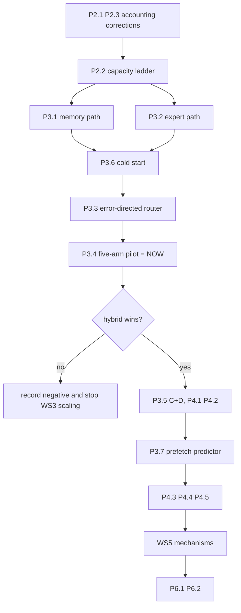

# PROGRAM PLAN — next phase, exhaustive and auditable

Status: **plan of record, pre-registration not yet written.** This document is
the complete TODO for the next program phase. Every item is numbered, and no
item from the strategy review is omitted. An item is only "done" when the
acceptance evidence named in it exists in the repository; a prose claim is not
evidence.

Companion documents: `docs/MANDATE.md` (requirements),
`docs/EXPERIMENT-CONTRACT.md` (registered thresholds; T1 is the current
section), `docs/PRIOR-ART-AND-NOVELTY.md` (what is actually prior art),
`docs/LIMITATIONS.md` (what the measured results do not establish),
`docs/TRAINING.md` (the training instrument as it exists).

## 0. How to read this plan

**Fields.** Each item carries:

- **What** — the deliverable, in checkable terms.
- **Why** — the reason it exists; what fails if it is skipped.
- **Depends** — item IDs that must be done first, or "none".
- **Acceptance evidence** — the exact receipt, court, test or document that
  makes the item done. Where an item changes a measurement, the receipt must
  name revision, command, environment and fixture.
- **Status** — one of `done`, `partial`, `open`, `blocked`, `deferred`.
- **Effort** — engineering sessions (S/M/L/XL) and, where a run is required,
  measured-resource estimate. One session is a focused working session on this
  workstation. Estimates are honest guesses and are not evidence.

**Status at the time of writing (revision at HEAD of `staging`):**

| area | state |
| --- | --- |
| M1 static whole-group omission | measured, **negative** (`results/M1-FRONTIER.md`) |
| M2 per-token post-hoc selection | measured, **negative**; oracle bound outside the usable tier (`results/M2-SELECTORS.md`, `docs/M2-CORRECTION.md`) |
| T1 trained/upcycled arms | pre-registered; infrastructure built; **no training run** |
| Rust crates | `core`, `format`, `convert`, `fixtures`, `atlas`, `store`, `cli` exist; `sim`, `runtime`, `bench` do not |
| Storage baselines | measured cold/warm NVMe and host-RAM baselines (`docs/STORAGE.md`) |
| Memory path, error-directed router, prefetch predictor | **do not exist** |
| Prior-art ledger | exists (`docs/PRIOR-ART-AND-NOVELTY.md`), created in this phase from recorded fetches |

**Number rule.** Measured performance, storage, latency, resource and
verification-count numbers are never written here by hand. Where a measured
quantity matters, this plan names the generated block in `docs/PERF-NUMBERS.md`
or the receipt under `results/`. Derived design counts (parameter arithmetic
over the registered architecture constants) are marked as arithmetic, are
exact integers, and carry a reproduce command; they are not measurements.

---

## 1. WS1 — Strategy and novelty boundaries

### P1.1 — Compete on the joint design, not on sparse routing alone

**What.** State, in the contract and in the README, that the program's
contribution candidate is the *joint* design of (a) learned conditional
capacity, (b) a learned retrieval/memory path, and (c) physical execution under
a strict per-token union budget — and that sparse routing by itself is neither
new nor the claim.

**Why.** Every component in isolation has prior art (see
`docs/PRIOR-ART-AND-NOVELTY.md`). A claim framed around routing would be
refuted by Deja Vu, PowerInfer, SEAP, SparseInfer, MoE-CORE and Prefetch-Steered
Routing on day one.

**Depends.** none.
**Acceptance evidence.** `docs/EXPERIMENT-CONTRACT.md` amendment adding the claim
sentence and the "not a claim" list; `README.md` current-result paragraph that
matches it; a `perf_numbers` court run proving no number was hand-written.
**Status.** open.
**Effort.** S.

### P1.2 — Separate "1B active with a dormant expert bank" from the actual question

**What.** Record the distinction explicitly: a 1B-active model with a large
dormant expert bank is established practice (OLMoE-1B-7B reports roughly 1.3B
active; the "1B" in its name is not a strict-union count). SELVEDGE's question
is different: whether *additional* capacity can be organised so that its
retrieval is predictable under a parameter budget **and** an I/O budget, at a
strictly counted union.

**Why.** Without this distinction the program will be read as re-running
well-known MoE inference, and the review will be right.

**Depends.** P1.3.
**Acceptance evidence.** a paragraph in the contract's "what this is not"
section, with the OLMoE citation and its verified active-parameter number
(`docs/PRIOR-ART-AND-NOVELTY.md`, entry `olmoe`).
**Status.** open.
**Effort.** S.

### P1.3 — Maintain the novelty boundary ledger

**What.** Keep `docs/PRIOR-ART-AND-NOVELTY.md` live. It must name, for each
mechanism the program intends to use, the closest antecedent, the overlapping
features, and what is genuinely uncombined. The boundary list is fixed:

- **Upcycling prior art:** Drop-Upcycling, SIMoE, UpIT, ToOL/ToMoE-style
  conversion, cluster-aware upcycling.
- **Learned/conditional memory prior art:** Memory Layers at Scale, Engram
  (and its derived works), PEER, Monet.
- **Predictive loading / cache-aware routing prior art:** SeqMoE, SpecMD,
  SpecPrefetch, Prefetch-Steered Routing, DoMoE, MoE-CORE, NeuroPrefetcher,
  MoE-Infinity.
- **Activation-sparsity prior art:** Deja Vu, PowerInfer, attribution-based
  sparse activation (2026), SEAP, SparseInfer, R-Sparse, La RoSA, Sirius,
  WINA, SpAx, BlockFFN, SPON.

The only claim permitted is: a **joint trained error-directed system with strict
union accounting** that combines capacity, retrieval and physical execution, at
a measured operating point.

**Why.** The mandate makes this a deliverable, and unverified citations are the
fastest route to an invalid result.

**Depends.** none.
**Acceptance evidence.** the ledger exists, every claim carries a status
(`VERIFIED`/`PARTIAL`/`UNSUPPORTED`/`PROPOSED`), every URL carries a retrieval
date, and `scripts/prior_art_fetch.py` reproduces the fetched bytes into
`results/prior-art/`. Re-run at every milestone advance.
**Status.** partial (ledger created this phase; must be refreshed when WS3/WS4
experiments are pre-registered).
**Effort.** S per refresh, M for a full re-verification.

### P1.4 — Rank the three directions and defer the third

**What.** Adopt this ranking for the phase:

1. **Error-directed memory + expert specialization** (WS3) — first.
2. **Utility-weighted predictive execution** (WS4/WS5.10) — second.
3. **Hierarchical shared-base + delta specialists** (WS5.1, WS5.3) — deferred
   until a trained bank shows a quality win.

**Why.** Direction 3 is a compression/parameter-efficiency play. Its benefit is
conditional on there being a specialist bank whose quality is worth preserving.
Building it first would optimise a bank that may not exist.

**Depends.** P3.4 (the pilot that decides whether a bank is worth preserving).
**Acceptance evidence.** the ranking recorded in the contract with the explicit
deferral condition ("deferred until P3.4 shows a quality win for the trained
bank over the dense control").
**Status.** open.
**Effort.** S.

---

## 2. WS2 — Correct the registered architecture accounting

### P2.1 — Record the Arm B sizing defect: routing is a compute saver, not capacity extraction

**What.** Amend T1.2 to state Arm B's **total accessible** count alongside its
active count, and to draw the consequence: with a 596,049,920-element core and
8 specialists per layer at 1,572,864 elements each, the whole bank is
352,321,536 and the whole model is 948,600,832 — already under the 1e9 ceiling.
Arm B therefore does not extract capacity from beyond the ceiling at all; it
trades *compute* for quality at equal total size. That is a legitimate
experiment, but it is not the capacity-extraction experiment the program
eventually needs.

**Why.** Without this, a reader will read Arm B as evidence about dormant
capacity, which it structurally cannot be. The arithmetic is already encoded in
`oracle/train/arms.py` (`DESIGN_TOTAL_ACCESSIBLE["B"]`), but the contract's
T1.2 never states it.

**Depends.** none (arithmetic verified in §2.6 below).
**Acceptance evidence.** contract amendment (next free letter) containing the
total-accessible formula and the "compute saver" sentence; `scripts/train-admission.sh`
receipt for Arm B whose emitted record carries `total_accessible` below the
ceiling; the `rust` court at that revision.
**Status.** open (arithmetic verified; amendment not written).
**Effort.** S.

### P2.2 — Capacity-scaling ladder with a genuinely oversized bank

**What.** Register a ladder of specialist counts per layer at width 512 and
`k = 4` selected, at 8 / 16 / 64 / 256 specialists, and record for each the
total accessible parameters, the active union and the BF16 weight footprint.
Verify every figure from the actual architecture constants and router sizes
(exact values in §2.6). State the BF16 footprint at the top rung.

**Why.** The ladder is the experiment that distinguishes "routing saves
compute" from "capacity beyond the ceiling helps". At 8 specialists the whole
model is under the ceiling and the bank alone is only a third of it; the total
first exceeds the ceiling at 16, and the bank alone first exceeds it at 64.
Without the ladder, a null result at 8 specialists would be misread as a null
result about dormant capacity.

**Depends.** P2.1.
**Acceptance evidence.** contract amendment with the ladder table; a CPU test
that recomputes each rung from `results/accounting/*-qwen3-0.6b.json` and
`arms.py` constants and fails closed on any mismatch; an admission record per
rung produced by `selvedge admit` (the ledger is the source of truth, not
Python).
**Status.** open (arithmetic verified; test and admission records not written).
**Effort.** M.

### P2.3 — Correct Arm A adapter counting and re-verify the active union with the Rust ledger

**What.** Re-verify Arm A end to end. The adapter is a low-rank factorisation
over the 384-wide group activation, `r*(384+384)` elements per selected group —
not `r*(384+2048)`. The first committed text had the latter. Recompute A's
active union with the Rust `ParameterLedger` and record the admission receipt.

**Why.** The difference is load-bearing, not cosmetic: the wrong form adds
7,454,720 unique elements and puts A at 1,005,724,672, i.e. **over** the
ceiling. A review flagged the inconsistency; the contract's A5 corrects it, but
the corrected form has not been re-admitted by the Rust ledger at the current
revision.

**Depends.** none.
**Acceptance evidence.** `selvedge admit` record for A and A0 at HEAD with
`active_unique_params` equal to the design count; a guard test that the
`r*(384+2048)` variant is **rejected** by the ledger (proving the guard works,
not merely that the good case passes); the `rust` court receipt.
**Status.** partial (contract corrected in A5; ledger re-admission not recorded).
**Effort.** S.

### P2.4 — Verify the teacher-target approximation against a full-distribution teacher, and add a hard-label control

**What.** Measure whether the T1 objective (top-16 support + one tail bucket,
`docs/TRAINING.md` §2) ranks arms the same way as the full-vocabulary
cross-entropy from a live teacher. Then register a **hard-label control arm**
(teacher argmax, or the true next token) trained identically, to separate "the
compact target is adequate" from "distillation itself is doing the work".

**Why.** Every T1 comparison uses the compact target. If the ranking it induces
differs from the full target's, the T1 conclusion is about the instrument, not
the architecture. The tail bucket is lossy for the teacher by construction; the
question is whether the loss matters for the comparison.

**Depends.** P2.2 (the arms being ranked), P3.5 phase A/B (the trained models
whose ranking is compared).
**Acceptance evidence.** a receipt comparing, on a held-out sample, the compact
target loss and the full-distribution CE for the same student checkpoints, with
rank correlation and paired differences; contract amendment adding the
hard-label arm with its own pre-registered threshold; the `oracle` court that
runs the comparison twice (two seeds) so a single run cannot decide it.
**Status.** open.
**Effort.** L (requires trained checkpoints).

### 2.6 Derived design counts (arithmetic, not measurement)

Constants are the registered receipts' unique counts (T1.1): Qwen3-0.6B core
`596,049,920`; hidden `1024`; 28 layers; specialist width `512`; `k = 4`.
One specialist is `3 × 512 × 1024 = 1,572,864` elements. One router is
`1024 × s` elements per layer.

| specialists/layer `s` | bank elements (28·s·1,572,864) | router elements (28·1024·s) | total accessible | active (core + 28·4·per + routers) | BF16 bytes (2 × total) |
| ---: | ---: | ---: | ---: | ---: | ---: |
| 8 | 352,321,536 | 229,376 | 948,600,832 | 772,440,064 | 1,897,201,664 |
| 16 | 704,643,072 | 458,752 | 1,301,151,744 | 772,669,440 | 2,602,303,488 |
| 64 | 2,818,572,288 | 1,835,008 | 3,416,457,216 | 774,045,696 | 6,832,914,432 |
| 256 | 11,274,289,152 | 7,340,032 | 11,877,679,104 | 779,550,720 | 23,755,358,208 |

Reading:

- At 8 specialists the **total** is under the ceiling, so the bank is not
  capacity beyond the ceiling. This is P2.1.
- From 16 upward the total exceeds the ceiling while the active union stays
  essentially flat (only the router term moves), which is the capacity question
  the program actually wants to ask.
- The top rung's BF16 footprint is `23,755,358,208` bytes = 22.12 GiB. The
  strategy note's "~23.7 GB" and "11.872B" are rounded differently; the exact
  values here include the routers and should replace them.
- Arm A's arithmetic is `663,610,368 + 28·5·2,359,296 + 28·5·2·32·384 +
  28·2048·16 = 998,269,952` (adapters `3,440,640`, routers `917,504`). The
  rejected `r*(384+2048)` form gives `1,005,724,672`, over the ceiling. This is
  P2.3.

Reproduce (pure integer arithmetic, no model access):

```bash
python3 - <<'PY'
core, h, layers, w, k = 596_049_920, 1024, 28, 512, 4
per = 3 * w * h
for s in (8, 16, 64, 256):
    bank, routers = layers * s * per, layers * h * s
    total = core + bank + routers
    active = core + layers * k * per + routers
    print(s, bank, routers, total, active, 2 * total)
PY
```

---

## 3. WS3 — Error-directed capacity architecture (first experimental matrix)

### P3.1 — Memory path with deterministic hashed addressing

**What.** Implement a learned memory path that:

- addresses deterministically by hashing the **token prefix** (n-gram keys);
  there is no scan of a large key table per token;
- stores 256-dimensional values;
- has `2^18` to `2^20` rows;
- is inserted at a small number of layers, not all 28;
- performs 2–4 reads per token;
- charges the active union as **only the retrieved value rows plus the index
  parameters actually evaluated** — never the whole table;
- records resident bytes even when the table is resident, and bytes read when
  it is not.

**Why.** The memory path is the cheapest test of "capacity that is not
procedural computation". It must be physically honest: a table scan would blow
the union budget while looking cheap in a logical count (the M2 defect class).

**Depends.** P1.3 (Engram/Memory Layers/PEER/Monet boundaries), P2.3 (ledger
admission path).
**Acceptance evidence.** a Rust ledger test proving the union for a memory read
is `rows_read × 256 + evaluated index elements`; a leakage test proving the key
is a function of the prefix only; a receipt recording resident bytes and read
bytes separately; `rust` + `oracle` courts.
**Status.** open (no memory module exists).
**Effort.** L.

### P3.2 — Expert path: conditional residual specialists that do not duplicate memory or backbone

**What.** Implement the specialist bank as conditional residual
transformations selected by a small router. Add an explicit **non-duplication
audit**: (a) no specialist may subsume the dense backbone FFN's function at
init (zero-init parity), (b) no specialist may be a copy of a memory row set,
(c) each specialist must show measurable residual-correction behaviour on held
out data rather than reproducing the backbone output.

**Why.** A bank that learns to imitate the backbone or the memory is capacity
that does nothing. The audit turns "experts specialised" into a falsifiable
measurement.

**Depends.** P3.1 (to measure memory/expert complementarity), P3.6.
**Acceptance evidence.** a complementarity report: per-specialist residual
correlation with the backbone output, cosine similarity of specialist updates
to zero, and a memory-vs-expert ablation at matched budget; the audit runs on a
trained checkpoint, not at init.
**Status.** open (the `SpecialistBank` module exists; the audit does not).
**Effort.** M after P3.6.

### P3.3 — Error-directed training: utility target and pre-execution prediction

**What.** Define the utility target

`u_e(x) = L(without e) − L(with e)`

measured **on calibration text only**, with real labels and real interventions.
Train the router to predict the **pre-execution incremental benefit** of each
candidate. Then run the decisive comparison against magnitude/probability
routing at the same budget.

**Why.** This is the program's central scientific bet (P1.4 direction 1). M2
showed a post-hoc magnitude statistic fails for *omission*; that does not answer
whether a trained router can predict the *incremental benefit* of *added*
capacity. If it cannot beat magnitude, the error-directed idea is dead and the
program should say so.

**Depends.** P3.2, P3.5 phase B.
**Acceptance evidence.** a pre-registered contract for the comparison; a receipt
with paired bootstrap CIs; a **leakage test** that the router's features are
computable before the expert executes (no future layer state, no teacher logit,
no gold token); the `oracle` court.
**Status.** open.
**Effort.** XL (training) + M (instrument).

### P3.4 — First matrix: five arms, one backbone, one data order, one compute budget

**What.** Run: **dense control**, **memory-only**, **expert-only**, **naive
hybrid**, **error-directed hybrid**. Same backbone, same data order, same
training compute. Scale the bank **only if** the error-directed hybrid wins.

**Why.** The matrix is the minimum that can attribute a win to *error
direction* rather than to *more parameters* or *more modules*. The gating rule
prevents the program from scaling a design that has not earned it.

**Depends.** P3.1, P3.2, P3.3, P2.4 (instrument check), P6.5 (pre-registration).
**Acceptance evidence.** a receipt per arm with token count, step count, loss
curve, held-out metrics, active union and bytes/token; a pre-registration
commit before the first step; K-style kill record if the hybrid does not win.
**Status.** **this is the NOW experiment** at pilot scale (§8).
**Effort.** XL.

### P3.5 — Training-recipe phases A–D

**What.** Register and run four phases in order:

- **A. Memory residual.** Memory path versus a parameter-matched dense adapter
  versus a learned-memory baseline (Memory Layers-style).
- **B. Specialists on residual errors.** Real labels + distillation + sampled
  counterfactual utility.
- **C. Complementarity.** memory-only vs expert-only vs both vs dense control at
  matched training compute.
- **D. Dormant capacity beyond GPU memory.** Quality, utilisation long tail,
  cold bytes/token, p95 latency.

**Why.** Each phase isolates one claim. Phase D is the only one that tests the
program's physical premise, and it is worthless before C shows a quality reason
to keep the bank.

**Depends.** A: P3.1. B: P3.2. C: A+B. D: C + WS4.
**Acceptance evidence.** one pre-registration per phase; per-phase receipts;
phase C's matched-compute table with CIs; phase D's long-tail utilisation
histogram and cold-bytes distribution.
**Status.** open.
**Effort.** XL total.

### P3.6 — Cold-start handling: warm-up/diversity initialisation, measured specialisation

**What.** Zero-init parity remains required. Add and compare specialist warm-up
initialisations: (i) random, (ii) dense-weight-derived, (iii) semantic-cluster
initialisation (cluster centroids as router init, SVD subspaces as expert init —
the mechanism Cluster-Aware Upcycling reports). Measure specialisation
explicitly (routing entropy, expert-usage Gini, per-expert residual error).
**Do not assume that more tokens fixes the cold start.**

**Why.** All-identical expert initialisation plus a random router produces
expert symmetry; the prior art says so and proposes a fix. The program must
test that fix rather than rediscover the failure.

**Depends.** P3.2.
**Acceptance evidence.** a receipt comparing the three initialisations at
matched compute with (a) the specialisation metrics above, (b) held-out quality,
(c) routing entropy over training; a kill note if more tokens does not close a
persistent symmetry gap.
**Status.** open.
**Effort.** M + training.

### P3.7 — Predictability without forcing reuse: a separate prefetch predictor

**What.** Add an auxiliary prefetch predictor that is **separate from the
router**. The router decides what executes; the predictor only decides what to
load. A prefetch miss causes a **stall**, never a different result. There is no
router-stickiness penalty: do not bias routing toward resident experts.

Record the 2026 negative result as prior evidence: a stickiness-style scheme cut
misses by roughly 60% but failed the 1%-PPL preservation test, so the trade was
rejected.

**Why.** Cache-aware routing changes the deployed model's semantics
(documented by Prefetch-Steered Routing) and the separate-predictor design is
already published (SpecPrefetch: a shared lightweight adapter predicts
next-layer candidates while the frozen native router decides execution). The
honest claim is therefore *not* "predictive loading"; it is that the predictor
is scored inside the same union/bytes budget as the selector, and that a miss is
provably semantics-preserving.

**Depends.** P4.2 (a tier to prefetch from), P3.4.
**Acceptance evidence.** an exact-mode parity court (Court E) proving output
equality under prefetch on/off and under injected transfer delay; a receipt with
miss rate, exposed stall p50/p95, and prefetch-wasted bytes; the negative
result recorded with its receipt.
**Status.** open.
**Effort.** L.

---

## 4. WS4 — Physical bottleneck and placement

### P4.1 — Record the bytes-per-token budget as a design constraint

**What.** Compute the ceiling on bytes/token from **measured** cold throughput
and a stated decode rate, and record it as a constraint: at the cold no-cache
device rate in `docs/STORAGE.md` (`storage-17b-none-cold`) and a target of 20
tokens/s, the ceiling is `rate / 20` MiB/token. Arm B's four selected experts
per layer are 336 MiB in BF16 per token. Naive fetch is therefore impossible,
not merely slow.

**Why.** This is the number that decides the architecture. If the active set
cannot be fetched in the decode interval, the design must be about residency,
compression or recomputation — not about routing cleverness.

**Depends.** none (measured storage baselines already exist).
**Acceptance evidence.** a section in the contract that references the generated
block, states 20 tok/s as a **design target supplied by the operator, not a
measurement**, and derives the MiB/token ceiling; a test that fails if the Arm B
per-token expert bytes exceed the derived ceiling (so the constraint cannot
silently stop binding).
**Status.** open.
**Effort.** S.

### P4.2 — Three-tier progression: VRAM → host RAM → selective NVMe

**What.** Register and execute the progression: (1) bank fits in VRAM; (2) bank
exceeds VRAM but fits host RAM; (3) bank requires selective NVMe. **Isolate
quality, then placement, then offload** — do not confound them.

**Why.** Tier 1 measures the neural question with no I/O noise. Tier 3 measures
the systems question. Comparing a tier-3 system against a tier-1 baseline
measures the tier, not the architecture.

**Depends.** P3.4 (a bank worth placing).
**Acceptance evidence.** three receipts with the same checkpoint, one per tier,
reporting quality and physical cost; a placement-only ablation (same quality,
different tier); the `io` court for the NVMe tier.
**Status.** open.
**Effort.** XL.

### P4.3 — Three-way per-group decision: full precision / compressed approximation / omit

**What.** For each candidate group, choose among (a) full-precision execution,
(b) a compressed approximation, (c) omission. Assign the tier by **predicted
error contribution**, not by magnitude alone.

**Why.** The three-way decision is a known mechanism: SpAx (arXiv 2610.02598)
replaces the binary read/skip choice with exactly "fully retain, approximate,
omit" for offloaded weights. The program can still test *predicted-error-based
tier assignment* against magnitude, but it must not present the three-way choice
as new.

**Depends.** P4.2, P3.3 (an error predictor).
**Acceptance evidence.** a receipt comparing magnitude-assigned tiers against
predicted-error-assigned tiers at matched bytes; a calibration curve for the
error predictor; an explicit overlap statement in the ledger.
**Status.** open.
**Effort.** L.

### P4.4 — Weight-traffic equivalence reporting

**What.** Every quality comparison must report **unique parameters**, **bytes
per token** (including selector, router and prefetch bytes) and an **equivalent
bit-width** alongside accuracy.

**Why.** A quality win at 4× the traffic is not a win. Equivalent bit-width
makes a dense BF16 baseline and a sparse mixed-precision system comparable on
one axis.

**Depends.** P2.3 (the union ledger), P3.7 (prefetch bytes).
**Acceptance evidence.** a receipt schema requiring the three fields; a
generated table in the plan/results with the fields for every arm; a test that
refuses a comparison row missing any of them.
**Status.** partial (M1/M2 report active counts and bytes; equivalent bit-width
is not in the schema).
**Effort.** M.

### P4.5 — Do not use sparse fragmentation when a resident contiguous approximation plus sparse correction is cheaper

**What.** Test the inversion: compare (a) fetching sparse fragmented exact
groups against (b) keeping a resident contiguous low-rank approximation and
applying a sparse correction. If (b) is cheaper in bytes or latency at equal
quality, adopt it.

**Why.** Fragmented reads pay alignment and queue-depth costs that a contiguous
resident approximation does not (the measured over-read amplification in
`docs/STORAGE.md` is the evidence that this matters). The strategy note asserts
the inversion; it must be measured, not assumed.

**Depends.** P4.2, P5.1 (the approximation).
**Acceptance evidence.** a measured bytes/latency comparison at matched quality,
with the `io` court and p50/p95 reported.
**Status.** open.
**Effort.** L.

---

## 5. WS5 — Inverted and combined mechanisms

Each item below is literature-derived and **requires verification before
adoption**. Statuses reference `docs/PRIOR-ART-AND-NOVELTY.md`; where the named
work could not be verified, the item says so and the mechanism is treated as
`PROPOSED`, not prior art.

### P5.1 — Resident dense low-rank approximation + sparse exact delta

**What.** Represent `W = W_lowrank + Δ_sparse`, score columns by
`|x| · ||W_col − Q(W_col)||`, and measure bytes saved at equal PPL. **Kill if**
bytes are reduced by less than 15% at equal PPL on 2 of 3 models.

**Why.** This is the cheapest way to keep a contiguous resident base while
sending only corrections over the bus.

**Depends.** P4.5, P1.4 direction 3 (deferred until a trained bank wins).
**Acceptance evidence.** a receipt with per-model bytes and PPL at the fixed
threshold; the kill decision recorded even if negative.
**Status.** proposed / deferred.
**Effort.** L.

### P5.2 — Chunk-tiered tiering (chunk union decides fetch)

**What.** Make the fetch unit a **chunk union** over consecutive tokens rather
than a per-token set, and measure whether chunk-level PPL degrades faster than
per-token PPL. **Kill if** it does.

**Why.** BlockFFN shows that token-level sparsity has poor chunk-level sparsity,
i.e. the union over consecutive tokens activates a large fraction. That is a
direct threat to per-token fetch plans and a possible argument for chunk
tiering. Whether the quality cost is acceptable is the open question.

**Depends.** P4.2.
**Acceptance evidence.** a receipt with chunk sizes {2,4,8,16}, chunk-PPL vs
per-token-PPL, and bytes/token per chunk size; the `io` court for the fetch
side.
**Status.** proposed.
**Effort.** L.

### P5.3 — Rotated shared-base delta experts

**What.** Combine three verified mechanisms: an orthogonal rotation of
activations (La RoSA), cluster-aware initialisation (Cluster-Aware Upcycling),
and shared-base-plus-delta experts (DeRS). **Kill if** the rotation *raises*
inter-expert similarity (measured by pairwise delta cosine), since the rotation
would then be destroying specialisation rather than enabling it.

**Why.** Each component exists; the combination is the candidate. The kill
criterion is the one that detects the failure mode the combination invites.

**Depends.** P3.6 (initialisation), P5.1 (delta representation).
**Acceptance evidence.** an inter-expert similarity matrix before/after
rotation, plus quality and bytes at matched budget.
**Status.** proposed.
**Effort.** L.

### P5.4 — Adaptive dense correction triggered by delta mass

**What.** Trigger a dense correction pass when the sparse delta's mass exceeds a
threshold. Build it **only if** delta mass correlates with sparse error at
Spearman `≥ 0.5` on held-out data; **kill below 0.3**.

**Why.** Without the correlation, the trigger is an uninformative heuristic and
the correction pass is wasted compute.

**Depends.** P5.1.
**Acceptance evidence.** a held-out correlation receipt with CI; the build/kill
decision recorded.
**Status.** proposed.
**Effort.** M.

### P5.5 — WINA / quantisation-error tiering

**What.** Test whether activation-magnitude-based selection already proxies for
quantisation error (WINA argues magnitude alone is a poor criterion). If
magnitude does proxy it, tier assignment can stay cheap; if not, use the
measured quantisation error.

**Why.** Cheapest possible version of P4.3's "predicted error, not magnitude"
requirement, and it can falsify the requirement.

**Depends.** P4.3.
**Acceptance evidence.** a receipt correlating magnitude with measured
quantisation error per group, and the resulting tier-assignment quality at
matched bytes.
**Status.** proposed.
**Effort.** M.

### P5.6 — Native gate as router under the union budget, with low-parameter gating

**What.** Train the native SwiGLU gate as the top-k router (SGA-Sparse) and
compare against a learned low-parameter gate (Model Casting / LoPA Gating), all
under the strict union budget. Measure whether this **removes selector cost**
entirely (no separate router parameters or reads).

**Why.** A selector that costs nothing is worth more than a better selector that
costs 5% of the budget. SGA-Sparse also shows the gate/up ordering *reverses*
after sparsity-aware training, which invalidates training-free routing
comparisons.

**Depends.** P2.3 (the ledger must be able to express "gate is both selector and
execution").
**Acceptance evidence.** a receipt with selector elements = 0 for the
native-gate arm, quality at matched active budget, and a leakage/ordering test.
**Status.** proposed.
**Effort.** L.

### P5.7 — Sequence-level budget allocation with per-output-token union accounting

**What.** Allocate the expert budget across a sequence (SeqTopK-style) instead
of per token, but account the union **per output token** as the contract
requires. Compare against per-token top-k at the same sequence budget.

**Why.** Sequence-level allocation is verified prior art (SeqTopK reports under
1% overhead and consistent gains). The open question for SELVEDGE is whether it
survives the strict per-token union rule, which sequence-level schemes can
violate at the worst token.

**Depends.** P3.4.
**Acceptance evidence.** a receipt reporting both the sequence-average and the
**worst per-token** union, with a compliance verdict per token (not just per
sequence).
**Status.** proposed.
**Effort.** M.

### P5.8 — Sequence-level masked-expert bank plus adaptive depth

**What.** Combine a masked-expert bank over frozen weights (MASKerade-style:
experts are learned sparse subnetworks of a frozen FFN, selected per token) with
adaptive recursive depth (Mixture-of-Recursions-style) and recursion-wise KV
caching. Use a staged curriculum.

**Why.** Both halves are verified prior art. The combination is attractive
because masks are cheap to store and depth is a second, orthogonal budget knob.
The risk is that masked subnetworks still read the full frozen tensor unless the
runtime slices them — so the union accounting must be checked, not assumed.

**Depends.** P4.2, P3.2.
**Acceptance evidence.** a receipt proving the masked execution reads only
selected elements (profiler cross-check, as in `docs/M2-CORRECTION.md` §5), plus
quality at matched depth/budget; a curriculum table.
**Status.** proposed.
**Effort.** XL.

### P5.9 — Cheap interaction signals

**What.** Implement and compare four low-cost interaction mechanisms:
(a) low-rank **pairwise** interaction scores (the "HOPE-style" idea — note:
`HOPE` could not be verified as a paper with this mechanism, so treat it as
`PROPOSED`); (b) online geometric centroids; (c) tree-structured routing;
(d) spontaneous/resting anchor vectors (SPON, verified: input-independent
learnable vectors trained by distribution matching).

**Why.** M2 found the pairwise interaction term is context-dependent and not
predicted by the tested graph features, using a linear bilinear surrogate. The
cheap mechanisms here are the plausible next step — but only SPON has a verified
source.

**Depends.** P3.3.
**Acceptance evidence.** a head-to-head receipt at matched selector cost, with
the M2 interaction finding cited as the baseline to beat.
**Status.** proposed.
**Effort.** L.

### P5.10 — Oracle-in-the-loop training

**What.** Use the offline budgeted oracle (the M2 `offline oracle` instrument,
labelled causally unavailable and non-deployable) to label optimal group sets on
training text, then distill a cheap **causal** selector from those labels.
Compare the distilled selector against the oracle's own bound to measure the
distillation gap.

**Why.** M2 established the oracle bound is outside the usable tier for
*omission*. The open question is whether an oracle over *added capacity* has a
bound worth distilling. If the bound is poor, no selector can help and the
program should stop early.

**Depends.** P3.3, P3.4.
**Acceptance evidence.** a receipt with the oracle bound, the distilled selector,
the gap and its CI; leakage test proving the student sees only pre-decision
features.
**Status.** proposed.
**Effort.** L.

### P5.11 — Recurrent latent computation as a separate later axis

**What.** Keep recurrent latent computation as a distinct axis with **no
guaranteed benefit**. If pursued, it needs its own hypothesis, baseline and kill
criterion, plus the critical recurrent analysis as prior evidence.

**Why.** Huginn reports gains from latent recurrence; the critical analysis
finds limited evidence of interpretable latent chain-of-thought and significant
problems. The program must not present recurrence as a free win.

**Depends.** nothing; explicitly after WS3/WS4.
**Acceptance evidence.** its own pre-registration if and when started; until
then, this item is a placeholder that prevents the idea from being smuggled in
as an assumption.
**Status.** deferred.
**Effort.** unknown by design.

---

## 6. WS6 — Success criteria and honest evaluation

### P6.1 — Neural-capacity advantage

**What.** Pre-register a primary capability composite and require a **3–5%
relative** improvement over the strongest matched baseline, with paired CIs and
no major domain regression. The baseline set is: dense control, dense distilled
control, conventional MoE, memory-only, memory+MoE.

**Why.** A win against a weak baseline is not a win. The dense distilled control
is the one that separates "conditional computation" from "distillation".

**Depends.** P3.4, P3.5.
**Acceptance evidence.** the pre-registration (thresholds fixed before
measurement); the evaluation receipt with per-domain results and paired CIs;
`lm-evaluation-harness` integration or a documented reason it cannot be used.
**Status.** open.
**Effort.** L.

### P6.2 — Physical-execution advantage

**What.** Report the end-to-end frontier against strong offloading baselines at
the **same GPU memory**: quality/latency Pareto, TPS, TTFT, p50/p95/p99, cold
bytes/token, PCIe bytes, residency, and energy if measurable.

**Why.** The mandate's success condition includes a physical win; a quality-only
result is a different (weaker) claim.

**Depends.** P4.2, P3.7.
**Acceptance evidence.** an `io`/bench receipt per configuration with all fields
above; paired interleaved A/B schedule, not a single run.
**Status.** open.
**Effort.** XL.

### P6.3 — Every comparison reports quality, bytes/token and wall-clock

**What.** Enforce the reporting triple in the receipt schema. **FLOPs alone is
not a result.**

**Why.** FLOPs are an arithmetic estimate; bytes and wall-clock are what the
deployment pays.

**Depends.** P4.4.
**Acceptance evidence.** schema validation that rejects a row missing any of the
three; a regenerated table for all existing arms showing the triple.
**Status.** partial (M1/M2 report active counts, FLOPs and some timings; the
schema does not enforce the triple).
**Effort.** M.

### P6.4 — Keep the Rust core/Atlas/converter/format/store; add a trainable one-pass model with an independently measured active union

**What.** Do not replace the existing Rust components. Add the trainable
one-pass model alongside them, and measure its active union **independently**
(the Rust ledger plus a profiler cross-check), not from the model's own
bookkeeping.

**Why.** The M1/M2 correction exists because a model's own count was wrong. The
independence is the safeguard.

**Depends.** P2.3.
**Acceptance evidence.** a profiler cross-check receipt in the style of
`results/selectors/sparse-audit-*.json` for the trained model, plus the ledger
admission record per arm.
**Status.** partial (the crates exist and are retained; the trained model does
not exist).
**Effort.** L.

### P6.5 — Pre-register before each run; keep negative results; no post-hoc thresholds

**What.** One pre-registration commit per training/eval run, before the first
step. Failed and negative runs are retained with their receipts. Thresholds are
never moved after seeing results; a change requires a dated amendment that says
it was made without knowledge of the outcome, or the result is reclassified as
exploratory.

**Why.** This is the only defence against the failure mode the M2 correction
documents: a number that looked fine until the instrument was audited.

**Depends.** none.
**Acceptance evidence.** the pre-registration commit ids referenced in every
result doc; a negative-results register; the `perf_numbers` court failing on a
hand-written measured number.
**Status.** partial (M1/M2/T1 followed this; it must continue).
**Effort.** S per run.

---

## 7. Sequencing



Hard order:

1. **P2.x** — accounting must be right before anything is measured.
2. **P3.1/P3.2/P3.6** — the capacity modules and their initialisation.
3. **P3.3/P3.4** — the pilot. Nothing in WS5 starts until this reports.
4. **WS4** — placement, only for a bank that P3.4 justified.
5. **WS5** — each mechanism gated by its own kill criterion.
6. **P6.x** — the evaluation regime runs throughout; P6.5 gates every run.

## 8. NOW — the single next experiment

**Run the five-arm pilot of P3.4 (B-like experts vs parameter-matched dense
adapter, with memory-only, naive hybrid and error-directed hybrid), at the
smallest pre-registered token budget that can distinguish them, immediately
after the P2.4 teacher-target instrument check on a held-out sample.**

Why this one, and not something cheaper:

- The M2 negative result already closed the *post-hoc inference-only* branch.
  The remaining decisive question is whether **trained conditional capacity**
  beats **dense capacity at the same active parameters, data order and compute**.
  That is a single comparison with a pre-registered decision rule, and every
  later workstream (placement, prefetch, delta compression, recurrent depth)
  spends real resources on the assumption that it can succeed.
- It is the only experiment whose outcome changes the program's direction. A
  null result retires WS3, WS4's tier-2/3 work and most of WS5; a positive
  result justifies the ladder (P2.2), the tiers (P4.2) and the mechanism matrix
  (WS5).
- The instrument check (P2.4) is folded in because a target-function artefact
  would invalidate the pilot. It costs hours, not a training campaign, and it
  must pass before the pilot's first step.

Minimum pilot requirements (otherwise the result is not interpretable): one
backbone, one data order, matched tokens and matched FLOPs, an admission record
per arm, a pre-registration commit, and paired CIs on the primary metric. If the
error-directed hybrid does not beat the dense control, record the negative
result and do not scale the bank.

## 9. Explicitly out of scope for this phase

- No claim of a Pareto win over any external system until P6.2 has receipts.
- No capacity-ladder run above 16 specialists until the pilot justifies it.
- No new storage format, no new quantisation codec, no custom CUDA kernel
  (the mandate's rule: profile first).
- No recurrent-depth work (P5.11) without its own pre-registration.
- No revision of any M1/M2 measured number. They stand as recorded, including
  the corrections of record.
