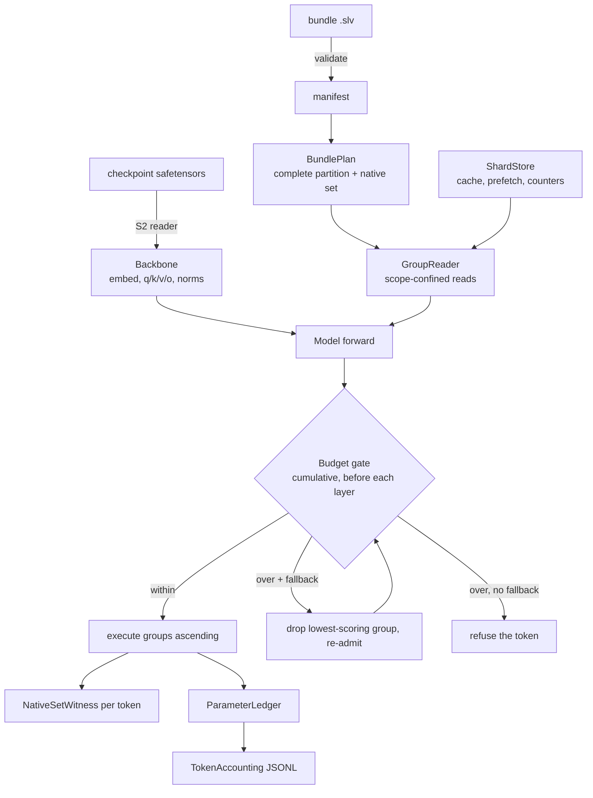

# RUNTIME — single-device Qwen3 with bundle-backed MLP groups (M4 part 1)

Status: **implemented and measured on CPU** for the pinned Qwen3-0.6B control.
The GPU path (part 2) is not implemented and no GPU number is claimed anywhere in
this document. Numbers inside `BEGIN GENERATED` / `END GENERATED` sentinels come
from `scripts/perf_numbers.py`; every one of them names the receipt it came from
in `docs/perf-numbers.json`.

## 1. What is proven, and what is not

Proven by the courts in this revision:

1. **The forward pass is Qwen3.** `crates/selvedge-runtime/tests/tiny_parity.rs`
   compares the Rust forward (including two greedy continuation steps, so the
   key/value cache is exercised) against an independent NumPy implementation of
   the published equations on a committed tiny checkpoint. The court asserts an
   elementwise tolerance of `abs = rel = 1e-4` and additionally asserts that the
   observed maxima stay below `1e-5` absolute, so a regression fails with a number
   rather than a threshold argument. The observed maxima are printed by the test
   (`cargo test -p selvedge-runtime --test tiny_parity -- --nocapture`).
2. **Exact mode executes the declared native set, per token.** Each token's
   executed shard set is compared element for element with the native set the
   validated manifest declares, and a mismatch is a failed run, not a weaker
   claim (`ModeState::classify_token`).
3. **Streaming cannot change the answer.** `tests/court_e.rs` runs twelve
   variants that differ only in cache capacity, cache policy, prefetch, fetch
   order, injected device delay and kernel thread count, and requires bitwise
   identical logits at every token. The same claim is repeated on the real
   checkpoint by `scripts/runtime-courts.sh court-e`.
4. **The real checkpoint matches the NumPy reference** on a five-token prompt,
   within the pre-registered tolerance, with the argmax agreeing at every
   position. Largest absolute logit difference from the reference:

<!-- BEGIN GENERATED: runtime-parity-max-abs -->
max |reference - observed| = 0.0001354217529296875
<!-- END GENERATED: runtime-parity-max-abs -->

   Argmax agreement:

<!-- BEGIN GENERATED: runtime-parity-top1 -->
5 of 5 prefill positions agree on the argmax
<!-- END GENERATED: runtime-parity-top1 -->

5. **Every executed token is inside the ceiling and accounted.** The budget gate
   is called before execution, cumulatively, and each token's
   `TokenAccounting` is written to JSONL. Exact mode on this checkpoint uses this
   many active unique parameters:

<!-- BEGIN GENERATED: runtime-active-unique-max -->
596049920 active unique parameters
<!-- END GENERATED: runtime-active-unique-max -->

   out of this many accessible learned parameters:

<!-- BEGIN GENERATED: runtime-total-accessible -->
596049920 accessible parameters
<!-- END GENERATED: runtime-total-accessible -->


**Not proven, and stated rather than implied:**

- The *declaration* that the bundle's shard set is the model's native MLP is a
  **trust input**. The witness proves the executed set equals the declared set,
  not that the declaration is honest. It is derived from the validated manifest
  (bundle id, roles, layers, channel sets, shapes) and it is checked against the
  checkpoint's `intermediate_size`, but a manifest that declared a wrong
  partition would still produce a "proven" record. This is the same residual
  trust boundary recorded in `docs/ARCHITECTURE.md`.
- Bitwise identity is claimed **within one build** for logits produced by this
  runtime under different streaming configurations. It is not claimed against
  NumPy, against PyTorch, or across CPU models: the reduction orders differ.
- No quality claim is made for approximate mode. The selector is a documented
  **control** selector with no learned parameters; its purpose is to exercise
  the approximate path, the gate and the two verdicts, not to be a good router.
- No GPU speed, no GPU memory figure, and no comparison against an offloading
  runtime is claimed. Those are part 2.

## 2. Backend decision

**Decision: a minimal in-repo f32 kernel backend, and `tokenizers` pinned for the
tokenizer only.** Candle was evaluated and rejected for this phase.

Measured, in the rust court, from
`results/runtime/backend-decision-20261116T012956Z.json` (which transcribes the
two court logs named in it):

`candle-core` + `candle-nn` 0.11.1 with CPU features, measured in the rust court:

<!-- BEGIN GENERATED: backend-candle-dependency-edges -->
159 dependency edges
<!-- END GENERATED: backend-candle-dependency-edges -->
<!-- BEGIN GENERATED: backend-candle-build-seconds -->
25.7 s cold build
<!-- END GENERATED: backend-candle-build-seconds -->
<!-- BEGIN GENERATED: backend-candle-peak-rss-bytes -->
1970229248 bytes peak RSS
<!-- END GENERATED: backend-candle-peak-rss-bytes -->

`tokenizers` 0.23.2 with `default-features = false, features = ["onig"]`, measured
the same way:

<!-- BEGIN GENERATED: backend-tokenizers-dependency-packages -->
93 dependency packages
<!-- END GENERATED: backend-tokenizers-dependency-packages -->
<!-- BEGIN GENERATED: backend-tokenizers-build-seconds -->
12.94 s cold build
<!-- END GENERATED: backend-tokenizers-build-seconds -->

In-repo kernels: zero dependencies added, no `unsafe`.

Reasons, in order of weight:

1. **The parity claim is bitwise, so the reduction order has to be ours.** Court E
   requires identical bits under different cache policies and thread counts. The
   kernels here reduce each dot product over `k` with eight interleaved f32
   accumulators and parallelise **rows only**, so an output element's bits cannot
   depend on how many threads ran or in what order rows were visited. With a
   tensor library that property would be an inference about someone else's
   kernels rather than a stated, tested property of ours.
2. **`unsafe` and allocation shape.** The workspace forbids `unsafe` in our code
   and the OOM discipline requires allocations we size and account for. Candle
   brings its own `unsafe`, an internal allocator and mmap-backed loading; both
   would sit underneath the exactness claim without being auditable here.
3. **Op coverage.** Seven operations are needed: matrix-vector product, RMSNorm,
   RoPE, softmax, SwiGLU, residual add, argmax. That is the whole backend.
4. **Build weight.** The measured cost above buys breadth this phase does not
   use.

`tokenizers` stays a dependency because the tokenizer must be the same engine the
teacher uses; the pinned version with the vendored Oniguruma engine is exactly
that, and it reproduces the teacher's ids (asserted in
`tests/tiny_parity.rs::tokenizer_round_trips_the_pinned_vocabulary`).

A CUDA backend is added in part 2 behind the same `MlpExecutor` seam (see §4), so
the model code does not change when the device does.

## 3. Crates and data flow

`selvedge-runtime` depends on `selvedge-core` (contracts, ledger, gate),
`selvedge-format` (manifest, validation), `selvedge-convert` (the S2 safetensors
reader) and `selvedge-store` (tiered reads, cache, metrics).



Modules:

| module | responsibility |
| --- | --- |
| `config` | `Qwen3Config` parsed from `config.json` and validated against what is implemented; `RunConfig`, `StreamConfig`, `ExecutionMode` |
| `kernels` | the seven f32 operations, with the documented reduction order |
| `weights` | backbone loader through the S2 reader; tied-`lm_head` verification |
| `bundle` | the executable plan derived from the manifest, the declared native set, and the scope-confined group reader |
| `model` | the Qwen3 forward, the key/value cache, per-token FLOP counting |
| `modes` | `ModeState::Exact` / `ModeState::Approximate` as distinct types with distinct evidence |
| `run` | the runner: gates, group execution, accounting, JSONL, comparison |
| `tokenizer` | greedy tokenization and the documented Qwen3 chat template |
| `account` | the per-token row, the JSONL writer and the `--json` summary |

## 4. Model implementation

Executed from `config.json` plus the checkpoint, with no architecture fallback:
`model_type` must be `qwen3`, `hidden_act` must be `silu`, embeddings must be
tied, attention must be unbiased, and a sliding window is rejected. Anything else
stops the run with a typed message.

* **Tied embeddings.** `lm_head` is the embedding matrix. The pinned checkpoint
  *does* ship an `lm_head.weight` even though `tie_word_embeddings` is true, so
  the loader reads it, requires it to be bit-identical to
  `model.embed_tokens.weight`, and records `lm_head_verified_tied` in the run
  summary. A difference is a hard error: this runtime will not guess which matrix
  is authoritative.
* **RMSNorm** in f32 with the configured epsilon, applied to the residual stream
  before attention and before the MLP, and to each query/key head
  (`q_norm`, `k_norm`) before RoPE.
* **RoPE** with `rotate_half` over the full head dimension and
  `inv_freq = 1 / theta^(2i/d)` computed once per model in f32.
* **Grouped-query attention**: `num_attention_heads / num_key_value_heads` query
  heads share a key/value head, contiguously, matching `repeat_kv`. Scores are
  scaled by `1/sqrt(head_dim)`, softmaxed with max subtraction, and applied to the
  cached values.
* **SwiGLU MLP** from the bundle, one group at a time:
  `h_g = silu(W_gate[G] x) * (W_up[G] x)`, `y += W_down[:, G] h_g`, with `G`
  ascending. The bundle stores `down` as the physical `[H, |G|]` block, which is
  exactly what the accumulation needs, so no transpose is ever materialised.
* **Tied output projection** `logits = W_embed x` after the final norm.
* **Greedy only.** `argmax` over the logits, ties to the lowest index. There is no
  sampler, no RNG and no temperature in the execution path.

The forward pass is **token-at-a-time**, including prefill: a prompt is the same
loop repeated with the cache growing. Prompt composition therefore changes which
cached rows attention reads, never the reduction order of any dot product.

## 5. The two execution modes

They are two states of one enum with different evidence, not a flag:

* `ModeState::Exact` is built only for a plan derived from a manifest that
  declares a complete SwiGLU partition (every layer present, three roles per
  group, channel lists partitioning `0..intermediate_size` exactly, unquantized
  f32, row-major gate/up and transposed down). Its selection is every group of
  every layer.
* `ModeState::Approximate(SelectorSpec)` keeps `keep_per_layer` groups chosen by
  the documented control selector: a Rademacher projection of the current
  pre-MLP hidden state, one direction per `(seed, layer, group)` from SplitMix64.
  It reads **no learned parameters** — `selector_parameter_elements` is zero —
  and it selects by descending score with ties broken by group index, then
  executes the selected groups in **ascending group order**.

### The exactness witness, concretely

For every token:

1. The reader records every shard id it actually read for execution
   (`GroupReader::executed`). Prefetch reads are not execution.
2. `ModeState::classify_token` builds a `SelectionDecision` from that set and
   compares it with the plan's `NativeComputationSet` through
   `NativeSetWitness::compare`: **full set equality in both directions**, bundle
   id equality, and a recomputed digest over `(bundle_id, sorted ids)`.
3. `ExactSelection::from_witness` re-derives the decision's digest and requires
   it to equal the witnessed executed and declared digests. Anything else is an
   error; an exact run cannot emit a token whose executed set differs from the
   declaration.
4. The witness's declared and executed digests are surfaced in `--json`
   (`exactness.status = "proven"`, with the classification embedded).

Approximate mode calls the same classification and necessarily gets
`Approximate { gap: SetMismatch }` — the executed set is not the native set — and
records both verdicts per run: `CausalAvailability::Available` with the inputs it
actually read (current hidden state, layer index, position, token prefix) and
`PhysicalCompliance::Compliant` with `ReadMeasurement::Measured`, whose audit
string names the store counters and the ledger union (see `modes.rs`).

## 6. Budget enforcement

The ceiling is on the **union** of every learned element a token touches,
including the embedding row, the tied output projection, every backbone
projection and every executed MLP fragment.

* Before the token: the embedding row plus the whole always-executed backbone are
  admitted as one `SelectionPath` (`ParameterLedger::admit_selection_path`).
* Before each layer's MLP: the cumulative path — everything admitted so far, plus
  this layer's selected fragments, plus a **reserve of one group for every layer
  that has not run yet** — is re-admitted. The reserve is what stops an early
  layer from spending the budget the rest of the network needs.
* On refusal in compliance mode the token is not produced and the run fails. In
  approximate mode with `--fallback`, the gate drops the lowest-scoring selected
  group and re-admits; a fallback that still does not fit is refused, and a layer
  may never drop below one group.
* After the token: the ledger snapshot is checked again and the union is
  cross-checked against a `DecisionPlan` built from the same uses. A disagreement
  fails the run. `TokenAccounting::within_budget` is a record, never permission.

## 7. Per-token accounting

One JSON Lines row per executed token, schema
`selvedge/runtime-token-accounting/v1`:

```json
{"schema":"selvedge/runtime-token-accounting/v1","phase":"decode","position":6,"token_id":13,"elapsed_ns":275616916,"mode":"exact","bundle_id":"swiglu-ad15450e2cc2-76dd1b90442e","layers_executed":28,"group_shards_executed":1344,"read_calls":1344,"cache_hits":1344,"bytes_device":0,"groups_trimmed":0,"budget":{"kind":"within","active_unique_params":596049920,"limit":1000000000},"accounting":{"active_unique_params":596049920,"resident_unique_params":596049920,"total_accessible_params":596049920,"parsed_parameter_reads":751633408,"learned_bytes_by_tier":{"host_ram":3006533632},"auxiliary_bytes":{},"flops":1193448768,"controller_flops":0,"quant_dequant_work":{"dequantized_elements":0,"requantized_elements":0},"mode":"compliance","within_budget":true,"budget_limit":1000000000}}
```

(That row is quoted verbatim from line 7 of
`results/runtime/court-f-warm-20261116T015616Z.jsonl`, a committed receipt of the
warm Court F run; it is a historical quotation, not a hand-written example.)


Fields and how they are obtained:

| field | source |
| --- | --- |
| `active_unique_params` | `ParameterLedger` union over the `ParamUse` set built from the slices actually executed |
| `resident_unique_params` | backbone identities (always resident) plus one identity whose element count is the store cache's measured resident bytes / 4 (every bundle shard is f32) |
| `parsed_parameter_reads` | sum of per-use reads, including repeats (the tied output projection is a full read every token) |
| `learned_bytes_by_tier` | per-use bytes attributed to the tier the bytes came from: `nvme` when the store reported a miss, `host_ram` on a hit, and — for prefetched shards — the tier the prefetch actually used, counted once |
| `flops` | `FlopEstimate`: `2*M*N*K` with `M = 1` for every matrix-vector product, plus a separate `other_flops` count for norms, RoPE, softmax, activation and attention accumulation |
| `controller_flops` | selector FLOPs, `2 * groups * hidden` per layer, zero in exact mode |
| `budget` | the gate's verdict, produced before the token executed |
| `read_calls`, `cache_hits`, `bytes_device` | the store's own per-read reports for this token |

The FLOP formula is a formula over shapes, not a measurement; every other number
in the row is a counter. Nothing here is inferred from wall time.

MLP fragments are identified in the ledger by their **shard id**
(`shard:<short-id>`, range `0..elements`). A shard id is a SHA-256 over the model
digest, role, layer, channel set, dtype, quantization and transform, so the
identity is content-addressed and two groups can never collide. This is a
documented convention: the ledger's other identities are checkpoint tensor keys,
and the two namespaces are disjoint by construction because the backbone never
reads `gate_proj`/`up_proj`/`down_proj`.

## 8. Exactness and tolerance policy

Three different claims, kept apart:

1. **Bitwise, within this build, across streaming variants.** Exact-mode logits
   must be identical bit for bit when only cache capacity, cache policy,
   prefetch, fetch order, injected delay or thread count changes. This is tested
   by digesting each token's f32 logits (`logits_sha256`) and comparing.
2. **Tolerance against an independent f32 implementation.** Against NumPy on the
   same weights the reduction orders differ (NumPy's pairwise/vectorised sums and
   BLAS versus eight interleaved accumulators here), so the policy is
   `|reference - observed| <= abs + rel * |reference|` with, pre-registered
   before the real-model run, `abs = 1e-3` and `rel = 1e-2` for the pinned 0.6B
   checkpoint and `abs = rel = 1e-4` for the tiny fixture. The observed maxima are
   asserted to be far below both, so a regression shows up as a number.
3. **Exact-mode semantics, not bitwise equality with the dense path.** Grouped
   execution sums group contributions in ascending group order, whereas a dense
   matmul sums intermediate channels in ascending order. Both compute the same
   function; the f32 accumulations differ in the last bits. The runtime therefore
   claims *semantic* exactness against the declared set, and it says so instead of
   claiming bit-identity with a dense implementation it never runs.

Reduction-order statements (the whole list):

- dot products: eight interleaved accumulators over `k`, combined ascending, tail
  ascending;
- MLP groups: ascending group index, each group's contribution accumulated into
  the output;
- attention: keys in ascending position order, softmax with max subtraction, and
  a value accumulation in ascending position order;
- RMSNorm: mean of squares in ascending index order;
- argmax: first maximum, ties to the lowest index.

## 9. Court E on the real checkpoint

`scripts/runtime-courts.sh court-e` runs the same five-token prompt and the same
two greedy steps under four streaming configurations and requires one sequence
digest. The receipt is
`results/runtime/court-e-0.6b-<stamp>.json`; the claim it records is that
exact-mode logits are bitwise identical under different cache capacity, cache
policy, prefetch, fetch order, injected device delay and thread count.

| variant | configuration |
| --- | --- |
| `court-e-cold` | no cache, 8 threads |
| `court-e-warm` | 1.2 GB LRU cache, 8 threads |
| `court-e-prefetch` | 1.2 GB LRU, prefetch, reverse fetch order, 4 threads |
| `court-e-delay` | 64 MB LRU, 200 µs injected delay per device read, 2 threads |

The per-variant device bytes and decode latency are in the receipt; the cold and
warm figures also appear in the Court F table below, which measures the same
quantity.

All four share `sequence_digest e55b4f889bd2628c…` (the full digest is in the
receipt) and the same generated tokens; a variant that is not `proven` exact, or
that moves no device bytes where the cold variant does, fails the court.

The tiny-fixture court (`tests/court_e.rs`) additionally covers `lfu`,
`least_stale`, `pinned`, a small cache that evicts on every insert, and thread
counts one, two and four, and asserts that cold reads strictly more device bytes
than warm — so the parity claim cannot be satisfied by a variant that silently
stopped reading.

## 10. Court F: CPU latency baseline

`scripts/runtime-courts.sh court-f` measures cold (no cache) and warm (bundle
resident) runs of the same prompt with sixteen generated tokens, plus a
single-threaded warm run. Receipt: `results/runtime/court-f-cpu-<stamp>.json`.

**Cold, 8 threads** — no cache, every group fetched for every token.

<!-- BEGIN GENERATED: runtime-court-f-cold-prefill-p50-ns -->
716836600 ns
<!-- END GENERATED: runtime-court-f-cold-prefill-p50-ns -->
<!-- BEGIN GENERATED: runtime-court-f-cold-decode-p50-ns -->
714690914 ns
<!-- END GENERATED: runtime-court-f-cold-decode-p50-ns -->
<!-- BEGIN GENERATED: runtime-court-f-cold-tokens-per-second -->
1.3998674759459198 tokens/s
<!-- END GENERATED: runtime-court-f-cold-tokens-per-second -->
<!-- BEGIN GENERATED: runtime-court-f-cold-bytes-per-token -->
1056964608 bytes per token from the backing tier
<!-- END GENERATED: runtime-court-f-cold-bytes-per-token -->

**Warm, 8 threads** — the bundle resident in the store's LRU cache.

<!-- BEGIN GENERATED: runtime-court-f-warm-prefill-p50-ns -->
275838940 ns
<!-- END GENERATED: runtime-court-f-warm-prefill-p50-ns -->
<!-- BEGIN GENERATED: runtime-court-f-warm-decode-p50-ns -->
274424919 ns
<!-- END GENERATED: runtime-court-f-warm-decode-p50-ns -->
<!-- BEGIN GENERATED: runtime-court-f-warm-tokens-per-second -->
3.650415972383406 tokens/s
<!-- END GENERATED: runtime-court-f-warm-tokens-per-second -->
<!-- BEGIN GENERATED: runtime-court-f-warm-bytes-per-token -->
50331648 bytes per token from the backing tier
<!-- END GENERATED: runtime-court-f-warm-bytes-per-token -->

**Warm, one thread** — same cache, kernels on one thread.

<!-- BEGIN GENERATED: runtime-court-f-warm-1t-decode-p50-ns -->
238533136 ns
<!-- END GENERATED: runtime-court-f-warm-1t-decode-p50-ns -->
<!-- BEGIN GENERATED: runtime-court-f-warm-1t-tokens-per-second -->
4.192902074235365 tokens/s
<!-- END GENERATED: runtime-court-f-warm-1t-tokens-per-second -->

The order of the values above is: prefill p50, decode p50, decode throughput,
device bytes per token (the single-thread variant repeats the warm byte count,
which is unchanged).

Environment: the `rust` Docker court (Debian slim, pinned toolchain), the
explicit `SELVEDGE_MEM`/`SELVEDGE_CPUS` limits recorded in the court receipt, the
pinned checkpoint and the 16-group bundle named in the run summary. The observed cgroup memory peak of the warm run is:

<!-- BEGIN GENERATED: runtime-court-f-memory-peak-bytes -->
2464423936 bytes
<!-- END GENERATED: runtime-court-f-memory-peak-bytes -->


Three honest observations from that table:

1. **Residency dominates.** With the bundle resident, the per-token device traffic
   collapses and decode latency roughly halves. The reduction factor and the
   digest-identity check are recorded in the same receipt under `residency`.
2. **More threads are not faster at batch 1 in this implementation.** Eight
   threads are slower than one. The kernels spawn a scoped thread group per
   matrix-vector call, and at this size the spawn and join cost outweighs the
   parallelism; the numbers above are the measurement, and the interpretation is a
   hypothesis (no measurement isolates the spawn cost yet). A persistent worker
   pool is the obvious next step and would change the thread-scaling row.
3. **Bytes per token are dominated by the MLP and the tied output projection.** In
   exact mode every group of every layer is fetched when the cache is cold, and
   the tied output projection reads the whole embedding matrix every token. The
   receipt reports both; the residency effect above is the difference between
   them.

### Comparison with the modelled expert working set

`docs/PROGRAM-PLAN.md` records a per-token expert working-set model for Arm B on
the 1.7B teacher in BF16 (four selected experts per layer). That is a different
model, a different selected fraction and a different dtype, so its figure is *not*
the number this run should be compared against, and no such comparison is made
here. The comparable quantity for this phase is the measured device bytes per
token in the values above, and the arithmetic that explains it: the bundle
payload is this many bytes of unquantized f32,

<!-- BEGIN GENERATED: runtime-bundle-payload-bytes -->
1056964608 bundle payload bytes
<!-- END GENERATED: runtime-bundle-payload-bytes -->

and exact mode fetches all of it once when the cache is cold. The fair generalisation
is per-model: bytes per token = payload bytes x (selected groups / total groups),
which for this checkpoint and a BF16 bundle would scale with both the selected
fraction and the dtype width.

## 11. CLI

```bash
# exact mode, greedy, with per-token accounting
selvedge run --model <model-dir> --bundle <bundle.slv> --mode exact \
  --prompt "The capital of France is" --max-new-tokens 8 \
  --accounting results/runtime/run.jsonl --json

# approximate mode with the control selector, two groups per layer
selvedge run --model <model-dir> --bundle <bundle.slv> --mode approximate \
  --keep-groups 2 --selector-seed 7 --fallback --budget 400000000 \
  --prompt-ids 785,6722,315,9625,374 --json

# parity against the NumPy reference
selvedge run --model <model-dir> --bundle <bundle.slv> --mode exact \
  --prompt-ids 785,6722,315,9625,374 --compare-logits ref-logits.bin \
  --tolerance-abs 1e-3 --tolerance-rel 1e-2 --json

# a cache-capacity experiment
selvedge run ... --policy lru --cache-bytes 1200000000 --prefetch --read-order reverse
```

Exit codes: `0` the run completed and every gate passed; `1` the run was refused
or a gate failed (budget, exactness, comparison) — the typed reason is printed and,
with `--json`, also emitted as a document; `2` the command line or a file could not
be used at all.

Reproduction:

```bash
scripts/court rust -- cargo test -p selvedge-runtime          # unit + tiny parity + Court E
scripts/court python -- python3 fixtures/tiny-qwen3/generate.py   # regenerate the fixture
scripts/court oracle -- python3 oracle/qwen3_numpy_reference.py \
  --model /work/fixtures/tiny-qwen3 --prompt-ids 1,5,9,17 --decode 2 \
  --json /work/fixtures/tiny-qwen3/reference-logits.json      # regenerate the reference
scripts/runtime-courts.sh                                     # Court E + parity + Court F
```

## 12. Deferred to GPU part 2, and why

Not implemented, not claimed, and not faked:

1. **A CUDA backend.** The work is a `MlpExecutor` implementation plus device
   residency and transfer accounting; it is deferred because the detached T2 pilot
   owns the GPU during this phase and because the CPU path must first be proven.
2. **GPU latency, GPU memory, and prefetch-overlap numbers.** Any GPU figure
   requires the backend in (1) and a receipt from a GPU court.
3. **Real-model parity against the teacher running on the GPU.** The CPU parity
   here is against NumPy. A teacher-side comparison at the model's native bf16
   precision is a different claim (bf16 arithmetic) and belongs with the GPU work;
   the approximate tolerance for that path is already recorded in
   `docs/ARCHITECTURE.md`.
4. **A persistent kernel worker pool.** The measured thread-scaling row above is
   the reason it is worth doing, and it is a CPU change, but it is not required
   for the parity claim.
5. **Pinned/registered buffers and asynchronous transfers.** The store models
   them; the runtime reads synchronously. Court E's injected delay exercises the
   "slow device" axis without them.
6. **Quality measurement for the approximate path** (perplexity, teacher KL, task
   benchmarks). Court G territory; the selector here is a control, not a
   candidate.
