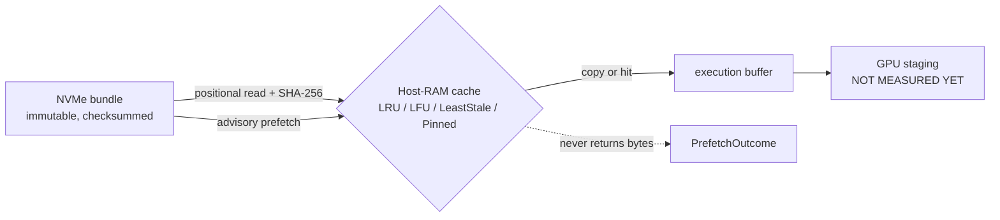
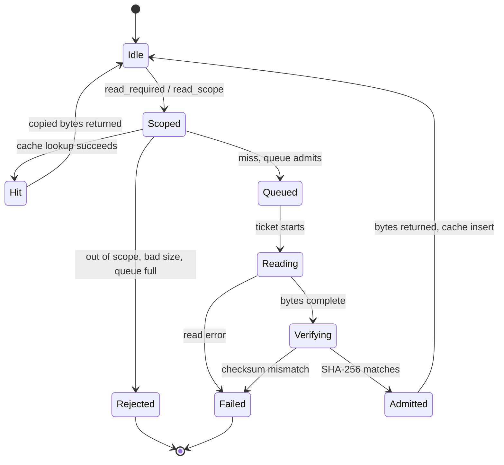

# STORAGE — tier model, exact-mode reads and measured baselines (M3, part 1)

Status: **measured on one workstation, repeated**. This document covers the
`selvedge-store` tiered shard engine, its exact-mode read contract, the cache
policies, the observability schema, and the measured cold/warm baselines on the
real Qwen3-0.6B and Qwen3-1.7B FFN bundles. It does not claim a GPU transfer
baseline; that is still future work (see "What is not measured").

## 1. Tier model



- **NVMe** is the durable tier. The bundle is immutable and atomically
  published; every read is positional and bound to the validated manifest.
- **Host RAM** is the only cache tier implemented and measured. Its capacity is
  a hard byte limit; an admission that would exceed it is refused, not silently
  over-allocated.
- **GPU staging** is not implemented in this crate. No transfer number in this
  document is a GPU number.
- Advisory prefetch can only populate the host cache. It has no API that
  returns bytes for execution and it cannot add a shard to an
  `ExecutionScope`, so it cannot change the executed set.

**Scope versus exactness.** `ExecutionScope` proves that no read leaves the
supplied shard set. It does **not** prove that the set is the model's native
computation. Semantic exactness needs `selvedge_core::NativeSetWitness` against
a declared `NativeComputationSet`; see `docs/ARCHITECTURE.md`. Every
measurement below executes the whole bundle, so the executed set equals the
supplied scope by construction.

## 2. State machine



- A read outside the scope is `StoreError::NotInScope` before any I/O.
- A wrong buffer length is rejected before any I/O.
- A cache-budget refusal (`CacheBudgetExceeded`) leaves the buffer unspecified;
  the caller must not use it.
- Checksum mismatch is a hard error; the bytes are never admitted.
- Prefetch has its own state (`admitted` / `rejected`) and never returns bytes.

## 3. Cache policies

| policy | eviction | admission beyond budget | measured in §5 |
| --- | --- | --- | --- |
| `none` | none | n/a | cold and warm control |
| `lru` | least recently used | evicts to fit | 1/8, 1/4, 1/2 and 2x payload |
| `lfu` | least frequently used | evicts to fit | 1/4 |
| `least_stale` | SELVEDGE's staleness score | evicts to fit | 1/4 |
| `pinned` | refuses eviction | refuses admission | all shards pinned |

`pinned-all` is the upper bound for a fully resident bundle; it is not a
recommended policy. `lru-2x` configures a cache larger than the payload and is
therefore equivalent to "all shards admitted" after the first pass.

## 4. Observability schema

Two artifacts are written:

1. **One JSON line per read** (`ReadMetrics`, schema
   `selvedge/store-metrics/v1`): wall and monotonic time, shard, source
   (`nvme`/`host_ram`), `bytes_requested`, `bytes_completed`, `bytes_used`,
   `bytes_wasted`, `device_bytes`, `queue_wait_ns`, `transfer_ns`, `verify_ns`,
   `cache_insert_ns`, `eviction_ns`, `stall_ns`, `read_amplification`, `hit`,
   `verified`, `verification` method and `evicted_entries`.
2. **One JSON receipt per bench run** (`selvedge/store-bench/v1`): bundle facts,
   layout, mount, environment, device idle-window noise floor, and per arm two
   passes with throughput, p50/p95/p99/max stall, requested/completed/used/
   wasted/device bytes, read amplification, checksum time, cache hits, and a
   per-pass cold device probe.

`StoreStats` additionally exposes `prefetch_bytes_read`,
`prefetch_bytes_used` and `prefetch_bytes_wasted`, where waste is
`read - used` with saturating subtraction. This is measured, not inferred: the
prefetch arm in §5 reads
<!-- BEGIN GENERATED: storage-06b-prefetch-read -->
37748736
<!-- END GENERATED: storage-06b-prefetch-read -->
bytes, delivers
<!-- BEGIN GENERATED: storage-06b-prefetch-used -->
9437184
<!-- END GENERATED: storage-06b-prefetch-used -->
and therefore wastes
<!-- BEGIN GENERATED: storage-06b-prefetch-wasted -->
28311552
<!-- END GENERATED: storage-06b-prefetch-wasted -->

**Raw JSONL is not tracked.** The per-request files are tens of MiB per
repeat (`results/store/metrics-*`), so `.gitignore` excludes
`results/store/metrics-*/` and `results/store/*.tmp.json`. The tracked inputs are
the JSON receipts and the variance summaries; `scripts/storage-summary.py`
regenerates the summaries from the receipts. Reproduce with:

```sh
selvedge io-scan --file <bundle> --out results/io/io-scan-<label>-rN.json
selvedge store bench --bundle <bundle> --out results/store/store-bench-<label>-rN.json \
    --metrics-dir results/store/metrics-<label>-rN
python3 scripts/storage-summary.py --bundle <label> \
    --store results/store/store-bench-<label>-r{1,2,3}.json \
    --io results/io/io-scan-<label>-r{1,2,3}.json \
    --out results/store/summary-<label>.json --io-out results/io/summary-<label>.json
```

## 5. Measured baselines

Environment: one consumer NVMe device, ext4, RTX 4080 SUPER host, 8 CPUs in the
`io` court, 8 GiB cgroup memory. Every number is the median of three repeats;
the range and coefficient of variation are in
`results/store/summary-06b.json` and `results/store/summary-17b.json`. Every
pass drops the page cache first except the explicitly warm control, and every
pass carries a 32 MiB cold device probe because this workstation's drive is
bimodal.

### 5.1 Exact-mode bundle reads (whole bundle, verified)

The two bundles are the real Qwen3 FFN group bundles. `plan-order` cold
median on the 0.6B bundle:
<!-- BEGIN GENERATED: storage-06b-plan-tp -->
612.012
<!-- END GENERATED: storage-06b-plan-tp -->
MiB/s with range
<!-- BEGIN GENERATED: storage-06b-plan-tp-min -->
609.059
<!-- END GENERATED: storage-06b-plan-tp-min -->
to
<!-- BEGIN GENERATED: storage-06b-plan-tp-max -->
616.344
<!-- END GENERATED: storage-06b-plan-tp-max -->
MiB/s, p95 per-shard stall
<!-- BEGIN GENERATED: storage-06b-plan-p95 -->
1575635
<!-- END GENERATED: storage-06b-plan-p95 -->
ns, and SHA-256 verify time
<!-- BEGIN GENERATED: storage-06b-plan-verify -->
415695357
<!-- END GENERATED: storage-06b-plan-verify -->
ns per pass. On the 1.7B bundle the same arm is
<!-- BEGIN GENERATED: storage-17b-plan-tp -->
697.609
<!-- END GENERATED: storage-17b-plan-tp -->
MiB/s with p95
<!-- BEGIN GENERATED: storage-17b-plan-p95 -->
5147716
<!-- END GENERATED: storage-17b-plan-p95 -->
ns and verify time
<!-- BEGIN GENERATED: storage-17b-plan-verify -->
1657683294
<!-- END GENERATED: storage-17b-plan-verify -->
ns.

`coalesced` on the 0.6B bundle: median
<!-- BEGIN GENERATED: storage-06b-coalesced-tp -->
618.075
<!-- END GENERATED: storage-06b-coalesced-tp -->
MiB/s, range
<!-- BEGIN GENERATED: storage-06b-coalesced-min -->
210.44
<!-- END GENERATED: storage-06b-coalesced-min -->
to
<!-- BEGIN GENERATED: storage-06b-coalesced-max -->
645.541
<!-- END GENERATED: storage-06b-coalesced-max -->
MiB/s, CV
<!-- BEGIN GENERATED: storage-06b-coalesced-cv -->
0.404906
<!-- END GENERATED: storage-06b-coalesced-cv -->
, p95
<!-- BEGIN GENERATED: storage-06b-coalesced-p95 -->
2189747
<!-- END GENERATED: storage-06b-coalesced-p95 -->
ns, verify time
<!-- BEGIN GENERATED: storage-06b-coalesced-verify -->
416415755
<!-- END GENERATED: storage-06b-coalesced-verify -->
ns. On the 1.7B bundle: median
<!-- BEGIN GENERATED: storage-17b-coalesced-tp -->
532.99
<!-- END GENERATED: storage-17b-coalesced-tp -->
MiB/s, range
<!-- BEGIN GENERATED: storage-17b-coalesced-min -->
414.968
<!-- END GENERATED: storage-17b-coalesced-min -->
to
<!-- BEGIN GENERATED: storage-17b-coalesced-max -->
577.829
<!-- END GENERATED: storage-17b-coalesced-max -->
MiB/s, CV
<!-- BEGIN GENERATED: storage-17b-coalesced-cv -->
0.135056
<!-- END GENERATED: storage-17b-coalesced-cv -->
, p95
<!-- BEGIN GENERATED: storage-17b-coalesced-p95 -->
7310958
<!-- END GENERATED: storage-17b-coalesced-p95 -->
ns, verify time
<!-- BEGIN GENERATED: storage-17b-coalesced-verify -->
1655812198
<!-- END GENERATED: storage-17b-coalesced-verify -->
ns.

Reading:

- The cold device rate is reported in the generated medians above; the
  `none-warm` control (page cache left populated) is much faster on its second
  pass, which is the page-cache effect and is not attributed to the store.
- Coalescing adjacent extents can help in the fast device state, but the three
  post-fix repeats show a wide range, so the honest claim is "coalescing is at
  least neutral and sometimes faster; the device state dominates". The range
  and CV are reported, not hidden.
- SHA-256 verification is not free: it accounts for most of the per-shard
  stall. The coalesced and plan paths both spend the same verify time (the
  earlier coalesced path failed to increment the counter; that bookkeeping bug
  is fixed and the test `coalesced_pass_verifies_every_shard_and_counts_device_bytes`
  now asserts a non-zero verify time).
- p95 is dominated by verify + read, and is much larger than p50; a mean is not
  reported alone.

### 5.2 Cache residency (second pass over the same bundle)

No cache (`none-cold`) on the 0.6B bundle: median
<!-- BEGIN GENERATED: storage-06b-none-cold -->
609.6
<!-- END GENERATED: storage-06b-none-cold -->
MiB/s, and on the 1.7B bundle
<!-- BEGIN GENERATED: storage-17b-none-cold -->
700.3
<!-- END GENERATED: storage-17b-none-cold -->
MiB/s. The page-cache-warm control (`none-warm`, pass 2) is
<!-- BEGIN GENERATED: storage-06b-none-warm-pass2 -->
2043.8
<!-- END GENERATED: storage-06b-none-warm-pass2 -->
MiB/s on the 0.6B bundle and
<!-- BEGIN GENERATED: storage-17b-none-warm-pass2 -->
2172.4
<!-- END GENERATED: storage-17b-none-warm-pass2 -->
MiB/s on the 1.7B bundle; that is the operating system serving the file, not
the store.

LRU 1/8 of the payload on pass 2: 0.6B
<!-- BEGIN GENERATED: storage-06b-lru1of8-pass2 -->
676.6
<!-- END GENERATED: storage-06b-lru1of8-pass2 -->
MiB/s, 1.7B
<!-- BEGIN GENERATED: storage-17b-lru1of8-pass2 -->
761.2
<!-- END GENERATED: storage-17b-lru1of8-pass2 -->
MiB/s. LRU 1/4: 0.6B
<!-- BEGIN GENERATED: storage-06b-lru1of4-pass2 -->
770.3
<!-- END GENERATED: storage-06b-lru1of4-pass2 -->
MiB/s, 1.7B
<!-- BEGIN GENERATED: storage-17b-lru1of4-pass2 -->
786.1
<!-- END GENERATED: storage-17b-lru1of4-pass2 -->
MiB/s. LRU 1/2: 0.6B
<!-- BEGIN GENERATED: storage-06b-lru1of2-pass2 -->
1095.6
<!-- END GENERATED: storage-06b-lru1of2-pass2 -->
MiB/s, 1.7B
<!-- BEGIN GENERATED: storage-17b-lru1of2-pass2 -->
1285.2
<!-- END GENERATED: storage-17b-lru1of2-pass2 -->
MiB/s. LRU 2x: 0.6B
<!-- BEGIN GENERATED: storage-06b-lru2x-pass2 -->
30014.5
<!-- END GENERATED: storage-06b-lru2x-pass2 -->
MiB/s, 1.7B
<!-- BEGIN GENERATED: storage-17b-lru2x-pass2 -->
34755.2
<!-- END GENERATED: storage-17b-lru2x-pass2 -->
MiB/s. `pinned-all` (an all-hit upper bound): 0.6B
<!-- BEGIN GENERATED: storage-06b-pinned-pass2 -->
29614.9
<!-- END GENERATED: storage-06b-pinned-pass2 -->
MiB/s, 1.7B
<!-- BEGIN GENERATED: storage-17b-pinned-pass2 -->
32887.2
<!-- END GENERATED: storage-17b-pinned-pass2 -->
MiB/s, which is host-RAM copy speed, not an NVMe claim. The second pass reads
shards in reverse plan order, so a cache smaller than the payload cannot
simply replay the same order. `lru-2x` and `pinned-all` must not be quoted as
device benchmarks.

### 5.3 Physical I/O characterisation (`io-scan`, same real bundle file)

Three repeats, page cache dropped for each cold measurement:

- 4 KiB buffered reads with readahead:
<!-- BEGIN GENERATED: storage-06b-io-4k-readahead -->
1672.26
<!-- END GENERATED: storage-06b-io-4k-readahead -->
  MiB/s; without readahead:
<!-- BEGIN GENERATED: storage-06b-io-4k-noreadahead -->
249.029
<!-- END GENERATED: storage-06b-io-4k-noreadahead -->
  MiB/s. Readahead is doing real work at small block sizes.
- Queue depth 1 / 4 / 16 on 64 KiB reads:
<!-- BEGIN GENERATED: storage-06b-io-qd1 -->
422.207
<!-- END GENERATED: storage-06b-io-qd1 -->
  /
<!-- BEGIN GENERATED: storage-06b-io-qd4 -->
661.174
<!-- END GENERATED: storage-06b-io-qd4 -->
  /
<!-- BEGIN GENERATED: storage-06b-io-qd16 -->
1132.71
<!-- END GENERATED: storage-06b-io-qd16 -->
  MiB/s. Depth 16 is best on this device; depth 1 is about a third of it. The
  1.7B depth-16 median is
<!-- BEGIN GENERATED: storage-17b-io-qd16 -->
1083.42
<!-- END GENERATED: storage-17b-io-qd16 -->
  MiB/s.
- Random 4 KiB p50 latency:
<!-- BEGIN GENERATED: storage-06b-io-random4k-p50 -->
114715
<!-- END GENERATED: storage-06b-io-random4k-p50 -->
  ns. A 1 MiB random read is about an order of magnitude slower in p50, which
  is why shard sizes and coalescing matter.
- Alignment: the bundle's 64 KiB-aligned extents read at an amplification of
  1.0. A deliberately over-read 8 MiB request to use 3 MiB measured
<!-- BEGIN GENERATED: storage-06b-io-overread-amp -->
2.66667
<!-- END GENERATED: storage-06b-io-overread-amp -->
  times the useful bytes
  (
<!-- BEGIN GENERATED: storage-17b-io-overread-amp -->
2.66667
<!-- END GENERATED: storage-17b-io-overread-amp -->
  on the 1.7B bundle). The 64 KiB-aligned case measured
<!-- BEGIN GENERATED: storage-06b-io-align64k-amp -->
1
<!-- END GENERATED: storage-06b-io-align64k-amp -->
  , the 4 KiB-aligned case
<!-- BEGIN GENERATED: storage-06b-io-align4k-amp -->
1
<!-- END GENERATED: storage-06b-io-align4k-amp -->
  and the 512-byte-offset case
<!-- BEGIN GENERATED: storage-06b-io-align512-amp -->
1.0013
<!-- END GENERATED: storage-06b-io-align512-amp -->
  , so at these sizes the device does not penalise sub-page offsets;
  over-reading does.
- Checksum: SHA-256 through the store measured
<!-- BEGIN GENERATED: storage-06b-io-checksum -->
2258.99
<!-- END GENERATED: storage-06b-io-checksum -->
  MiB/s warm (
<!-- BEGIN GENERATED: storage-06b-io-checksum-nspgib -->
453300701
<!-- END GENERATED: storage-06b-io-checksum-nspgib -->
  ns/GiB), and
<!-- BEGIN GENERATED: storage-17b-io-checksum -->
2211.24
<!-- END GENERATED: storage-17b-io-checksum -->
  MiB/s on the second bundle. This is the cost that exact mode pays on every
  cold shard; a publication-proof mode can skip it, but it is a trust input
  (see §6).
- Page-cache control: the cold/warm probe ratio was
<!-- BEGIN GENERATED: storage-06b-io-coldwarm-ratio -->
584.756
<!-- END GENERATED: storage-06b-io-coldwarm-ratio -->
  , so the drop is effective and the warm control is genuinely warm.

## 6. Threats to validity

- **Device-state bimodality.** The same arm can be 2-3x slower depending on the
  drive's internal state. Every pass records a 32 MiB cold probe; summaries
  report median, min, max and CV. A single favorable run would be misleading.
- **Page cache.** `posix_fadvise(DONTNEED)` is advisory. The cold/warm probe
  ratio shows it worked here; on another kernel or filesystem it might not.
  `none-warm` is a deliberate page-cache measurement, not a cache-policy win.
- **Verification mode.** `VerificationMode::Always` hashes every shard.
  `PublicationProof` trusts a registry whose bundle id and manifest digest
  match; a forged registry could hide corrupted bytes. Every number here uses
  `Always`. The proof path is not measured as a latency optimization.
- **One device, one filesystem, one kernel.** The queue-depth optimum and the
  coalescing gain are device-specific. They are not extrapolated.
- **No GPU tier.** Host-RAM copy speeds are not GPU transfer speeds, and this
  document contains no GPU staging measurement.
- **The M2 traces are not a trained-router workload.** The exact-mode storage
  bench reads whole bundles in plan order and reverse order. The M2 per-token
  selection traces come from a degraded, untrained-router setting and their
  instability does not extrapolate to a trained router. No conclusion here
  depends on the M2 trace distribution.
- **Bytes are per pass.** `bytes_requested/completed/used/wasted` and
  `device_bytes` are per whole-bundle pass. They are not per-token decode
  reads; a decode loop would re-read the selected slices per token.
- **Raw logs are not in git.** The JSONL records are reproducible but excluded;
  the tracked receipts are the evidence.

## 7. What is not measured

- GPU staging, pinned host buffers and PCIe transfer time.
- Concurrent readers under memory pressure beyond the Court D stress test.
- A trained router's request trace; the execution-envelope experiment needs one.
- A different alignment or a repacked bundle; only the published alignment was
  measured.
- An end-to-end exact-mode runtime that consumes `ExactSelection`; the type
  exists but no runtime path does.

## Receipts

- Store summaries: `results/store/summary-06b.json`,
  `results/store/summary-17b.json`,
  `results/store/summary-coalesced-06b.json`,
  `results/store/summary-coalesced-17b.json`.
- I/O summaries: `results/io/summary-06b.json`, `results/io/summary-17b.json`
  and the coalesced-only summaries.
- Raw receipts: `results/store/store-bench-*-r{1,2,3}.tmp.json`,
  `results/store/coalesced-*-r{1,2,3}.json`,
  `results/io/io-scan-*-r{1,2,3}.tmp.json` (these are JSON receipts and are
  tracked; the JSONL volumes are not).
- Courts: `results/courts/io-*.json`, `results/courts/rust-*.json`.
